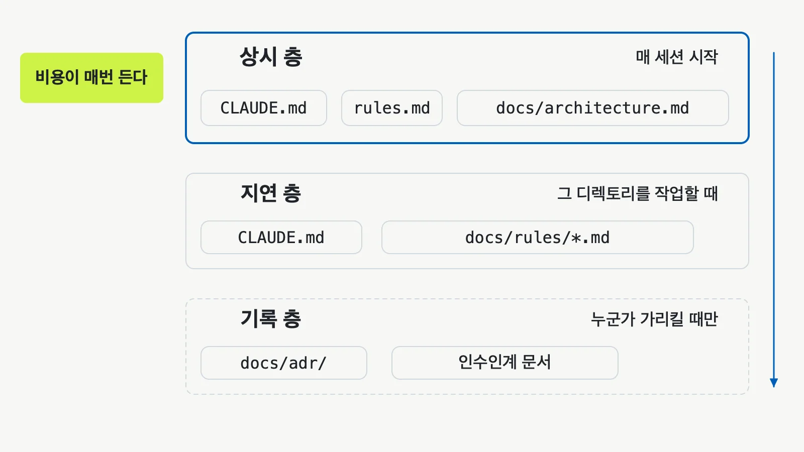
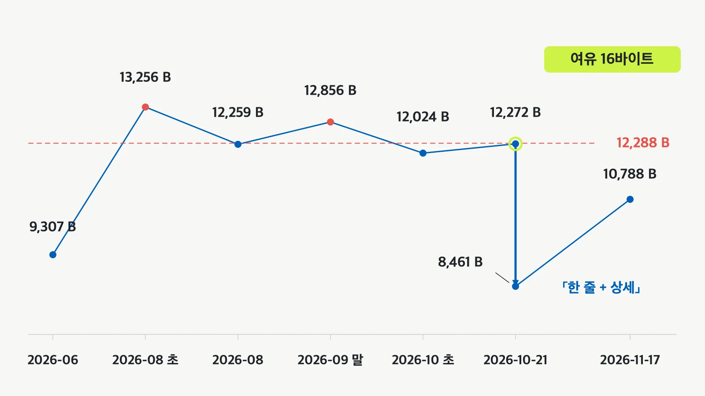
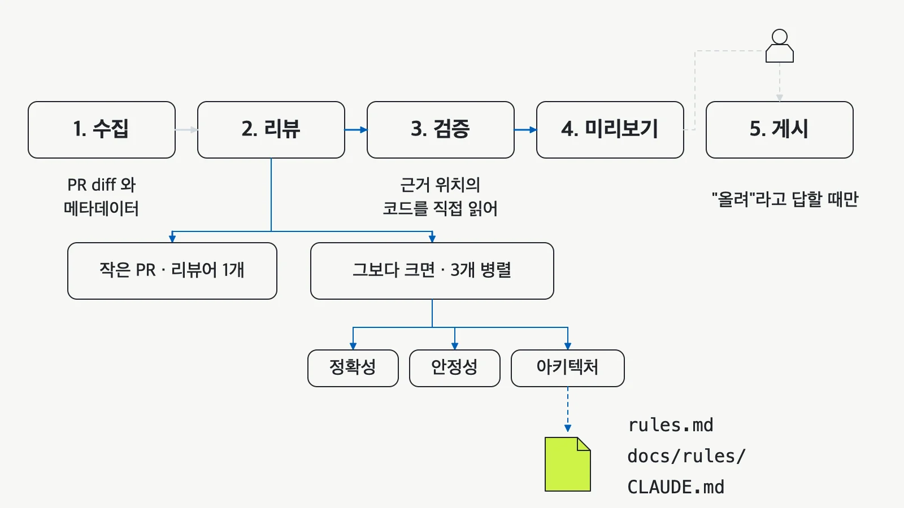
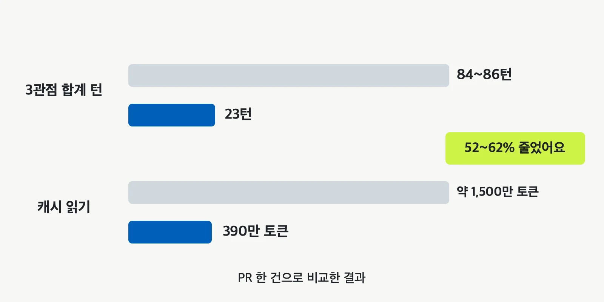

## 들어가며: 규칙 파일이 16바이트를 남기고 꽉 찼다

[앞 글](/posts/bloc_concurrency_refactor)은 속도가 남긴 진짜 비용이 기준의 부재였고, 그래서 정한 기준을 에이전트가 작업할 때마다 읽는 규칙 파일에 한 줄로 넣었다는 이야기로 끝났어요. 이 글은 그 "한 줄"이 들어가는 파일 이야기예요.

그 파일에는 예산이 있어요. Claude Code 같은 AI 코딩 에이전트가 세션을 시작할 때마다 통째로 읽는 문서 묶음은 합계 12,288 B(12 KiB)를 넘기지 않기로 정해 두었어요. 10월의 어느 날, 이 묶음이 12,272 B 가 됐어요. **남은 여유는 16바이트**였어요. 한글 한 글자가 UTF-8 로 3바이트이니, 규칙 한 줄은커녕 다섯 글자 남짓이에요.

처음엔 2KB 도 안 되던 파일이었어요.

| | 2025년 12월 | 2026년 11월 |
|---|---|---|
| 세션마다 읽히는 규칙 문서 | 파일 1개, 1,934 B | 파일 3개, 10,788 B |
| 번호 붙은 규칙 | 9줄 | 40줄 |
| 규칙 문서를 고친 사람 | 1명 | 저를 포함해 4명 |
| 설계 결정 기록(ADR) | 0개 | 38개 |
| 직접 만든 에이전트·명령·스킬 | 0개 | 약 24개 |

규모가 커지자 복사본이 어긋나고, 매 세션 읽히는 문서가 불어나고, 리뷰 봇의 한도에 걸린 PR 이 리뷰 없이 머지됐어요. 이 글은 그걸 풀려고 만든 장치들, 즉 규칙을 한 곳에만 두는 원칙, 「규칙 한 줄 + 상세는 다른 곳」 구조, 하네스 감사, 같은 규칙을 리뷰어 에이전트에게도 읽히는 PR 리뷰 스킬의 기록이에요.

## 에이전트는 무엇을, 언제 읽나

Claude Code 는 세션을 시작할 때 저장소 루트의 `CLAUDE.md` 를 읽고, 그 안에 `@rules.md` 처럼 적힌 파일도 함께 읽어요(import). 하위 디렉토리의 `CLAUDE.md` 는 에이전트가 그 디렉토리의 파일을 다룰 때 불러오고, `docs/` 아래 문서는 누가 경로를 가리켜야 읽혀요. 이 글에서는 이걸 매 세션 읽히는 상시 층(루트 `CLAUDE.md` + `rules.md` + `docs/architecture.md`), 그 디렉토리를 작업할 때 읽히는 지연 층(모듈별 `CLAUDE.md` 6개, `docs/rules/*.md`), 누군가 가리킬 때만 읽히는 기록 층(`docs/adr/`, 인수인계 문서)으로 부를게요.

<figure>
	
	<figcaption>세 층 가운데 매 세션 비용이 드는 건 상시 층뿐이에요. 지연 층의 <code>CLAUDE.md</code> 는 모듈마다 하나씩 있는 파일이에요.</figcaption>
</figure>

상시 층의 1바이트는 모든 세션, 모든 서브에이전트에 실려요. 아래 장치들은 결국 "이 지식을 어느 층에 둘까"를 정하는 규칙이에요.

## 1. 복사본은 반드시 어긋난다: 규칙은 한 곳에만

처음 규칙 파일은 `CLAUDE.md` 하나였어요. Codex 나 Gemini 같은 다른 도구는 이 파일을 읽지 않아서, 같은 내용을 `AGENTS.md`, `GEMINI.md` 로 복사해 두었어요. 복사본은 금방 어긋났어요. 6월에 보니 앱 저장소의 `AGENTS.md` 는 1월 2일 이후 한 번도 고쳐지지 않은 2,223 B 였고, 그사이 `CLAUDE.md` 는 4,567 B 로 두 배가 돼 있었어요.

서버 저장소는 더 위험했어요. 8월에 서버 쪽 규칙 문서 21개를 감사해 보니 `AGENTS.md`·`GEMINI.md` 가 옛 `CLAUDE.md` 와 바이트 단위로 같은 복사본이었고, 그사이 들어간 최우선 안전 조항 4개("main·develop 에 자동 머지 금지" 같은)가 통째로 없었어요. 다른 에이전트를 쓰면 **머지 안전장치가 없는 규칙**을 받는 상태였어요.

그래서 복사본을 정본을 가리키는 짧은 안내문으로 바꿨어요. 지금 앱 저장소의 `AGENTS.md` 는 이게 거의 전부예요.

```markdown
# Project 규칙 (Codex 등 타 도구용 진입점)

규칙 정본은 도구 공통으로 아래 파일에 있다. 코드 생성 전 반드시 읽을 것
— 이 파일에 규칙을 복제하지 말 것(drift 방지):

- `CLAUDE.md` — tech stack, 기본 원칙
- `rules.md` — 코드 컨벤션·파일 배치·git 규칙 전체
- `docs/architecture.md` — 모듈 구조·데이터 흐름·심화 문서 인덱스
```

"복제하지 말 것"을 적어 둔 건 다음 사람이 비어 있다고 다시 채워 넣지 않게 하려는 거예요. 서버 쪽 안내문에는 안전 조항 요약만 남겨, 정본을 안 읽어도 머지 금지는 보이게 했어요.

같은 원칙을 지식 전체로 넓혀, 새 지식은 종류에 따라 정해진 한 곳(결정은 `docs/adr/`, 컨벤션은 `rules.md`, 모듈별 함정은 그 모듈 `CLAUDE.md`)에만 두기로 했어요. 상시 층이나 지연 층으로 올리는 건 같은 문제가 두 번 이상 재발하고 팀 전체에 적용될 때만이에요. 한 번 겪은 함정을 바로 규칙으로 만들면 규칙 파일이 사고 기록부가 되거든요.

"보고는 결론 먼저" 같은 제 작업 습관도 앱 저장소의 에이전트 메모리에만 쌓여 서버 저장소에서는 따라오지 않았어요. 그래서 11월에 개인 규칙 4개 파일(합계 5,125 B)을 별도 저장소로 빼서 사용자 전역 설정(`~/.claude/CLAUDE.md`)에서 import 하고, 원래 위치의 사본은 지웠어요. 이제 팀 규칙은 저장소에, 제 습관은 개인 저장소에, 프로젝트의 사실은 에이전트 메모리에 있어요.

## 2. 매 세션 읽히는 문서에는 예산이 있다: 「규칙 한 줄 + 상세는 다른 곳」

복사본을 정리하던 6월에, 하나뿐이던 `CLAUDE.md`(4,567 B)를 세 파일로 나눴어요. `CLAUDE.md` 는 647 B 로 줄이고 컨벤션은 `rules.md`, 구조는 `docs/architecture.md` 로 보냈어요. 이때 상시 층 예산을 12KB 로 정했는데, 근거 있는 계산이 아니라 어림짐작으로 고른 값이었던 것 같아요.

<figure>
	
	<figcaption>예산 안으로 돌아와도 상시 층은 다시 자랐고, 「한 줄 + 상세」 구조로 바꾼 뒤에야 크게 줄었어요.</figcaption>
</figure>

예산을 정한 뒤에도 상시 층은 계속 자랐어요. 나눈 직후 9,307 B 였던 합계가 8월 초 13,256 B 로 예산을 넘었고, 정비 뒤 9월 말에 12,856 B 로 다시 넘었다가 10월 21일에 12,272 B 까지 찼어요. 나눈 건 구조였지 양이 아니었어요. 규칙을 더하는 커밋은 꾸준한데 빼는 커밋은 넘친 뒤에야 나왔어요.

왜 이렇게 불어났는지는 당시 규칙 하나를 보면 알 수 있어요.

```markdown
15. BlocProvider 는 Page 내부가 아닌 `{feature}_page_route.dart` 의 route builder 에서
    `create: (_) => XBloc(...)..add(InitEvent(...))` 로 주입한다. Page 는 `context.read<XBloc>()` 접근만.
```

규칙 하나가 무엇을 하라와 어떻게 하라를 함께 담고 있었어요. 쓰는 사람에게는 친절하지만, 모든 에이전트가 이 규칙과 상관없는 작업에서도 예시 코드까지 매번 읽어요.

16바이트가 남은 그날 저녁, 팀원이 `rules.md` 를 다시 썼어요. 커밋 메시지에 예산 이야기는 없었지만 원칙은 분명했어요. **상시 층에는 규칙 한 줄과 상세 경로만, 상세는 지연 층으로.**

```markdown
각 규칙은 한 줄 요약이다. 해당 작업을 하기 전에 섹션·줄 끝의 상세 문서를 읽는다.

## Code conventions — 상세 `docs/rules/code-conventions.md`

15. BlocProvider 는 `{feature}_page_route.dart` route builder 에서 주입, Page 는 `context.read` 만
```

예시와 이유는 `docs/rules/code-conventions.md` 로 갔어요. 그 결과 `rules.md` 는 8,006 B 에서 4,195 B 로 절반이 됐는데, 번호 붙은 규칙은 31줄에서 32줄로 오히려 늘었어요. 상시 층 합계는 8,461 B 로 내려갔다가 지금 10,788 B 예요. 정보를 버린 게 아니라 층을 옮긴 거예요.

> **헷갈리기 쉬운 것: 번호는 왜 고정하나요?**
>
> `rules.md` 의 결번(1, 2, 4, 5, 7…)은 린트(`analysis_options.yaml`)로 옮긴 규칙이에요. 기계가 검사할 수 있는 규칙은 문서에 둘 이유가 없거든요. 번호를 다시 매기지 않는 건 계획서, 코드 주석, 리뷰 코멘트가 "§15" 처럼 번호로 규칙을 가리키기 때문이에요.

### 하나의 결정은 세 층에 다른 길이로 들어간다

앞 글에서 정한 "BLoC 이벤트 겹침" 기준이 이 구조로 들어간 모습이에요. 상시 층 `rules.md` 에는 하라·하지 마라 한 줄과 상세 경로만 있어요.

```markdown
42. **BLoC 이벤트 겹침은 `bloc_concurrency` transformer 로 선언** — 플래그·세대 번호·`asyncExpand`
    손구현 금지, 기존은 수정 시 이관. 상세 `presenter/CLAUDE.md`·ADR 0034
```

어떤 이벤트에 어떤 transformer 를 쓰는지, `emit.isDone` 함정, 테스트 방법은 지연 층 `presenter/CLAUDE.md` 에 한 문단으로, 왜 이렇게 정했고 어떤 대안을 버렸는지는 ADR 문서 하나로 들어가요. 화면 코드만 고치는 세션은 presenter 의 함정을 읽지 않고, BLoC 을 고치는 세션은 presenter 디렉토리 파일을 여는 순간 지연 층을 읽어요.

ADR 은 처음에 코드 주석에 남기던 "왜"를 옮긴 자리예요. 긴 주석은 코드를 읽을 때마다 함께 읽히고 결정이 바뀌어도 남아 있어서, 주석에는 WHY·제약만 두고 비자명한 설계 결정은 사람에게 확인받아 `docs/adr/` 에 써요. 6월 이후 38개가 쌓였어요.

이 구조에서는 규칙이 하나 늘 때 상시 층이 한 줄만 늘어요. 대신 에이전트가 상세를 안 열면 한 줄만 보고 일하니, "§17 커스텀 백 처리 화면은 ShellRoute 하위 금지"처럼 한 줄 자체에 금지사항을 담아요. 비용이 사라지는 것도 아니에요. 화면 모듈의 `CLAUDE.md` 는 10,606 B 로 상시 층 예산과 거의 같은 크기이고, 화면 코드를 고치는 세션은 이걸 매번 읽어요.

## 3. 문서도 코드처럼 낡는다: 하네스 감사

규칙 문서에는 테스트가 없어서, 틀린 내용이 들어가도 아무것도 실패하지 않아요. 에이전트가 그 틀린 내용대로 코드를 쓸 뿐이에요. 그래서 6월에 상시 층을 나누면서, 에이전트가 읽는 문서·명령·스킬·훅 전체(이 글에서 말하는 하네스)를 점검하는 `/harness-audit` 명령도 만들었어요.

감사 명령은 분석만 하고 고치지 않아요. 상시 층 크기를 실측해 예산을 판정하고, 깨진 참조와 아무도 안 가리키는 문서, 실제 디렉토리와 어긋난 설명, 다시 생긴 복사본을 찾아요. "해결된 항목과 낡은 규칙은 감사 때 지운다(append-only 금지)"는 원칙도 명령 안에 적어 두었어요.

8월 첫 감사는 `CLAUDE.md` 의 Flutter·Dart 버전 표기가 실제와 다르고, 상시 층 어디에도 빌드·테스트 명령이 없고, 한 규칙이 무관한 ADR 을 가리킨다는 걸 찾았어요. 에이전트는 이 문서를 믿고 일하니, 버전이 틀리면 없는 API 를 쓰고 명령이 없으면 매번 추측해요.

예산 표기도 모호하던 "토큰 예산 12KB"에서 "`wc -c` 합계 12,288 B, 토큰 아닌 바이트"로 못 박았어요. 토큰은 모델마다 세는 법이 달라도, 바이트는 명령 하나로 누구나 같은 값을 얻어요.

다만 월 1회 돌리기로 한 감사가 정비 PR 까지 간 건 8월 한 번이에요. 9월과 10월에 예산이 찼을 때 줄인 건 감사가 아니라 팀원의 정리 커밋이었어요. **감사는 돌려야 일하는 도구라서, 돌리는 사람이 바쁘면 멈춰요.**

## 4. 같은 규칙을 리뷰어에게도 읽혔다: PR 리뷰 스킬

그다음 병목은 리뷰였어요. 저희는 AI 리뷰 봇(CodeRabbit)을 쓰는데, 앞 글에서 Claude 가 만든 회귀 세 건을 잡은 것도 이 봇이었어요. 문제는 시간당 리뷰 횟수 상한이었어요. 당시 요금제에서는 "5 reviews per hour" 가 관측됐고(2026년 9월 기준), 팀원 여럿이 PR 을 연달아 올리면 일부가 `Review rate limited` 로 남은 채 머지됐어요. 서버 저장소에서는 최근 머지된 PR 15개 모두 봇의 인라인 지적이 0건이었어요.

요금제를 올리는 방법을 따져 봤는지는 지금 기억나지 않아요. 저는 대신 봇이 막힌 PR 을 같은 형식으로 리뷰하는 스킬(`/pr-review`)을 만들었어요. 작은 PR(3파일·150줄 이하)은 리뷰어 에이전트 하나가, 그보다 크면 정확성·안정성·아키텍처 관점별 리뷰어 셋이 병렬로 봐요. 메인 세션은 지적마다 근거 코드를 직접 읽어 확인할 수 없는 건 버리고, 사람이 미리보기를 보고 "올려"라고 답할 때만 PR 에 달아요.

<figure>
	
	<figcaption>아키텍처 리뷰어는 코드를 쓰는 에이전트와 같은 규칙 문서(<code>rules.md</code>, <code>docs/rules/</code>, 바뀐 모듈의 <code>CLAUDE.md</code>)를 읽고, 게시는 사람이 승인할 때만 해요.</figcaption>
</figure>

아키텍처 리뷰어의 기준은 PR head 의 `rules.md` 와 상세 `docs/rules/`, 변경된 모듈의 `CLAUDE.md` 예요. **코드를 쓰는 에이전트가 읽는 바로 그 문서를 리뷰어도 읽어요.** 지적에는 "`rules.md` §15 위반"처럼 규칙 번호를 인용해요.

리뷰어는 읽기 전용이어야 해서, Bash 명령을 검사하는 훅이 허용 목록의 명령만 통과시켜요.

```python
# awk is absent on purpose: its program can run commands or write files through variables, which no pattern catches.
ALLOWED = {'cd', 'git', 'grep', 'rg', 'head', 'tail', 'wc', 'cat', 'sed', 'sort', 'uniq', 'nl', 'ls',
           'echo', 'printf'}
GIT_SUBCOMMANDS = {'show', 'grep', 'diff', 'log', 'cat-file', 'ls-tree', 'rev-parse', 'blame', 'merge-base'}
```

### 헛걸음: 정답을 알려 준 채로 시험을 봤다

성능은 봇이 이미 리뷰한 과거 PR 을 다시 리뷰시켜 비교했어요. 첫 시험에서 봇의 Major 2건 중 한 건은 Minor 로 찾고 한 건은 놓쳤는데, 원인을 찾다 보니 출력 형식 문서에 예시로 붙인 지적이 바로 그 PR 의 정답 원문이었어요. 예시를 바꾸자 Major 로 찾았지만, 그사이 점검 목록 몇 줄도 이 PR 에서 나와 있었어요. 문서를 고치면서 시험지에 맞춰 버린 거예요.

그래서 세 번째는 점검 목록과 상관없는 PR 로 블라인드 시험을 하고, 실행 뒤 리뷰어의 기록을 감사해 정답을 엿본 흔적이 없는지 확인했어요.

| | 리뷰 봇 | `/pr-review` |
|---|---|---|
| Major 지적 | 3건 | 2건 적중, 1건 놓침 |
| 오탐 | — | 0건 |
| 적중한 지적의 심각도 | Major | 전부 Minor |

찾기는 찾았는데 첫 시험처럼 전부 한 단계 낮게 매겼어요. 강제 로그아웃이나 요청 경합처럼 드물게 지나가는 경로의 문제를 깎고 있었던 거예요. 그래서 심각도 기준을 바꿨어요.

> 심각도는 **문제가 일어났을 때의 영향**으로 정한다. 발생 빈도가 낮다는 이유로 낮추지 않는다 — 빈도는 본문에 적는다.

34줄짜리 파일의 363~366줄을 근거로 대는 환각도 한 건 나와서, 메인 세션이 근거 줄 범위를 실제 파일 길이와 대조하게 했어요. 과거 PR 로 시험한다면 하나 더 막아야 해요. 리뷰어가 쓸 수 있는 `git log` 에 그 PR 의 버그를 고친 후속 커밋이 보이거든요.

### 리뷰 봇이 리뷰 스킬의 구멍을 찾았다

10월에 이 스킬을 서버 저장소 두 곳으로 옮기면서 점검 목록과 심각도 기준은 다시 썼어요. 서버에서 Critical 은 크래시가 아니라 데이터 오염, 중복 지급, 배포를 깨는 마이그레이션, 비밀값 노출이에요.

| 저장소 | 리뷰 봇 지적 | 재현 | 봇에 없던 지적 |
|---|---|---|---|
| Django | 4건 | 3건(같은 심각도) | 비밀키가 에러 추적 도구 기록에 남는 경로 등 |
| FastAPI | 1건 | 0건 | 설정 버전 미갱신, 아무것도 검증하지 않는 테스트 등 |

FastAPI 에서 놓친 건 배포 환경 값에 걸린 지적이라, 저장소에서 확인할 수 없는 추측은 지적하지 않는다는 원칙대로 뺀 것으로 보여요. 오탐을 0으로 두려는 원칙의 대가예요.

재미있는 일은 그다음이었어요. 이 서버 PR 들을 리뷰 봇이 리뷰하다가 읽기 전용 훅의 우회로를 찾아냈어요. `git grep -O` 를 `-nOsh` 처럼 짧은 옵션에 묶거나, 임시 파일 압축에 지정한 프로그램을 실행하는 `sort --compress-program` 을 쓰면 실제로 뚫렸어요. 고치다 보니 긴 옵션 줄여 쓰기(`sort --out=`), 셸 변수 확장(`--${X}compress-program`) 같은 우회도 나와서, 그때마다 테스트를 먼저 쓰고 막았어요. 테스트는 52개에서 86개가 됐어요.

리뷰 봇이 막힐 때 쓰려고 만든 도구의 보안 구멍을 그 리뷰 봇이 찾은 거예요. 두 리뷰어는 서로를 대체하는 관계가 아니었어요. 봇은 패턴을 넓게 보고, 스킬은 저장소 규칙을 깊게 봐요.

### 리뷰어 하나가 10만 토큰으로 시작한다

남은 문제는 비용이었어요. 60개 파일, 6,379줄짜리 PR 을 3관점으로 돌리니 약 17분, 총 2,110만 토큰이 들었고 96.5% 가 캐시 읽기였어요. 리뷰어 에이전트는 약 98K 토큰의 컨텍스트로 시작해 턴마다 그걸 다시 읽는데, 파일을 한 턴에 하나씩 여느라 관점 하나가 15~35턴을 쓰고 있었어요.

그래서 수집 스크립트가 앞뒤 15줄 문맥을 붙인 diff 와 기준 규칙을 합친 파일을 미리 만들고, 리뷰어는 첫 턴에 이를 한 번에 읽고 추가 확인은 한 Bash 호출로 묶게 했어요. 같은 PR 로 비교하니 3관점 합계가 84~86턴에서 23턴으로, 캐시 읽기가 약 1,500만에서 390만 토큰으로 줄어 비용이 52~62% 줄었어요. PR 한 건으로 비교한 결과라 크기에 따라 달라질 수 있어요.

<figure>
	
	<figcaption>턴을 줄이자 캐시 읽기와 비용이 함께 줄었어요(PR 한 건 기준).</figcaption>
</figure>

남은 가장 큰 비용은 리뷰어마다 처음 읽는 약 10만 토큰이고, 여기에 상시 층도 실려요. 대부분은 도구 정의와 시스템 지시라, 상시 층은 어림(약 2.8바이트에 1토큰)으로 4천 토큰 남짓, 5% 안쪽이에요. 그래도 그 1바이트가 리뷰어 3개에 각각 실리니, 상시 층을 줄이는 일은 리뷰 비용이기도 했어요.

스킬은 앱과 서버, 세 저장소에 들어갔고 11월 19일까지 PR 9개에 리뷰 14건을 게시했어요. 그중 몇 건의 지적이 머지 전에 고쳐졌는지는 따로 세어 두지 않았어요.

## 5. 이 글을 쓰다 찾은 어긋남들

이 글을 쓰려고 세 저장소를 다시 읽다가, 제가 세운 원칙을 제가 어긴 곳들을 찾았어요.

리뷰 스킬 자체가 세 벌의 복사본이에요. 앱 저장소의 훅은 셸 변수 확장과 `--textconv` 를 막는 2차 수정이 빠져 있어요. 앱 PR 이 그 커밋 전에 머지됐고 "큰 문제 없으면 그냥 두자"고 넘어갔던 거예요. 1장 그대로, **복사본은 반드시 어긋나요.**

리뷰어가 읽는 상세 문서 목록도 10월 당시 세 파일 이름으로 하드코딩돼 있어요.

```python
# rules.md keeps one line per rule; the detail a reviewer cites lives here.
RULE_DETAIL_PATHS = ['docs/rules/file-layout.md', 'docs/rules/code-conventions.md', 'docs/rules/work-closing.md']
```

그 뒤에 생긴 네이티브 채널·접근성(Semantics) 규칙의 상세는 이 목록에 없어서, 리뷰어는 그 두 규칙의 한 줄만 보고 리뷰해요.

번호도 `rules.md` 에 38번이 두 개, ADR 에 0002·0021·0024·0029 가 두 개씩 있어요. 번호가 참조 키라면 중복은 깨진 참조와 같아요. 매 세션 읽히는 에이전트 메모리 목차도 10월에 27KB 에서 16.9KB 로 줄였는데 지금 23,166 B 예요. 여기엔 예산도 감사도 없어요.

넷 다 사람이 기억해서 지키는 규칙이었어요. 다음 할 일은 상세 문서 목록은 `docs/rules/` 를 디렉토리째 읽게, 번호 중복은 감사 항목으로, 메모리 목차는 예산으로 바꿔 도구가 검사하게 하는 거예요.

## 마치며: 규칙은 적는 것보다 읽히게 두는 게 어렵다

처음엔 빠짐없이, 친절하게, 예시까지 붙여 잘 쓰면 된다고 생각했어요. 그렇게 쓴 파일이 16바이트를 남기고 꽉 찼어요. 열한 달 동안 바뀐 건 규칙의 내용보다 놓인 자리였어요. 매번 필요한 건 한 줄로, 그 작업에만 필요한 건 지연 층으로, 이유는 ADR 로 보내고, 같은 규칙을 코드를 쓰는 에이전트와 리뷰하는 에이전트가 함께 읽게 했어요.

> 에이전트에게 규칙을 읽히는 일은, 무엇을 매번 읽힐지 고르는 일입니다.

AI 에이전트용 규칙 파일을 쓰고 있다면 세 가지를 확인해 보세요.

1. 세션마다 읽히는 문서의 크기를 지금 바이트로 말할 수 있나요? 말할 수 없다면 그 문서는 이미 자라고 있어요. `wc -c` 한 줄이면 돼요.
2. 같은 규칙이 두 곳 이상에 적혀 있지 않나요? `AGENTS.md`, 다른 도구용 파일, 리뷰 봇 설정, 저장소마다 복사한 스킬까지 찾아보세요.
3. 규칙대로 썼는지 확인하는 쪽도 같은 규칙을 읽나요? 사람 리뷰어든 봇이든, 코드를 쓰는 쪽과 다른 기준으로 보고 있다면 둘 중 하나는 낡은 기준이에요.

돌아보면 규칙 파일이 1년 가까이 버텼던 건 규칙이 좋아서가 아니라, 넘칠 때마다 누군가 손으로 덜어 냈기 때문이었어요. 손으로 덜어 내는 일은 덜어 내는 사람이 바쁠 때 멈춰요. 그래서 다음 목표는 덜어 내야 할 때를 **도구가 먼저 알려 주게** 하는 거예요.
