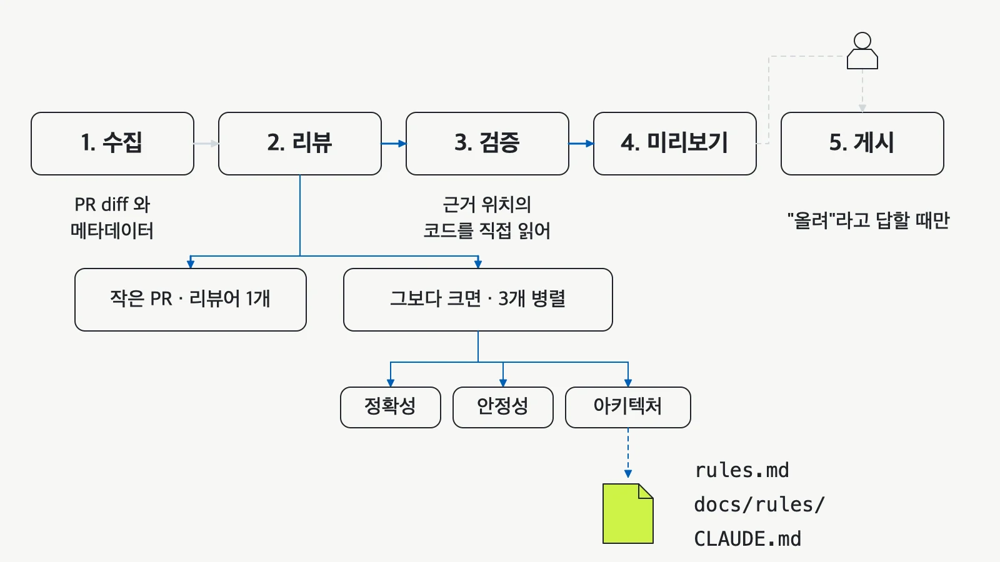
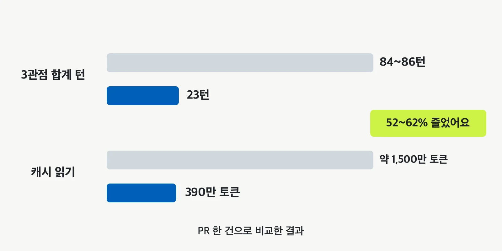

## 들어가며: 리뷰 봇이 쉬는 동안 머지된 PR 들

저희 팀은 PR 을 AI 리뷰 봇(CodeRabbit)에게 먼저 보여요. [BLoC 리팩토링 글](/posts/bloc_concurrency_refactor)에서 Claude 가 만든 회귀 세 건을 머지 전에 잡은 것도 이 봇이었어요. 문제는 시간당 리뷰 횟수 상한이었어요. 당시 요금제에서는 "5 reviews per hour" 가 관측됐고(2026년 9월 기준), 팀원 여럿이 PR 을 연달아 올리면 일부가 `Review rate limited` 로 남은 채 머지됐어요. 서버 저장소를 보니 최근 머지된 PR 15개 모두 봇의 인라인 지적이 0건이었어요.

그래서 봇이 막힌 PR 을 같은 형식으로 리뷰하는 Claude Code 스킬 `/pr-review` 를 만들었어요. 핵심 아이디어는 하나였어요. **코드를 쓰는 에이전트가 읽는 규칙 문서를 리뷰어도 똑같이 읽게 한다.** 규칙 문서를 어떻게 예산 안에 두는지는 [앞 글](/posts/ai_agent_harness)에 썼고, 이 글은 그 규칙을 읽는 리뷰어를 만들고 검증한 기록이에요.

## 설계: 확인한 지적만, 사람이 승인할 때만 올린다

작은 PR(3파일·150줄 이하)은 리뷰어 에이전트 하나가, 그보다 크면 정확성·안정성·아키텍처 관점별 리뷰어 셋이 병렬로 봐요. 메인 세션은 지적마다 근거 코드를 직접 읽어 확인할 수 없는 건 버리고, 사람이 미리보기를 보고 "올려"라고 답할 때만 PR 에 달아요.

<figure>
	
	<figcaption>아키텍처 리뷰어는 코드를 쓰는 에이전트와 같은 규칙 문서(<code>rules.md</code>, <code>docs/rules/</code>, 바뀐 모듈의 <code>CLAUDE.md</code>)를 읽고, 게시는 사람이 승인할 때만 해요.</figcaption>
</figure>

아키텍처 리뷰어의 기준은 PR head 의 `rules.md` 와 상세 `docs/rules/`, 변경된 모듈의 `CLAUDE.md` 예요. 지적에는 "`rules.md` §15 위반"처럼 규칙 번호를 인용해요. 사람 리뷰어든 봇이든 코드를 쓰는 쪽과 다른 기준으로 보면 둘 중 하나는 낡은 기준이 되니까요.

리뷰어는 읽기 전용이어야 해서, Bash 명령을 검사하는 훅이 허용 목록의 명령만 통과시켜요.

```python
# awk is absent on purpose: its program can run commands or write files through variables, which no pattern catches.
ALLOWED = {'cd', 'git', 'grep', 'rg', 'head', 'tail', 'wc', 'cat', 'sed', 'sort', 'uniq', 'nl', 'ls',
           'echo', 'printf'}
GIT_SUBCOMMANDS = {'show', 'grep', 'diff', 'log', 'cat-file', 'ls-tree', 'rev-parse', 'blame', 'merge-base'}
```

## 헛걸음: 정답을 알려 준 채로 시험을 봤다

성능은 봇이 이미 리뷰한 과거 PR 을 다시 리뷰시켜 비교했어요. 첫 시험에서 봇의 Major 2건 중 한 건은 Minor 로 찾고 한 건은 놓쳤는데, 원인을 찾다 보니 출력 형식 문서에 예시로 붙인 지적이 바로 그 PR 의 정답 원문이었어요. 예시를 바꾸자 Major 로 찾았지만, 그사이 점검 목록 몇 줄도 이 PR 에서 나와 있었어요. 문서를 고치면서 시험지에 맞춰 버린 거예요.

그래서 세 번째는 점검 목록과 상관없는 PR 로 블라인드 시험을 하고, 실행 뒤 리뷰어의 기록을 감사해 정답을 엿본 흔적이 없는지 확인했어요.

| | 리뷰 봇 | `/pr-review` |
|---|---|---|
| Major 지적 | 3건 | 2건 적중, 1건 놓침 |
| 오탐 | — | 0건 |
| 적중한 지적의 심각도 | Major | 전부 Minor |

찾기는 찾았는데 첫 시험처럼 전부 한 단계 낮게 매겼어요. 강제 로그아웃이나 요청 경합처럼 드물게 지나가는 경로의 문제를 깎고 있었던 거예요. 그래서 심각도 기준을 바꿨어요.

> 심각도는 **문제가 일어났을 때의 영향**으로 정한다. 발생 빈도가 낮다는 이유로 낮추지 않는다 — 빈도는 본문에 적는다.

34줄짜리 파일의 363~366줄을 근거로 대는 환각도 한 건 나와서, 메인 세션이 근거 줄 범위를 실제 파일 길이와 대조하게 했어요. 과거 PR 로 시험한다면 하나 더 막아야 해요. 리뷰어가 쓸 수 있는 `git log` 에 그 PR 의 버그를 고친 후속 커밋이 보이거든요.

## 서버로 옮기자 리뷰 봇이 스킬의 구멍을 찾았다

10월에 스킬을 서버 저장소 두 곳으로 옮기면서 점검 목록과 심각도 기준은 다시 썼어요. 서버에서 Critical 은 크래시가 아니라 데이터 오염, 중복 지급, 배포를 깨는 마이그레이션, 비밀값 노출이에요.

| 저장소 | 리뷰 봇 지적 | 재현 | 봇에 없던 지적 |
|---|---|---|---|
| Django | 4건 | 3건(같은 심각도) | 비밀키가 에러 추적 도구 기록에 남는 경로 등 |
| FastAPI | 1건 | 0건 | 설정 버전 미갱신, 아무것도 검증하지 않는 테스트 등 |

FastAPI 에서 놓친 건 배포 환경 값에 걸린 지적이라, 저장소에서 확인할 수 없는 추측은 지적하지 않는다는 원칙대로 뺀 것으로 보여요. 오탐을 0으로 두려는 원칙의 대가예요.

재미있는 일은 그다음이었어요. 이 서버 PR 들을 리뷰 봇이 리뷰하다가 읽기 전용 훅의 우회로를 찾아냈어요. `git grep -O` 를 `-nOsh` 처럼 짧은 옵션에 묶거나, 임시 파일 압축에 지정한 프로그램을 실행하는 `sort --compress-program` 을 쓰면 실제로 뚫렸어요. 고치다 보니 긴 옵션 줄여 쓰기(`sort --out=`), 셸 변수 확장(`--${X}compress-program`) 같은 우회도 나와서, 그때마다 테스트를 먼저 쓰고 막았어요. 테스트는 52개에서 86개가 됐어요.

리뷰 봇이 막힐 때 쓰려고 만든 도구의 보안 구멍을 그 리뷰 봇이 찾은 거예요. 두 리뷰어는 서로를 대체하는 관계가 아니었어요. **봇은 패턴을 넓게 보고, 스킬은 저장소 규칙을 깊게 봐요.**

## 리뷰어 하나가 10만 토큰으로 시작한다

남은 문제는 비용이었어요. 60개 파일, 6,379줄짜리 PR 을 3관점으로 돌리니 약 17분, 총 2,110만 토큰이 들었고 96.5% 가 캐시 읽기였어요. 리뷰어 에이전트는 약 98K 토큰의 컨텍스트로 시작해 턴마다 그걸 다시 읽는데, 파일을 한 턴에 하나씩 여느라 관점 하나가 15~35턴을 쓰고 있었어요.

그래서 수집 스크립트가 앞뒤 15줄 문맥을 붙인 diff 와 기준 규칙을 합친 파일을 미리 만들고, 리뷰어는 첫 턴에 이를 한 번에 읽고 추가 확인은 한 Bash 호출로 묶게 했어요. 같은 PR 로 비교하니 3관점 합계가 84~86턴에서 23턴으로, 캐시 읽기가 약 1,500만에서 390만 토큰으로 줄어 비용이 52~62% 줄었어요. PR 한 건으로 비교한 결과라 크기에 따라 달라질 수 있어요.

<figure>
	
	<figcaption>턴을 줄이자 캐시 읽기와 비용이 함께 줄었어요(PR 한 건 기준).</figcaption>
</figure>

남은 가장 큰 비용은 리뷰어마다 처음 읽는 약 10만 토큰이에요. 대부분은 도구 정의와 시스템 지시이고, 세션마다 읽히는 규칙 문서는 4천 토큰 남짓으로 5% 안쪽이에요. 그래도 그 문서가 리뷰어 3개에 각각 실리니, 규칙 문서를 줄이는 일은 리뷰 비용이기도 했어요.

## 결과: 지적 88건, 그중 심각한 42건은 모두 머지 전에 고쳐졌다

스킬은 앱과 서버, 세 저장소에 들어갔고 10월 15일부터 11월 11일까지 PR 9개에 리뷰 14건을 게시했어요. 게시한 지적이 실제로 고쳐졌는지는 PR 의 답글과, 리뷰 뒤 머지 전까지 들어온 커밋을 대조해 셌어요.

| 심각도 | 지적 | 머지 전 반영 |
|---|---|---|
| Critical | 3 | 3 |
| Major | 39 | 39 |
| Minor | 46 | 34 |
| 합계 | 88 | 76 (86%) |

Critical·Major 는 하나도 빠짐없이 머지 전에 고쳐졌어요. 남은 Minor 12건 중 5건은 바로 다음 PR 에서 고쳤고, 1건은 지금 범위에서는 영향이 없다는 사유를 답글로 남겨 보류했고, 6건은 구조·컨벤션 지적이라 그대로 두었어요.

이 숫자는 한계도 같이 읽어야 해요. 14건 모두 제가 올린 PR 에 제가 돌린 리뷰라, 지적을 받아들인 사람도 저예요. 다른 팀원의 PR 에서도 같은 비율이 나올지는 아직 몰라요.

한 가지는 지키지 못했어요. 스킬이 세 저장소에 복사본으로 들어가 있어서, 앱 저장소의 훅에는 셸 변수 확장을 막는 2차 수정이 빠져 있어요. 앱 PR 이 그 커밋 전에 머지됐거든요. 규칙 문서에서 배운 "복사본은 반드시 어긋난다"가 도구 자체에서도 그대로 일어났어요.

## 마치며: 리뷰어를 시험하는 일이 리뷰어를 만드는 일보다 어려웠다

처음엔 좋은 점검 목록을 쓰면 좋은 리뷰어가 된다고 생각했어요. 실제로 시간이 든 건 점검 목록이 아니라 시험이었어요. 정답이 새는 통로를 막고, 심각도를 깎는 습관을 찾고, 근거 줄 번호의 환각을 걸러 내야 비로소 결과를 믿을 수 있었어요.

AI 리뷰어를 만든다면 세 가지를 먼저 정해 보세요.

1. 무엇과 비교해 잘한다고 말할 건가요? 이미 리뷰된 과거 PR 을 쓴다면, 정답이 리뷰어에게 새지 않는지 확인했나요?
2. 심각도는 무엇으로 매기나요? 빈도로 매기면 드문 경로의 큰 문제가 Minor 가 돼요.
3. 리뷰어가 읽기 전용이라는 걸 무엇으로 보장하나요? 허용 목록을 만들었다면, 그 목록을 다른 리뷰어에게도 공격해 보게 하세요.
