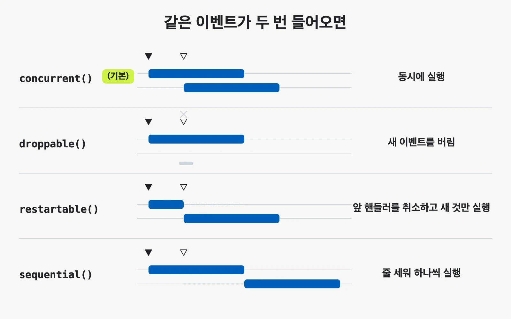
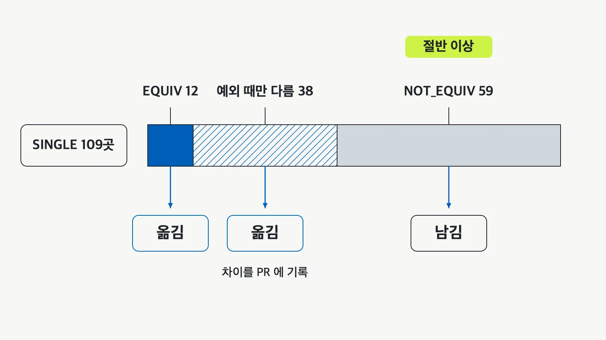
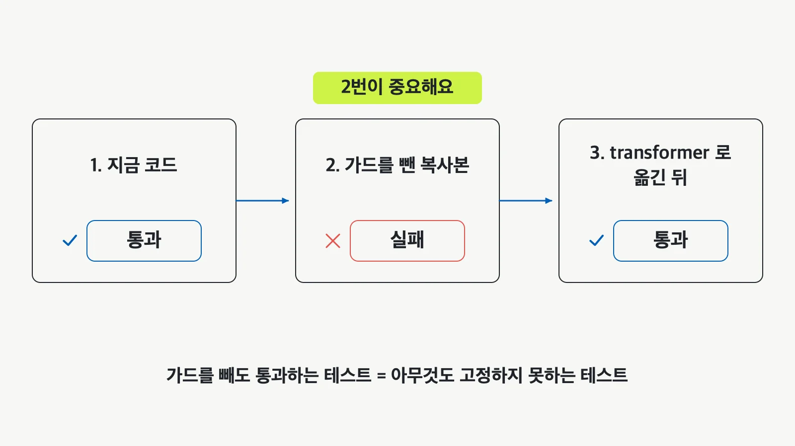
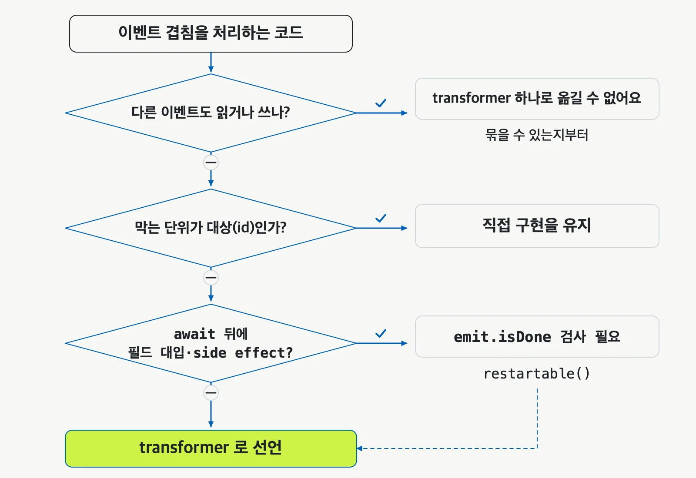

## 들어가며: 1월부터 코드를 거의 읽지 않았다

올해 1월부터 코드 대부분을 Claude Code 같은 AI 에이전트와 함께 썼어요. 1월 이후 main 에 들어간 커밋이 2,500개가 넘고, 10월 한 달에만 500개가 넘었어요. 수천 줄짜리 PR 을 몇 분 만에 머지할 만큼 리뷰 없이 달렸고, 기능은 돌아갔어요. 그러다 "이 코드를 내가 설명할 수 있나?" 싶어 하루를 잡고 직접 읽어 봤어요.

AI 의 코드 스타일을 보려던 건데, 더 큰 문제가 보였어요. **같은 문제를 파일마다 다른 방법으로 풀고 있었고, 세어 보니 약 270곳이었어요.** 이 글은 그 270곳을 다시 AI 와 함께 정리하며 무엇을 옮기고 무엇을 남겼는지, 정리하는 AI 가 또 어떤 실수를 했는지 적은 기록이에요.

> 정리 대상 코드가 전부 AI 가 쓴 건 아니에요. 리팩토링이 지운 줄을 `git blame` 해 보니, AI 공동 작성 표시(`Co-Authored-By`)가 있는 커밋에서 온 줄은 약 37% 였고 나머지는 저와 팀원들이 썼어요(표시 없이 AI 를 썼을 수도 있어요). 그래서 이 글은 "AI 가 쓴 코드"보다 "리뷰 없이 빠르게 쌓은 코드"에 대한 이야기예요. 다만 리뷰 없이 머지한 PR 이 늘어난 건 AI 와 일하기 시작한 뒤였어요.

## 1월 BLoC 과 11월 BLoC 을 나란히 놓고 읽다

1월 BLoC 과 11월 BLoC 을 짝으로 놓고 사용자 입력 하나가 상태로 바뀌기까지 따라가다 보니, 세 쌍쯤에서 공통점이 보였어요. 화면 로직에는 늘 "앞 처리가 끝나기 전에 이벤트가 또 들어오면?" 이라는 질문이 있어요. 연타해도 결제는 한 번만, 검색은 마지막 검색어 결과만, 저장은 들어온 순서대로 처리해야 하죠. 이 글에서는 이걸 이벤트 겹침이라고 부를게요. 코드는 이 질문에 파일마다, 한 파일 안에서도 다르게 답하고 있었어요.

다음은 코치 챌린지 화면의 BLoC 이에요. 늦게 온 응답을 버리려고 요청마다 번호(`_requestSeq`)를 붙여요.

```dart
Future<void> _fetch(Emitter<CoachChallengeState> emit) async {
  final seq = ++_requestSeq;
  ...
  final result = await _coachChallengeUseCase.fetch();
  if (seq != _requestSeq) return;   // 늦게 온 응답은 통째로 버린다
  ...
}

Future<void> _onOverrideRequested(...) async {
  if (state.isOverrideInFlight) return;
  emit(state.copyWith(isOverrideInFlight: true));
  final seq = ++_requestSeq;
  switch (await _coachChallengeUseCase.overrideTopic(...)) {
    case Success(:final data):
      emit(state.copyWith(
          status: seq == _requestSeq ? CoachChallengeStatus.success : null,
          challenge: data,   // 번호와 상관없이 덮어쓴다
  ...
```

`_fetch` 는 늦은 응답을 통째로 버리는데, `_onOverrideRequested` 는 상태값(`status`)에만 번호를 적용하고 데이터(`challenge`)는 덮어써요. 같은 번호를 두 규칙으로 쓰니 둘 중 하나는 틀린 거예요. 다른 화면은 직접 만든 transformer(`events.asyncExpand(mapper)`), 상태 플래그(`isLoadingMore`), `bool` 필드(`_isReviewLoading`), 플래그 두 개와 재실행 콜백 조합을 제각각 썼어요. AI 는 대개 주변 파일 하나를 따라 쓰니, 정해진 방식이 없으면 그때 참고한 파일의 방식이 복제돼요. 리뷰가 없으니 아무도 통일하자고 말하지 않았고요.

## 파일럿 두 개 대신 범위부터 쟀다

AI 는 파일 두 개로 파일럿을 하자고 했지만, 매번 새로 쓰이는 거라면 범위부터 알아야 한다고 봤어요. BLoC 144개를 에이전트 4개에게 나눠 감사하게 하고, 각 지점을 규칙 종류, 가드가 이벤트 하나에만 걸리는지(SINGLE) 여러 이벤트가 함께 쓰는지(CROSS), 버려지는 실행이 필드나 side effect 를 건드리는지로 분류했어요.

결과는 113개 파일, 약 270곳이었어요. 대부분은 연타 방지인 버리기(120곳)였고, 마지막만 반영 36곳, 순서대로 23곳이 뒤를 이었어요. 그리고 약 45%가 CROSS 였는데, 이 숫자가 나중에 계획을 크게 바꿔요.

## 배경: BLoC 의 기본은 동시 실행이다

`bloc` 7.2 부터(지금 쓰는 8 버전도) `on<E>(handler)` 핸들러는 기본이 동시 실행이에요. 같은 이벤트가 두 번 들어오면 핸들러 두 개가 동시에 돌아요. 바꾸려면 등록할 때 `transformer` 를 넘기고, 공식 패키지 `bloc_concurrency` 가 자주 쓰는 네 가지를 제공해요.

| transformer | 겹치면 | 어울리는 곳 |
|---|---|---|
| `concurrent()` (기본) | 동시에 실행 | 서로 영향 없는 작업 |
| `droppable()` | 앞이 끝날 때까지 새 이벤트를 버림 | 제출·결제 같은 버튼 액션 |
| `restartable()` | 앞 핸들러를 취소하고 새 것만 실행 | 조회·검색·새로고침 |
| `sequential()` | 줄 세워 하나씩 실행 | 순서가 결과를 바꾸는 저장·토글 |

<figure>
	
	<figcaption>같은 이벤트가 겹쳐 들어오면 transformer 마다 처리 방식이 달라지고, 아무것도 넘기지 않으면 동시 실행이에요.</figcaption>
</figure>

이걸 모르면 코드가 기본값을 착각해요. 실제로 배틀패스 BLoC 에는 이런 주석이 있었어요.

```dart
// 같은 타입 이벤트는 순차 처리(기본 asyncExpand)라 큐에서 대기하는 동안 유저가 다른 칩을
// 선택했을 수 있다 — 이미 선택이 바뀐 요청은 시작 전에 버려 불필요한 호출을 막는다.
```

기본은 순차가 아니라 동시예요. 코드는 우연히 맞게 돌았지만, 주석을 믿고 고치면 틀리게 고치게 돼요.

## 첫 설계와 그게 무너진 두 지점

처음 계획은 `bool` 플래그는 `droppable()`, 요청 번호는 `restartable()`, 직접 쓴 `events.asyncExpand(mapper)` 는 `sequential()` 로 옮기는 거였어요. 마지막은 쉬웠어요. `sequential()` 의 구현이 `events.asyncExpand(mapper)` 그대로라, 23곳을 첫 PR 로 옮겼어요.

나머지는 두 군데서 무너졌어요. 첫째, transformer 는 등록 하나에만 걸려서 A 와 B 가 플래그 하나를 같이 쓰던 CROSS(45%)는 옮길 수 없었어요. 둘째, `restartable()` 의 취소는 앞 핸들러의 `emit` 만 무시해요. 진행 중인 HTTP 요청이나 `await` 뒤의 필드 대입·side effect 는 그대로 실행되니, 그런 코드가 있으면 `if (emit.isDone) return;` 으로 직접 끊어야 해요. 그래서 질문을 **"바꿔도 동작이 같은 곳이 어디인가"** 로 바꿨어요.

## 규칙을 바꿨다: 동작이 같은 곳만 옮긴다

CROSS 는 일단 빼고, SINGLE 109곳의 등가성을 에이전트 4개가 지점마다 판정했어요. 모든 경로에서 같으면 EQUIV, 예외 때만 다르면 "예외 때만 다름", 다른 핸들러가 같은 플래그를 건드리거나 id 별 가드이거나 다른 이벤트가 바꾼 state 로 늦은 응답을 판단하면 NOT_EQUIV 예요. EQUIV 12곳과 예외 때만 다름 38곳은 옮기고(차이는 PR 에 기록), NOT_EQUIV 59곳은 남겼어요.

<figure>
	
	<figcaption>SINGLE 109곳 중 옮긴 건 50곳이고, 절반이 넘는 59곳은 동작이 달라져서 남겼어요.</figcaption>
</figure>

비슷해 보이던 연타 방지 플래그가 절반 넘게 다른 이벤트와 얽혀 있을 줄은 몰랐어요. 반대로 "예외 때만 다름" 38곳은 사실 기존 코드의 버그였어요. 퀴즈 화면의 다시 보기가 대표적이에요.

```dart
bool _isReviewLoading = false;

Future<void> _onReviewRequested(DailyQuizListReviewRequestedEvent event, Emitter<DailyQuizListState> emit) async {
  if (_isReviewLoading) return;
  _isReviewLoading = true;
  final result = await _dailyQuizUseCase.fetchItem(event.seqNo);
  _isReviewLoading = false;
  ...
}
```

`fetchItem` 이 예외를 던지면 `finally` 가 없으니 플래그가 켜진 채로 남아, 그 화면에서 다시 보기가 영원히 막혀요. 이 프로젝트는 결과를 `onSuccess` / `onFailure` / `onCatch` 체인으로 받는데, 예외가 나면 `onFailure` 는 불리지 않고 `onCatch` 만 불려요. 사람도 AI 도 `onFailure` 에서만 플래그를 풀었던 거예요. `droppable()` 로 옮기면 핸들러가 예외로 끝나도 다음 이벤트를 받으니 이 문제가 구조적으로 사라져요.

```dart
on<DailyQuizListReviewRequestedEvent>(_onReviewRequested, transformer: droppable());
```

잠기던 것이 풀리는 방향의 변경이라 옮기되, 화면이 읽는 state 필드(`isSubmitting` 같은)와 그 `emit` 은 그대로 둬서 표시는 이전과 같게 했어요.

## 테스트로 지금 동작부터 못 박았다

등가성 판정은 에이전트가 코드를 읽고 내린 결론일 뿐이라, 옮기기 전에 지금 동작을 테스트로 고정했어요. `Completer` 로 응답 시점을 쥐고, 첫 요청을 끝내지 않은 채 두 번째 이벤트를 넣어요.

```dart
test('다시 보기 조회 대기 중 다른 문항을 탭하면 버려지고, 끝나면 다시 받는다', () async {
  final first = Completer<Result<DailyQuizItemDetailModel>>();
  when(() => usecase.fetchItem(100)).thenAnswer((_) => first.future);
  when(() => usecase.fetchItem(200)).thenAnswer((_) async => const Success(detail));

  bloc.add(const DailyQuizListReviewRequestedEvent(seqNo: 100));
  await pumpEventQueue();
  bloc.add(const DailyQuizListReviewRequestedEvent(seqNo: 200));
  await pumpEventQueue();

  verify(() => usecase.fetchItem(100)).called(1);
  verifyNever(() => usecase.fetchItem(200));   // 겹친 요청은 버려진다

  first.complete(const Success(detail));
  await pumpEventQueue();
  bloc.add(const DailyQuizListReviewRequestedEvent(seqNo: 200));
  await pumpEventQueue();

  verify(() => usecase.fetchItem(200)).called(1);   // 끝난 뒤에는 다시 받는다
});
```

테스트는 지점마다 세 번 돌렸어요. 지금 코드에서 통과하는지, 일회용 복사본에서 가드를 빼면 실패하는지, transformer 로 옮긴 뒤 다시 통과하는지요.

<figure>
	
	<figcaption>가드를 뺀 복사본에서 실패해야 그 테스트가 지금 동작을 정말 고정하고 있다는 뜻이에요.</figcaption>
</figure>

가드를 빼도 통과하는 테스트는 아무것도 고정하지 못해요. 실제로 기존 테스트 하나가 동시 실행인데도 통과하는 걸 이 단계에서 찾았어요. 첫 PR 은 transformer 를 전부 뺀 복사본에서 대상 22개 파일의 테스트가 모두 실패하는 걸 확인한 뒤 옮겼고, 커밋도 "테스트 → 이관" 순서로 나눠 리뷰어가 두 가지를 따로 볼 수 있게 했어요.

> **막혔던 곳: fake 시계 안의 `droppable()` 은 닫히지 않아요**
>
> 이관 중에 위젯 테스트 몇 개가 시간 제한에도 걸리지 않고 10분 넘게 멈춰 있었어요. `fakeAsync`·`testWidgets` 의 가짜 시계 안에서 만든 BLoC 에 `droppable()` 등록이 다른 등록과 함께 있으면 `close()` 가 끝나지 않아요. `droppable()` 의 취소 콜백이 `async` 라, 가짜 시계가 끝난 뒤에는 그 마이크로태스크가 돌지 않았거든요. 다른 transformer 나 실제 시계에서는 생기지 않았어요. 운영 코드는 두고 해당 테스트 3곳만 `addTearDown(() => unawaited(bloc.close()))` 로 기다리지 않게 고치고, ADR 에도 적었어요.

이렇게 첫 PR 에서 `sequential()` 23곳, 둘째 묶음에서 `droppable()` 48곳과 `restartable()` 1곳을 옮겼어요. 마지막으로 실기기에서 WebDriverAgent 로 40ms 간격 3연타를 넣어, 코인 차감·개수·토스트가 한 번만 일어나는지 7개 흐름에서 확인했어요.

## 리팩토링을 끝내자 버그가 보였다

NOT_EQUIV 59곳과 CROSS 104곳은 남겼지만, 판정하는 동안 버그로 보이는 것들이 계속 나왔어요. 리팩토링과 버그 수정이 한 PR 에 섞이면 의도한 동작 변경인지 구분할 수 없으니, 리팩토링 PR 을 머지한 다음 날 버그만 따로 PR 로 만들었어요. 영양제 검색 더 보기는 옛 응답을 버리면서 `isLoadingMore` 를 내리지 않아 새 검색어의 더 보기가 영원히 막혔고, 코치 챌린지는 앞의 번호 불일치 때문에 진행 중이던 조회 응답이 덮어쓰기 결과를 되돌렸어요. 수분 기록·식사 상세 더 보기는 요청 시점의 state 스냅샷에 병합해서 그사이 바뀐 값을 지웠고, 이중 요청으로 크래시 이력이 있는 확정 저장과 짝인 루틴 변경 확정에는 주석과 달리 가드가 없었어요.

버그마다 실패하는 테스트를 먼저 쓰고 의도한 이유로 실패하는지 확인한 뒤 고쳤어요. 팀 생성의 429 응답을 알리지 않는 동작처럼 정해 둔 정책 그대로인 것은 정책부터 다시 정할 문제로 남겼어요.

## AI 로 정리했더니 AI 가 또 버그를 만들었다

깔끔한 결말이면 좋겠지만, 버그 PR 에서 Claude 의 수정이 새 버그를 세 개 만들었어요. 이미 끝난 작업을 되살린 팀 게시판 새로고침, 같은 페이지를 두 번 합산한 수분 기록 더 보기, 그사이 받은 가져오기 동의를 놓친 러닝 기록 재조회예요. 셋 다 리뷰 봇(CodeRabbit)이 잡았고, 봇이 diff 밖에 남긴 지적 하나는 Claude 가 놓쳤다가 제가 물어서 다시 처리했어요. Claude 가 처음엔 "서버 최신 상태이니 맞다"며 둔 코치 챌린지 덮어쓰기도, CROSS 판정 중 반례가 나오자 스스로 "판단이 불완전했다"며 다시 고쳤어요.

이 리팩토링 PR(117개 파일, +2,434줄)도 사람 리뷰 없이 머지했어요. 대신 동작을 고정한 테스트, 변이 검사, 리뷰 봇, 실기기 연타 확인을 겹겹이 뒀고, 회귀 세 건이 머지 전에 잡힌 것도 그 덕분이에요. **AI 에게 정리를 맡기면 정리도 빨라지지만 실수도 같은 속도로 늘어요.** 처음에 없었던 건 AI 의 능력이 아니라 실수를 잡는 장치였어요.

## 어디까지 transformer 로 옮기고 어디서 멈추나

CROSS 는 여러 이벤트를 sealed 상위 이벤트 하나로 묶으면 될 줄 알았어요. 하지만 104곳 중 그대로 묶으면 되는 곳은 15곳, 핸들러를 쪼개면 되는 곳은 18곳, 묶으면 동작이 바뀌는 곳은 7곳이었고, 64곳(62%)은 transformer 로 아예 표현할 수 없었어요. id 별 가드, 다른 이벤트가 바꾼 state 로 늦은 응답을 판단하는 코드, "모았다가 끝난 뒤 한 번 더" 같은 규칙은 패키지에 없거든요. 조기 return 하는 이벤트를 `restartable()` 그룹에 넣으면 진행 중인 조회만 취소되고 화면이 로딩에 멈추는 함정도 있었어요.

그래서 이벤트 겹침을 처리하는 코드를 보면 이렇게 묻기로 했어요.

1. 이 가드를 다른 이벤트도 읽거나 쓰나? 그렇다면 transformer 하나로는 못 옮기니, 묶을 수 있는지부터 따져요.
2. 막는 단위가 "이 이벤트"인가, "이 대상(id)"인가? 대상별이면 직접 구현을 유지해요.
3. `await` 뒤에 `emit` 이 아닌 코드(필드 대입, side effect)가 있나? `restartable()` 로 옮긴다면 `emit.isDone` 검사가 필요해요.

<figure>
	
	<figcaption>세 질문을 모두 통과한 곳만 transformer 로 선언하고, 걸리는 곳은 그 질문이 가리키는 대로 처리해요.</figcaption>
</figure>

남은 곳은 2,900줄짜리 홈 BLoC 처럼 위험이 큰 파일이 섞여 있어, 한 번에 옮기지 않고 그 BLoC 을 수정할 때 옮기기로 했어요.

## 마치며: 속도가 남긴 진짜 비용은 기준의 부재였다

버그를 찾을 줄 알았는데, 더 큰 문제는 같은 질문에 대한 답이 저장소에 하나도 정해져 있지 않았다는 거였어요. 그래서 이번 작업의 마지막 결과물은 코드가 아니라 기준이었어요. 결정과 이유를 ADR 로 남기고, AI 에이전트가 작업할 때마다 읽는 규칙 파일에 "이벤트 겹침은 `bloc_concurrency` transformer 로 선언한다. 플래그·요청 번호·`asyncExpand` 를 손으로 만들지 않는다." 한 줄을 넣었어요. 이제 새 코드는 이 줄을 보고 쓰여요.

AI 와 빠르게 코드를 쌓고 있다면, 한번 이렇게 물어보세요.

1. 최근 한 달 동안 머지한 코드 중, 내가 직접 설명할 수 있는 파일은 몇 개인가?
2. 우리 코드베이스에서 자주 반복되는 질문(이벤트 겹침, 에러 매핑, 로딩 표시)에 정해진 답이 있나? 그 답이 AI 가 읽는 곳에 적혀 있나?
3. AI 에게 리팩토링을 맡긴다면, "동작이 같다"를 무엇으로 확인할 건가?

돌아보면 1년 동안 코드가 잘 돌아갔던 건 코드가 일관돼서가 아니라, 겹친 이벤트가 생각보다 드물게 일어났기 때문이었어요. 드물게 일어나는 문제일수록, 기준이 없으면 아무도 모르는 사이에 270가지 답이 생깁니다.

## 참고 자료

- [bloc_concurrency](https://pub.dev/packages/bloc_concurrency) — `droppable`·`restartable`·`sequential`·`concurrent` (0.2.5 기준)
- [bloc](https://pub.dev/packages/bloc) — 7.2 부터 이벤트 핸들러 기본 동작은 동시 실행 (8.1.4 기준)
