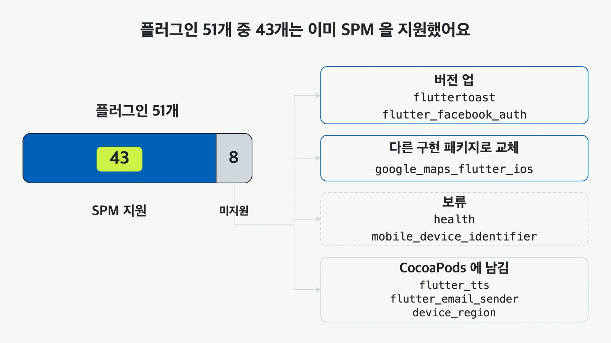
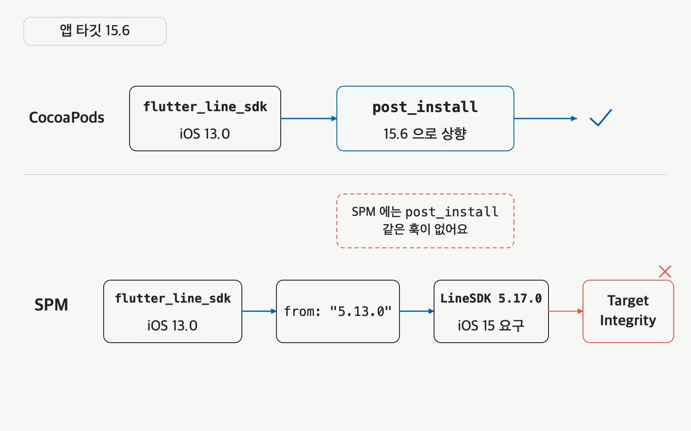
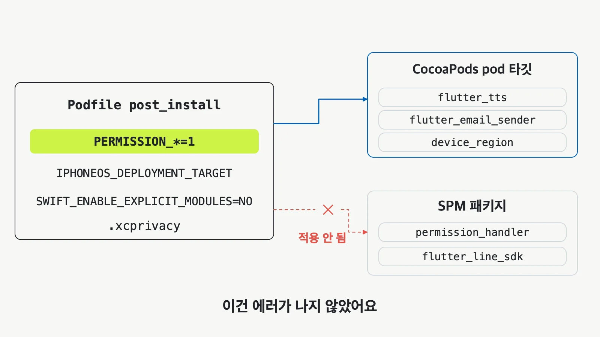
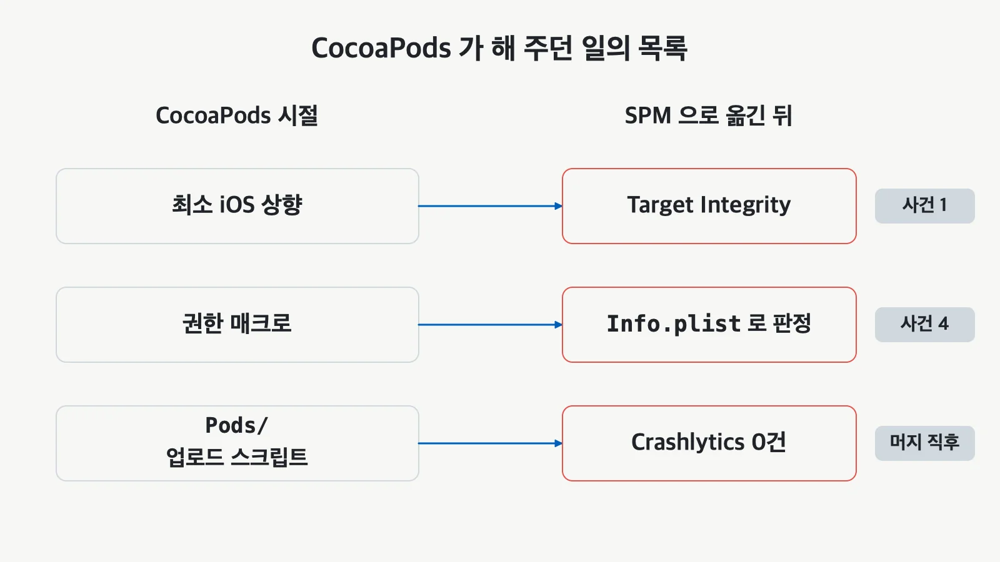

## 들어가며: 지금도 빌드는 되는데 왜 옮기나

2026년 10월 중순, 코드를 한 줄도 바꾸지 않았는데 CI 의 iOS 빌드가 전부 `pod install` 단계에서 멈췄어요. Facebook iOS SDK 19.0.0 이 새로 공개된 탓이었어요. Podfile 에서 18.0.2 로 고정해 두었어도 CocoaPods 의 CDN 검색은 그 pod 의 모든 버전 podspec 을 받아 오는데, 새 19.0.0 podspec 이 CI 러너에서 `Error in the HTTP2 framing layer` 로 받아지지 않았거든요.

podspec URL 을 직접 지정해 넘어갔지만, 비슷한 시기에 더 큰 소식이 있었어요. CocoaPods 중앙 저장소(trunk)가 2026년 12월 2일부터 영구 읽기 전용이 돼서, Firebase 같은 SDK 의 새 버전을 더 이상 CocoaPods 로 받을 수 없게 된다는 거예요. 저희 앱이 trunk 에서 받던 네이티브 SDK 는 36개였어요. Flutter 도 3.44 부터 Swift Package Manager(SPM)가 기본이고, `enable-swift-package-manager: false` 같은 끄는 설정은 앞으로 허용되지 않을 거라고 안내하고 있었어요.

그래서 11월에 iOS 의존성을 SPM 으로 옮겼고, trunk 의존은 36개에서 0개가 됐어요. 그런데 그 과정에서 **CocoaPods 가 조용히 대신 해 주던 일들이 하나씩 드러났어요.** 이 글은 그 목록이고, 마지막에 체크리스트를 붙였어요.

## 배경: 세 겹의 의존성과 세 가지 믿음

Flutter 앱의 iOS 의존성은 순수 Dart 패키지(`dio`), iOS 코드를 CocoaPods 나 SPM 으로 붙이는 플러그인(`firebase_core`), 플러그인이 끌고 오는 네이티브 SDK(`FirebaseCore`, `LineSDK`) 세 겹이에요. trunk 종료의 영향을 받는 건 네이티브 SDK 이고, SPM 으로 옮길 수 있는지는 플러그인이 `Package.swift` 를 제공하는지로 정해져요. Flutter 는 `Package.swift` 가 있는 플러그인만 SPM 으로 붙이는 혼합 방식을 지원해서, 저희는 이 방식으로 먼저 켜고 CocoaPods 완전 제거는 미뤘어요.

시작할 때 저는 세 가지를 당연하게 믿고 있었어요. 앱의 최소 iOS 버전이 15.6 이면 의존성도 15.6 기준으로 맞춰진다(2026년 6월에 앱 타깃을 13.0 에서 15.6 으로 올려 둔 상태였어요), Podfile 에 적어 둔 빌드 설정은 계속 적용된다, 빌드가 한 번 통과하면 의존성 버전은 그대로 고정돼 있다. 셋 다 SPM 에서는 성립하지 않았어요.

## 플러그인 51개 중 43개는 이미 SPM 을 지원했다

`pubspec.lock` 에 고정된 버전의 플러그인 소스에 `Package.swift` 가 있는지 확인해 보니, iOS 네이티브 코드가 있는 플러그인 51개 중 43개는 이미 SPM 을 지원했어요. 나머지 8개 중 `fluttertoast`(10.0.2)와 `flutter_facebook_auth`(7.3.2)는 버전을 올렸고, `google_maps_flutter_ios` 는 다른 구현 패키지로 바꿨어요. `health` 는 새 버전이 요구하는 `device_info_plus` 13 이 `win32` 6 을 끌어오면서 다른 플러그인 네 개까지 메이저 업그레이드가 필요해 보류했고, 직접 고친 복사본을 쓰는 `mobile_device_identifier` 도 보류했어요. 지원 버전이 없는 `flutter_tts`·`flutter_email_sender`·`device_region` 은 CocoaPods 에 남겼어요.

<figure>
	
	<figcaption>51개 중 43개는 이미 SPM 을 지원했고, 남은 8개는 네 갈래로 처리했어요.</figcaption>
</figure>

다만 이 판정은 "`Package.swift` 가 있다"까지만 본 것이었고, 첫 번째 사건이 바로 거기서 났어요.

## 사건 1: 앱은 15.6 인데 "이 타깃은 13.0 을 지원한다"며 깨졌다

SPM 을 켜고 빌드하자 패키지 해석 단계에서 이런 에러가 났어요.

```text
Target Integrity (Xcode): The package product 'LineSDK' requires minimum platform version 15.0 for the iOS platform, but this target supports 13.0
Target Integrity (Xcode): The package product 'GoogleCast' requires minimum platform version 16.0 for the iOS platform, but this target supports 15.0
```

앱 타깃은 15.6 인데 "13.0 을 지원하는 타깃"은 어디 있을까요? 여기서 타깃은 앱이 아니라 플러그인 패키지였어요. SPM 은 패키지마다 `Package.swift` 에 최소 iOS 버전을 선언하고, 의존 패키지가 그보다 높은 버전을 요구하면 앱 타깃과 상관없이 거부해요.

```swift
let package = Package(
    name: "flutter_line_sdk",
    platforms: [
        .iOS("13.0"),
    ],
    dependencies: [
        .package(url: "https://github.com/line/line-sdk-ios-swift.git", from: "5.13.0")
    ],
    // ...
)
```

`flutter_line_sdk` 2.6.2 는 iOS 13.0 을 선언하고 LINE SDK 를 `from: "5.13.0"`, 즉 5.13.0 이상의 최신으로 받아요. 그 최신인 5.17.0 이 iOS 15 를 요구하면서 충돌이 났어요. `flutter_chrome_cast` 1.4.6 도 같은 구조로, iOS 15.0 을 선언하고 `google-cast-sdk` 를 `from: "4.8.3"` 으로 받는데 최신 4.8.6 이 iOS 16 을 요구했어요.

CocoaPods 에서 괜찮았던 이유는 Podfile 의 `post_install` 에 있었어요.

```ruby
# 프로젝트 최소 타겟(15.6) 미만인 Pod 는 모두 15.6 으로 상향.
deployment_target = config.build_settings['IPHONEOS_DEPLOYMENT_TARGET']
if deployment_target && deployment_target.to_f < 15.6
  config.build_settings['IPHONEOS_DEPLOYMENT_TARGET'] = '15.6'
end
```

CocoaPods 는 설치 후에 모든 pod 의 빌드 설정을 덮어쓸 수 있었어요. 첫 번째 믿음은 사실 **이 몇 줄이 만들어 준 것**이었어요. SPM 에는 이런 훅이 없고, 패키지의 `Package.swift` 는 작성자의 것이라 앱 쪽에서 고칠 수 없어요.

<figure>
	
	<figcaption>CocoaPods 에서는 post_install 이 최소 버전을 올려 줬지만, SPM 에는 그 훅이 없어 플러그인 선언이 그대로 부딪혔어요.</figcaption>
</figure>

그래서 SPM 의 잠금 파일 `Package.resolved` 에 충돌하지 않는 마지막 버전, `google-cast-sdk` 4.8.4 와 `line-sdk-ios-swift` 5.16.0(iOS 13 선언)을 고정했어요. 이 파일은 `Runner.xcworkspace` 와 `Runner.xcodeproj` 아래 두 곳에 있어 둘 다 커밋하고, 지금 패키지 25개가 고정돼 있어요. 이 고정은 Xcode 의 "Update to Latest Package Versions" 한 번이면 풀려 빌드가 깨지니 팀에 알려 뒀고, 근본 해결(`flutter_line_sdk` 3.0.0 은 Android Gradle Plugin 9 필요, 또는 최소 iOS 16)은 따로 잡아 뒀어요.

> 원래 SPM 을 꺼 둔 이유도 이 계열이었어요. Flutter 문서가 안내하는 해법(최소 배포 버전을 올리고 `flutter build ios --config-only` 재실행)은 Flutter 가 만드는 `FlutterGeneratedPluginSwiftPackage` 쪽 문제만 풀고, 플러그인 자신의 선언은 풀지 못해요. 같은 에러 문구가 두 가지 다른 원인을 가리킬 수 있어요.

## 사건 2: 지도 플러그인은 구조상 SPM 을 쓸 수 없었다

`google_maps_flutter_ios` 는 최신 버전에도 `Package.swift` 가 없었어요. 기본 구현은 `GoogleMaps` 를 `'>= 8.4', '< 11.0'` 범위로 받아 앱의 최소 iOS 에 따라 SDK 9.x(iOS 15)나 10.x(iOS 16)가 들어오는데, 범위 안의 최신판을 고르는 SPM 으로는 이 구조를 옮길 수 없어서예요([flutter/flutter#146920](https://github.com/flutter/flutter/issues/146920)).

대신 Flutter 팀이 SDK 버전별로 낸 구현 패키지 `google_maps_flutter_ios_sdk9`(iOS 15 이상)와 `_sdk10`(iOS 16 이상)이 있어요. `pubspec.yaml` 에 넣기만 하면 기본 구현을 대신해요.

```yaml
dependencies:
  google_maps_flutter_ios_sdk9: "^2.19.0"
```

최소 iOS 가 15.6 이라 sdk9 를 골랐고, 전환 전후 모두 Maps SDK 9.4.0 이 들어왔으며 실기기에서 러닝 화면의 지도도 확인했어요. 연합 플러그인(federated plugin) 구조에서는 앱이 플랫폼 구현을 골라 끼울 수 있으니, 미지원 플러그인을 만나면 지원을 기다리기 전에 대체 구현부터 찾아보세요.

## 사건 3: Podfile 로 버티던 Facebook SDK 고정이 필요 없어졌다

이건 깨진 게 아니라 풀린 사건이에요. 저희는 `flutter_facebook_auth` 를 7.1.2 로, Podfile 에서 FBSDK pod 4개를 18.0.2 로 붙잡고 있었고, CDN 사고 뒤로는 podspec URL 을 직접 가리키는 모양까지 돼 있었어요.

```ruby
fbsdk_spec = ->(name, shard) { "https://cdn.jsdelivr.net/cocoa/Specs/#{shard}/#{name}/18.0.2/#{name}.podspec.json" }
pod 'FBSDKCoreKit', :podspec => fbsdk_spec.call('FBSDKCoreKit', '9/b/5')
pod 'FBSDKLoginKit', :podspec => fbsdk_spec.call('FBSDKLoginKit', 'b/3/c')
# ... 2줄 더
```

7.1.2 고정은 FBSDK 18.0.2 컴파일 오류를 피하려던 것이었어요([flutter-facebook-auth#478](https://github.com/darwin-morocho/flutter-facebook-auth/issues/478)). 커밋 메시지와 Podfile 주석에 그 이유가 남아 있어서, **다시 조사하지 않고 7.3.2 로 올리며 FBSDK 4줄을 지울 수 있었어요.** 이유가 적혀 있지 않은 고정은 지워도 되는지 판단할 수 없어요. FBSDK 는 SPM 으로 18.1.1 이 들어왔고, 실기기에서 Facebook Limited Login 으로 서버 로그인까지, LINE·Kakao·Google 은 SDK 화면 진입까지 확인했어요.

## 사건 4: Podfile 의 수동 설정은 SPM 플러그인에 닿지 않는다

이건 에러가 나지 않아 일부러 찾아야 했어요. `post_install` 은 CocoaPods 가 만든 pod 타깃에만 적용되니, SPM 으로 옮겨 간 플러그인은 이 설정을 받지 못해요.

| Podfile 설정 | 하던 일 | SPM 으로 옮긴 뒤 |
|---|---|---|
| `GCC_PREPROCESSOR_DEFINITIONS` 의 `PERMISSION_*=1` | `permission_handler` 가 쓸 권한 코드만 컴파일 | 적용 안 됨. SPM 판이 다른 방식으로 판정 |
| `IPHONEOS_DEPLOYMENT_TARGET` 15.6 상향 | 낮게 선언한 pod 을 15.6 으로 | 적용 안 됨 (사건 1) |
| `SWIFT_ENABLE_EXPLICIT_MODULES=NO` | Xcode 26 에서 Firebase 서브스펙 모듈 해석 실패 회피 | 남은 pod 에만 적용 |
| `.xcprivacy` 를 Resources 로 이동 | 프라이버시 매니페스트 위치 교정 | 남은 pod 에만 적용 |

<figure>
	
	<figcaption>post_install 은 pod 타깃에만 닿아서, SPM 으로 옮겨 간 플러그인은 에러 없이 설정을 잃었어요.</figcaption>
</figure>

가장 위험한 건 첫 줄이었어요. `permission_handler` 는 **매크로가 꺼진 권한은 요청해도 아무 일도 일어나지 않아요.** SPM 판(`permission_handler_apple` 9.4.10)의 `Package.swift` 에는 판정 순서가 적혀 있었어요.

```swift
// Permissions are resolved in priority order:
//   1. Environment variable (e.g. `launchctl setenv PERMISSION_CAMERA 1` ...)
//   2. Matching key present in the app's Info.plist
//   3. Default: enabled for permissions with no required plist key
//              (PERMISSION_NOTIFICATIONS, PERMISSION_CRITICAL_ALERTS),
```

SPM 판은 Podfile 대신 앱 `Info.plist` 에 사용 목적 키(`NSCameraUsageDescription` 등)가 있는지로 판정해서, 카메라·사진·ATT 는 그대로 켜지고 쓰지 않는 `PERMISSION_CRITICAL_ALERTS` 는 꺼져요. 실기기용 산출물을 `nm -u` 로 열어 `PHPhotoLibrary`·`AVCaptureDevice`·`ATTrackingManager` 참조도 확인했어요. `Info.plist` 를 바꾼 뒤에는 DerivedData 를 지워야 이 판정이 다시 돈다는 점도 기억해 두세요. 새 설치 상태의 권한 팝업은 아직 확인하지 못했어요.

## 머지 직후: 같은 모양의 사고 두 개

전환을 main 에 머지한 다음 날 두 가지가 드러났어요([크래시 0건은 측정값이 아니었다](/posts/ios_crashlytics_zero_crashes)에 자세히 썼어요). 하나는 `${PODS_ROOT}` 아래의 `upload-symbols` 를 부르던 dSYM 업로드 단계가 경로를 잃고도 실패를 삼켜, Crashlytics 의 iOS 집계가 0건이 된 일이에요. 다른 하나는 `Package.resolved` 가 머지 커밋에서 빠져 SPM 이 사건 1 의 최신판(4.8.6·5.17.0)을 다시 받아 archive 가 깨진 일이에요. 이건 CI 의 gym 에 `disable_package_automatic_updates: true`(`xcodebuild -disableAutomaticPackageResolution`)를 켜서, 잠금 파일이 없으면 바로 멈추게 했어요.

두 사고는 사건 1·4 와 뿌리가 같아요. **CocoaPods 시절에 무언가가 조용히 맞춰 주고 있었고, 옮긴 뒤엔 그게 빠졌는데 아무도 알려 주지 않았어요.**

## 헛걸음 경계: main 의 iOS CI 실패는 SPM 탓이 아니었다

머지하던 날 main 의 iOS CI 가 연달아 실패해서 SPM 을 의심하기 쉬웠지만, 실패 단계는 인증서 저장소를 clone 하는 fastlane match 였고, 전환 직전 커밋 네 개가 모두 여기서 멈춘 반면 전환 커밋의 빌드는 통과했어요. 큰 전환 직후의 빌드 실패는 **에러 문구보다 실패한 단계부터** 보세요. 전환 이후 main 의 iOS 빌드는 계속 통과했고, 11월 12~13일에는 dev·prod 서명 archive 도 확인했어요.

## 혼합 기간에 남아 있는 것들

첫째, `#include?` 는 파일이 없으면 조용히 건너뛰어요. Flutter 가 만드는 `ios/Flutter/*.xcconfig` 첫 줄은 이렇게 생겼어요.

```text
#include? "Pods/Target Support Files/Pods-Runner/Pods-Runner.debug-dev.xcconfig"
#include "Generated.xcconfig"
```

이 Pods xcconfig 가 검색 경로와 링커 플래그를 제공해서, `flutter clean` 직후 `pod install` 없이 빌드하면 `Undefined symbol: _OBJC_CLASS_$_FlutterError` 같은 링커 에러가 나요. xcconfig 에 경로를 직접 추가하면 같은 키가 앞의 값을 대체해 오히려 Pods 경로가 사라지니, `pod install` 을 다시 돌리는 게 답이에요. 이런 xcconfig 가 11개 있고, CocoaPods 를 걷어 낼 때 함께 지워야 해요.

둘째, CI 는 아직 매 빌드 `pod deintegrate` 를 하고 `Podfile.lock` 을 지워서, CocoaPods 1.16.2 가 남은 pod 의 최신판을 매번 새로 받아요. 남은 pod 은 trunk SDK 에 의존하지 않아 지금은 괜찮지만, SPM 쪽에서 막은 일이 여기서는 열려 있는 셈이에요.

셋째, CI 가 빌드마다 DerivedData 를 지우니 그 아래 `SourcePackages/` 의 패키지 25개를 매번 새로 받아요. main 의 iOS 빌드 job 시간 중앙값은 전환 전 3주(10월 18일~11월 9일) 약 16분에서 전환 후(11월 10일~19일) 약 25분으로 늘었어요. 러너 부하 같은 요인도 섞여 있어 패키지 몫을 따로 떼어 보진 못했고, 필요하면 gym 의 `cloned_source_packages_path` 로 캐시할 계획이에요.

pbxproj diff 가 커 보여도 `PBXFileSystemSynchronized*` 포맷 변경, `[CP] Embed Pods Frameworks` 단계 삭제, 스킴별 "Run Prepare Flutter Framework Script" pre-action 추가는 모두 정상이에요. `Podfile.lock` 은 615줄이 줄었고, 남은 건 SPM 을 지원하지 않는 플러그인 5개예요.

## SPM 전환 체크리스트

전환 전

- [ ] 플러그인마다 `Package.swift` 유무를 `pubspec.lock` 버전 기준으로 확인했다. 미지원이면 최신 버전 → 대체 구현 → CocoaPods 잔류 순으로 검토했다.
- [ ] Podfile `post_install` 의 각 설정이 어느 플러그인을 위한 것인지 표로 만들고, SPM 으로 옮겨 가는 쪽은 대체 수단을 찾았다.
- [ ] Podfile 의 버전 고정마다 이유를 찾았다. 이유가 없어졌으면 고정도 지운다.
- [ ] 빌드 단계 스크립트에서 `PODS_ROOT` 참조를 찾았다. `grep -n 'PODS_ROOT' ios/Runner.xcodeproj/project.pbxproj`

전환 중

- [ ] `Target Integrity` 에러는 플러그인 `Package.swift` 의 `platforms` 와 의존 SDK 의 최소 버전을 비교해, 앱 타깃으로 풀리는 문제인지 먼저 갈랐다.
- [ ] 버전을 고정했다면 `Package.resolved` 두 곳을 모두 커밋하고 팀에 알렸다. "Update to Latest Package Versions" 금지.
- [ ] 권한·로그인·지도처럼 "빌드됨"과 "동작함"이 먼 기능은 실기기에서 확인했다. 권한 매크로는 `nm -u` 로 볼 수 있다.

전환 후

- [ ] CI 가 `Package.resolved` 에 적힌 버전만 쓰게 했다 (`-disableAutomaticPackageResolution`).
- [ ] 머지 커밋에서 잠금 파일이 지워지지 않았는지 확인했다. `git diff --name-status --diff-filter=D -- '*Package.resolved' '*.lock'`
- [ ] dSYM 업로드처럼 실패해도 빌드가 통과하는 단계가 실제로 성공하는지 봤다.
- [ ] 빌드가 실패하면 에러 문구보다 실패한 단계부터 본다.

## 마치며: CocoaPods 가 해 주던 일의 목록

처음엔 "설정 하나 끄고, 안 되는 플러그인 몇 개 버전 올리기" 정도로 봤고, 실제로 바뀐 코드도 많지 않았어요. 시간이 든 곳은 CocoaPods 가 저희 대신 해 주던 일을 찾아내는 것이었어요. 의존성의 최소 iOS 를 앱에 맞춰 올려 주고, 권한 매크로를 넣어 주고, Firebase 를 `Pods/` 에 넣어서 업로드 스크립트가 돌게 해 주던 일들이요.

<figure>
	
	<figcaption>CocoaPods 가 대신 해 주던 일은 SPM 으로 옮긴 뒤에야 하나씩 드러났어요.</figcaption>
</figure>

도구를 바꿀 때 옮겨야 하는 건 설정 파일이 아니라, 그 도구가 해 주던 일의 목록입니다.

그 목록은 Podfile 의 `post_install`, 빌드 단계 스크립트, 커밋 메시지에 흩어져 있어요. SPM 전환을 앞두고 있다면 세 가지를 먼저 물어보세요.

1. Podfile `post_install` 의 각 줄이 무슨 일을 하는지 설명할 수 있나요?
2. 빌드 단계 중에 `Pods/` 경로를 전제로 한 것이 있나요?
3. 의존성 버전이 바뀌면 CI 가 멈추나요, 아니면 조용히 최신판을 받나요?

## 참고 자료

- CocoaPods Blog, [CocoaPods Trunk Read-only Plan](https://blog.cocoapods.org/CocoaPods-Specs-Repo/) — trunk 읽기 전용 일정(2026-12-02). 기존 버전 설치는 계속된다고 안내 (2026-11 확인)
- Flutter, [Swift Package Manager for app developers](https://docs.flutter.dev/packages-and-plugins/swift-package-manager/for-app-developers) — 혼합 방식, 최소 배포 버전 에러 대처, SPM 끄기 설정에 대한 안내 (2026-11 확인)
- [flutter/flutter#146920](https://github.com/flutter/flutter/issues/146920) — `google_maps_flutter_ios` 의 SPM 미지원 이유
- [flutter-facebook-auth#478](https://github.com/darwin-morocho/flutter-facebook-auth/issues/478) — FBSDK 18.0.2 컴파일 오류
- `permission_handler_apple` 9.4.10 의 `ios/permission_handler_apple/Package.swift` — SPM 판 권한 매크로 판정 순서
- 기준 버전: Flutter 3.47.4, Xcode 26.6(CI ARM)·26.4.1(CI Intel), CocoaPods 1.16.2, `flutter_line_sdk` 2.6.2, `flutter_chrome_cast` 1.4.6, `google_maps_flutter_ios_sdk9` 2.19.0, `flutter_facebook_auth` 7.3.2
