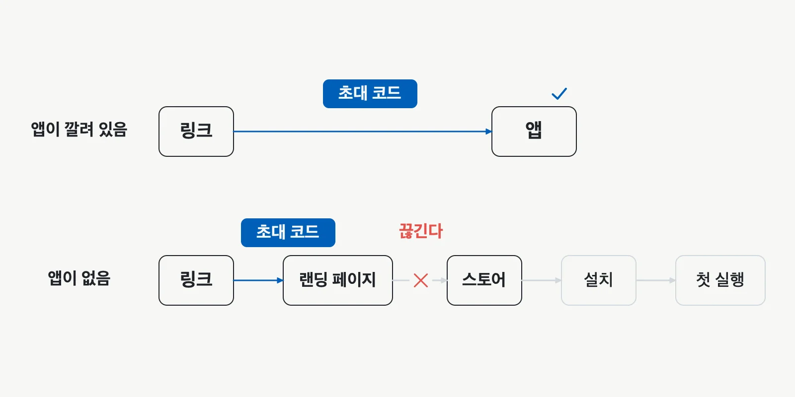

## 들어가며: 링크를 눌렀는데 앱이 없을 때

올해 4월에 친구 초대 기능을 만들었어요. 친구가 초대 링크로 앱을 깔고 가입하면 두 사람 모두에게 보상을 줘요. 친구에게 이미 앱이 있다면 링크가 앱을 열고 초대 코드를 읽으면 끝이지만, 앱이 없으면 링크는 스토어로 가고 설치 뒤 첫 실행 때는 어디에도 남아 있지 않아요.

설치를 거친 뒤에도 링크 정보를 이어 주는 것을 디퍼드 딥링크(deferred deep link)라고 해요. 보통은 Branch 나 AppsFlyer 같은 어트리뷰션 SDK 가 맡지만, 저희는 서버에서 직접 매칭했어요. Android 는 Google Play 의 Install Referrer API 로, iOS 는 랜딩 페이지와 앱 첫 실행의 기기 정보를 서버가 맞춰 봐서요. 어떤 기준으로 골랐고, 처음 조건이 왜 틀렸고, 무엇을 떠안았는지 적었어요.

> iOS 매칭에 쓰는 신호의 종류는 적었지만, 세부 기준값과 어뷰징 방지 규칙은 일부러 뺐어요. 공개하면 그대로 우회할 수 있어서요.

## 설치 한 번에 초대 코드가 사라진다

앱이 없으면 랜딩 페이지 → 스토어 → 설치 → 첫 실행을 거치는데, 스토어는 링크를 앱까지 들고 가 주지 않아요. 이 설치가 누구의 초대에서 시작됐는지 앱 혼자서는 알 수 없으니, 누군가 설치 전과 후를 이어 붙여야 해요.

<figure>
	
	<figcaption>앱이 없으면 초대 코드가 스토어를 지나면서 끊겨요.</figcaption>
</figure>

그런데 이 기능에는 보상이 걸려 있어서, 잘못 이어 붙이면 초대하지 않은 사람에게 보상이 나가요. **풀어야 할 건 링크 전달이 아니라, 보상을 누구에게 줄지 서버가 판정할 근거를 만드는 것이었어요.**

## 기준: 판정은 우리 DB 에서, 애매하면 주지 않는다

이 정의에서 기준이 나왔어요. 첫째, 누가 누구를 초대했고 보상을 이미 줬는지는 우리 DB 의 한 테이블에서 판정해 한 번만 줘요. 둘째, 두 플랫폼에 같은 방법을 억지로 맞추지 않고 플랫폼마다 가장 확실한 신호를 써요. 셋째, 애매하면 주지 않아요. 초대를 놓치는 미매칭은 아쉽지만, 남의 초대로 잘못 붙이는 오매칭은 사고예요. 광고 성과나 유입 채널 분석은 앱에 이미 있던 어트리뷰션 SDK 의 몫이라 목표가 아니었어요.

## Android: Play 가 코드를 대신 들고 와 준다

Play 스토어 주소에 `referrer` 파라미터를 붙여 두면, 그 주소로 설치된 앱이 첫 실행 때 Play Install Referrer API 로 그 값을 그대로 돌려받아요. 추측이 아니라 Play 가 직접 이어 준 값이에요. 앱에서는 Flutter 플러그인 `play_install_referrer` 로 읽어요.

```dart
Future<String?> _resolveReferrerFromPlayStore() async {
  try {
    final details = await PlayInstallReferrer.installReferrer;
    return parseReferrerReferralCode(details.installReferrer); // "ref_code=AB12..." 에서 코드만
  } catch (e, stackTrace) {
    // Play 미지원 기기·사이드로드 빌드에서는 실패가 정상이다
    _logger.nonFatalError('Failed to get install referrer: $e', stackTrace);
    return null;
  }
}
```

Play 서비스가 없는 기기나 사이드로드 설치에서는 값이 없으니, 실패를 정상 경로로 보고 초대 없는 가입으로 처리해요.

## iOS: 랜딩과 첫 실행의 기기 신호를 맞춘다

App Store 는 설치를 일으킨 링크 정보를 앱에 넘겨주지 않아요. 그래서 랜딩 페이지가 초대 코드와 기기 신호를 서버에 저장한 뒤 스토어로 보내고, 앱이 첫 실행 때 같은 종류의 신호를 보내면, 서버가 짧은 시간 창 안에서 아직 연결되지 않은 랜딩 신호 중 조건이 모두 맞는 가장 최근 것을 찾아 초대 코드를 돌려줘요.

<figure>
	
	<figcaption>iOS 에서는 설치 전 랜딩과 설치 후 첫 실행의 기기 신호를 서버가 맞춰 봐요.</figcaption>
</figure>

신호는 IP 의 앞 두 자리(/16), 시간대, 언어, 기종(플랫폼), 화면 크기, 픽셀 비율이에요. 랜딩 페이지에서는 브라우저 값으로 모아요.

```js
const signals = {
  referral_code: "{{ referral_code|escapejs }}",
  language: navigator.language,                                // "ko-KR"
  timezone: Intl.DateTimeFormat().resolvedOptions().timeZone,  // "Asia/Seoul"
  screen: `${screen.width}x${screen.height}`,                  // "390x844"
  pixel_ratio: String(window.devicePixelRatio || ""),          // "3"
};
```

IP 는 서버가 요청에서 읽고, 앱은 언어·시간대·플랫폼을 이미 요청 헤더로 보내니 화면 크기와 픽셀 비율만 더 실어요. 서버 매칭은 점수제가 아니라 조건을 모두 만족하는 행만 남기는 필터예요.

```python
query = Q(ip__startswith=ip_prefix)                       # IP 앞 두 자리
query &= Q(created_at__gte=now - MATCH_WINDOW)            # 짧은 시간 창
query &= Q(timezone=timezone_value)
query &= language_matches(normalize_language(language))   # 'ko' 와 'ko-KR' 은 같게
if platform:     query &= Q(os__iexact=platform)
if screen:       query &= Q(screen=screen)
if pixel_ratio:  query &= Q(pixel_ratio=normalize_pixel_ratio(pixel_ratio))

event = await Referral.objects.filter(query, invitee__isnull=True).order_by('-created_at').afirst()
```

값은 정규화해서 비교하고(`ko-KR` → `ko`, `3` → `3.000`), 없는 신호는 조건에서 빼고, 이미 다른 회원에게 연결된 신호는 다시 쓰지 않아요. 받은 코드는 가입 요청에 실려 오고, 서버는 새로 만들어진 회원일 때만 초대 관계를 연결해요.

## 처음 매칭 조건은 너무 엄격했다

처음에는 "다 똑같아야 같은 사람"이라고 생각했어요. 첫 버전의 조건은 이랬어요.

```python
# 첫 버전: 모든 값이 정확히 같아야 매칭
Referral.objects.filter(
    ip=ip,                  # IP 전체
    os_version=os_version,
    language=language,
    timezone=timezone_value,
    screen=screen,
    created_at__gte=now - MATCH_WINDOW,
    invitee__isnull=True,
)
```

이 조건은 첫 PR 을 머지한 날 밤, 매칭이 잘 되지 않아 두 시간 남짓한 사이 커밋 네 개로 하나씩 풀렸어요. 언어를 요청 헤더(`Accept-Language`)에서 읽게 고치고, 화면 크기와 OS 버전을 매칭에서 빼고, IP 를 전체 일치에서 앞 두 자리(/16) 일치로 완화했어요. 모두 같은 기기인데 값이 다르게 찍히는 경우였어요.

OS 버전은 랜딩 쪽 값을 믿을 수 없었어요. 랜딩은 브라우저 User-Agent 에서 OS 버전을 꺼내는데, Apple 의 Safari 26.0 릴리스 노트에 따르면 iOS 26·iPadOS 26 의 Safari 는 UA 에 iOS 26 이전의 마지막 버전을 고정해서 적어요. 그래서 지금도 OS 버전은 쓰지 않아요. IP 는 스토어 다운로드 사이에 모바일 주소가 바뀌거나 Wi-Fi 로 넘어갈 수 있어 앞 두 자리만 보기로 했는데, 같은 통신사 사용자가 앞자리를 나눠 쓰니 변별력이 크게 떨어져요. 그래서 6월에 화면 크기를 값이 있을 때만 쓰는 선택 조건으로 되살리고, "같은 공유기 공인 IP 충돌을 기기 모델 단위로 변별"하려고 픽셀 비율도 추가했어요.

화면 크기가 왜 처음에 문제였는지는 나중에 QR 기능을 만들며 실제 데이터로 확인했어요. 어느 Android 기기의 랜딩 신호는 `339x735`, 픽셀 비율 `3.188` 이었는데, 같은 기기에서 Flutter 가 `(physicalSize / devicePixelRatio).toInt()` 로 계산한 값은 너비 338, 높이 734 였어요. **브라우저의 CSS 픽셀과 Flutter 의 논리 픽셀은 반올림이 달라서, 정확히 일치로 비교하면 1픽셀 차이로 매칭이 깨져요.** 정수 비율인 iPhone 보다 소수 비율의 Android 에서 그대로 드러나요. 그래서 QR 쪽 앱 요청에는 화면 크기를 보내지 않고 픽셀 비율만 보내기로 했어요.

<figure>
	
	<figcaption>브라우저와 Flutter 의 반올림 차이 때문에 같은 기기에서도 화면 크기가 1픽셀 어긋났어요.</figcaption>
</figure>

첫 가정은 반만 맞았어요. **같은 사람인지는 모든 값이 같은가가 아니라, 같은 기기에서 안정적으로 같게 찍히는 값이 같은가로 봐야 했어요.**

<figure>
	
	<figcaption>매칭 조건은 같은 기기에서 안정적으로 같게 찍히는 값 위주로 바뀌었어요.</figcaption>
</figure>

## SDK 는 이미 앱에 있었다

AppsFlyer SDK 는 3월에 설치·이벤트 집계용으로 이미 들어와 있었고 초대 기능은 4월에 나왔으니, 실제 질문은 이미 있는 SDK 에 보상 판정까지 맡길지였어요. SDK 는 플랫폼별 설치 경로 처리, 링크 관리 화면, 캠페인 집계까지 맡아 주고, 직접 만들면 이 중 아무것도 공짜로 오지 않아요. 그래도 **SDK 의 디퍼드 딥링크를 쓰지 않은 실제 이유는 비용이었어요.**

구조로 봐도 서버 매칭은 첫째 기준에 맞아요. 보상 지급은 우리 DB 의 초대 행을 조건부 업데이트 한 줄로 선점해요.

```python
async def mark_inviter_rewarded_if_unrewarded(self, referral_id: int) -> bool:
    affected_rows = await touch_update(
        Referral.objects.filter(id=referral_id, inviter_rewarded_at__isnull=True),
        inviter_rewarded_at=timezone.now(),
    )
    return affected_rows > 0   # 먼저 선점한 요청만 보상을 준다
```

매칭을 SDK 가 하면 서버는 앱이 SDK 에서 받아 다시 보낸 값을 믿고 행을 만들어야 해요. 서버가 하면 신호 저장부터 연결, 지급까지 한 테이블 안에서 끝나요. 다만 이 이점은 제가 지금 코드에서 거꾸로 읽어 낸 거예요. 당시 결정을 가른 건 비용이었고, 같은 조건으로 두 방식을 나란히 돌려 본 비교도 아니에요.

## 같은 구조를 QR 보상에 다시 쓰다

6월에는 오프라인 행사용 QR 보상을 만들었어요. 앱이 없는 사람도 설치 후 보상을 받아야 해서 문제의 모양이 초대와 똑같았어요. 그래서 매칭 조건을 공용 함수 하나로 빼서 초대와 QR 이 함께 쓰고, 신호 테이블만 QR 전용으로 두었어요.

재사용하면서 약점도 보였어요. QR 은 처음에 Android 에서도 신호 매칭만 써서, 8월에 Install Referrer 를 먼저 보게 고쳤어요. 또 행사장은 여러 사람이 비슷한 시각에 같은 네트워크로 QR 을 찍으니 IP 앞자리, 시간대, 언어가 전부 같아요. 남는 변별력은 기종과 화면뿐인데 QR 요청에서는 그마저 보내지 않고 있어서, 같은 8월 수정 때 픽셀 비율을 추가했어요.

## 직접 만들어서 떠안은 것들

잘 돌아간다고만 쓰면 반쪽짜리 글이니, 직접 만든 대가도 적어 둘게요.

먼저 오매칭과 미매칭의 줄다리기예요. 조건을 풀면 오매칭이, 조이면 미매칭이 늘어요. 6월에 후보 초대자가 둘 이상이면 연결하지 않는 규칙을 넣었다가 다음 날 되돌려, 지금은 가장 최근 신호를 골라요. 되돌린 이유는 기록에 없고, 앱에는 그때 만든 "애매함" 응답 처리가 남아 있어요. 또 iOS 매칭은 결국 추정이라, 나중에 외부 추천 프로그램을 붙일 때는 가입 중 추천 코드를 직접 입력하는 수동 경로를 만들고, SDK 가 링크 클릭으로 확정한 값이 있으면 그 값을 우선하기로 했어요.

플러그인 버그도 제 몫이었어요. `play_install_referrer` 0.5.0 에는 연결 타임아웃이 없고, 재시도 실패나 값이 둘 다 비면 응답을 영원히 돌려주지 않는 분기가 있었어요. 첫 실행 스플래시가 이 값을 기다리다 보니 신규 설치 사용자가 스플래시에서 못 빠져나갔고, `try/catch` 로는 잡을 수 없어 타임아웃을 걸었어요.

```dart
// 플러그인이 응답하지 않는 경우가 있어 try/catch 로는 못 잡는다. 타임아웃이 유일한 방어다.
await _profileUseCase.fetchAndStoreReferralCode().timeout(const Duration(seconds: 5));
```

같은 길을 지나는 다른 도구와도 부딪혔어요. 10월에 스토어로 바로 보낸 설치가 자연 유입으로 집계되는 걸 바로잡으려고 모든 랜딩을 AppsFlyer OneLink 경유로 바꿨는데, OneLink 는 Play 의 `referrer` 값을 다시 써요.

| OneLink 에 붙인 값 | Play `referrer` 에 남은 값 |
|---|---|
| `ref_code=abc` | 사라짐 |
| `referrer=...` 직접 지정 | AppsFlyer 값으로 덮어씀 |
| `deep_link_value`, `deep_link_sub1` | 그대로 남음 |

그래서 서버는 코드를 표준 키에 싣고, 앱은 기존 키를 먼저 보고 없으면 표준 키를 읽게 바꾼 뒤, 앱이 스토어에 다 퍼지고 나서 서버를 배포했어요. 매칭은 직접 소유해도 링크가 지나는 길은 다른 도구와 나눠 쓰고 있었던 거예요.

마지막은 개인정보예요. 회원이 되기 전인 사람의 IP, 언어, 시간대, 화면 정보를 저장하니, 보관 기간 같은 정책은 개인정보보호법 같은 법 기준을 따라가요. SDK 를 써도 이 질문은 남지만, 직접 만들면 답할 사람이 저희뿐이에요.

## 이 방식을 쓰지 않을 때

모든 디퍼드 딥링크를 직접 만들 필요는 없어요. 링크 뒤에 보상이나 돈이 걸려 있지 않다면 SDK 에 맡기세요. 공유한 글로 데려가는 정도라면 가끔 틀려도 사고가 아니에요. "누구에게 무엇을 한 번만 준다"를 서버가 결정해야 한다면 매칭도 서버에 두는 편이 단순해요. 그리고 iOS 오매칭을 감당할 수 없다면, 신호 매칭만으로 끝내지 말고 코드 입력 같은 수동 경로를 처음부터 같이 설계하세요.

## 마치며

처음에는 디퍼드 딥링크를 링크를 앱까지 이어 주는 기술로 봤어요. 만들고 보니 보상을 누구에게 줄지 판정할 근거를 모으는 일이었고, 그렇게 보니 Android 는 Play 가 근거를 대신 들고 와 주고 iOS 는 저희가 추정해야 한다는 차이가 선명해졌어요.

직접 만든다는 건 기능을 소유하는 게 아니라, 그 기능이 지나는 길의 모든 실패를 소유하는 것입니다.

매칭 로직은 몇십 줄이었어요. 시간이 든 건 브라우저와 Flutter 의 1픽셀 차이, 응답하지 않는 플러그인, 링크를 다시 쓰는 다른 도구 같은 주변이었어요.

디퍼드 딥링크를 고민 중이라면 세 가지를 먼저 물어보세요.

1. 이 링크가 틀리면 무엇이 잘못 나가나요? 아무것도 아니라면 SDK 로 충분해요.
2. 같은 기기에서 설치 전과 후에 똑같이 찍히는 값은 무엇인가요? 랜딩과 앱에서 같은 기기로 값을 직접 찍어 비교해 보세요.
3. 스토어로 가는 길에 다른 도구가 끼어 있나요? 있다면 그 도구가 `referrer` 를 건드리는지 실제 요청으로 확인해 보세요.

## 참고 자료

- Android Developers, [Play Install Referrer Library](https://developer.android.com/google/play/installreferrer/library) (2026-11-19 확인)
- pub.dev, [`play_install_referrer`](https://pub.dev/packages/play_install_referrer) — 이 글의 기준 버전 0.5.0
- AppsFlyer, [Unified Deep Linking (UDL)](https://dev.appsflyer.com/hc/docs/unifieddeeplink) — `deep_link_value`, `deep_link_sub1`~`deep_link_sub10` 파라미터 (2026-11-19 확인)
- Apple Developer, [Safari 26.0 Release Notes](https://developer.apple.com/documentation/safari-release-notes/safari-26-release-notes) — UA 의 OS 버전 고정 항목 (2026-11-19 확인)
