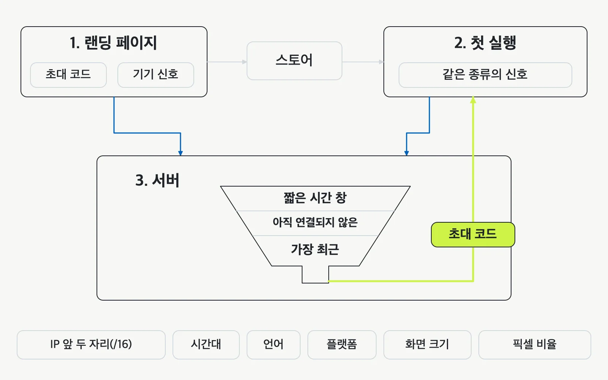
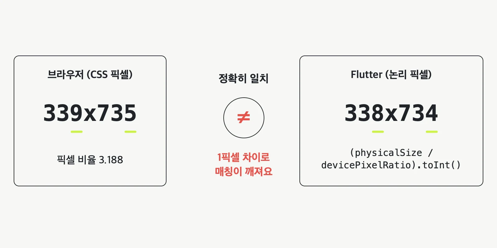
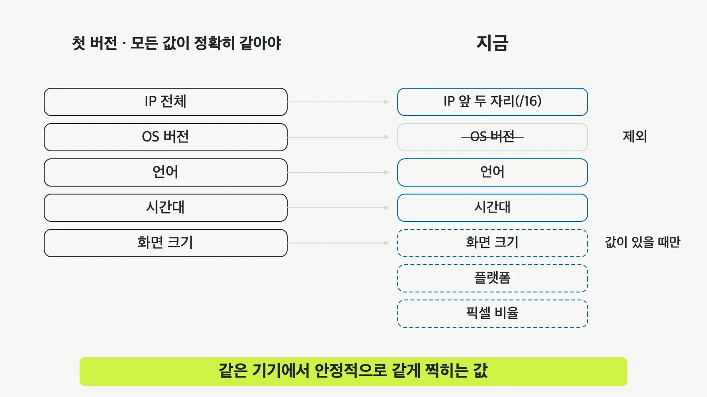

## 들어가며: 링크를 눌렀는데 앱이 없을 때

저는 Flutter 로 웰니스 앱을 만들고, 서버(Django·FastAPI)까지 맡고 있어요.

올해 4월에 친구 초대 기능을 만들었어요. 친구에게 링크를 보내고, 친구가 그 링크로 앱을 깔고 가입하면 **두 사람 모두에게 보상을 주는** 기능이에요. 친구가 이미 앱을 깔아 뒀다면 쉬워요. 링크가 앱을 바로 열고, 링크에 붙은 초대 코드를 앱이 읽으면 돼요. 어려운 건 **친구에게 앱이 없을 때**예요. 링크는 스토어로 가고, 설치가 끝나고 앱을 처음 열 때는 그 링크가 어디에도 남아 있지 않아요.

설치를 거친 뒤에도 링크의 정보를 이어 주는 것을 **디퍼드 딥링크**(deferred deep link)라고 해요. 보통은 Branch 나 AppsFlyer 같은 어트리뷰션 SDK 가 이 일을 해 줘요. 저희는 이 매칭을 **SDK 에 맡기지 않고 서버에서 직접** 했어요. Android 는 Google Play 가 주는 Install Referrer API 를 쓰고, iOS 는 랜딩 페이지와 앱 첫 실행에서 모은 기기 정보를 서버가 맞춰 봐요.

이 글은 그 결정의 기록이에요. 어떤 기준으로 골랐는지, 처음 매칭 조건이 왜 틀렸는지, 직접 만든 대가로 무엇을 떠안았는지까지 적었어요. 이런 분께 참고가 될 거예요.

- 초대·추천 보상을 붙이려는데 디퍼드 딥링크를 어떻게 할지 정해야 하는 분
- Android 와 iOS 에서 설치 경로를 알아내는 방법이 왜 다른지 궁금한 분
- 어트리뷰션 SDK 가 이미 앱에 있는데, 보상 판정까지 맡겨도 되는지 고민하는 분

> iOS 매칭에 쓰는 신호의 종류는 적었지만, **세부 기준값과 어뷰징 방지 규칙은 일부러 빼었어요.** 공개하면 그대로 우회할 수 있어서요.

## 설치 한 번에 초대 코드가 사라진다

먼저 앱이 이미 깔려 있는 경우와 아닌 경우를 나란히 놓아 볼게요.

| 상황 | 링크를 누르면 | 초대 코드는 |
|---|---|---|
| 앱이 깔려 있음 | 링크가 앱을 바로 연다 | 링크 주소에 있으니 앱이 읽으면 끝 |
| 앱이 없음 | 랜딩 페이지 → 스토어 → 설치 → 첫 실행 | **스토어를 지나면서 끊긴다** |


<figure>
	
	<figcaption>앱이 없으면 초대 코드가 스토어를 지나면서 끊겨요.</figcaption>
</figure>

두 번째 줄의 문제는 **스토어가 링크를 앱까지 들고 가 주지 않는다**는 거예요. 앱이 처음 열렸을 때 "이 설치는 누구의 초대 링크에서 시작됐나?"를 앱 혼자서는 알 수 없어요. 누군가 설치 전과 설치 후를 이어 붙여 줘야 해요.

처음에는 이 문제를 "링크를 앱까지 이어 주는 문제"로 봤어요. 그런데 이 기능에는 보상이 걸려 있어요. 잘못 이어 붙이면 **초대하지 않은 사람에게 보상이 나가요.** 그래서 문제를 다시 정의했어요.

**저희가 풀어야 했던 건 링크를 앱까지 전달하는 게 아니라, 보상을 누구에게 줄지 서버가 판정할 근거를 만드는 것이었어요.**

이 문장이 아래의 기준과 선택을 모두 끌고 가요.

## 기준은 세 가지였어요

1. **보상 판정은 우리 DB 안에서 끝나야 한다.** 누가 누구를 초대했는지, 보상을 이미 줬는지를 한 테이블에서 보고, 한 번만 줘야 해요.
2. **플랫폼마다 가장 확실한 신호를 쓴다.** 두 플랫폼에 같은 방법을 억지로 맞추지 않아요.
3. **애매하면 주지 않는 쪽이 낫다.** 초대를 놓치는 건(미매칭) 아쉽지만, 남의 초대로 잘못 붙이는 건(오매칭) 보상이 엉뚱한 곳으로 나가는 사고예요.

목표가 아닌 것도 있었어요. 광고 성과 측정이나 유입 채널 분석은 이 기능의 목표가 아니었어요. 그 일은 앱에 이미 들어와 있던 어트리뷰션 SDK 가 하고 있었어요. 이 얘기는 뒤에서 다시 할게요.

## 1. Android: Play 가 코드를 대신 들고 와 준다

Android 에는 이 문제의 정답에 가까운 공식 API 가 있어요. **Play Install Referrer API** 예요. Play 스토어 주소에 `referrer` 파라미터를 붙여 두면, 그 주소로 설치된 앱이 첫 실행 때 Play 에 물어서 그 값을 그대로 돌려받아요. 추측이 아니라 **Play 가 설치와 링크를 직접 이어 준 값**이라서, 1번 기준(서버 판정)과 2번 기준(가장 확실한 신호)을 둘 다 만족해요.

앱에서는 Flutter 플러그인 `play_install_referrer` 로 값을 읽고, 쿼리 문자열에서 초대 코드를 꺼내요.

```dart
Future<String?> _resolveReferrerFromPlayStore() async {
  try {
    final details = await PlayInstallReferrer.installReferrer;
    return parseReferrerReferralCode(details.installReferrer); // "ref_code=AB12..." 에서 코드만
  } catch (e, stackTrace) {
    // Play 미지원 기기·사이드로드 빌드에서는 실패가 정상이다
    _logger.nonFatalError('Failed to get install referrer: $e', stackTrace);
    return null;
  }
}
```

여기서 볼 건 **실패를 정상 경로로 다룬다**는 점이에요. Play 서비스가 없는 기기나 스토어를 거치지 않은 설치에서는 값이 없어요. 이때는 조용히 `null` 을 돌려주고, 초대 없이 가입한 것으로 처리해요.

## 2. iOS: 랜딩과 첫 실행의 기기 신호를 맞춘다

iOS 에는 Install Referrer 같은 API 가 없어요. App Store 는 설치를 일으킨 링크 정보를 앱에 넘겨주지 않아요. 그래서 iOS 에서는 **설치 전과 설치 후에 각각 같은 기기 정보를 모아서, 서버가 둘을 맞춰 보는** 방법을 골랐어요.

흐름은 이래요.

1. 친구가 초대 링크를 누르면 **랜딩 페이지**가 열려요. 페이지의 스크립트가 초대 코드와 함께 기기 신호를 서버에 저장하고, 스토어로 보내요.
2. 친구가 앱을 깔고 **처음 열면**, 앱이 같은 종류의 신호를 서버에 보내요.
3. 서버는 **짧은 시간 창 안에서, 아직 아무에게도 연결되지 않은** 랜딩 신호 중 조건이 모두 맞는 가장 최근 것을 찾아 초대 코드를 돌려줘요.


<figure>
	
	<figcaption>iOS 에서는 설치 전 랜딩과 설치 후 첫 실행의 기기 신호를 서버가 맞춰 봐요.</figcaption>
</figure>

신호는 IP 의 앞 두 자리(/16), 시간대, 언어, 기종(플랫폼), 화면 크기, 픽셀 비율이에요. 랜딩 페이지에서는 브라우저 값으로 모아요.

```js
const signals = {
  referral_code: "{{ referral_code|escapejs }}",
  language: navigator.language,                                // "ko-KR"
  timezone: Intl.DateTimeFormat().resolvedOptions().timeZone,  // "Asia/Seoul"
  screen: `${screen.width}x${screen.height}`,                  // "390x844"
  pixel_ratio: String(window.devicePixelRatio || ""),          // "3"
};
```

IP 는 페이지가 보내지 않아요. 서버가 요청에서 직접 읽어요. 앱 쪽도 언어·시간대·플랫폼은 모든 요청에 붙는 헤더로 이미 보내고 있어서, 화면 크기와 픽셀 비율만 따로 실어요.

서버의 매칭은 가중치를 매기는 점수제가 아니에요. **조건을 모두 만족하는 행만 남기는 필터**예요. 구조만 줄여서 보면 이래요.

```python
query = Q(ip__startswith=ip_prefix)                       # IP 앞 두 자리
query &= Q(created_at__gte=now - MATCH_WINDOW)            # 짧은 시간 창
query &= Q(timezone=timezone_value)
query &= language_matches(normalize_language(language))   # 'ko' 와 'ko-KR' 은 같게
if platform:     query &= Q(os__iexact=platform)
if screen:       query &= Q(screen=screen)
if pixel_ratio:  query &= Q(pixel_ratio=normalize_pixel_ratio(pixel_ratio))

event = await Referral.objects.filter(query, invitee__isnull=True).order_by('-created_at').afirst()
```

여기서 볼 건 세 가지예요. 비교 전에 **값을 정규화**해요(`ko-KR` → `ko`, `3` → `3.000`). **값이 없는 신호는 조건에서 빠져요.** 그리고 이미 다른 회원에게 연결된 신호(`invitee__isnull=True` 가 아닌 것)는 다시 쓰지 않아요.

받은 코드는 앱이 기기에 잠깐 들고 있다가, **가입 요청에 실어 보내요.** 서버는 그 요청이 **새로 만들어진 회원일 때만** 초대 관계를 연결해요. 기존 회원이 다시 로그인하면서 코드를 보내도 아무 일도 일어나지 않아요.

## 처음 매칭 조건은 너무 엄격했다

솔직히 처음에는 "다 똑같아야 같은 사람"이라고 생각했어요. 첫 버전의 매칭 조건은 이랬어요.

```python
# 첫 버전: 모든 값이 정확히 같아야 매칭
Referral.objects.filter(
    ip=ip,                  # IP 전체
    os_version=os_version,
    language=language,
    timezone=timezone_value,
    screen=screen,
    created_at__gte=now - MATCH_WINDOW,
    invitee__isnull=True,
)
```

이 조건은 첫 PR 을 머지한 날 밤에 하나씩 풀렸어요. 두 시간 남짓한 사이에 커밋 네 개가 이어졌어요 [확인 필요: 조건을 푼 계기가 실기기 테스트였는지].

| 커밋 | 바뀐 것 |
|---|---|
| 1 | 언어를 요청 헤더(`Accept-Language`)에서 읽도록 수정 |
| 2 | **화면 크기를 매칭에서 제외** |
| 3 | **OS 버전을 매칭에서 제외** |
| 4 | **IP 를 전체 일치에서 앞 두 자리(/16) 일치로 완화** |

이 표에서 볼 건, 엄격하게 시작한 조건이 **"같은 기기인데 값이 다르게 찍히는" 경우**에 하나씩 무너졌다는 점이에요. 하나씩 이유를 보면 이래요.

**OS 버전**은 랜딩 페이지 쪽 값을 믿을 수 없었어요. 랜딩은 브라우저의 User-Agent 문자열에서 OS 버전을 꺼내는데, 서버 코드에는 "Safari 가 UA 의 OS 버전을 고정해서 보낸다"는 이유가 남아 있어요. 실제로 Apple 의 Safari 26.0 릴리스 노트에는 **iOS 26·iPadOS 26 의 Safari 가 UA 에 iOS 26 이전의 마지막 버전을 고정해서 적는다**고 나와 있어요. 랜딩에서 읽은 OS 버전이 기기의 실제 버전과 다를 수 있다는 뜻이에요. 그래서 OS 버전은 지금도 매칭에 쓰지 않아요.

**IP** 는 랜딩을 연 순간과 앱을 처음 연 순간이 끝자리까지 같다는 보장이 없어요. 사이에 스토어에서 내려받는 시간이 끼고, 그사이 모바일 네트워크의 주소가 바뀌거나 Wi-Fi 로 넘어갈 수 있어요. 그래서 앞 두 자리만 보기로 했어요. 대신 **변별력이 크게 떨어져요.** 같은 통신사 사용자들이 같은 앞자리를 나눠 쓰기 때문이에요.

**화면 크기**는 처음에 뺐다가, 6월에 **값이 있을 때만 쓰는 선택 조건**으로 다시 넣었어요. 이때 픽셀 비율도 함께 추가했어요. IP 를 넓힌 만큼 다른 신호로 변별력을 되찾아야 했거든요. 서버 코드의 주석은 픽셀 비율을 넣은 이유를 "같은 공유기 공인 IP 충돌을 기기 모델 단위로 변별"이라고 적고 있어요.

화면 크기가 왜 처음에 문제였는지는 나중에 QR 기능을 만들며 실제 데이터로 확인했어요. 어느 Android 기기의 랜딩 신호는 `339x735`, 픽셀 비율 `3.188` 이었어요. 같은 기기에서 Flutter 가 계산한 화면 크기는 `(physicalSize / devicePixelRatio).toInt()` 라서 **너비가 338 로 잘리고, 높이도 734 로 어긋났어요.** 브라우저의 CSS 픽셀과 Flutter 의 논리 픽셀은 같은 단위처럼 보여도 반올림이 달라요. 서버가 화면 크기를 정확히 일치로 비교하니 **1픽셀 차이로 매칭이 깨지는** 거예요. iPhone 은 픽셀 비율이 2나 3 같은 정수라 이 어긋남이 덜하지만, 소수 비율을 쓰는 Android 기기에서는 그대로 드러나요. 그래서 QR 쪽 앱 요청에는 화면 크기를 아예 보내지 않고 픽셀 비율만 보내기로 했어요.


<figure>
	
	<figcaption>브라우저와 Flutter 의 반올림 차이 때문에 같은 기기에서도 화면 크기가 1픽셀 어긋났어요.</figcaption>
</figure>

정리하면 첫 가정은 반만 맞았어요. **같은 사람인지는 "모든 값이 같은가"가 아니라 "같은 기기에서 안정적으로 같게 찍히는 값이 같은가"로 봐야 했어요.**


<figure>
	
	<figcaption>매칭 조건은 같은 기기에서 안정적으로 같게 찍히는 값 위주로 바뀌었어요.</figcaption>
</figure>

## SDK 는 이미 앱에 있었다

여기까지 읽으면 이런 의문이 들 수 있을 것 같아요. "어트리뷰션 SDK 를 쓰면 이걸 다 안 해도 되지 않나?"

사실 앱에는 **AppsFlyer SDK 가 초대 기능보다 먼저 들어와 있었어요.** 3월에 설치·이벤트 집계용으로 넣었고, 초대 기능은 4월에 나왔어요. 그러니 "SDK 를 새로 넣을지"가 아니라 **"이미 있는 SDK 에 보상 판정까지 맡길지"**가 실제 질문이었어요.

SDK 의 강점은 분명해요. 플랫폼별 설치 경로 처리를 SDK 가 맡아 주고, 링크 관리 화면과 캠페인 단위 집계까지 따라와요. 직접 만들면 이 중 아무것도 공짜로 오지 않아요.

그래도 매칭을 서버에 둔 건, 1번 기준 때문이에요. 보상은 **"이 회원이 이 초대 행에 연결돼 있고, 아직 보상을 안 받았는가"**를 우리 DB 에서 판정해야 해요. 지급은 조건부 업데이트 한 줄로 선점해요.

```python
async def mark_inviter_rewarded_if_unrewarded(self, referral_id: int) -> bool:
    affected_rows = await touch_update(
        Referral.objects.filter(id=referral_id, inviter_rewarded_at__isnull=True),
        inviter_rewarded_at=timezone.now(),
    )
    return affected_rows > 0   # 먼저 선점한 요청만 보상을 준다
```

초대 관계가 이 테이블의 한 행이고, 그 행이 랜딩 신호에서 시작해요. 매칭을 SDK 가 하면 앱이 SDK 에서 받은 값을 서버로 다시 보내야 하고, 서버는 **앱이 보낸 값을 믿고** 행을 만들어야 해요. 매칭을 서버가 하면 신호 저장부터 연결, 지급까지 **한 테이블 안에서** 끝나요.

다만 이건 제가 지금 코드에서 읽어 낸 기준이에요. 당시 SDK 의 디퍼드 딥링크 기능을 비용이나 계약 조건까지 놓고 비교한 기록은 남아 있지 않아요 [확인 필요: 4월 결정 당시 SDK 디퍼드 딥링크(OneLink 등)를 검토했는지, 비용·플랜 제약이 있었는지]. **같은 조건으로 두 방식을 나란히 돌려 본 비교도 아니에요.**

## 같은 구조를 QR 보상에 다시 쓰다

6월에는 오프라인 행사용 QR 보상을 만들었어요. QR 을 찍으면 보상을 주는데, 앱이 없는 사람도 설치 후 받을 수 있어야 했어요. **문제의 모양이 초대와 똑같았어요.** 랜딩에서 코드와 신호를 저장하고, 앱 첫 실행 때 맞춰 보면 돼요.

그래서 매칭 조건을 **공용 함수 하나로 빼고**, 초대와 QR 이 같은 함수를 쓰게 했어요. 신호를 저장하는 테이블은 QR 전용으로 따로 두었어요.

재사용하면서 초대 때는 드러나지 않던 약점이 보였어요.

첫째, **QR 은 처음에 Android 에서도 기기 신호 매칭만 썼어요.** 초대 기능은 Android 에서 Install Referrer 를 쓰는데, QR 은 플랫폼 구분 없이 신호 매칭 한 경로뿐이었어요. 8월에 Android QR 도 Install Referrer 를 **먼저** 보고, 값이 없을 때만 신호 매칭으로 넘어가게 고쳤어요.

둘째, **행사장은 신호 매칭에 가장 불리한 곳이에요.** 한 장소에서 여러 사람이 비슷한 시각에 같은 네트워크로 QR 을 찍어요. IP 앞자리, 시간대, 언어가 전부 같아요. 남는 변별력은 기종과 화면뿐인데, QR 요청에서는 그마저 앱이 보내지 않고 있었어요. 8월 수정 때 픽셀 비율을 앱 요청에 추가했어요.

## 직접 만들어서 떠안은 것들

이 방식이 잘 돌아간다고만 쓰면 반쪽짜리 글이에요. 직접 만든 대가로 떠안은 것을 적어 둘게요.

**오매칭과 미매칭 사이의 줄다리기.** 조건을 풀면 오매칭이, 조이면 미매칭이 늘어요. 6월에 "조건을 만족하는 초대자가 둘 이상이면 아예 연결하지 않는" 규칙을 넣은 적이 있어요. 3번 기준(애매하면 주지 않는다)을 그대로 코드로 옮긴 거예요. 이 규칙은 다음 날 되돌려졌고, 지금 서버는 **가장 최근 신호를 고르는** 방식이에요 [확인 필요: 되돌린 이유]. 앱은 그때 만든 "애매함" 응답 처리를 아직 갖고 있어서, 서버가 다시 그 응답을 주면 코드를 버리게 돼 있어요.

**iOS 는 결국 확률이에요.** 신호를 아무리 다듬어도 iOS 매칭은 추정이에요. 그래서 나중에 외부 추천 프로그램을 붙일 때는 **가입 중에 추천 코드를 직접 입력하는 화면**을 따로 만들었어요. 매칭이 실패해도 사용자가 메울 수 있는 수동 경로예요. 같은 작업에서, SDK 가 링크 클릭으로 확정해 주는 값이 있으면 **신호 매칭 결과보다 그 값을 우선**하기로 했어요.

**플러그인 버그도 내 몫이에요.** `play_install_referrer` 0.5.0 플러그인에는 결과를 **영원히 돌려주지 않는 분기**가 있었어요. 연결 시작에 타임아웃이 없고, 재시도 실패나 값이 둘 다 비는 경우에도 응답이 오지 않아요. 앱은 첫 실행 스플래시에서 이 값을 기다리고 있어서, **신규 설치 사용자가 스플래시에서 못 빠져나가는** 일이 생겼어요. `try/catch` 로는 멈춤을 잡을 수 없어서 타임아웃을 걸었어요.

```dart
// 플러그인이 응답하지 않는 경우가 있어 try/catch 로는 못 잡는다. 타임아웃이 유일한 방어다.
await _profileUseCase.fetchAndStoreReferralCode().timeout(const Duration(seconds: 5));
```

**같은 길을 지나는 다른 도구와 부딪혀요.** 10월에 광고 집계를 바로잡으려고, 모든 랜딩의 스토어 이동을 AppsFlyer 의 OneLink 를 거치게 바꿨어요. 스토어로 바로 보내면 SDK 가 이 설치를 광고 유입이 아닌 자연 유입으로 집계했거든요. 그런데 **OneLink 는 Play 의 `referrer` 값을 다시 써요.** 직접 확인해 보니 저희가 붙인 `ref_code=` 같은 임의 키는 사라지고, AppsFlyer 표준 키(`deep_link_value`, `deep_link_sub1` 등)만 남았어요.

| OneLink 에 붙인 값 | Play `referrer` 에 남은 값 |
|---|---|
| `ref_code=abc` | 사라짐 |
| `referrer=...` 직접 지정 | AppsFlyer 값으로 덮어씀 |
| `deep_link_value`, `deep_link_sub1` | 그대로 남음 |

그래서 서버는 코드를 표준 키에 싣고, 앱은 **기존 키를 먼저 보고 없으면 표준 키를 읽도록** 바꿨어요. 서버가 먼저 바뀌면 그사이 설치한 Android 사용자가 코드를 잃기 때문에, **앱이 스토어에 다 퍼진 뒤에 서버를 배포**하는 순서를 지켰어요. 매칭을 직접 소유해도, 링크가 지나는 길은 다른 도구와 나눠 쓰고 있었던 거예요.

**개인정보.** 이 방식은 랜딩을 연 사람의 IP, 언어, 시간대, 화면 정보를 서버에 저장해요. 회원이 되기 전의 사람이에요. 무엇을 얼마나 오래 보관하는지 정해 두어야 하고 [확인 필요: 랜딩 신호 보관 기간·삭제 정책], Apple 은 개발자 문서 User Privacy and Data Use 에서 **기기를 고유하게 식별할 목적으로 기기에서 데이터를 끌어내는 것(fingerprinting)을 금지**하고, 그 예로 브라우저 속성, 기기 설정, 네트워크 연결을 들어요 [확인 필요: 자사 랜딩→자사 앱 매칭이 이 조항에 해당하는지 검토 결과]. SDK 를 써도 이 질문은 사라지지 않지만, **직접 만들면 답할 사람이 저희뿐이에요.**

## 이 방식을 쓰지 않을 때

모든 디퍼드 딥링크를 직접 만들 필요는 없어요. 제 기준으로는 이렇게 갈라요.

- **링크 뒤에 보상이나 돈이 걸려 있지 않다면** SDK 에 맡기세요. 공유한 글로 바로 데려가는 정도라면, 가끔 틀려도 사고가 아니에요.
- **판정 근거를 서버가 가져야 하는가?** "누구에게 무엇을 한 번만 준다"를 서버가 결정해야 한다면 매칭도 서버에 두는 편이 단순해요.
- **iOS 오매칭을 감당할 수 있는가?** 감당할 수 없다면 신호 매칭만으로 끝내지 말고, 코드 입력 같은 수동 경로를 처음부터 같이 설계하세요.

## 마치며

처음에 저는 디퍼드 딥링크를 "링크를 앱까지 이어 주는 기술"로 봤어요. 만들고 나서 보니 이건 **"보상을 누구에게 줄지 판정하는 근거"를 모으는 일**이었어요. 그렇게 보니 Android 는 Play 가 근거를 대신 들고 와 주고, iOS 는 근거를 저희가 추정해야 한다는 차이가 선명해졌어요.

가장 크게 배운 건 이거예요.

**직접 만든다는 건 기능을 소유하는 게 아니라, 그 기능이 지나는 길의 모든 실패를 소유하는 것입니다.**

매칭 로직은 몇십 줄이었어요. 시간이 든 건 그 주변이었어요. 브라우저와 Flutter 의 1픽셀 차이, 응답하지 않는 플러그인, 링크를 다시 쓰는 다른 도구 같은 것들이요.

디퍼드 딥링크를 고민 중이라면 세 가지를 먼저 물어보세요.

1. **이 링크가 틀리면 무엇이 잘못 나가나요?** 아무것도 아니라면 SDK 로 충분해요.
2. **같은 기기에서 설치 전과 후에 똑같이 찍히는 값은 무엇인가요?** 랜딩과 앱에서 같은 기기로 값을 직접 찍어 비교해 보세요.
3. **스토어로 가는 길에 다른 도구가 끼어 있나요?** 있다면 그 도구가 `referrer` 를 건드리는지 실제 요청으로 확인해 보세요.

## 참고 자료

- Android Developers, [Play Install Referrer Library](https://developer.android.com/google/play/installreferrer/library) (2026-11-19 확인)
- pub.dev, [`play_install_referrer`](https://pub.dev/packages/play_install_referrer) — 이 글의 기준 버전 0.5.0
- AppsFlyer, [Unified Deep Linking (UDL)](https://dev.appsflyer.com/hc/docs/unifieddeeplink) — `deep_link_value`, `deep_link_sub1`~`deep_link_sub10` 파라미터 (2026-11-19 확인)
- Apple Developer, [User Privacy and Data Use](https://developer.apple.com/app-store/user-privacy-and-data-use/) — "Can I fingerprint or use signals from the device to try to identify the device or a user?" 항목 (2026-11-19 확인)
- Apple Developer, [Safari 26.0 Release Notes](https://developer.apple.com/documentation/safari-release-notes/safari-26-release-notes) — UA 의 OS 버전 고정 항목 (2026-11-19 확인)
