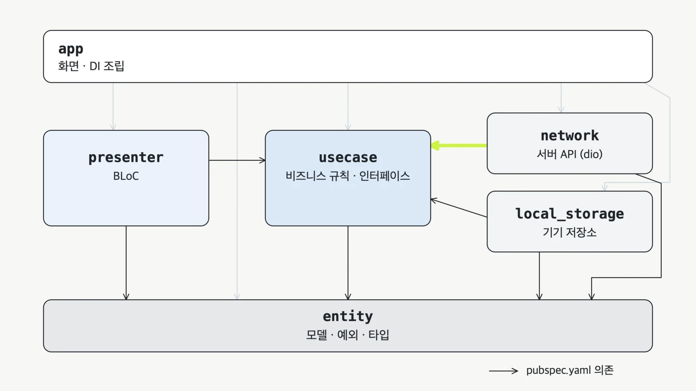
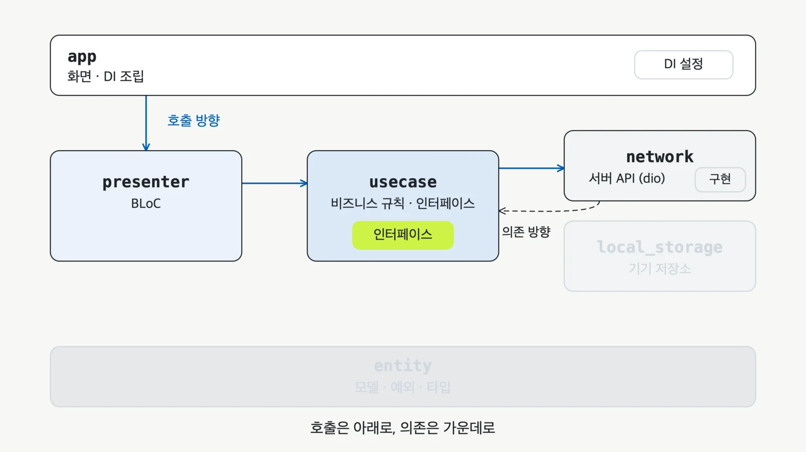

## 들어가며: 설정 화면 하나에 파일 28개가 바뀌었다

저는 Flutter 로 웰니스 앱을 만들고, 서버(Django·FastAPI)도 함께 맡고 있어요. 이번 달에 **"이메일 수신 설정"** 화면을 하나 만들었어요. 토글 몇 개로 마케팅 메일 수신 여부와 주제별 수신 여부를 바꾸는 화면이에요. 서버 API 는 조회 하나, 변경 하나였어요.

그런데 머지된 커밋을 보니 **파일 28개가 바뀌어 있었어요.** 패키지 다섯 곳에 걸쳐서요.

| 패키지 | 바뀐 파일 | 무엇을 |
|---|---|---|
| `app` | 8 | 화면, 라우트, 화면용 값 객체, DI 등록, 위젯 테스트 |
| `entity` | 7 | 모델 2개, 타입 1개, barrel, 모델 테스트 |
| `presenter` | 7 | BLoC·이벤트·상태·사이드 이펙트, barrel, BLoC 테스트 |
| `usecase` | 4 | UseCase, 데이터 소스 인터페이스, barrel |
| `network` | 2 | 데이터 소스 구현, barrel |

이 표에서 볼 건 두 가지예요. **화면 하나가 사실상 모든 계층을 한 번씩 지나가요.** 그리고 28개 중 4개는 **barrel 파일**(패키지가 밖으로 무엇을 보여 줄지 모아 둔 `export` 목록)이고, 1개는 **DI 등록**이에요. 기능과 상관없이 구조 때문에 생기는 파일이에요.

이걸 보고 처음으로 이런 질문을 했어요. **"우리는 왜 패키지를 6개로 나눴지?"**

솔직히 답을 몰랐어요. 이 구조는 제가 정한 게 아니라 프로젝트 첫날 이미 있었거든요. 그래서 이 글은 두 가지를 구분해서 써요. **git 이력과 문서에서 확인한 사실**, 그리고 **지금 구조에서 거꾸로 읽히는 이유**예요. 최초 결정의 이유는 어디에도 적혀 있지 않았어요.

이 글은 「Flutter 앱을 6개 패키지로 나눈 이유」 시리즈의 첫 편이에요. 이런 분께 도움이 될 거예요.

- Flutter 앱을 여러 패키지로 나눌지 고민 중인 분
- 이미 나눴는데, 기능 하나에 손대는 파일이 너무 많다고 느끼는 분
- Melos·Dart pub workspace 를 쓰는데 패키지 경계가 실제로 무엇으로 지켜지는지 궁금한 분

## 지도부터: 6개 패키지와 각자의 금지 목록

먼저 지금 모습이에요. 숫자는 이 글을 쓰는 날(2026년 11월 18일) main 기준이고, 줄 수는 **생성 코드를 뺀** `lib/` 의 줄 수예요.

| 패키지 | 맡는 일 | 넣으면 안 되는 것 | `lib/` 파일 | `lib/` 줄 수 | 테스트 파일 |
|---|---|---|---|---|---|
| `app` | 화면(Page·Widget), 라우팅, 테마, 화면용 값 객체(VO), DI 조립 | **BLoC·모델·예외** | 2,441 | 324,246 | 906 |
| `presenter` | BLoC (이 프로젝트에서는 ViewModel 역할) | **데이터 소스** | 585 | 68,701 | 325 |
| `usecase` | 비즈니스 규칙, 바깥 세계에 대한 **인터페이스** | `presenter`·`app` 참조 | 305 | 27,193 | 202 |
| `network` | 서버 API 호출(dio), 응답을 모델로 변환 | 상위 계층 참조 | 107 | 15,294 | 111 |
| `local_storage` | 기기 저장소(shared_preferences, 파일) | 상위 계층 참조 | 15 | 675 | 11 |
| `entity` | 모델, 예외, 타입 | **다른 패키지 참조 전부** | 1,015 | 46,504 | 246 |

`app` 의 파일 수에서는 생성 파일 39개(번역 37개, 에셋·폰트 2개)를 뺐어요. 생성 파일까지 세면 `app/lib` 은 120만 줄이 넘어요. 거의 전부 다국어 번역 코드예요.

여기서 볼 건 **"넣으면 안 되는 것" 열**이에요. 패키지마다 맡는 일보다 금지 목록이 더 분명해요. 예를 들어 `app` 에는 화면과 화면용 값 객체만 둬요. BLoC 이 필요하면 `presenter` 에, 모델이 필요하면 `entity` 에 만들어요. 이 금지 목록이 사실상 이 구조의 정의예요.

기능 단위로 세면 이래요.

| 무엇 | 개수 |
|---|---|
| 화면 파일(`*_page.dart`) | 203 |
| BLoC | 146 (Cubit 0) |
| UseCase | 116 |
| `usecase` 의 인터페이스 파일 | 112 |
| `network` 의 데이터 소스 구현 | 60 |
| 모델 파일 | 690 |

### 화살표는 호출 방향과 다르다

각 패키지가 `pubspec.yaml` 에 적은 의존을 그대로 옮기면 이래요.

```text
app ──────────► presenter, usecase, network, local_storage, entity
presenter ────► usecase, entity
network ──────► usecase, entity
local_storage ► usecase, entity
usecase ──────► entity
entity ───────► (없음)
```


<figure>
	
	<figcaption>pubspec.yaml 의 의존을 그대로 그리면, network 가 usecase 를 향하고 있어요.</figcaption>
</figure>

처음 보면 이상한 점이 있어요. 데이터는 `presenter → usecase → network` 순서로 흘러가는데, **`usecase` 는 `network` 를 모르고 오히려 `network` 가 `usecase` 를 알아요.**

이유는 인터페이스의 위치에 있어요. `usecase` 패키지 안에 "이메일 설정을 가져오는 무언가"라는 인터페이스가 있어요.

```dart
// usecase/lib/interface/repository/email_preference_data_source.dart
abstract interface class EmailPreferenceDataSource {
  Future<Result<EmailPreferenceModel>> getEmailPreference();
  Future<Result<EmailPreferenceModel>> putMarketingSubscribed(bool subscribed);
  // ...
}
```

`network` 는 이 인터페이스를 **구현**하려고 `usecase` 를 참조해요. `UseCase` 는 인터페이스만 보고 일하고, 실제 구현을 끼워 넣는 건 모든 패키지를 아는 `app` 의 DI 설정이에요. 호출은 아래로 흐르지만 의존은 가운데(`usecase`)를 향해요. 클린 아키텍처에서 말하는 의존성 역전이에요.

이 글에서는 두 방향을 이렇게 구분해서 부를게요.

- **호출 방향**: 런타임에 누가 누구를 부르나. `app → presenter → usecase → network`
- **의존 방향**: `pubspec.yaml` 에 누가 누구를 적었나. `network → usecase`


<figure>
	
	<figcaption>호출은 network 쪽으로 흐르지만, 의존은 인터페이스가 있는 usecase 를 향해요.</figcaption>
</figure>

이 구분이 시리즈 내내 필요해요. "app → presenter → usecase → network/local_storage" 같은 한 줄 요약은 호출 방향이에요. 의존 방향으로 읽으면 틀린 그림이 돼요.

## 처음부터 6개였다: 첫 커밋과 첫 주의 헛걸음

이 구조가 언제 생겼는지 git 이력을 거꾸로 따라갔어요.

**첫 커밋(2025년 10월 29일)에 이미 6개 패키지가 있었어요.** 동료가 만든 뼈대였고, 루트 패키지 이름은 `skeleton_workspace`, 설명은 "Root workspace for clean architecture Flutter project" 였어요. 그날 바로 `presentation` 이 `presenter` 로 이름이 바뀌었고, 루트 `pubspec.yaml` 에 `workspace:` 목록이 들어갔어요. 다음 날 `melos.yaml` 이 지워지고 Melos 스크립트가 루트 `pubspec.yaml` 로 옮겨졌어요.

그러니까 이 저장소는 **처음부터 Melos 7 + Dart pub workspace** 였어요. Melos 3 에서 7 로 옮긴 이력은 없어요. 지금 잠금 파일에 고정된 Melos 버전은 7.4.1 이에요.

왜 6개로 나눴는지 적은 문서는 찾지 못했어요. README 는 이 저장소를 "Clean Architecture 기반 멀티패키지 구조 템플릿"이라고만 소개해요. `[확인 필요: 최초에 6개 패키지로 나눈 이유와, 어떤 템플릿을 참고했는지]`

### 첫 주에 화살표가 한 번 거꾸로 섰다

이력에서 더 흥미로웠던 건 첫 주예요. 지금의 의존 방향은 첫 커밋과 같아요. 그런데 그 사이 일주일 동안 **화살표가 한 번 거꾸로 섰다가 돌아왔어요.**

계기는 로그인이었어요. 제가 로그인 BLoC 을 처음 만들면서, 이메일 로그인 실패를 잡으려고 `network` 패키지에 있던 예외 클래스를 `presenter` 에서 직접 `import` 했어요.

```dart
// presenter/lib/src/blocs/login/login_bloc.dart (당시)
import 'package:network/network.dart';
// ...
} on LogInWithEmailAndPasswordFailure catch (e) {
```

그러려면 `presenter` 의 `pubspec.yaml` 에 `network` 를 적어야 했어요. 며칠 뒤에는 반대로 `network` 와 `local_storage` 가 `presenter` 를 참조하는 줄도 들어갔어요. 이때 그린 의존성 그림(`melos list --mermaid` 로 만든 `docs/dependency.png`)에는 `network → presenter`, `local_storage → presenter` 화살표가 그대로 남아 있어요.

일주일 뒤 리뷰를 반영하면서 이 줄들을 지웠어요. 고친 방법은 **예외를 `entity` 로 옮기는 것**이었어요. `presenter` 는 이제 `network` 의 예외가 아니라 `entity` 의 `LogInFailedException` 을 잡아요. `[확인 필요: 당시 리뷰에서 어떤 근거로 되돌리자고 했는지]`

여기서 배운 건 하나예요. **의존 방향을 실제로 가른 건 "예외 클래스를 어디에 두나" 같은 사소한 결정**이었어요. 거창한 설계 원칙보다, 매일 쓰는 타입 하나가 어느 패키지에 사느냐가 화살표를 만들어요.

## 지금 구조에서 읽히는 이유 세 가지

최초 이유는 모르지만, 1년 동안 이 구조 위에 기능을 쌓으면서 **실제로 기대고 있는 성질**은 코드에서 읽혀요. 세 가지예요.

### 1. 바깥 세계는 전부 `usecase` 의 인터페이스 뒤에 있다

`usecase/lib/interface/` 에는 인터페이스 파일이 112개 있어요. 서버 API 데이터 소스뿐 아니라 기기 정보, 로컬 알림, 위치, 헤드폰 연결 감지, 워치 연결 같은 **플랫폼 기능까지** 여기에 인터페이스로 있어요. 구현은 `network`, `local_storage`, 또는 `app` 에 있어요.

그래서 `usecase` 테스트는 인터페이스에 가짜 구현을 끼워서 돌릴 수 있어요. 서버도 기기도 필요 없어요. `usecase` 테스트 파일 202개가 이 성질에 기대요.

### 2. 의존이 `pubspec.yaml` 에 한 줄로 드러난다

`presenter` 가 `network` 를 쓰려면 `pubspec.yaml` 에 한 줄을 더해야 해요. 첫 주의 헛걸음도 결국 이 한 줄이 리뷰에서 눈에 띄어 되돌릴 수 있었어요. 폴더로만 나눴다면 `import` 한 줄이 파일 수백 개 속에 묻혔을 거예요.

### 3. 테스트 위치가 계층을 따라간다

테스트도 패키지별로 나뉘어요. **"이 테스트는 무엇의 스펙인가"가 위치로 정해져요.**

| 위치 | 무엇의 스펙 |
|---|---|
| `entity/test/models` | 서버 JSON 필드 매핑 (`snake_case` → 모델) |
| `usecase/test/feat` | 비즈니스 규칙 |
| `presenter/test/blocs` | 이벤트에 따른 상태 전이 |
| `network/test/data_source` | 요청 경로·본문과 응답 변환 |
| `app/test/feat` | 화면이 상태를 어떻게 그리나 |

이메일 수신 설정도 그랬어요. 모델 테스트 58줄, BLoC 테스트 157줄, 화면 테스트 150줄이 각자 자기 패키지에 있어요. 무엇을 고치든 **어느 테스트를 먼저 읽어야 하는지**가 분명해요.

그렇다면 첫 번째로 기대했던 성질, "패키지로 나누면 경계를 컴파일러가 지켜 준다"는 어땠을까요?

## 가정이 깨진 곳: 경계는 컴파일러가 아니라 린트가 지킨다

이 글의 개요를 처음 잡을 때, "나눠서 얻은 것" 첫 줄에 **"경계가 컴파일러로 강제된다"** 고 적었어요. 패키지를 나누는 가장 흔한 이유이기도 해요. 확인해 보니 반만 맞았어요.

### 실험: 선언하지 않은 패키지를 import 하면

Dart pub workspace(Dart 3.6 부터)는 **워크스페이스 전체를 한 번에 해석해요.** 의존성 해석 결과인 `package_config.json` 이 루트에 하나만 생기고, 거기에 모든 워크스페이스 패키지가 들어가요. 저희 저장소에서는 이 파일 하나에 약 370개 패키지가 들어 있어요.

그렇다면 `pubspec.yaml` 에 적지 않은 형제 패키지를 `import` 하면 어떻게 될까요? 빈 워크스페이스를 만들어 확인했어요(Dart 3.13.3).

```yaml
# pubspec.yaml (루트)
name: ws
environment:
  sdk: ^3.13.0
workspace:
  - a
  - b
```

```dart
// a/bin/main.dart — a 의 pubspec.yaml 에는 b 가 없다
import 'package:b/b.dart';

void main() => print(hello());
```

```text
$ dart pub get
Got dependencies!
$ cd a && dart run bin/main.dart
from b
$ dart analyze
No issues found!
```

여기서 볼 건 **세 명령이 모두 성공했다**는 점이에요. 선언하지 않은 패키지가 그대로 컴파일되고 실행돼요. 기본 분석도 아무 말이 없어요. 이 글에서는 이렇게 `pubspec.yaml` 에 없는데 `import` 되는 의존을 **유령 의존**이라고 부를게요.

유령 의존을 잡는 건 린트 규칙 하나예요.

```text
$ dart analyze   # depend_on_referenced_packages 를 켠 뒤
  error - lib/a.dart:1:8 - The imported package 'b' isn't a dependency
          of the importing package. - depend_on_referenced_packages
```

### 저희 저장소에서는 누가 지키고 있었나

그래서 저희 설정을 확인했어요.

| 패키지 | 분석 설정 | `depend_on_referenced_packages` |
|---|---|---|
| `app`, `presenter`, `entity` | 루트 `analysis_options.yaml` 포함 | **error** |
| `usecase`, `network`, `local_storage` | `package:lints/recommended.yaml` | **info** (경고만, 분석은 성공) |

그리고 CI 워크플로에는 **`dart analyze` 단계가 없어요.** 빌드와 일부 테스트만 돌아요.

정리하면 저희 경계를 지키던 건 컴파일러가 아니었어요. **편집기와 AI 에이전트가 보여 주는 린트 경고, 그리고 리뷰**였어요. 다행히 지금 6개 패키지 사이의 `import` 를 전부 세어 보니, `pubspec.yaml` 에 없는 형제 패키지를 참조하는 곳은 없었어요. 하지만 그건 지켜진 결과지, 강제된 결과는 아니에요.


<figure>
	
	<figcaption>경계를 어긴 import 를 실제로 멈추는 건 컴파일러가 아니라 린트 경고와 리뷰였어요.</figcaption>
</figure>

### barrel 은 `src/` 에 둔 패키지만 지켜진다

"각 패키지는 barrel 로만 노출한다"는 규칙도 같은 식으로 확인했어요. 다른 패키지에서 오는 `import` 를 barrel 로 들어온 것과 내부 파일로 바로 들어온 것으로 나눠 셌어요.

| 방향 | barrel 로 | 내부 파일로 직접 |
|---|---|---|
| `app → presenter` | 546 | **0** |
| `app → entity` | 983 | 230 |
| `app → usecase` | 464 | **380** |
| `network → usecase` | 3 | 212 |

`presenter` 만 0 이에요. 이유는 폴더 배치에 있어요. `presenter` 는 파일 3개를 빼고 모든 코드를 `lib/src/` 아래에 둬요. 루트 설정의 `implementation_imports: error` 는 **다른 패키지의 `lib/src/` 를 직접 import 하는 것만** 막아요. `usecase` 는 코드를 `lib/feat/`, `lib/interface/`, `lib/utils/` 에 둬서 이 린트에 걸리지 않아요.

그러니까 barrel 규칙이 지켜지는 건 **규칙을 적어서가 아니라, 린트가 알아보는 폴더에 코드를 뒀기 때문**이에요.

### 선언은 했지만 새는 곳

`pubspec.yaml` 에 적힌 의존은 린트도 막지 않아요. 그런 곳이 세 군데 보였어요.

- **`usecase` 가 Flutter 플러그인을 안다.** 건강 데이터 플러그인(`health`)을 `usecase` 의 파일 10개가 직접 `import` 해요. 그래서 `usecase` 는 순수 Dart 패키지가 아니에요. 지금 Flutter 에 전혀 의존하지 않는 패키지는 `entity` 하나예요.
- **`presenter` 가 결제·영상 플러그인을 안다.** `in_app_purchase` 와 `video_player` 가 `presenter` 의존에 있어요.
- **화면이 `UseCase` 를 직접 부른다.** `app` 은 DI 조립 때문에 모든 패키지를 의존해요. 그래서 화면에서 `UseCase` 를 바로 꺼내 쓰는 것도 막히지 않아요. `app/lib/feat` 의 화면·위젯 파일 중 78개가 DI 컨테이너에서 `UseCase` 를 직접 꺼내요. 대부분은 BLoC 에 넘겨 주려는 것이지만, 위젯이 `UseCase` 의 네트워크 메서드를 바로 부르는 곳도 섞여 있어요.

마지막 것은 패키지 구조로는 막을 수 없어서, 소스를 훑는 **아키텍처 테스트**로 막고 있어요. 위젯이 `UseCase` 의 `Future` 반환 메서드를 직접 부르면 실패하는 테스트예요. 기존 위반 26곳은 허용 목록에 두고, 새로 생기는 것만 막아요. 이 이야기는 계층 경계를 다루는 2편에서 이어 갈게요.

## 치른 비용

이제 반대쪽이에요. 나눠서 얻은 것만큼 매일 내는 비용도 있어요.

### 1. 기능 하나가 여러 패키지를 지나간다

들어가며의 28개 파일은 예외가 아니었어요. 최근 6개월(2026년 5월 18일~11월 18일) 동안 main 에 들어간 `feat` 커밋 297개를, `lib/` 코드를 고친 패키지 수로 나눠 봤어요.

| 고친 패키지 수 | 커밋 수 |
|---|---|
| 0 (설정·문서·테스트만) | 16 |
| 1 | 73 |
| 2 | 55 |
| 3 | 51 |
| 4 | 38 |
| 5 | 59 |
| 6 | 5 |


<figure>
	
	<figcaption>기능 커밋의 절반 이상이 패키지 3개 이상을 지나갔어요.</figcaption>
</figure>

**기능 커밋의 절반 이상(153개, 52%)이 패키지 3개 이상을 고쳤어요.** 5개를 고친 커밋이 59개로, 3개나 4개보다 많아요. 화면 하나를 새로 만들면 `entity → usecase → network → presenter → app` 을 한 번씩 지나가는 게 기본이라서예요.

고칠 곳이 많은 것 자체보다 **잊기 쉬운 곳이 늘어나는 게** 비용이에요. barrel 에 `export` 한 줄, DI 등록 몇 줄, 인터페이스 하나가 기능마다 따라와요. 빠뜨리면 컴파일 에러로 바로 알 수 있는 것도 있지만, DI 등록 누락은 그 화면을 열어야 알 수 있어요.

barrel 도 커졌어요. `entity` 의 barrel 은 `export` 가 820줄, `presenter` 는 462줄, `usecase` 는 240줄이에요.

### 2. 새 체크아웃은 부트스트랩부터

새 작업 공간(git worktree 등)을 만들면 코드보다 먼저 의존성을 풀어야 해요. 저희는 이걸 스크립트 하나로 묶어 뒀어요.

```yaml
# 루트 pubspec.yaml 의 melos.scripts
setpj:
  run: |
    melos clean
    flutter pub get
    melos bootstrap
```

이걸 잊으면 실패 모양이 헷갈려요. `.dart_tool/package_config.json` 이 없는 상태에서 분석을 돌리면, **방금 고친 코드뿐 아니라 멀쩡한 기존 심볼까지** "isn't defined" 로 무더기로 나와요. 코드가 맞는데 에러가 쏟아지면 먼저 의존성 해석을 의심해야 해요.

### 3. 툴체인 버전이 여러 곳에서 맞아야 한다

Flutter 버전은 `.fvmrc`(지금 3.47.4)로 고정해요. 그런데 Melos 는 전역으로 설치하는 Dart 실행 파일이라, **Melos 를 컴파일한 Dart 버전과 실행하는 Dart 버전이 다르면 죽어요.** CI 설정에 이런 주석이 남아 있어요.

```yaml
# `fvm exec` 로 실행해야 한다 — bare `melos` 는 runner PATH 의 전역 dart(옛 stable 3.9.2)로 돌아
# fvm(.fvmrc 3.47.4/Dart 3.13) 로 컴파일된 melos kernel 을 못 읽고 "Invalid kernel binary format version" 으로 실패한다.
fvm exec melos bootstrap
```

로컬도 같아요. Flutter 를 올리면 `.fvmrc`, fvm 기본 버전, 전역 Melos 를 함께 올려야 해요. 하나만 올리면 로컬 셸이나 CI 중 한쪽이 깨져요.

### 4. 버전은 한 곳에서 풀리지만, 선언은 여러 곳에 적힌다

외부 패키지는 6개 `pubspec.yaml` 에 합쳐서 96종이 적혀 있어요. 그중 **15종은 두 패키지 이상에 중복으로** 적혀 있어요. 같은 패키지의 제약을 다르게 적은 곳도 있어요. `equatable` 은 `^2.0.5`(3곳)와 `^2.0.7`(2곳)으로, `health` 는 `^13.3.1` 과 `^13.2.1` 로 적혀 있어요.

다행히 workspace 는 **잠금 파일 하나**(`pubspec.lock`, 366개 패키지)로 해석해서, 실제로는 한 버전만 쓰여요. 패키지마다 다른 버전이 깔리는 일은 없어요. 대신 제약을 올릴 때 여러 파일을 같이 고쳐야 하고, 하나를 빠뜨려도 아무 신호가 없어요.

### 5. 코드 생성은 생각보다 적었다

`melos run build_runner <패키지>` 처럼 패키지별로 코드 생성을 돌리는 스크립트가 있어요. 문서에도 "DI 는 get_it + injectable", "모델은 json_serializable" 이라고 적혀 있고요. 그래서 패키지마다 생성 코드를 관리하는 비용이 클 거라고 생각했어요.

세어 보니 달랐어요.

- 저장소에 `*.g.dart` 파일이 **하나도 없어요.**
- 모델의 `fromJson` 은 **손으로** 써요(모델 파일 690개). `json_serializable` 은 의존 목록에만 있어요.
- DI 는 injectable 어노테이션 없이 **손으로** 등록해요. 등록 코드가 두 파일 1,931줄, 등록 호출이 265곳이에요.
- 생성 코드는 `app` 에만 있어요. 에셋·폰트 접근자 2개와 번역 37개예요.

문서와 의존 목록이 실제와 어긋나 있었던 거예요. 처음 의존성 그림(`docs/dependency.png`)도 첫 주의 거꾸로 선 화살표를 그린 채 1년째 그대로였어요. **구조를 설명하는 문서가 가장 먼저 낡았어요.** 문서가 낡는 문제는 [AI 에이전트에게 규칙을 읽히는 법](/posts/ai_agent_harness)에서 더 자세히 다뤘어요.

## 나누기 전에, 또는 나눈 뒤에 물어볼 것

숫자를 다 모으고 나니, "6개가 맞나"보다 **"각 경계를 무엇이 지키고 있나"** 가 더 중요한 질문이었어요. 패키지를 나누거나 이미 나눈 구조를 점검할 때 이렇게 물어보면 판별할 수 있어요.

1. **이 경계를 어긴 `import` 를 넣으면, 무엇이 실패하나?** 컴파일러인가, error 린트인가, info 린트인가, 아무것도 아닌가. workspace 라면 컴파일러는 답이 아니에요.
2. **그 린트를 CI 가 돌리나?** 편집기에서만 보이는 경고는 AI 에이전트나 급한 커밋이 지나칠 수 있어요.
3. **내부 파일 직접 import 를 막고 싶다면, 코드가 `lib/src/` 아래에 있나?** 아니라면 `implementation_imports` 는 아무것도 막지 않아요.
4. **새 기능 하나가 평균 몇 개 패키지를 지나가나?** 대부분 커밋이 모든 패키지를 지난다면, 그 경계가 실제로 독립적으로 바뀌는 단위인지 다시 볼 만해요.

마지막 질문은 저희에게도 숙제예요. `local_storage` 는 `lib/` 이 675줄이에요. 이 정도면 독립 패키지로 둘 이유가 무엇인지 따져 볼 만해요. `[확인 필요: local_storage 를 별도 패키지로 둔 이유]`

## 마치며: 지도는 화살표보다 린트 설정에 있었다

처음 질문은 "왜 6개로 나눴지?"였어요. 최초 이유는 결국 찾지 못했어요. 대신 다른 걸 알게 됐어요. **6개라는 숫자보다, 각 경계를 무엇이 지키고 있는지가 구조의 실체**였어요.

`pubspec.yaml` 의 화살표는 의도를 보여 줘요. 하지만 workspace 에서 그 의도를 실제로 지키는 건 `analysis_options.yaml` 의 린트 몇 줄, `lib/src/` 라는 폴더 이름, 그리고 리뷰였어요. 1년 동안 경계가 대부분 지켜진 건 강제돼서가 아니라 **지키는 사람이 있어서**였고요.

이 시리즈를 쓰면서 저희도 해 볼 일이 생겼어요. 여러분의 저장소에서도 이렇게 확인해 보세요.

- 아무 패키지에서 선언하지 않은 형제 패키지를 하나 `import` 해 보세요. 어디서 실패하나요?
- 최근 기능 커밋 몇 개를 골라, 각각 몇 개 패키지를 고쳤는지 세어 보세요.
- 의존성 그림이나 아키텍처 문서가 마지막으로 갱신된 날짜를 확인해 보세요.

### 시리즈 안내

이 시리즈는 같은 앱의 구조를 다섯 편에 걸쳐 따라가요. 2편부터는 이 글의 "이메일 수신 설정" 화면을 예시로 계속 써요.

1. **모노레포 지도: 왜 패키지를 6개로 나눴나** (이 글)
2. **데이터 한 사이클**: 토글 하나가 화면에서 서버까지 갔다 오는 길, 그리고 계층 경계
3. **Result 와 ROP**: 예외 대신 실패를 값으로 넘기기
4. **BLoC 을 ViewModel 로**: 상태·이벤트·사이드 이펙트를 나누는 기준
5. **DI·라우팅·테스트, 그리고 AI 와 일할 때**: 구조를 사람과 AI 에이전트가 함께 지키는 법

## 참고 자료

- [Dart pub workspaces](https://dart.dev/tools/pub/workspaces) — 워크스페이스 전체를 한 번에 해석해 루트에 `package_config.json` 하나를 만든다
- [Melos](https://melos.invertase.dev/) — 7.x 부터 pub workspace 위에서 동작 (이 글은 7.4.1 기준)
- [depend_on_referenced_packages](https://dart.dev/tools/linter-rules/depend_on_referenced_packages) — `pubspec.yaml` 에 없는 패키지 import 를 알려 주는 린트
- [implementation_imports](https://dart.dev/tools/linter-rules/implementation_imports) — 다른 패키지의 `lib/src/` import 를 알려 주는 린트
