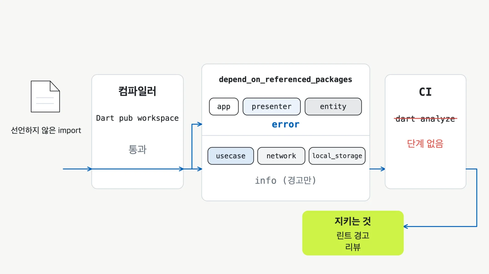
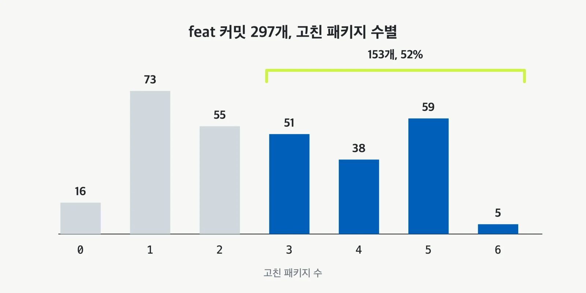

## 들어가며: 설정 화면 하나에 파일 28개가 바뀌었다

이번 달에 토글 몇 개로 메일 수신 여부를 바꾸는 "이메일 수신 설정" 화면을 만들었어요. 서버 API 는 조회 하나, 변경 하나였는데, 머지된 커밋을 보니 **파일 28개가 바뀌어 있었어요.** `app` 8개, `entity`·`presenter` 각 7개, `usecase` 4개, `network` 2개로, 화면 하나가 사실상 모든 계층을 한 번씩 지나갔어요. 그중 4개는 barrel 파일(패키지가 밖으로 보여 줄 것을 모은 `export` 목록), 1개는 DI 등록으로, 기능과 상관없이 구조 때문에 생긴 파일이에요.

이걸 보고 익숙한 질문을 다시 꺼냈어요. "우리는 왜 패키지를 6개로 나눴지?"

답은 알고 있었어요. **Clean Architecture 의 계층을 패키지로 나누면, 의존 방향을 어기는 `import` 를 컴파일러가 막아 준다.** 1년 동안 그렇게 믿고 이 구조 위에 기능을 쌓았어요. 그런데 파일 28개를 보고 나니, 그 답이 실제로 지켜지고 있는지, 이 비용만큼 값을 하는지는 한 번도 재 본 적이 없었어요.

그래서 이 글은 그 답을 git 이력과 문서로 확인한 사실, 그리고 지금 코드에서 잰 수치로 하나씩 따져 봐요. 「Flutter 앱을 6개 패키지로 나눈 이유」 시리즈의 첫 편이에요.

## 지도부터: 6개 패키지와 각자의 금지 목록

숫자는 이 글을 쓰는 날(2026년 11월 18일) main 기준이고, 줄 수는 생성 코드를 뺀 `lib/` 의 줄 수예요.

| 패키지 | 맡는 일 | 넣으면 안 되는 것 | `lib/` 파일 | `lib/` 줄 수 | 테스트 파일 |
|---|---|---|---|---|---|
| `app` | 화면(Page·Widget), 라우팅, 테마, 화면용 값 객체(VO), DI 조립 | BLoC·모델·예외 | 2,441 | 324,246 | 906 |
| `presenter` | BLoC (이 프로젝트에서는 ViewModel 역할) | 데이터 소스 | 585 | 68,701 | 325 |
| `usecase` | 비즈니스 규칙, 바깥 세계에 대한 인터페이스 | `presenter`·`app` 참조 | 305 | 27,193 | 202 |
| `network` | 서버 API 호출(dio), 응답을 모델로 변환 | 상위 계층 참조 | 107 | 15,294 | 111 |
| `local_storage` | 기기 저장소(shared_preferences, 파일) | 상위 계층 참조 | 15 | 675 | 11 |
| `entity` | 모델, 예외, 타입 | 다른 패키지 참조 전부 | 1,015 | 46,504 | 246 |

`app` 에서는 생성 파일 39개를 뺐어요(세면 120만 줄이 넘고, 거의 전부 번역 코드예요). 이 위에 화면 파일 203개, BLoC 146개, UseCase 116개, 모델 파일 690개가 올라가 있어요. 패키지마다 맡는 일보다 "넣으면 안 되는 것"이 더 분명하고, 이 금지 목록이 사실상 이 구조의 정의예요.

### 화살표는 호출 방향과 다르다

각 패키지가 `pubspec.yaml` 에 적은 의존을 그대로 옮기면 이래요.

```text
app ──────────► presenter, usecase, network, local_storage, entity
presenter ────► usecase, entity
network ──────► usecase, entity
local_storage ► usecase, entity
usecase ──────► entity
entity ───────► (없음)
```

<figure>
	
	<figcaption>pubspec.yaml 의 의존을 그대로 그리면, network 가 usecase 를 향하고 있어요.</figcaption>
</figure>

데이터는 `presenter → usecase → network` 로 흐르는데, 오히려 `network` 가 `usecase` 를 알아요. 인터페이스가 `usecase` 안에 있어서예요.

```dart
// usecase/lib/interface/repository/email_preference_data_source.dart
abstract interface class EmailPreferenceDataSource {
  Future<Result<EmailPreferenceModel>> getEmailPreference();
  Future<Result<EmailPreferenceModel>> putMarketingSubscribed(bool subscribed);
  // ...
}
```

`network` 는 이 인터페이스를 구현하려고 `usecase` 를 참조하고, 구현을 끼워 넣는 건 모든 패키지를 아는 `app` 의 DI 설정이에요. 의존성 역전이죠. 그래서 이 시리즈에서는 런타임에 누가 누구를 부르나(`app → presenter → usecase → network`)를 호출 방향, `pubspec.yaml` 에 누가 누구를 적었나(`network → usecase`)를 의존 방향으로 구분해요. 흔한 한 줄 요약은 호출 방향이라, 의존 방향으로 읽으면 틀린 그림이 돼요.

<figure>
	
	<figcaption>호출은 network 쪽으로 흐르지만, 의존은 인터페이스가 있는 usecase 를 향해요.</figcaption>
</figure>

## 처음부터 6개였다: 첫 커밋과 첫 주의 헛걸음

git 이력을 거꾸로 따라가 보니, 첫 커밋(2025년 10월 29일)에 이미 6개 패키지가 있었어요. 동료가 만든 뼈대였고, 루트 패키지 설명은 "Root workspace for clean architecture Flutter project" 였어요. 그날 `presentation` 이 `presenter` 로 바뀌고 `workspace:` 목록이 들어갔고, 다음 날 `melos.yaml` 의 스크립트가 루트 `pubspec.yaml` 로 옮겨졌어요. 처음부터 Melos 7 + Dart pub workspace 였고, 지금 고정된 Melos 는 7.4.1 이에요.

의도는 팀이 함께 공유하고 있었어요. Clean Architecture 의 계층을 패키지로 나눠 의존 방향을 지키자는 거였죠. 다만 문서로 남은 건 README 의 "Clean Architecture 기반 멀티패키지 구조 템플릿"이라는 한 줄뿐이었어요. 왜 하필 6개인지, 그 경계가 무엇으로 지켜지는지는 적혀 있지 않았어요.

더 흥미로웠던 건 첫 주에 화살표가 한 번 거꾸로 섰다가 돌아왔다는 거예요. 제가 로그인 BLoC 을 처음 만들면서, 이메일 로그인 실패를 잡으려고 `network` 의 예외 클래스를 `presenter` 에서 직접 `import` 했거든요.

```dart
// presenter/lib/src/blocs/login/login_bloc.dart (당시)
import 'package:network/network.dart';
// ...
} on LogInWithEmailAndPasswordFailure catch (e) {
```

그러려면 `presenter` 의 `pubspec.yaml` 에 `network` 를 적어야 했고, 며칠 뒤에는 `network` 와 `local_storage` 가 `presenter` 를 참조하는 줄까지 들어갔어요. 이때 `melos list --mermaid` 로 그린 `docs/dependency.png` 에는 그 화살표가 그대로 남아 있어요.

일주일 뒤 예외를 `entity` 로 옮기면서 되돌렸는데, 리뷰 코멘트 중에 의존 방향을 짚은 건 없었어요. 예외를 오류마다 클래스로 만들자는 코멘트를 반영해 `entity` 의 `AuthException` 아래에 `LogInFailedException` 등을 만들다가, 같은 커밋에서 세 `pubspec.yaml` 의 거꾸로 선 줄도 함께 지운 거예요. **의존 방향을 실제로 가른 건 예외 클래스를 어디에 두나 같은 사소한 결정이었어요.** 거창한 설계 원칙보다, 매일 쓰는 타입 하나가 어느 패키지에 사느냐가 화살표를 만들어요.

## 1년 동안 실제로 기대 온 성질

1년 동안 기능을 쌓으면서 실제로 기대 온 성질은 코드에서 읽혀요. 첫째, 바깥 세계는 전부 `usecase` 의 인터페이스 뒤에 있어요. 인터페이스 112개에는 서버 API 뿐 아니라 기기 정보, 로컬 알림, 위치, 워치 연결 같은 플랫폼 기능까지 들어 있어서, `usecase` 테스트 202개는 서버도 기기도 없이 가짜 구현을 끼워서 돌아요.

둘째, 의존이 `pubspec.yaml` 에 한 줄로 드러나요. 첫 주의 헛걸음도 이 한 줄이 리뷰에서 눈에 띄어 되돌릴 수 있었어요. 폴더로만 나눴다면 `import` 한 줄이 파일 수백 개 속에 묻혔을 거예요.

셋째, 테스트 위치가 계층을 따라가서 "이 테스트는 무엇의 스펙인가"가 위치로 정해져요. `entity` 는 JSON 필드 매핑, `presenter` 는 상태 전이, `app` 은 화면이 상태를 그리는 방식의 스펙이에요. 이메일 수신 설정도 모델 테스트 58줄, BLoC 테스트 157줄, 화면 테스트 150줄이 각자 자기 패키지에 있어서, 어느 테스트를 먼저 읽을지가 분명해요.

그렇다면 처음에 기대했던 성질, "경계를 컴파일러가 지켜 준다"는 어땠을까요?

## 가정이 깨진 곳: 경계는 컴파일러가 아니라 린트가 지킨다

이 글의 개요를 처음 잡을 때 "나눠서 얻은 것" 첫 줄에 "경계가 컴파일러로 강제된다"고 적었는데, 확인해 보니 반만 맞았어요. Dart pub workspace(Dart 3.6 부터)는 워크스페이스 전체를 한 번에 해석해서, 루트의 `package_config.json` 하나에 모든 패키지를 넣어요(저희는 약 370개). 그렇다면 `pubspec.yaml` 에 적지 않은 형제 패키지를 `import` 하면 어떻게 될까요? 빈 워크스페이스로 확인했어요(Dart 3.13.3).

```yaml
# pubspec.yaml (루트)
name: ws
environment:
  sdk: ^3.13.0
workspace:
  - a
  - b
```

```dart
// a/bin/main.dart — a 의 pubspec.yaml 에는 b 가 없다
import 'package:b/b.dart';

void main() => print(hello());
```

```text
$ dart pub get
Got dependencies!
$ cd a && dart run bin/main.dart
from b
$ dart analyze
No issues found!
```

세 명령이 모두 성공했어요. **선언하지 않은 패키지가 그대로 컴파일되고 실행되고, 기본 분석도 아무 말이 없어요.** 이렇게 `pubspec.yaml` 에 없는데 `import` 되는 의존을 이 글에서는 유령 의존이라고 부를게요. 유령 의존을 잡는 건 린트 규칙 하나예요.

```text
$ dart analyze   # depend_on_referenced_packages 를 켠 뒤
  error - lib/a.dart:1:8 - The imported package 'b' isn't a dependency
          of the importing package. - depend_on_referenced_packages
```

저희 설정에서 이 규칙은 루트 `analysis_options.yaml` 을 쓰는 `app`·`presenter`·`entity` 에서만 error 였고, `usecase`·`network`·`local_storage` 에서는 info(경고만, 분석은 성공)였어요. 게다가 CI 워크플로에는 `dart analyze` 단계가 없어요. 저희 경계를 지키던 건 컴파일러가 아니라 **편집기와 AI 에이전트가 보여 주는 린트 경고, 그리고 리뷰**였어요. 지금 6개 패키지 사이의 `import` 를 전부 세어 보니 선언 없이 형제 패키지를 참조하는 곳은 없었지만, 그건 지켜진 결과지 강제된 결과는 아니에요.

<figure>
	
	<figcaption>경계를 어긴 import 를 실제로 멈추는 건 컴파일러가 아니라 린트 경고와 리뷰였어요.</figcaption>
</figure>

이 글을 쓰는 지금도 세 패키지에서는 이 린트가 info 이고, CI 에도 분석 단계가 없어요. 다음 할 일은 두 린트(`depend_on_referenced_packages`, `implementation_imports`)를 모든 패키지에서 error 로 올리고, CI 가 `dart analyze` 를 돌리게 하는 거예요. 그래야 경계가 사람의 주의가 아니라 빌드로 지켜져요.

### barrel 은 `src/` 에 둔 패키지만 지켜진다

"각 패키지는 barrel 로만 노출한다"는 규칙도 같은 식으로 확인했어요. 다른 패키지에서 오는 `import` 를 barrel 로 들어온 것과 내부 파일로 바로 들어온 것으로 나눠 셌어요.

| 방향 | barrel 로 | 내부 파일로 직접 |
|---|---|---|
| `app → presenter` | 546 | 0 |
| `app → entity` | 983 | 230 |
| `app → usecase` | 464 | 380 |
| `network → usecase` | 3 | 212 |

`presenter` 만 0 인 이유는 폴더 배치에 있어요. 루트 설정의 `implementation_imports: error` 는 다른 패키지의 `lib/src/` 직접 import 만 막는데, `presenter` 는 파일 3개를 빼고 모든 코드를 `lib/src/` 에 두고 `usecase` 는 `lib/feat/`·`lib/interface/` 등에 둬요. barrel 규칙이 지켜지는 건 **규칙을 적어서가 아니라, 린트가 알아보는 폴더에 코드를 뒀기 때문**이에요.

### 선언은 했지만 새는 곳

`pubspec.yaml` 에 적힌 의존은 린트도 막지 않아요. `usecase` 의 파일 10개가 건강 데이터 플러그인 `health` 를 직접 `import` 해서 Flutter 에 전혀 의존하지 않는 패키지는 `entity` 하나뿐이고, `presenter` 도 `in_app_purchase`·`video_player` 를 의존해요. 또 DI 조립 때문에 모든 패키지를 의존하는 `app` 에서는 화면·위젯 파일 78개가 `UseCase` 를 직접 꺼내요. 대부분은 BLoC 에 넘겨 주려는 것이지만, 위젯이 네트워크 메서드를 바로 부르는 곳도 섞여 있어요. 이건 제가 위젯이 `UseCase` 의 `Future` 반환 메서드를 부르면 실패하는 아키텍처 테스트를 만들어 막고, 기존 위반 26곳은 허용 목록에 뒀어요. 이 이야기는 2편에서 이어 갈게요.

## 치른 비용

### 기능 커밋의 절반이 패키지 3개 이상을 지나간다

들어가며의 28개 파일은 예외가 아니었어요. 최근 6개월(2026년 5월 18일~11월 18일) 동안 main 에 들어간 `feat` 커밋 297개를 `lib/` 코드를 고친 패키지 수로 나눠 보니, 0개(설정·문서·테스트만) 16, 1개 73, 2개 55, 3개 51, 4개 38, 5개 59, 6개 5였어요.

<figure>
	
	<figcaption>기능 커밋의 절반 이상이 패키지 3개 이상을 지나갔어요.</figcaption>
</figure>

**기능 커밋의 절반 이상(153개, 52%)이 패키지 3개 이상을 고쳤어요.** 화면 하나를 새로 만들면 다섯 패키지를 한 번씩 지나가는 게 기본이라 5개짜리가 3·4개보다 많아요. 비용은 고칠 곳이 많은 것보다 잊기 쉬운 곳이 늘어나는 데 있어요. barrel 의 `export` 한 줄, DI 등록, 인터페이스가 기능마다 따라오고, DI 등록 누락은 그 화면을 열어야 알 수 있어요. barrel 도 커져서 `entity` 는 `export` 가 820줄, `presenter` 는 462줄, `usecase` 는 240줄이에요.

### 체크아웃과 툴체인이 손이 간다

새 작업 공간(git worktree 등)을 만들면 코드보다 먼저 의존성을 풀어야 해서, 스크립트 하나로 묶어 뒀어요.

```yaml
# 루트 pubspec.yaml 의 melos.scripts
setpj:
  run: |
    melos clean
    flutter pub get
    melos bootstrap
```

이걸 잊고 `.dart_tool/package_config.json` 없이 분석을 돌리면 멀쩡한 기존 심볼까지 "isn't defined" 로 무더기로 나와요. 코드가 맞는데 에러가 쏟아지면 먼저 의존성 해석을 의심하세요.

툴체인도 여러 곳에서 맞아야 해요. Flutter 를 올리면 `.fvmrc`, fvm 기본 버전, 전역으로 설치한 Melos 를 함께 올려야 하고, 하나만 올리면 로컬이나 CI 중 한쪽이 깨져요. 외부 패키지도 6개 `pubspec.yaml` 에 96종이 흩어져 있고, 15종은 중복이며 `equatable` 처럼 `^2.0.5`(3곳)와 `^2.0.7`(2곳)로 제약이 다른 것도 있어요. 잠금 파일 하나(`pubspec.lock`, 366개 패키지)로 해석해서 실제로는 한 버전만 쓰이지만, 제약을 올릴 때 하나를 빠뜨려도 아무 신호가 없어요.

### 코드 생성은 생각보다 적었고, 문서가 먼저 낡았다

문서에는 "DI 는 get_it + injectable", "모델은 json_serializable" 이라고 적혀 있어서 패키지마다 생성 코드 관리 비용이 클 줄 알았는데, 세어 보니 `*.g.dart` 파일은 하나도 없었어요. `fromJson` 은 손으로 쓰고, DI 도 두 파일 1,931줄, 등록 호출 265곳으로 손으로 등록해요. 생성 코드는 `app` 의 에셋·폰트 접근자 2개와 번역 37개뿐이에요. 의존성 그림(`docs/dependency.png`)도 첫 주의 거꾸로 선 화살표를 그린 채 1년째 그대로였으니, 구조를 설명하는 문서가 가장 먼저 낡은 셈이에요. 문서가 낡는 문제는 [AI 에게 규칙은 쓰는 것보다 읽히는 게 어렵다](/posts/ai_agent_harness)에서 더 자세히 다뤘어요.

## 나누기 전에, 또는 나눈 뒤에 물어볼 것

숫자를 다 모으고 나니, "6개가 맞나"보다 **"각 경계를 무엇이 지키고 있나"** 가 더 중요한 질문이었어요. 패키지를 나누거나 이미 나눈 구조를 점검할 때 이렇게 물어보세요.

1. 이 경계를 어긴 `import` 를 넣으면, 무엇이 실패하나? 컴파일러인가, error 린트인가, info 린트인가, 아무것도 아닌가. workspace 라면 컴파일러는 답이 아니에요.
2. 그 린트를 CI 가 돌리나? 편집기에서만 보이는 경고는 AI 에이전트나 급한 커밋이 지나칠 수 있어요.
3. 내부 파일 직접 import 를 막고 싶다면, 코드가 `lib/src/` 아래에 있나? 아니라면 `implementation_imports` 는 아무것도 막지 않아요.
4. 새 기능 하나가 평균 몇 개 패키지를 지나가나? 대부분 커밋이 모든 패키지를 지난다면, 그 경계가 실제로 독립적으로 바뀌는 단위인지 다시 볼 만해요.

마지막 질문은 저희에게도 숙제예요. `lib/` 이 675줄인 `local_storage` 를 독립 패키지로 둘 이유가 무엇인지 따져 볼 만해요. 따로 둔 이유도 거창하지 않았어요. 기존 패키지 중에 넣을 마땅한 곳이 없었을 뿐이에요.

## 마치며: 지도는 화살표보다 린트 설정에 있었다

처음 질문은 "왜 6개로 나눴지?"였어요. 왜 하필 6개인지는 기록에서 끝내 찾지 못했지만, 대신 다른 걸 알게 됐어요. 6개라는 숫자보다, 각 경계를 무엇이 지키고 있는지가 구조의 실체였어요.

`pubspec.yaml` 의 화살표는 의도를 보여 줍니다. 하지만 workspace 에서 그 의도를 지키는 건 `analysis_options.yaml` 의 린트 몇 줄, `lib/src/` 라는 폴더 이름, 그리고 리뷰입니다.

1년 동안 경계가 대부분 지켜진 건 강제돼서가 아니라 지키는 사람이 있어서였어요. 여러분의 저장소에서도 이렇게 확인해 보세요.

- 아무 패키지에서 선언하지 않은 형제 패키지를 하나 `import` 해 보세요. 어디서 실패하나요?
- 최근 기능 커밋 몇 개를 골라, 각각 몇 개 패키지를 고쳤는지 세어 보세요.
- 의존성 그림이나 아키텍처 문서가 마지막으로 갱신된 날짜를 확인해 보세요.

### 시리즈 안내

이 시리즈는 같은 앱의 구조를 다섯 편에 걸쳐 따라가요. 2편부터는 이 글의 "이메일 수신 설정" 화면을 예시로 계속 써요.

1. **패키지를 6개로 나눠도 경계는 린트가 지킨다** (이 글)
2. [계층의 경계는 타입이 바뀌는 자리였다 — 토글 하나를 서버까지 따라가 보기](/posts/flutter_architecture_2_data_flow)
3. [실패를 값으로 바꾸자, 던져진 실패가 숨기 시작했다](/posts/flutter_architecture_3_result)
4. [emit 했는데 화면이 그대로인 이유 — 이벤트와 화면 사이의 다섯 칸](/posts/flutter_architecture_4_bloc_viewmodel)
5. [구조는 사람보다 AI 가 더 문자 그대로 읽는다 — DI·라우팅·테스트 편](/posts/flutter_architecture_5_di_routing_testing)

## 참고 자료

- [Dart pub workspaces](https://dart.dev/tools/pub/workspaces) — 워크스페이스 전체를 한 번에 해석해 루트에 `package_config.json` 하나를 만든다
- [Melos](https://melos.invertase.dev/) — 7.x 부터 pub workspace 위에서 동작 (이 글은 7.4.1 기준)
- [depend_on_referenced_packages](https://dart.dev/tools/linter-rules/depend_on_referenced_packages) — `pubspec.yaml` 에 없는 패키지 import 를 알려 주는 린트
- [implementation_imports](https://dart.dev/tools/linter-rules/implementation_imports) — 다른 패키지의 `lib/src/` import 를 알려 주는 린트
