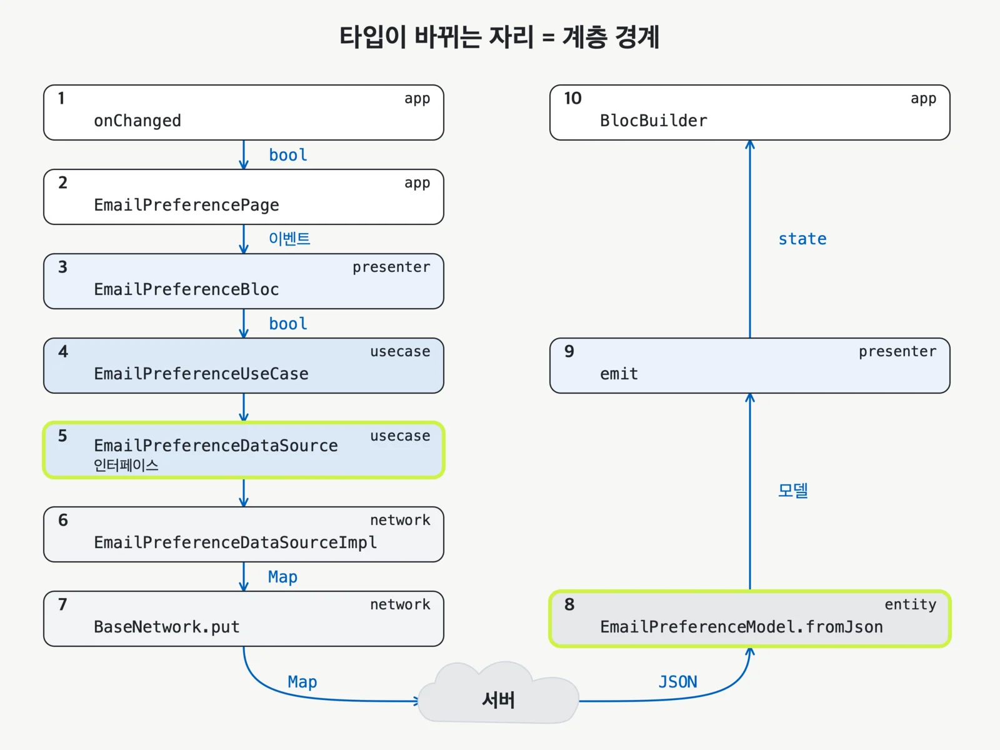
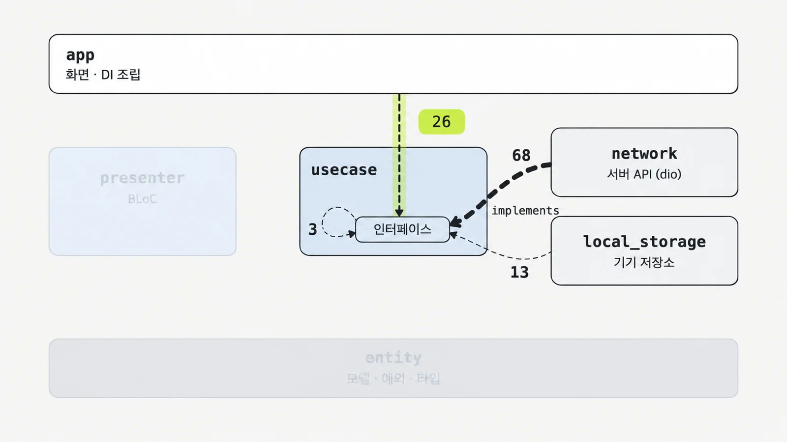
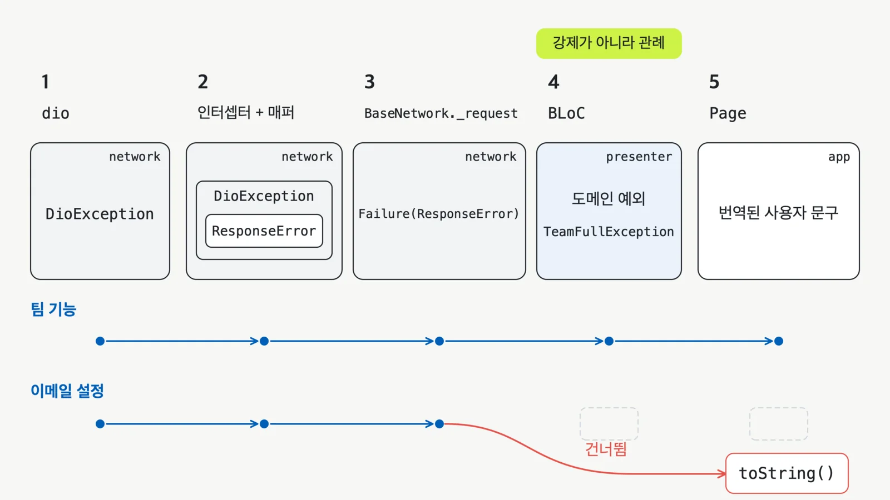

## 들어가며: 문서는 네 줄, 코드는 열 칸이었다

마케팅 메일 수신 토글을 끄면, 그 `bool` 하나가 서버까지 갔다가 화면으로 돌아와요. [1편](/posts/flutter_architecture_1_monorepo)에서 6개 패키지의 지도를 그렸다면, 이번 편은 1편의 "이메일 수신 설정" 화면으로 그 길을 실제로 걸어 보는 글이에요. 저희 저장소의 아키텍처 문서에는 이 흐름이 이렇게 적혀 있어요.

```text
1. Page 가 context.read<XBloc>().add(Event)
2. BLoC 핸들러 → UseCase → network DataSource(dio) → 서버 response 를 entity 로 변환해 반환
3. 실패 시 DioException → ResponseError 변환은 network(dio_exception_mapper.dart) 담당,
   BLoC 이 ResponseError/도메인 Exception(entity/lib/exceptions/)을 매핑해 state emit
4. UI 는 BlocBuilder/BlocListener
```

저도 이 네 줄을 믿고 있었어요. 비즈니스 로직은 UseCase 에 있고, 에러는 계층을 올라가며 도메인 예외로 바뀐다고요. 그런데 토글 하나를 코드로 따라가 보니 열 칸을 지나갔고, 두 믿음 모두 이 기능에서는 맞지 않았어요. UseCase 는 20줄짜리 전달자였고, 서버 에러는 원래 모양 그대로 화면의 스낵바까지 올라왔어요. 기준은 2026년 11월 18일 main 이에요.

<figure>
	
	<figcaption>토글 하나가 열 칸을 지나는 동안 넘기는 타입이 계속 바뀌고, 그 자리가 계층 경계예요.</figcaption>
</figure>

열 칸 사이에서 넘기는 타입은 `bool` → 이벤트 → `Map` → JSON → 모델 → state 로 계속 바뀌어요. 계층 경계는 결국 **타입이 바뀌는 자리**예요. 그런데 문서의 네 줄에는 이 구조의 핵심인 인터페이스(5칸)와 모델 변환(8칸)이 따로 드러나지 않아요.

## 1~3칸: 화면은 이벤트만 넣고, 보낼지는 BLoC 이 정한다

화면에서 토글에 걸린 건 `onChanged: (value) => bloc.add(EmailPreferenceMarketingToggledEvent(subscribed: value))` 한 줄이에요. `Page` 는 값을 바꾸지 않고, 결과는 나중에 state 로 돌아와요. BLoC 은 이 이벤트를 받아 화면을 먼저 바꾸고 UseCase 를 불러요.

```dart
// presenter/lib/src/blocs/email_preference/email_preference_bloc.dart
Future<void> _onToggle(EmailPreferenceToggleEvent event, Emitter<EmailPreferenceState> emit) async {
  final EmailPreferenceModel? previous = state.preference;
  if (previous == null || !previous.hasEmail || !previous.isChangeable) return;

  final Future<Result<EmailPreferenceModel>> request;
  switch (event) {
    case EmailPreferenceMarketingToggledEvent(:final subscribed):
      if (previous.marketingSubscribed == subscribed) return;
      emit(state.copyWith(preference: previous.withMarketingSubscribed(subscribed)));
      request = _emailPreferenceUseCase.updateMarketing(subscribed);
    // ... 주제 토글
  }
  final result = await request; // 9칸에서 이어서
}
```

이메일이 없거나, 바꿀 수 없는 계정이거나, 값이 같으면 UseCase 를 부르지 않아요. 화면을 먼저 바꾸고 실패하면 되돌리는 낙관적 갱신도 여기서 하는데, 그 설계는 4편에서 다뤄요. `Page` 는 UseCase 부터 아래를 모르고, BLoC 은 dio·서버 경로·JSON 키를 몰라요. 다만 BLoC 이 서버 에러 타입 `ResponseError` 를 안다는 점은 에러 절에서 다시 볼게요.

## 4~5칸: 20줄짜리 UseCase 는 경계였다

BLoC 이 부른 `EmailPreferenceUseCase` 는 파일 전체가 20줄이에요.

```dart
// usecase/lib/feat/email_preference/email_preference_usecase.dart
class EmailPreferenceUseCase {
  EmailPreferenceUseCase({required this._dataSource});

  final EmailPreferenceDataSource _dataSource;

  Future<Result<EmailPreferenceModel>> fetch() => _dataSource.getEmailPreference();

  Future<Result<EmailPreferenceModel>> updateMarketing(bool subscribed) {
    return _dataSource.putMarketingSubscribed(subscribed);
  }

  Future<Result<EmailPreferenceModel>> updateCategory(EmailPreferenceCategoryType type, bool subscribed) {
    return _dataSource.putCategorySubscribed(type, subscribed);
  }
}
```

(`required this._dataSource` 는 private 필드를 named 파라미터로 받는 Dart 3.13 문법이에요.)

메서드 세 개가 인자를 그대로 넘기기만 해요. 이 기능의 규칙은 BLoC("보낼지 말지")과 모델(`withMarketingSubscribed`, 모르는 주제를 버리는 `fromJson`)에 있었어요. 이 20줄이 하는 일은 UseCase 가 무엇을 import 하는지에서 보여요.

```dart
// usecase/lib/interface/repository/email_preference_data_source.dart
/// 응답은 GET·PUT 모두 전체 설정이다.
abstract interface class EmailPreferenceDataSource {
  Future<Result<EmailPreferenceModel>> getEmailPreference();
  Future<Result<EmailPreferenceModel>> putMarketingSubscribed(bool subscribed);
  Future<Result<EmailPreferenceModel>> putCategorySubscribed(EmailPreferenceCategoryType type, bool subscribed);
}
```

이 인터페이스는 `usecase` 안에 있고, 구현인 `EmailPreferenceDataSourceImpl implements EmailPreferenceDataSource` 는 `network` 에 있어요. `network` 가 `usecase` 를 import 하고 반대 방향은 없어요. 1편의 "호출은 아래로, 의존은 가운데로"가 코드에서는 이 `implements` 한 단어예요. 런타임에 구현을 끼워 넣는 DI 등록은 5편에서 볼게요.

`usecase/lib/interface/` 의 추상 클래스 109개를 grep 으로 세어 보면(근삿값) `network` 가 68개, `app` 이 26개, `local_storage` 가 13개, `usecase` 자신이 3개를 구현해요. 로컬 알림·위치·워치 연결처럼 Flutter 플러그인이 필요한 구현은 `app` 에 두고 인터페이스만 `usecase` 에 둔 거예요.

<figure>
	
	<figcaption>usecase 의 인터페이스는 network 만이 아니라 app 과 local_storage 도 구현해요.</figcaption>
</figure>

그러니까 이 UseCase 의 일은 로직이 아니라 **BLoC 이 `network` 를 모르게 하는 것**이에요. 비용은 파일 하나와 위임 메서드 세 개고요. "UseCase = 비즈니스 로직"이라고 설명하면 이 파일을 읽은 사람은 헷갈려요. 이 프로젝트에서 UseCase 는 먼저 경계이고, 로직은 있을 때만 있어요.

## 6~8칸: network 의 출구에서 이미 모델이 된다

구현체는 서버 경로를 알고, `bool` 을 요청 키 `marketing_subscribed` 로 바꾸고, 응답을 무엇으로 바꿀지 정해요.

```dart
// network/lib/data_source/email_preference/email_preference_data_source_impl.dart
@override
Future<Result<EmailPreferenceModel>> putMarketingSubscribed(bool subscribed) {
  return _baseNetwork.put(
    '/(이메일 설정 경로)',
    data: {'marketing_subscribed': subscribed},
    fromJson: EmailPreferenceModel.fromJson,
  );
}
```

실제 HTTP 는 공통 클래스 `BaseNetwork` 가 해요.

```dart
// network/lib/dio_network/base_network.dart
Future<Result<T>> _request<T>(Future<Response<dynamic>> Function() send, {FromJson<T>? mapper}) async {
  try {
    final response = await send();
    // ... (204, 빈 바디 처리)
    final parsedData = data is String ? jsonDecode(data) : data;
    if (mapper != null) return Success(mapper(parsedData));
    // ... (mapper 가 없을 때의 처리)
  } on DioException catch (error, stackTrace) {
    if (error.error is ResponseError) {
      return Failure(error.error as ResponseError, stackTrace);
    }
    return Failure(error, stackTrace);
  } catch (error, stackTrace) {
    return Failure(error, stackTrace); // 파싱 실패도 값으로
  }
}
```

dio 의 `Response` 는 이 함수 밖으로 나가지 않아요. 성공이면 모델이, 실패면 에러가 `Result` 에 담겨 나가요(`Result` 는 3편에서 다뤄요). `network/lib/data_source/` 에서 `fromJson:` 을 넘기는 곳이 411군데이고, 모델 대신 `Result<Map<String, dynamic>>` 을 돌려주는 인터페이스는 결제 영수증 검증과 개발용 테스트 API 2개뿐이었어요. 결제 쪽은 그 맵이 `app` 의 결제 서비스까지 올라가 거기서 응답 키를 읽어요. 출구에서 모델로 바꾸지 않으면 JSON 키를 아는 계층이 그만큼 위로 올라가요.

`fromJson` 자체는 `network` 가 아니라 `entity` 의 모델에 있어요.

```dart
// entity/lib/models/email_preference/email_preference_model.dart
class const EmailPreferenceModel({
  final String? email,
  final bool marketingSubscribed = false,
  final List<EmailPreferenceCategoryModel> categories = const [],
  // ... isChangeable, consentedAt, processedAt
}) extends Equatable {
  factory EmailPreferenceModel.fromJson(Object? json) {
    final Map<String, dynamic> map = json is Map<String, dynamic> ? json : const {};
    final Object? categories = map['categories'];
    return EmailPreferenceModel(
      // ...
      marketingSubscribed: map['marketing_subscribed'] as bool? ?? false,
      categories: (categories is List<dynamic> ? categories : const <dynamic>[])
          .whereType<Map<String, dynamic>>()
          .map(EmailPreferenceCategoryModel.fromJson)
          .nonNulls
          .toList(),
      // ...
    );
  }
  // ...
}
```

(`class const X(...)` 는 클래스 이름 옆에 생성자 파라미터를 바로 적어 필드를 선언하는 Dart 3.13 의 primary constructor 문법이에요.)

이 `fromJson` 은 어떤 입력에도 던지지 않아요. 맵이 아니면 빈 맵으로, 키가 없으면 기본값으로 받고, 앱이 모르는 주제 코드는 `.nonNulls` 가 버려요. 서버가 주제를 늘려도 이미 배포된 앱이 깨지지 않게 하려는 장치예요. 서버의 `snake_case` 키는 응답 쪽을 `entity` 가, 요청 쪽을 `network` 가 알고, `presenter` 와 `app` 은 하나도 몰라요. 화면에서는 주제 타입을 번역 문구로 바꾸는 `app` 의 VO(화면용 값 객체) `EmailPreferenceCategoryVo.of(type)` 만 따로 있어요.

## 9~10칸: 돌아오는 길에는 타입이 바뀌지 않는다

`Future<Result<EmailPreferenceModel>>` 은 그대로 `network` → `usecase` → `presenter` 로 올라와, BLoC 에서 비로소 state 가 돼요.

```dart
// presenter/lib/src/blocs/email_preference/email_preference_bloc.dart
final result = await request;
switch (result) {
  case Success(:final data):
    emit(state.copyWith(preference: data));
    // ... 전체 수신 변경이면 처리 일시를 사이드 이펙트로 알림
  case Failure(:final error):
    emit(state.copyWith(preference: previous));
    _emitSideEffect(EmailPreferenceUpdateFailedEffect(error: error));
    if (error is ResponseError && error.hasErrorCode(notChangeableErrorCode)) {
      await _onLoad(const EmailPreferenceLoadEvent(), emit);
    }
}
```

성공하면 서버가 돌려준 전체 설정으로 state 를 덮고(PUT 응답도 GET 과 같은 전체 설정이라 가능해요), `BlocBuilder` 가 다시 그리면서 열 칸이 끝나요. 성공 경로는 문서의 네 줄과 거의 같았어요. 달랐던 건 `case Failure` 쪽이에요.

## 에러는 계층마다 모양을 바꾼다, 이 기능에서는 한 번 덜

서버가 400 과 함께 `{"error_code": "(접두어):EMAIL_PREFERENCE_NOT_CHANGEABLE"}` 을 돌려줬다고 해 볼게요. dio 는 이걸 `DioException` 으로 던져요. 문서는 변환을 `dio_exception_mapper.dart` 가 맡는다고 적었지만, 실제로 매퍼를 부르는 건 인터셉터예요.

인터셉터는 401 이면 토큰을 갱신해 다시 보내고, 연결 오류면 재시도하고, 나머지는 매퍼로 `ResponseError` 를 만들어요. 그런데 인터셉터는 에러를 `DioException` 으로만 넘길 수 있어서, 새 `DioException` 껍데기 안 `error` 필드에 `ResponseError` 를 넣어요. 그 껍데기를 벗겨 `Failure(ResponseError)` 로 만드는 건 앞의 `BaseNetwork._request` 고요. 변환이 매퍼, 인터셉터, `BaseNetwork` 세 곳에 나뉘어 있는 셈이에요. 매퍼는 `error_code` 를 `:` 로 잘라 `ResponseErrorType.fromCode()` 로 찾는데, 정의된 73종에 `EMAIL_PREFERENCE_NOT_CHANGEABLE` 은 없어서 `unknown` 이 돼요. 그래서 원문 코드를 다시 꺼내는 `hasErrorCode()` 가 따로 있어요. `ResponseError` 와 `Result` 는 `entity` 가 아니라 `usecase/lib/core/` 에 있는데, `network` 와 `presenter` 가 둘 다 `usecase` 를 의존하니 맞는 위치예요.

문서의 3번 줄대로 도메인 예외로 바꾸는 기능도 있어요. 팀 기능의 BLoC 은 `error is ResponseError ? error.toTeamException() : error` 로 한 번 바꿔서, `usecase` 의 `TeamErrorMapper` 가 정한 `TeamFullException` 같은 예외 22종 중 하나를 사이드 이펙트에 담아요. 그러면 화면은 서버 코드 문자열 대신 `is TeamFullException` 으로 분기해요. 덧붙이면 이 매퍼의 doc 주석은 "data source 구현체에서 호출한다"고 적었지만, 실제 호출 14곳은 전부 BLoC 3개 파일에 있어요.

이메일 설정 BLoC 은 이 변환을 건너뛰고 `error` 를 그대로 사이드 이펙트에 담아요. 화면은 그걸 `SnackBar(content: Text(error.toString()))` 로 띄우니, `ResponseError.toString()` 을 따라가면 스낵바에는 이런 문자열이 떠요.

```text
비행기 모드에서 토글:   ResponseError(type: NO_INTERNET_CONNECTION, statusCode: 0)
바꿀 수 없는 계정:      ResponseError(type: UNKNOWN_ERROR, statusCode: 400) code: (접두어):EMAIL_PREFERENCE_NOT_CHANGEABLE
```

사용자에게 보이는 문구가 디버그 문자열이에요. 같은 폴더의 알림 설정 화면 두 개도 같은 방식이고, 이 화면은 그 패턴을 따랐어요. 세 화면 모두 에러를 번역 문구로 바꾸는 게 다음 수정 대상이에요.

<figure>
	
	<figcaption>도메인 예외로 바꾸는 4단계는 관례라서, 이메일 설정은 그 단계를 건너뛰었어요.</figcaption>
</figure>

**도메인 예외로 바꾸는 4단계는 강제가 아니라 관례**예요. `Failure.error` 의 타입이 `Object` 라 BLoC 이 바꾸지 않아도 컴파일러는 아무 말을 하지 않고, 4단계가 빠지면 화면이 분기할 기준이 없어 번역 문구 단계도 같이 빠져요. `presenter/lib` 에서 `ResponseError` 를 직접 다루는 파일이 29개, 도메인 예외로 분기하는 파일이 25개로(grep 기준) 두 방식이 섞여 있어요. 이 구멍을 어떻게 막을지는 3편에서 `Result` 와 함께 다뤄요.

## 새는 경계: 모른다고 적었지만 아는 곳

저장소 전체로 넓히면 "이 계층은 이걸 모른다"가 지켜지지 않는 곳이 두 종류 있어요.

첫째, 화면이 BLoC 을 건너뛰고 UseCase 를 불러요. `app` 은 DI 조립 때문에 모든 패키지를 의존해서 화면에서 `getIt<XUseCase>().method()` 를 불러도 막히지 않고, 라우트 빌더와 개발자 페이지를 뺀 `app/lib/feat` 파일 78개가 실제로 그렇게 해요. 동기 getter 나 스트림 구독은 괜찮지만, `Future` 를 돌려주는 네트워크 호출을 화면이 직접 부르면 로딩·에러 상태가 state 밖에 흩어지고 위젯 없이는 테스트할 수 없어요. 그래서 제가 소스를 읽는 아키텍처 테스트를 만들었어요.

```dart
// app/test/architecture/bloc_bypass_guard_test.dart
// 뒤에 `.` 이 붙은 것만 — Bloc(useCase: getIt<X>()) 같은 BLoC 조립은 매칭되지 않는다.
final RegExp _directCall = RegExp(r'getIt<(\w*(?:UseCase|Usecase|UseCases))>\(\)\s*\.\s*(\w+)');

// 찾은 멤버의 반환형을 usecase/lib 선언에서 찾아, Future 면 위반으로 센다.
```

호출부의 `await` 가 아니라 선언의 반환형으로 판정해요. `await` 없이 콜백으로 넘긴 네트워크 호출도 있었거든요. 기존 위반 26건은 허용 목록에 두고, 고쳐진 항목이 목록에 남아 있으면 실패하게 해서 목록은 줄어들기만 해요.

둘째, 인터페이스와 BLoC 이 플러그인 타입을 알아요. 건강 데이터 인터페이스 `HealthSyncDataSource` 는 플러그인의 `HealthDataPoint` 를 그대로 반환해서, `usecase` 에서 `package:health` 를 import 하는 파일이 10개예요. 시그니처에 바깥 타입이 있으면 인터페이스가 있어도 경계는 열려 있어요. `presenter` 에서는 페이월·코인 구매 BLoC 을 포함한 파일 5개가 `in_app_purchase` 를 import 해요. 인터페이스 주석에 이유가 남아 있는데, 구매 호출이 조회해 온 상품 인스턴스(`ProductDetails`) 자체를 요구하고 무료 체험 여부가 그 안에 실려 있어서 평평한 값 객체로 바꿀 수 없다는 거예요. 같은 주석은 "`usecase` 는 Flutter 의존이 없다"는 것도 이유로 드는데, 그때 이미 `usecase` 에는 `health` 가 있었어요.

## 마치며: 경계는 타입이 바뀌는 자리였다

처음 믿었던 두 가지는 이 기능에서 맞지 않았어요. 규칙은 BLoC 과 모델에 있었고, UseCase 는 BLoC 이 바깥 세계를 모르게 하는 경계였어요. 에러는 `ResponseError` 까지만 구조가 바꿔 주고, 그다음은 각 BLoC 이 고르는 관례였어요. 문서의 네 줄이 틀린 건 아니에요. 다만 네 줄은 화살표를 적었고, 경계의 실체는 **화살표 사이에서 바뀌는 타입**에 있었어요. 타입이 바뀌는 자리를 보면 그 계층이 무엇을 숨기는지가, 그대로 통과하는 자리를 보면 무엇이 새는지가 보여요.

여러분의 저장소에서도 버튼 하나를 골라 탭부터 화면 갱신까지 걸어 보면서 이렇게 물어보세요.

1. network 의 출구에서 나가는 타입이 모델인가? `Response`, `Map`, `dynamic` 이 나가면 그 위 계층이 JSON 키를 알게 돼요.
2. 서버가 4xx 를 돌려주면 사용자에게 어떤 문구가 보이나? BLoC 이 에러 코드 문자열을 직접 비교하고 있다면 도메인 예외 단계가 빠진 거예요.
3. 인터페이스 시그니처에 바깥 패키지 타입이 있나? 있다면 구현은 숨겨도 의존은 숨기지 못해요.
4. 화면에서 UseCase 의 `Future` 메서드를 직접 부르는 곳이 있나? 패키지 의존으로는 막히지 않으니 테스트나 린트가 필요해요.

UseCase 가 위임만 한다고 지울 필요는 없다고 봐요. 그 UseCase 를 지웠을 때 BLoC 이 `network` 나 인터페이스를 직접 알게 된다면, 그 20줄은 경계로서 일하고 있습니다.

### 시리즈 안내

1. [패키지를 6개로 나눠도 경계는 린트가 지킨다](/posts/flutter_architecture_1_monorepo)
2. **계층의 경계는 타입이 바뀌는 자리였다 — 토글 하나를 서버까지 따라가 보기** (이 글)
3. [실패를 값으로 바꾸자, 던져진 실패가 숨기 시작했다](/posts/flutter_architecture_3_result)
4. [emit 했는데 화면이 그대로인 이유 — 이벤트와 화면 사이의 다섯 칸](/posts/flutter_architecture_4_bloc_viewmodel)
5. [구조는 사람보다 AI 가 더 문자 그대로 읽는다 — DI·라우팅·테스트 편](/posts/flutter_architecture_5_di_routing_testing)

## 참고 자료

- [The Clean Architecture](https://blog.cleancoder.com/uncle-bob/2012/08/13/the-clean-architecture.html) — 의존은 안쪽(정책)으로만 향한다는 규칙
- [dio Interceptors](https://pub.dev/packages/dio#interceptors) — `onError` 에서 `handler.reject` / `resolve` 로 에러를 바꾸거나 복구하는 방식 (이 글은 dio 5.9.2 기준)
- [Dart class modifiers](https://dart.dev/language/class-modifiers) — `abstract interface class` 의 의미
- [flutter_bloc](https://bloclibrary.dev/) — `BlocBuilder`, `Emitter` (이 글은 flutter_bloc 8.1.6 기준)
