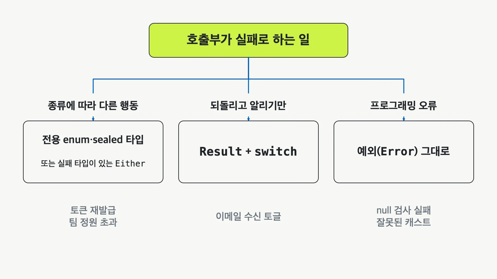

## 들어가며: 실패를 받는 콜백이 왜 두 개일까

올해 10월, 동료가 기록 탭이 스켈레톤에 갇히는 결함을 고쳤어요. 첫 조회가 실패하면 로딩을 풀지 않던 문제였는데, 고친 코드를 보면 로딩을 푸는 처리가 두 군데에 들어가 있어요.

```dart
// presenter/lib/src/blocs/progress/progress_bloc.dart
await _progressUsecase
    .getProgressMainData(date: /* 선택한 날짜 */)
    .onSuccess((progressMain) { /* ... */ })
    .onFailure((error, stackTrace) {
      // ...
      _emitLoadFailed(emit);
    })
    // 성공 콜백 안에서 던진 예외도 execute 가 삼킨다 — 여기서 잡지 않으면 로딩이 풀리지 않는다.
    .onCatch((error, stackTrace) {
      _logger.fatalError(error, stackTrace);
      _emitLoadFailed(emit);
    })
    .execute();
```

실패를 받는 콜백이 `onFailure` 와 `onCatch` 두 개이고, 하나만 달면 나머지 쪽 실패는 조용히 사라져요. [BLoC 이벤트 겹침을 정리한 글](/posts/bloc_concurrency_refactor)에서도 같은 모양을 만났어요. `onFailure` 에서만 플래그를 푸는 코드는 예외가 나면 잠긴 채 남았어요.

실패는 하나인데 왜 받는 곳이 둘일까요? [1편](/posts/flutter_architecture_1_monorepo)·[2편](/posts/flutter_architecture_2_data_flow)에 이어, 이번 편은 2편 끝에서 미뤄 둔 "예외와 값 중 무엇으로 실패를 넘길까"를 이 질문으로 풀어 봐요.

## Result 는 sealed 클래스 하나로 시작했다

`Result` 는 프로젝트 첫 커밋으로부터 3주쯤 지난 2025년 11월 20일, 동료가 뼈대 파일을 추가하면서 들어왔어요. 지금도 거의 그대로인 `usecase/lib/core/result.dart` 86줄의 핵심은 이래요.

```dart
// usecase/lib/core/result.dart
sealed class Result<T> {
  const Result();

  Result<R> map<R>(R Function(T data) transform) => switch (this) {
    Success(:final data) => Success(transform(data)),
    Failure(:final error, :final stackTrace) => Failure(error, stackTrace),
  };

  Result<R> chainResult<R>(Result<R> Function(T data) transform) => switch (this) {
    Success(:final data) => transform(data),
    Failure(:final error, :final stackTrace) => Failure(error, stackTrace),
  };
  // ... fold, when, getOrNull, getOrDefault, getOrElse, getOrThrow
}

final class Success<T> extends Result<T> {
  const Success(this.data);
  final T data;
}

final class Failure<T> extends Result<T> {
  const Failure(this.error, this.stackTrace);
  final Object error;
  final StackTrace stackTrace;
}
```

`sealed` 는 하위 타입을 같은 라이브러리 안에서만 만들 수 있게 막는 Dart 3 의 수식어예요. 그래서 컴파일러는 하위 타입이 `Success` 와 `Failure` 둘뿐이라는 걸 알고, `switch` 가 둘 다 다뤘는지 검사할 수 있어요.

왜 예외 대신 이 타입을 쓰기로 했는지 적은 ADR 은 없어요. 대신 `ResultChain` 과 같은 날 쓰인 가이드 문서(`docs/03_RESULT_AND_ROP_PATTERN_KR.md`)에 장점 세 줄이 있어요.

> - 에러가 타입 시스템에 명시됨
> - 호출자가 에러 처리를 강제받음
> - 함수형 체이닝 가능 (ROP)

이 글은 1년이 지난 지금 코드가 이 세 약속을 지키는지 하나씩 확인해요. 미리 짚어 두면, `Failure.error` 의 타입은 `Object` 예요. 이 단어가 첫 번째 약속을 반으로 줄여요.

## switch 로 받으면 컴파일러가 실패 처리를 강제한다

시리즈 공통 예시인 이메일 수신 설정에서, 실패가 값이 되는 곳은 2편에서 본 `BaseNetwork._request` 한 곳이에요. 요청 전체를 `try` 로 감싸 모든 예외를 `Failure` 로 바꾸니, 서버를 거쳐 온 실패는 값으로 올라와요. `EmailPreferenceUseCase.updateMarketing` 은 그 값을 그대로 넘기고, 이메일 설정 BLoC 이 `switch` 로 나눠 `case Failure` 에서 낙관적으로 바꾼 토글을 되돌려요.

여기서 `case Failure` 를 지우면, 빈 패키지에 `Result` 를 복사해 돌린 `dart analyze`(Dart 3.13.3)가 `non_exhaustive_switch_statement` 를 경고가 아니라 에러로 내요. `switch` 로 받는 한 두 번째 약속은 컴파일러가 지켜요. 그런데 이 코드베이스에서 `Result` 를 받는 방법은 `switch` 하나가 아니에요.

## ResultChain 은 대부분 try/catch 대용으로 쓰였다

`Result` 가 들어오고 나흘 뒤인 11월 24일, 같은 동료가 `ResultChain` 을 더했어요. `Future<Result<T>>` 에 확장 메서드를 달아 결과를 콜백으로 이어 받게 하는 클래스예요.

```dart
// presenter/lib/src/blocs/profile/profile_bloc.dart
await _onboardingUsecase
    .updateOnboardingStep(/* 목표 날짜 */)
    .chainResult((_) => _onboardingUsecase.getForecast()) // 성공하면 다음 요청으로
    .onStart(() => _emitSideEffect(const MyProfileLoadingEffect(isLoading: true)))
    .onSuccess((forecastData) {
      emit(state.copyWith(targetDate: event.targetDate));
      _emitSideEffect(MyProfileWeightForecastEffect(forecastData: forecastData));
    })
    .onFailure((error, stackTrace) {
      _logger.fatalError(error, stackTrace);
      _emitSideEffect(MyProfileNetworkFailEffect(error: error));
    })
    .onFinal(() => _emitSideEffect(const MyProfileLoadingEffect(isLoading: false)))
    .execute();
```

`onCatch` 는 future 나 콜백이 예외를 던졌을 때, `onFinal` 은 `finally` 처럼 마지막에 불려요. `chainResult` 는 앞이 성공해야 다음 요청으로 넘어가는 ROP(성공·실패 두 레일로 단계를 잇는 패턴)의 핵심이라, 목표 날짜 저장이 실패하면 예측 조회는 나가지 않아요. 실행은 `execute()` 가 맡는데, 빼먹으면 콜백이 하나도 불리지 않고 `ResultChain` 은 `Future` 가 아니라서 `unawaited_futures` 린트도 알아채지 못해요. 다행히 지금 저장소의 체인 314개는 전부 `execute()` 로 끝나요. (첫 주에 실행 방식이 두 번 바뀌었는데, 가이드 문서는 첫날 버전에 머물러 지금도 "`.future` 로 await 하라"고 적혀 있어요.)

2026년 11월 18일 main 기준으로 세어 보면, `presenter/lib` 에 체인이 302개(54개 파일), `switch` 의 `case Success(` 가 193개(69개 파일)예요. 그런데 체인 314개 중 단계를 실제로 잇는 `chainResult` 는 9곳뿐이에요. 세 번째 약속 "함수형 체이닝"은 가능하지만, 실제로 ResultChain 은 대부분 **`try`/`catch`/`finally` 를 콜백으로 바꿔 쓰는 도구**였어요.

BLoC 파일 146개를 만든 시기로 나눠 보면(지금 파일 내용 기준) 흐름이 더 분명해요.

| 파일을 만든 시기 | 체인만 | 둘 다 | `switch` 만 | 둘 다 아님 |
|---|---|---|---|---|
| 2025-10 ~ 2026-09 | 43 | 9 | 3 | 15 |
| 2026-10 ~ 2026-11 | 0 | 2 | 55 | 19 |

("둘 다 아님"은 `Result` 를 받지 않거나 `getOrNull()`·`isSuccess` 처럼 다른 방법으로 받는 BLoC 이에요.)

<figure>
	
	<figcaption>10월부터 만든 BLoC 에서는 체인만 쓰는 파일이 하나도 없어요.</figcaption>
</figure>

10월을 기점으로 새 BLoC 은 체인만 쓰는 경우가 사라졌어요. 규칙 문서는 찾지 못했고, 에이전트가 그렇게 쓰기 시작해서 굳은 것으로 추정해요. 결과적으로는 그쪽이 덜 새는 방향이었어요.

## 함정: 실패가 다니는 통로는 두 개다

실패를 받는 콜백이 왜 두 개인지는 반환 타입에 답이 있어요. BLoC 이 받는 건 `Result<T>` 가 아니라 `Future<Result<T>>` 예요. `Future` 는 원래 실패를 던지는 통로를 갖고 있고, 그 안에 `Result` 를 넣으면 실패를 값으로 넘기는 통로가 하나 더 생겨요. future 가 정상 완료됐는데 값이 `Failure` 인 경우를 값 통로, future 자체가 예외로 끝나거나 콜백이 예외를 던진 경우를 예외 통로라고 부를게요. `execute()` 는 **두 통로를 각자 다른 콜백에 연결**해요.

```dart
// usecase/lib/core/result_chain.dart
Future<Result<T>> execute() async {
  await _onStart?.call();
  try {
    final result = await _future;
    switch (result) {
      case Success(:final data):
        await _onSuccess?.call(data);
      case Failure(:final error, :final stackTrace):
        await _onFailure?.call(error, stackTrace); // 값 통로
    }
    return result;
  } catch (e, st) {
    await _onCatch?.call(e, st);                   // 예외 통로
    return Failure(e, st);
  } finally {
    await _onFinal?.call();
  }
}
```

확실히 하려고 이 두 파일을 그대로 복사해 돌려 봤어요(Dart 3.13.3). 콜백이 불린 순서와 `execute()` 의 반환 타입이에요.

```text
응답 뒤 던진 예외:                     catch -> final                 => Failure<int>
응답 뒤 던진 예외, onCatch 없음:        final                          => Failure<int>
onSuccess 안에서 던짐:                 success -> catch -> final      => Failure<int>
onSuccess 안에서 던짐, onCatch 없음:    success -> final               => Failure<int>
execute() 없이:                        []
```

예외 통로로 온 실패는 `onFailure` 를 부르지 않고, 체인을 쓰는 BLoC 은 `execute()` 의 반환값을 거의 보지 않아요. 그래서 `onCatch` 가 없으면 예외는 로그도 크래시 보고도 없이 사라져요. `onSuccess` 에서 null 검사 하나가 터져도 마찬가지예요. 들어가며의 주석이 말한 게 이 경우예요.

<figure>
	> 안에 서버 실패가 다니는 값 통로와 콜백 안에서 던진 예외가 다니는 예외 통로가 있고, execute() 는 값 통로를 onSuccess·onFailure 에, 예외 통로를 onCatch 에 연결하며, onCatch 가 없으면 예외는 흔적 없이 사라진다" width="1600" height="1000" loading="lazy" />
	<figcaption>execute() 는 값 통로를 onFailure 에, 예외 통로를 onCatch 에 따로 연결해요.</figcaption>
</figure>

반대쪽으로 새는 체인도 있어요. 알림 설정 BLoC 이에요.

```dart
// presenter/lib/src/blocs/notifications/notifications_bloc.dart
await _memberUsecase
    .getNotificationSettings()
    .onStart(() { /* 로딩 켜기 */ })
    .onSuccess((notificationSettings) {
      emit(state.copyWith(notificationSettings: notificationSettings));
    })
    .onCatch((error, stackTrace) {
      _logger.nonFatalError(error, stackTrace);
      _emitSideEffect(NotificationsNetworkFailEffect(error: error));
    })
    .onFinal(() { /* 로딩 끄기 */ })
    .execute();
```

사이드 이펙트 이름은 "네트워크 실패"인데, 네트워크 실패는 `BaseNetwork` 가 이미 값 통로로 보내요. 그래서 연결이 끊겨도 이 `onCatch` 는 불리지 않고, 로딩만 꺼진 채 아무 안내도 뜨지 않아요. 체인 314개를 두 콜백으로 나눠 보면 이래요.

| `onFailure` | `onCatch` | 체인 수 | 새는 쪽 |
|---|---|---|---|
| 있음 | 있음 | 26 | 없음 |
| 있음 | 없음 | 279 | 예외 통로(조용히 사라짐) |
| 없음 | 있음 | 2 | 값 통로 |
| 없음 | 없음 | 7 | 둘 다 |

<figure>
	
	<figcaption>두 통로를 모두 받는 체인은 314개 중 26개뿐이에요.</figcaption>
</figure>

둘 다 단 체인은 26개(8%)뿐이에요. 279개가 다 버그라는 뜻은 아니고, 대부분은 예외가 날 일이 드문 짧은 콜백이에요. 하지만 그 "드물다"는 판단을 컴파일러가 아니라 작성자가 매번 하고 있어요. **두 번째 약속은 `switch` 에서만 지켜지고, 체인에서는 지켜지지 않아요.** `switch` 방식에서는 `await request` 가 던지면 핸들러 밖으로 빠져나가 BLoC 의 `onError` 로 가니(bloc 8.1.4 는 `onError` 를 부른 뒤 다시 던져요), 적어도 조용히 사라지진 않아요.

`BaseNetwork` 가 다 잡는데도 예외 통로로 들어오는 실패는, 콜백 안에서 던진 예외 말고도 두 가지가 더 있었어요. 하나는 `Result` 바깥에 붙인 연산이에요. 앱 초기화 BLoC 의 `getAppInit().timeout(_initStepTimeout)` 은 시간이 넘으면 `TimeoutException` 을 던져서, 이 체인은 `onFailure` 와 `onCatch` 양쪽에 같은 대체값을 넣어요. 다른 하나는 `Result` 를 돌려주지 않는 인터페이스예요. `usecase/lib/interface/` 에서 `Future<Result<…>>` 를 돌려주는 메서드는 504개, 그냥 `Future<…>` 는 138개이고 그중 72개가 서버 데이터 소스 인터페이스(`repository/`)에 있어요.

실험 중 의외였던 것도 있어요. `async` 함수가 첫 `await` 전에 던져서 future 가 `execute()` 전에 이미 실패해 있으면, `onCatch` 와 별개로 그 에러가 zone 의 미처리 에러로도 보고돼요. `execute()` 가 `onStart` 를 먼저 `await` 하는 사이 리스너 없는 future 가 실패하기 때문이고, 같은 이유로 `onStart` 는 요청보다 늦게 불려요. 저희 앱은 `runZonedGuarded` 가 이런 에러를 fatal 로그로 남겨서, 화면에서 처리된 실패가 보고서에 한 번 더 남을 수 있어요.

## 실패의 타입은 Object 였다

첫 번째 약속 "에러가 타입 시스템에 명시됨"으로 가 볼게요. `Result<EmailPreferenceModel>` 은 성공했을 때 무엇이 오는지는 알려 주지만, `Failure.error` 가 `Object` 라서 실패했을 때 무엇이 오는지는 알려 주지 않아요.

이 차이 때문에 제가 직접 고친 버그가 있어요. 올해 6월, 팀 게시판에서 멤버 초대가 정원 초과로 실패해도 안내 토스트가 뜨지 않았어요. 화면은 `error is TeamFullException` 일 때 토스트를 띄우는데, BLoC 이 담아 보낸 `error` 는 `ResponseError` 라서 이 분기는 처음부터 죽은 코드였어요. BLoC 경계에서 바꿔 주는 한 줄을 같은 모양의 `emit` 11곳에 넣어 고쳤어요.

```dart
// presenter/lib/src/blocs/team/team_board_bloc.dart
.onFailure((error, st) {
  _logger.fatalError(error, st);
  final mapped = error is ResponseError ? error.toTeamException() : error;
  _emitSideEffect(TeamBoardMemberActionFailed(error: mapped));
})
```

그동안 컴파일러는 아무 말도 하지 않았어요. 사이드 이펙트의 `error` 필드도 `Object` 였고, `Object` 에는 어떤 `is` 검사를 써도 막지 않으니까요. 2편의 이메일 설정 스낵바에 `ResponseError(...)` 문자열이 뜨는 것도 같은 뿌리예요. **도메인 예외 단계라는 관례를 강제할 수단이 타입에 없어요.** 일주일 뒤 `presenter` 모듈 규칙에 "raw error 를 state 로 흘리면 소비측 `is XException` 분기가 전부 silent no-op 이 된다"는 줄을 넣었지만, 규칙 문서는 사람과 AI 에이전트가 읽을 뿐 컴파일러는 읽지 않아요.

정리하면 세 약속 중 첫째는 성공 타입만 명시되니 반만, 둘째는 `switch` 에서만, 셋째는 가능하지만 체인 314개 중 `chainResult` 9곳으로 드물게 지켜지고 있어요.

## 다른 선택지와, 고르는 기준

그렇다면 처음부터 다르게 했어야 할까요? 저희가 라이브러리 대신 `Result` 를 직접 만든 건 내부 동작이 블랙박스가 되는 게 싫고, 구현이 어렵지 않아 팀 입맛에 맞게 쓰려는 이유였어요(구현은 다른 팀원이 했어요). 대안을 비교한 기록은 없어서, 저희 코드에 대입하면 무엇이 달라지는지만 적어요.

예외만 쓰면 코드가 가볍지만, Dart 의 예외는 모두 unchecked 라서 호출부가 `try` 를 잊어도 아무도 몰라요. `onFailure` 를 빼먹은 체인과 같은 자리예요. fpdart 같은 `Either<L, R>` 는 실패 쪽에도 타입이 있어 첫 번째 약속을 온전히 지키고, 팀 게시판 버그도 시그니처에서 드러났을 거예요. 대신 `Future<Result<` 가 나오는 1,727곳마다 어떤 실패를 낼 수 있는지 정해야 해요. 지금 `network` 는 그걸 `ResponseError` 하나로 뭉뚱그리고 있으니, 라이브러리보다 실패 종류를 정하는 일이 더 커요(지금 의존 목록에 fpdart·dartz 는 없어요).

기능 전용 결과 타입은 저희도 이미 써요. 올해 7월 동료가 "네트워크가 잠깐 끊기면 로그아웃된다"는 문제를 고치면서, 토큰 재발급 결과를 `Result<bool>` 대신 전용 enum 으로 바꿨어요.

```dart
// usecase/lib/core/token_refresh_result.dart
/// bool 로는 "실패"만 알 수 있어 네트워크가 끊겨 요청이 못 나간 것과
/// 서버가 토큰을 무효로 판정한 것을 구분할 수 없었다.
enum TokenRefreshResult {
  success,
  networkFailure, // 토큰 유효성은 알 수 없다 — 로그아웃하지 않는다
  authInvalid,    // 재시도해도 같다 — 로그아웃한다
}
```

실패를 `Object` 하나로 받았다면 로그아웃할지 말지를 정할 수 없었던 경우예요. 세 가지를 놓고 보면, 기준은 기술의 우열이 아니라 **호출부가 실패를 받아서 무엇을 하느냐**예요. 실패 종류에 따라 다른 행동을 하면(토큰 재발급, 팀 정원 초과) 전용 enum·sealed 타입이나 실패 타입이 있는 `Either` 가, 되돌리고 알리기만 하면(이메일 수신 토글) `Result` + `switch` 가, 복구할 수 없는 프로그래밍 오류(null 검사 실패, 잘못된 캐스트)면 예외 그대로가 맞아요.

<figure>
	
	<figcaption>도구를 고르는 기준은 호출부가 실패를 받아서 무엇을 하느냐예요.</figcaption>
</figure>

`ResultChain` 을 계속 쓴다면, 실패 처리는 `onFailure` 와 `onCatch` 양쪽에 두고 플래그·로딩처럼 반드시 풀어야 하는 건 `onFinal` 에 둬요.

## 마치며: 값으로 바꾼 만큼, 던져진 실패는 더 잘 숨는다

`Future` 가 원래 가진 예외 통로 위에 `Result` 가 값 통로를 하나 더 깔았고, `ResultChain` 은 두 통로에 각자 콜백을 달게 했어요. 서버 실패는 전부 값 통로로 오니 `onFailure` 만 달아도 충분해 보였고, 그 사이 예외 통로로 들어온 실패는 `catch` 에 잡혀 로그 한 줄 없이 사라졌어요.

실패를 값으로 만들면, 값이 아닌 실패는 따로 챙겨야 합니다.

`Result` 는 "예외를 잊는 문제"를 `switch` 를 쓰는 곳에서만 없앴어요. 저희는 지금 새 BLoC 을 `switch` 로 쓰고 있고, 기존 체인 314개와 `Object` 인 실패 타입은 그대로 남아 있어요. 여러분의 저장소에서도 이렇게 확인해 보세요.

- 실패를 담는 타입에서 실패 쪽 필드의 타입을 보세요. `Object` 나 `dynamic` 이라면, 화면의 `is SomeException` 분기 중 실제로 참이 될 수 있는 게 몇 개인지 따라가 보세요.
- 결과를 콜백으로 받는 체인을 하나 골라, 콜백 안에서 예외를 던져 보세요. 어느 콜백이 불리고, 로그가 남나요?
- `Future<Result>` 를 돌려주는 함수 중 `await` 이전에 던질 수 있는 코드가 있는지 보세요. 그 실패는 값 통로가 아니라 예외 통로로 나가요.

### 시리즈 안내

1. [패키지를 6개로 나눠도 경계는 린트가 지킨다](/posts/flutter_architecture_1_monorepo)
2. [계층의 경계는 타입이 바뀌는 자리였다 — 토글 하나를 서버까지 따라가 보기](/posts/flutter_architecture_2_data_flow)
3. **실패를 값으로 바꾸자, 던져진 실패가 숨기 시작했다** (이 글)
4. [emit 했는데 화면이 그대로인 이유 — 이벤트와 화면 사이의 다섯 칸](/posts/flutter_architecture_4_bloc_viewmodel)
5. [구조는 사람보다 AI 가 더 문자 그대로 읽는다 — DI·라우팅·테스트 편](/posts/flutter_architecture_5_di_routing_testing)

## 참고 자료

- [Dart class modifiers: sealed](https://dart.dev/language/class-modifiers#sealed) — 같은 라이브러리 밖에서 하위 타입을 만들 수 없게 해 `switch` 완전성 검사를 가능하게 한다 (Dart 3.0 부터, 이 글은 3.13.3)
- [Dart branches: exhaustiveness checking](https://dart.dev/language/branches#exhaustiveness-checking) — sealed 타입에 대한 `switch` 가 모든 경우를 다루지 않으면 컴파일 에러
- [Dart error handling](https://dart.dev/language/error-handling) — Dart 의 예외는 모두 unchecked
- [Future.timeout](https://api.dart.dev/stable/dart-async/Future/timeout.html) — `onTimeout` 이 없으면 `TimeoutException` 으로 완료
- [Railway Oriented Programming](https://fsharpforfunandprofit.com/rop/) — Scott Wlaschin, 성공·실패 두 레일로 단계를 잇는 패턴
- [fpdart](https://pub.dev/packages/fpdart) — 실패 타입을 가진 `Either`·`TaskEither` 를 제공하는 Dart 패키지
- [기준 없이 AI 와 1년, 연타 방지 코드가 270가지가 됐다](/posts/bloc_concurrency_refactor) — `onFailure` 에서만 플래그를 풀던 코드와 BLoC 이벤트 겹침 정리
