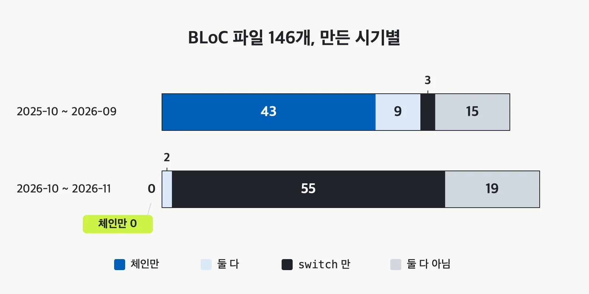
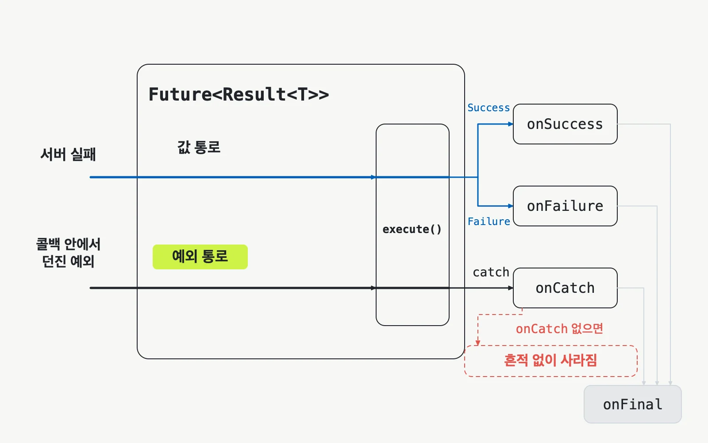
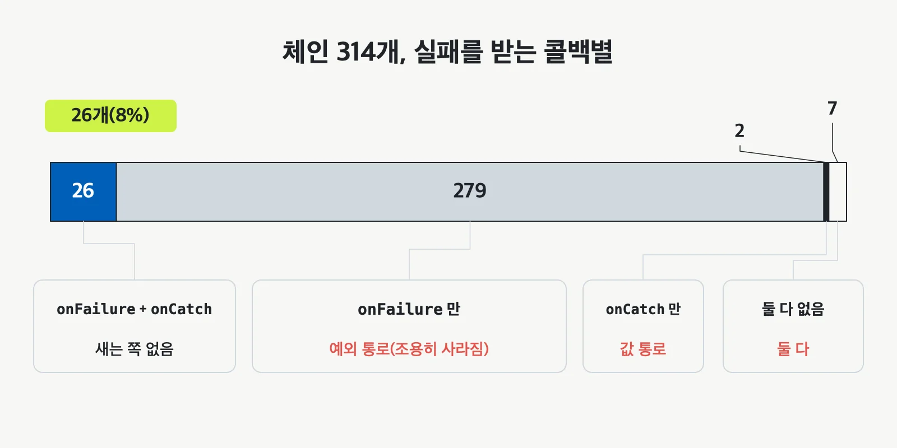

## 들어가며: 실패를 받는 콜백이 왜 두 개일까

「Flutter 앱을 6개 패키지로 나눈 이유」 시리즈 3편이에요. [1편](/posts/flutter_architecture_1_monorepo)에서 6개 패키지의 지도를 그렸고, [2편](/posts/flutter_architecture_2_data_flow)에서는 이메일 수신 토글 하나가 서버까지 갔다 오는 길과, 그 사이 에러가 모양을 바꾸는 자리를 따라갔어요. 2편 끝에서 미뤄 둔 질문이 있어요. **"예외와 값 중 무엇으로 실패를 넘길까"** 예요.

올해 10월, 동료가 기록 탭이 스켈레톤에 갇히는 결함을 고쳤어요. 첫 조회가 실패하면 로딩을 풀지 않던 문제였어요. 고친 코드를 보면 로딩을 푸는 처리가 **두 군데**에 들어가 있어요.

```dart
// presenter/lib/src/blocs/progress/progress_bloc.dart
await _progressUsecase
    .getProgressMainData(date: /* 선택한 날짜 */)
    .onSuccess((progressMain) { /* ... */ })
    .onFailure((error, stackTrace) {
      // ...
      _emitLoadFailed(emit);
    })
    // 성공 콜백 안에서 던진 예외도 execute 가 삼킨다 — 여기서 잡지 않으면 로딩이 풀리지 않는다.
    .onCatch((error, stackTrace) {
      _logger.fatalError(error, stackTrace);
      _emitLoadFailed(emit);
    })
    .execute();
```

여기서 볼 건 **실패를 받는 콜백이 `onFailure` 와 `onCatch` 두 개**라는 점이에요. 그리고 둘 중 하나만 달면 나머지 쪽 실패는 조용히 사라져요. [BLoC 이벤트 겹침을 정리한 글](/posts/bloc_concurrency_refactor)에서도 같은 모양을 만났어요. **`onFailure` 에서만 플래그를 푸는 코드는 예외가 나면 잠긴 채 남았어요.**

실패는 하나인데 왜 받는 곳이 둘일까요? 이 글은 그 답을 찾아가요. 이런 분께 도움이 될 거예요.

- `Result`·`Either` 같은 타입으로 실패를 넘기고 있거나, 도입을 고민 중인 분
- 콜백 체인으로 성공·실패를 받는데, 어떤 실패가 어느 콜백으로 가는지 헷갈리는 분
- "에러 처리를 강제하려고 만든 타입"인데 실패가 여전히 새는 것 같은 분

다룰 개념은 `Result<T>` sealed 클래스, `ResultChain`, Railway-Oriented Programming(ROP), 그리고 이 글에서 **"두 통로"** 라고 부를 구조예요.

## Result 는 sealed 클래스 하나로 시작했다

`Result` 는 프로젝트 첫 커밋으로부터 3주쯤 지난 **2025년 11월 20일**, 동료가 뼈대 파일을 추가하면서 들어왔어요. 지금도 거의 그대로이고, `usecase/lib/core/result.dart` 86줄이에요. 핵심만 추리면 이래요.

```dart
// usecase/lib/core/result.dart
sealed class Result<T> {
  const Result();

  Result<R> map<R>(R Function(T data) transform) => switch (this) {
    Success(:final data) => Success(transform(data)),
    Failure(:final error, :final stackTrace) => Failure(error, stackTrace),
  };

  Result<R> chainResult<R>(Result<R> Function(T data) transform) => switch (this) {
    Success(:final data) => transform(data),
    Failure(:final error, :final stackTrace) => Failure(error, stackTrace),
  };
  // ... fold, when, getOrNull, getOrDefault, getOrElse, getOrThrow
}

final class Success<T> extends Result<T> {
  const Success(this.data);
  final T data;
}

final class Failure<T> extends Result<T> {
  const Failure(this.error, this.stackTrace);
  final Object error;
  final StackTrace stackTrace;
}
```

`sealed` 는 Dart 3 의 클래스 수식어예요. **하위 타입을 같은 라이브러리(보통 같은 파일) 안에서만 만들 수 있게** 막아요. 그래서 컴파일러는 `Result` 의 하위 타입이 `Success` 와 `Failure` 둘뿐이라는 걸 알고, `switch` 가 둘 다 다뤘는지 검사할 수 있어요.

왜 예외 대신 이 타입을 쓰기로 했는지 적은 ADR 은 없어요. 대신 `ResultChain` 과 같은 날 쓰인 가이드 문서(`docs/03_RESULT_AND_ROP_PATTERN_KR.md`)에 장점 세 줄이 있어요.

> - 에러가 타입 시스템에 명시됨
> - 호출자가 에러 처리를 강제받음
> - 함수형 체이닝 가능 (ROP)

이 글에서는 이 세 줄을 **"세 약속"** 이라고 부를게요. 그리고 1년이 지난 지금 코드가 이 약속을 지키는지 하나씩 확인해 볼게요. 미리 한 가지만 짚어 두면, `Failure.error` 의 타입은 **`Object`** 예요. 이 단어가 첫 번째 약속을 반으로 줄여요. 뒤에서 다시 볼게요.

## 이메일 수신 설정에서 Result 가 흐르는 모양

시리즈 공통 예시인 이메일 수신 설정으로 실제 흐름을 볼게요. 호출 경로 전체는 2편에서 봤으니, 여기서는 **실패가 어디서 값이 되고 어디서 풀리는지**만 따라가요.

**실패가 값이 되는 곳은 `network` 의 출구 한 곳**이에요. 2편에서 본 `BaseNetwork._request` 가 요청 전체를 `try` 로 감싸고, `DioException` 이든 파싱 실패든 **모든 예외를 `catch` 해서 `Failure` 로** 바꿔요. 그래서 서버를 거쳐 온 실패는 던져지지 않고 값으로 올라와요.

`UseCase` 는 그 값을 손대지 않고 넘겨요.

```dart
// usecase/lib/feat/email_preference/email_preference_usecase.dart
class EmailPreferenceUseCase {
  // ...
  Future<Result<EmailPreferenceModel>> updateMarketing(bool subscribed) {
    return _dataSource.putMarketingSubscribed(subscribed);
  }
}
```

**실패가 풀리는 곳은 BLoC** 이에요. 이메일 설정 BLoC 은 `await` 로 결과를 받은 뒤 `switch` 로 나눠요.

```dart
// presenter/lib/src/blocs/email_preference/email_preference_bloc.dart
final result = await request;
switch (result) {
  case Success(:final data):
    emit(state.copyWith(preference: data));
    // ...
  case Failure(:final error):
    emit(state.copyWith(preference: previous)); // 낙관적으로 바꾼 토글을 되돌린다
    _emitSideEffect(EmailPreferenceUpdateFailedEffect(error: error));
    if (error is ResponseError && error.hasErrorCode(notChangeableErrorCode)) {
      await _onLoad(const EmailPreferenceLoadEvent(), emit);
    }
}
```

여기서 볼 건 `case Failure` 를 지우면 어떻게 되느냐예요. 빈 패키지에 `Result` 를 복사해 확인했어요(Dart 3.13.3).

```text
$ dart analyze bin/ex.dart
  error - ex.dart:4:3 - The type 'Result<int>' isn't exhaustively matched by the switch
          cases since it doesn't match the pattern 'Failure<int>()'. ... - non_exhaustive_switch_statement
```

**경고가 아니라 에러**예요. `switch` 로 받는 한, 두 번째 약속 "호출자가 에러 처리를 강제받음"은 컴파일러가 지켜요. 이 성질이 `sealed` 를 쓴 가장 큰 이유로 읽혀요.

그런데 이 코드베이스에서 `Result` 를 받는 방법은 `switch` 하나가 아니에요.

## ResultChain: 콜백 다섯 개와 execute()

`Result` 가 들어오고 나흘 뒤인 **11월 24일**, 같은 동료가 `ResultChain` 을 더했어요. `Future<Result<T>>` 에 확장 메서드를 달아, 결과를 콜백으로 이어 받게 하는 클래스예요. 실제 BLoC 코드는 이렇게 생겼어요.

```dart
// presenter/lib/src/blocs/profile/profile_bloc.dart
await _onboardingUsecase
    .updateOnboardingStep(/* 목표 날짜 */)
    .chainResult((_) => _onboardingUsecase.getForecast()) // 성공하면 다음 요청으로
    .onStart(() => _emitSideEffect(const MyProfileLoadingEffect(isLoading: true)))
    .onSuccess((forecastData) {
      emit(state.copyWith(targetDate: event.targetDate));
      _emitSideEffect(MyProfileWeightForecastEffect(forecastData: forecastData));
    })
    .onFailure((error, stackTrace) {
      _logger.fatalError(error, stackTrace);
      _emitSideEffect(MyProfileNetworkFailEffect(error: error));
    })
    .onFinal(() => _emitSideEffect(const MyProfileLoadingEffect(isLoading: false)))
    .execute();
```

콜백마다 역할은 이래요.

| 메서드 | 언제 불리나 |
|---|---|
| `onStart` | `execute()` 가 시작될 때 |
| `onSuccess` | 결과가 `Success` 일 때 |
| `onFailure` | 결과가 `Failure` 일 때 |
| `onCatch` | **future 나 콜백이 예외를 던졌을 때** |
| `onFinal` | 무슨 일이 있어도 마지막에 (`finally`) |
| `chainResult` | 앞이 성공하면 다음 `Future<Result>` 로 이어 감 |
| `execute()` | 체인을 실제로 실행하고 `Future<Result<T>>` 를 돌려줌 |

`chainResult` 가 ROP 의 핵심이에요. ROP 는 성공 레일과 실패 레일 두 개를 깔고, 한 단계라도 실패하면 나머지 단계를 건너뛰어 실패 레일로 끝까지 가는 그림이에요. 위 코드에서 목표 날짜 저장이 실패하면 예측 조회는 아예 나가지 않아요.

### 실행 방식은 첫 주에 두 번 바뀌었다

처음 들어온 날에는 **`onEnd` 를 부르면 그 자리에서 체인이 실행**됐어요. 같은 날 이 자동 실행이 빠졌고, 다음 날 실행용 getter `.future` 가 메서드 `execute()` 로 바뀌었어요. 나흘 뒤 `flatMap` 이 `chainResult` 로, 12월에는 `onEnd` 가 `onFinal` 로 이름이 바뀌었어요. 가이드 문서는 첫날 버전에 머물러 지금도 "`.future` 로 await 하라"고 적혀 있어요. 함께 들어온 `docs/result.md` 가 추천하는 `flatMapAsync` 는 git 이력 어디에도 **코드로 존재한 적이 없어요.** 문서가 먼저 낡는 이야기는 1편에서 했으니 넘어갈게요.

이 이력에서 남은 성질 하나는 짚어야 해요. **`execute()` 를 빼먹으면 콜백이 하나도 불리지 않아요.** `ResultChain` 은 `Future` 가 아니라서 `unawaited_futures` 같은 린트도 알아채지 못해요. 다행히 지금 저장소의 체인 314개는 전부 `execute()` 로 끝나요(콜백 메서드 호출문을 괄호 짝으로 따라가 센 결과예요).

## 두 방식이 한 코드베이스에 산다

그러면 `switch` 와 체인은 각각 얼마나 쓰일까요? 2026년 11월 18일 main 기준으로 셌어요.

| 무엇 | `presenter/lib` | 저장소 전체 |
|---|---|---|
| 체인(`.execute()` 호출) | 302 (54개 파일) | 314 |
| `switch` 의 `case Success(` | 193 (69개 파일) | 263 |
| `chainResult` 로 단계를 이은 곳 | 7 | 9 |

여기서 볼 건 마지막 줄이에요. 체인은 314개인데 **단계를 실제로 잇는 `chainResult` 는 9곳**뿐이에요. 나머지 300여 개는 요청 하나에 콜백을 다는 용도예요. 세 번째 약속 "함수형 체이닝"은 가능은 하지만, 실제로는 **ResultChain 이 대부분 `try`/`catch`/`finally` 를 콜백으로 바꿔 쓰는 도구**로 쓰였어요.

BLoC 파일 146개를 **만든 시기**로 나눠 보면 흐름이 더 분명해요. 지금 파일 내용 기준이라, 나중에 방식을 바꾼 파일은 바뀐 쪽으로 셌어요.

| 파일을 만든 시기 | 체인만 | 둘 다 | `switch` 만 | 둘 다 아님 |
|---|---|---|---|---|
| 2025-10 ~ 2026-09 | **43** | 9 | 3 | 15 |
| 2026-10 ~ 2026-11 | **0** | 2 | **55** | 19 |

("둘 다 아님"은 `Result` 를 받지 않거나, `getOrNull()`·`isSuccess` 처럼 다른 방법으로 받는 BLoC 이에요.)


<figure>
	
	<figcaption>10월부터 만든 BLoC 에서는 체인만 쓰는 파일이 하나도 없어요.</figcaption>
</figure>

10월을 기점으로 **새 BLoC 은 체인을 하나도 쓰지 않았어요.** 이렇게 바꾸자고 정한 규칙 문서는 찾지 못했어요. `[확인 필요: 10월부터 새 BLoC 이 switch 로만 쓰인 계기]` 다만 다음 절의 실험을 해 보면, 결과적으로 그쪽이 덜 새는 방향이었다는 건 말할 수 있어요.

## 함정: 실패가 다니는 통로는 두 개다

들어가며의 질문으로 돌아가요. 실패를 받는 콜백이 왜 두 개일까요?

답은 반환 타입에 있어요. BLoC 이 받는 건 `Result<T>` 가 아니라 **`Future<Result<T>>`** 예요. `Future` 는 원래 **실패를 던지는 통로**를 갖고 있어요. 그 안에 `Result` 를 넣으면 **실패를 값으로 넘기는 통로**가 하나 더 생겨요. 이 글에서는 둘을 이렇게 부를게요.

- **값 통로**: future 가 정상 완료됐는데 그 값이 `Failure` 인 경우
- **예외 통로**: future 자체가 예외로 끝나거나, 콜백이 예외를 던진 경우

`execute()` 는 두 통로를 각자 다른 콜백에 연결해요.

```dart
// usecase/lib/core/result_chain.dart
Future<Result<T>> execute() async {
  await _onStart?.call();
  try {
    final result = await _future;
    switch (result) {
      case Success(:final data):
        await _onSuccess?.call(data);
      case Failure(:final error, :final stackTrace):
        await _onFailure?.call(error, stackTrace); // 값 통로
    }
    return result;
  } catch (e, st) {
    await _onCatch?.call(e, st);                   // 예외 통로
    return Failure(e, st);
  } finally {
    await _onFinal?.call();
  }
}
```

확실히 하려고 이 두 파일을 그대로 복사해 돌려 봤어요(Dart 3.13.3). 콜백이 불린 순서와 `execute()` 의 반환 타입이에요.

```text
응답 뒤 던진 예외:                     catch -> final                 => Failure<int>
응답 뒤 던진 예외, onCatch 없음:        final                          => Failure<int>
onSuccess 안에서 던짐:                 success -> catch -> final      => Failure<int>
onSuccess 안에서 던짐, onCatch 없음:    success -> final               => Failure<int>
execute() 없이:                        []
```

이 결과에서 볼 건 세 가지예요.

1. **예외 통로로 온 실패는 `onFailure` 를 부르지 않아요.** `execute()` 는 마지막에 `Failure` 를 돌려주지만, 체인을 쓰는 BLoC 은 그 반환값을 거의 보지 않아요.
2. **`onCatch` 가 없으면 예외는 흔적 없이 사라져요.** 로그도, 크래시 보고도 없어요. `catch` 가 이미 잡았으니까요.
3. **콜백 안에서 던진 예외도 예외 통로**예요. `onSuccess` 에서 모델을 상태로 옮기다 null 검사 하나가 터져도 `onFailure` 는 모르고 지나가요. 들어가며의 주석이 말한 게 이 경우예요.


<figure>
	> 안에 서버 실패가 다니는 값 통로와 콜백 안에서 던진 예외가 다니는 예외 통로가 있고, execute() 는 값 통로를 onSuccess·onFailure 에, 예외 통로를 onCatch 에 연결하며, onCatch 가 없으면 예외는 흔적 없이 사라진다" width="1600" height="1000" loading="lazy" />
	<figcaption>execute() 는 값 통로를 onFailure 에, 예외 통로를 onCatch 에 따로 연결해요.</figcaption>
</figure>

### 반대쪽으로 새는 경우도 있다

`onFailure` 만 다는 것만 위험한 게 아니에요. 알림 설정 BLoC 에는 반대 모양의 체인이 있어요.

```dart
// presenter/lib/src/blocs/notifications/notifications_bloc.dart
await _memberUsecase
    .getNotificationSettings()
    .onStart(() { /* 로딩 켜기 */ })
    .onSuccess((notificationSettings) {
      emit(state.copyWith(notificationSettings: notificationSettings));
    })
    .onCatch((error, stackTrace) {
      _logger.nonFatalError(error, stackTrace);
      _emitSideEffect(NotificationsNetworkFailEffect(error: error));
    })
    .onFinal(() { /* 로딩 끄기 */ })
    .execute();
```

사이드 이펙트 이름은 "네트워크 실패"예요. 그런데 네트워크 실패는 `BaseNetwork` 가 이미 잡아서 **값 통로**로 보내요. 그래서 서버가 에러를 돌려주거나 연결이 끊겨도 이 `onCatch` 는 불리지 않고, 로딩만 꺼진 채 아무 안내도 뜨지 않아요. 작성자는 "실패하면 `onCatch`"라고 읽은 거예요.

저장소의 체인 314개를 두 콜백으로 나눠 보면 이래요.

| `onFailure` | `onCatch` | 체인 수 | 새는 쪽 |
|---|---|---|---|
| 있음 | 있음 | 26 | 없음 |
| 있음 | 없음 | **279** | 예외 통로(조용히 사라짐) |
| 없음 | 있음 | 2 | 값 통로 |
| 없음 | 없음 | 7 | 둘 다 |


<figure>
	
	<figcaption>두 통로를 모두 받는 체인은 314개 중 26개뿐이에요.</figcaption>
</figure>

여기서 볼 건 **둘 다 단 체인이 26개(8%)뿐**이라는 점이에요. 279개가 다 버그라는 뜻은 아니에요. 대부분은 예외가 날 일이 드문 짧은 콜백이에요. 하지만 그 "드물다"는 판단을 컴파일러가 아니라 작성자가 매번 하고 있다는 뜻이에요. **두 번째 약속은 `switch` 에서만 지켜지고, 체인에서는 지켜지지 않아요.**

`switch` 방식에도 예외 통로는 있어요. 다만 `await request` 가 던지면 핸들러 밖으로 빠져나가 BLoC 의 `onError` 로 가요(bloc 8.1.4 는 `onError` 를 부른 뒤 다시 던져요). **적어도 조용히 사라지진 않아요.**

### 예외 통로로 실패가 들어오는 곳

`BaseNetwork` 가 다 잡는다면 예외 통로로는 무엇이 들어올까요? 코드에서 찾은 건 세 종류예요.

- **콜백 안에서 던진 예외.** 위 실험의 세 번째 줄이에요. 응답 모델을 state 로 옮기는 코드, 날짜 계산, 컬렉션 접근이 여기 해당해요.
- **`Result` 바깥에 붙인 연산.** 앱 초기화 BLoC 은 `getAppInit().timeout(_initStepTimeout)` 처럼 `Future<Result>` 에 시간 제한을 걸어요. 시간이 넘으면 `Future.timeout` 은 `TimeoutException` 을 **던져요.** 이 체인은 그래서 `onFailure` 와 `onCatch` 양쪽에서 같은 대체값을 넣어요.
- **`Result` 를 돌려주지 않는 인터페이스.** `usecase/lib/interface/` 의 메서드 중 `Future<Result<…>>` 를 돌려주는 건 504개, 그냥 `Future<…>` 를 돌려주는 건 138개예요. 그중 72개는 서버 데이터 소스 인터페이스(`repository/`)에 있어요. 이런 메서드가 `UseCase` 안에서 섞이면 `Future<Result>` 를 돌려주는 함수도 예외로 끝날 수 있어요.

하나 더, 실험 중에 의외였던 게 있어요. future 가 **`execute()` 를 부르기도 전에 이미 예외로 끝나 있으면**(`async` 함수가 첫 `await` 전에 던지는 경우), `onCatch` 가 불리는 것과 별개로 **그 에러가 zone 의 미처리 에러로도 보고돼요.** `execute()` 가 future 를 기다리기 전에 `onStart` 를 먼저 `await` 하는 사이에, 리스너 없는 future 가 실패하기 때문이에요. 같은 이유로 **`onStart` 는 요청보다 늦게** 불려요. 요청은 `Future<Result>` 를 돌려주는 함수를 부른 순간 이미 출발했으니까요.

```text
즉시 던진 예외:  [zone 미처리 에러] Bad state: 즉시 던짐
                 catch -> final => Failure<int>
순서:            request -> onStart
```

저희 앱은 `runZonedGuarded` 의 에러 핸들러가 이런 에러를 fatal 로그로 남겨요. 같은 실패가 화면에서는 처리되고, 보고서에는 미처리 에러로 한 번 더 남을 수 있어요.

## 실패의 타입은 Object 였다

이제 첫 번째 약속, "에러가 타입 시스템에 명시됨"이에요. `Result<EmailPreferenceModel>` 은 **성공했을 때 무엇이 오는지**를 타입으로 알려 줘요. 하지만 `Failure.error` 는 `Object` 라서 **실패했을 때 무엇이 오는지**는 알려 주지 않아요.

이 차이 때문에 제가 직접 고친 버그가 있어요. 올해 6월, 팀 게시판에서 멤버 초대가 **정원 초과로 실패해도 안내 토스트가 뜨지 않았어요.** 화면 쪽 코드는 이랬어요.

```dart
// app/lib/feat/team/team_board_side_effect_handler.dart
case TeamBoardMemberActionFailed(:final error):
  if (error is TeamFullException) {
    TeamBoardActionToast.teamFull().show();
  }
```

BLoC 은 `onFailure` 로 받은 `error` 를 그대로 사이드 이펙트에 담았어요. 그런데 값 통로로 오는 `error` 는 **`ResponseError`** 예요. 도메인 예외 `TeamFullException` 이 아니에요. 그래서 `error is TeamFullException` 은 **항상 false** 였고, 이 분기는 처음부터 죽은 코드였어요. 고친 방법은 BLoC 경계에서 바꿔 주는 한 줄이었고, 같은 모양의 `emit` 11곳에 넣었어요.

```dart
// presenter/lib/src/blocs/team/team_board_bloc.dart
.onFailure((error, st) {
  _logger.fatalError(error, st);
  final mapped = error is ResponseError ? error.toTeamException() : error;
  _emitSideEffect(TeamBoardMemberActionFailed(error: mapped));
})
```

여기서 볼 건 **컴파일러가 처음부터 끝까지 아무 말도 하지 않았다**는 점이에요. 사이드 이펙트의 `error` 필드도 `Object` 였고, `Object` 에는 어떤 `is` 검사를 써도 컴파일러가 막지 않아요. 2편에서 본 "이메일 설정의 스낵바에 `ResponseError(...)` 문자열이 그대로 뜬다"도 같은 뿌리예요. 2편은 이걸 "4단계가 강제가 아니라 관례"라고 했는데, 그 관례를 강제할 수단이 **타입에 없어요.**

일주일 뒤 정리한 `presenter` 모듈 규칙에는 이런 줄이 있어요. "에러는 BLoC 경계에서 `ResponseError`/도메인 Exception 으로 매핑해 emit — raw error 를 state 로 흘리면 소비측 `is XException` 분기가 전부 silent no-op 이 된다." 규칙 문서는 사람과 AI 에이전트가 읽지만, 컴파일러는 읽지 않아요.

정리하면 세 약속은 이렇게 지켜지고 있어요.

| 약속 | 지금 코드에서 |
|---|---|
| 에러가 타입에 명시된다 | **반만.** 성공 타입은 명시, 실패 타입은 `Object` |
| 호출자가 처리를 강제받는다 | **`switch` 에서만.** 체인은 콜백을 빼도 컴파일됨 |
| 함수형으로 이을 수 있다 | **가능하지만 드묾.** 체인 314개 중 `chainResult` 9곳 |

## 다른 선택지와, 고르는 기준

그렇다면 처음부터 다르게 했어야 할까요? 독자가 떠올릴 대안은 셋일 것 같아요. 저희가 왜 이것들을 고르지 않았는지 적은 기록은 없어요. `[확인 필요: Result 를 직접 만들기로 한 이유, fpdart 등을 검토했는지]` 그래서 여기서는 "저희 코드에 대입하면 무엇이 달라지나"만 근거 있는 만큼 쓸게요.

**예외만 쓰기.** Dart 공식 문서는 이렇게 적어요. "In contrast to Java, all of Dart's exceptions are unchecked exceptions. Methods don't declare which exceptions they might throw, and you aren't required to catch any exceptions."(Java 와 달리 Dart 의 예외는 모두 unchecked 예요. 메서드는 무엇을 던질지 선언하지 않고, 어떤 예외도 잡도록 강제되지 않아요.) 감쌀 타입이 없어서 코드가 가볍고, 스택 트레이스도 자연스럽게 따라와요. 하지만 호출부가 `try` 를 잊어도 아무도 모른다는 점에서, **`onFailure` 를 빼먹은 체인과 같은 자리**에 서요. 저희가 실패를 값으로 바꾼 이유가 이 지점이었다면, 체인은 그 이유를 절반만 살렸어요.

**`Either<L, R>`(fpdart 등).** 실패 쪽에도 타입 매개변수가 있어요. `Either<(팀 실패 타입), TeamModel>` 처럼 쓰면 첫 번째 약속을 온전히 지킬 수 있어요. 팀 게시판 버그 같은 건 시그니처에서 드러났을 거예요. 대가도 분명해요. 저희 저장소에서 `Future<Result<` 가 나오는 곳이 1,727곳이에요. 실패 타입을 정한다는 건 이 시그니처마다 "이 호출은 어떤 실패를 낼 수 있나"를 정한다는 뜻이고, 지금 `network` 는 그걸 `ResponseError` 하나로 뭉뚱그려요. 라이브러리를 바꾸는 것보다 **실패 종류를 정하는 일이 더 큰 작업**이에요. 지금 저장소의 의존 목록에는 fpdart·dartz 가 없어요.

**기능 전용 결과 타입.** 실패 종류가 다음 행동을 가르는 곳에서는 저희도 이미 이렇게 해요. 토큰 재발급 결과는 `Result<bool>` 이 아니라 전용 enum 이에요.

```dart
// usecase/lib/core/token_refresh_result.dart
/// bool 로는 "실패"만 알 수 있어 네트워크가 끊겨 요청이 못 나간 것과
/// 서버가 토큰을 무효로 판정한 것을 구분할 수 없었다.
enum TokenRefreshResult {
  success,
  networkFailure, // 토큰 유효성은 알 수 없다 — 로그아웃하지 않는다
  authInvalid,    // 재시도해도 같다 — 로그아웃한다
}
```

올해 7월 동료가 "네트워크가 잠깐 끊기면 로그아웃된다"는 문제를 고치면서 만든 타입이에요. 실패를 `Object` 하나로 받았다면 **로그아웃할지 말지를 정할 수 없었던** 경우예요.

세 가지를 놓고 보면, 기준은 기술의 우열이 아니라 **호출부가 실패를 받아서 무엇을 하느냐**예요. 저희 코드에 대입하면 이렇게 판별할 수 있어요.

| 호출부가 실패로 하는 일 | 맞는 도구 | 저희 코드의 예 |
|---|---|---|
| 실패 **종류에 따라 다른 행동**을 한다 | 전용 enum·sealed 타입, 또는 실패 타입이 있는 `Either` | 토큰 재발급(로그아웃 여부), 팀 정원 초과 |
| 실패면 **되돌리고 알리기만** 한다 | `Result` + `switch` | 이메일 수신 토글 |
| 복구할 방법이 없는 **프로그래밍 오류**다 | 예외(`Error`) 그대로 | null 검사 실패, 잘못된 캐스트 |


<figure>
	
	<figcaption>도구를 고르는 기준은 호출부가 실패를 받아서 무엇을 하느냐예요.</figcaption>
</figure>

`ResultChain` 을 계속 쓴다면 지킬 건 두 가지예요. **실패 처리는 `onFailure` 와 `onCatch` 양쪽에 두고, 플래그·로딩처럼 반드시 풀어야 하는 건 `onFinal` 에 둬요.** 들어가며의 수정은 그 앞 절반, 로딩 해제를 두 콜백에 각각 넣는 쪽을 택했어요.

## 마치며: 값으로 바꾼 만큼, 던져진 실패는 더 잘 숨는다

처음 질문은 "실패는 하나인데 왜 받는 곳이 둘일까"였어요. 답은 `Future<Result<T>>` 에 있었어요. `Future` 가 원래 가진 **예외 통로** 위에 `Result` 가 **값 통로**를 하나 더 깔았고, `ResultChain` 은 두 통로에 각자 콜백을 달게 했어요. 서버 실패는 전부 값 통로로 오니, 개발자는 `onFailure` 만 달아도 충분하다고 느껴요. 그 사이 예외 통로로 들어온 실패는 `catch` 에 잡혀 **로그 한 줄 없이** 사라졌어요.

실패를 값으로 만들면, 값이 아닌 실패는 따로 챙겨야 합니다.

`Result` 는 "예외를 잊는 문제"를 없앤 게 아니라, **`switch` 를 쓰는 곳에서만** 없앴어요. 저희는 지금 새 BLoC 을 `switch` 로 쓰고 있고, 기존 체인 314개와 `Object` 인 실패 타입은 그대로 남아 있어요. 여러분의 저장소에서도 이렇게 확인해 보세요.

- 실패를 담는 타입에서 **실패 쪽 필드의 타입**을 보세요. `Object` 나 `dynamic` 이라면, 화면의 `is SomeException` 분기 중 실제로 참이 될 수 있는 게 몇 개인지 따라가 보세요.
- 결과를 콜백으로 받는 체인을 하나 골라, **콜백 안에서 예외를 던져** 보세요. 어느 콜백이 불리고, 로그가 남나요?
- `Future<Result>` 를 돌려주는 함수 중 **`await` 이전에 던질 수 있는 코드**가 있는지 보세요. 그 실패는 값 통로가 아니라 예외 통로로 나가요.

### 시리즈 안내

1. **모노레포 지도: 왜 패키지를 6개로 나눴나** ([1편](/posts/flutter_architecture_1_monorepo))
2. **데이터 한 사이클**: 토글 하나가 화면에서 서버까지 갔다 오는 길, 그리고 계층 경계 ([2편](/posts/flutter_architecture_2_data_flow))
3. **Result 와 ROP**: 예외 대신 실패를 값으로 넘기기 (이 글)
4. **BLoC 을 ViewModel 로**: 상태·이벤트·사이드 이펙트를 나누는 기준 ([4편](/posts/flutter_architecture_4_bloc_viewmodel))
5. **DI·라우팅·테스트, 그리고 AI 와 일할 때**: 구조를 사람과 AI 에이전트가 함께 지키는 법 ([5편](/posts/flutter_architecture_5_di_routing_testing))

## 참고 자료

- [Dart class modifiers: sealed](https://dart.dev/language/class-modifiers#sealed) — 같은 라이브러리 밖에서 하위 타입을 만들 수 없게 해 `switch` 완전성 검사를 가능하게 한다 (Dart 3.0 부터, 이 글은 3.13.3)
- [Dart branches: exhaustiveness checking](https://dart.dev/language/branches#exhaustiveness-checking) — sealed 타입에 대한 `switch` 가 모든 경우를 다루지 않으면 컴파일 에러
- [Dart error handling](https://dart.dev/language/error-handling) — Dart 의 예외는 모두 unchecked
- [Future.timeout](https://api.dart.dev/stable/dart-async/Future/timeout.html) — `onTimeout` 이 없으면 `TimeoutException` 으로 완료
- [Railway Oriented Programming](https://fsharpforfunandprofit.com/rop/) — Scott Wlaschin, 성공·실패 두 레일로 단계를 잇는 패턴
- [fpdart](https://pub.dev/packages/fpdart) — 실패 타입을 가진 `Either`·`TaskEither` 를 제공하는 Dart 패키지
- [같은 문제를 270가지 방법으로 푼 코드베이스](/posts/bloc_concurrency_refactor) — `onFailure` 에서만 플래그를 풀던 코드와 BLoC 이벤트 겹침 정리
