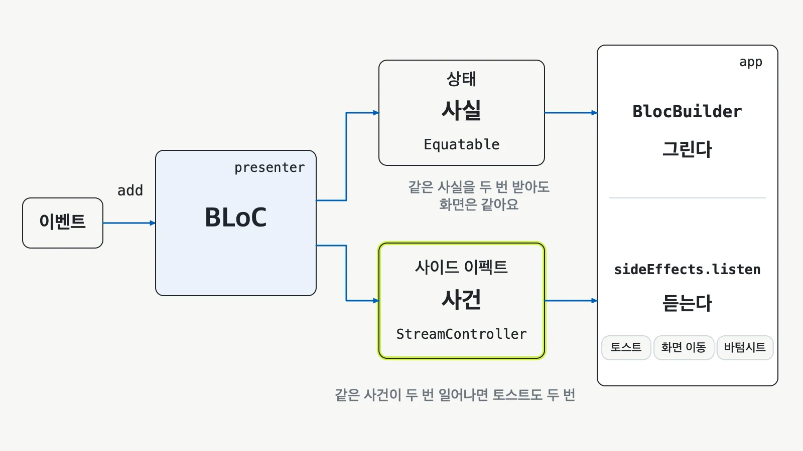
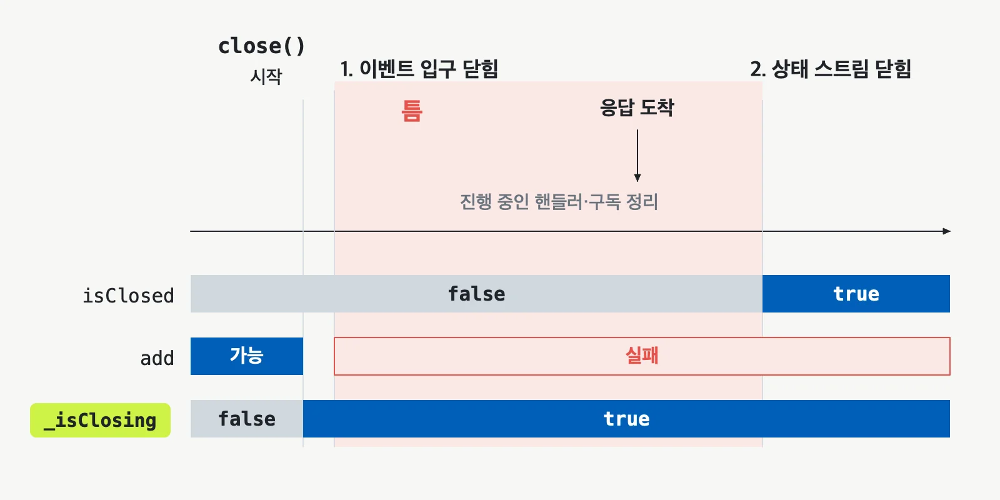
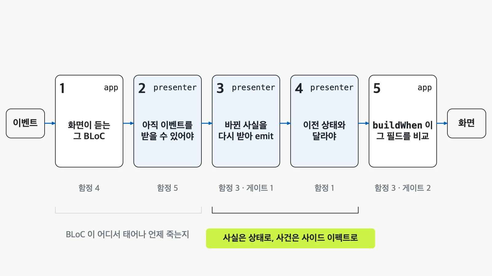

## 들어가며: 저장은 됐는데 언어가 바뀌지 않았다

올해 8월에 앱 안에서 언어를 고르는 설정 화면을 만들었어요. 목록에서 일본어를 눌렀는데 화면이 그대로였어요. 앱을 껐다 켜면 일본어로 떠 있었으니, 선택은 저장됐는데 지금 떠 있는 앱만 그 사실을 몰랐던 거예요. 같은 화면에는 리뷰에서 잡힌 문제도 하나 있었어요. 구현 계획대로 짰다면 저장 실패 토스트가 두 번째 실패부터는 뜨지 않았을 거예요.

두 문제 모두 에러가 없었어요. BLoC 은 이벤트를 받았고 `emit` 도 불렸는데, 화면은 반응하지 않았어요. 제가 믿고 있던 규칙은 이랬어요.

> 이벤트를 넣으면 BLoC 이 상태를 `emit` 하고, `emit` 하면 화면이 다시 그려진다.

[1편](/posts/flutter_architecture_1_monorepo)에서 "BLoC(ViewModel 역할)" 한 줄로 넘어간 `presenter` 패키지를 열어, 이 문장이 어디서 깨지는지 따라가 볼게요. 숫자는 2026년 11월 18일 main 기준이고, `bloc` 8.1.4·`flutter_bloc` 8.1.6·`equatable` 2.0.8 이에요.

## 「BLoC = ViewModel」은 출력을 두 갈래로 나눈다는 뜻이었다

저희 규칙 문서의 "BLoC 을 View Model 로 취급한다"는 한 줄은, 세어 보니 꽤 구체적인 모양을 만들고 있었어요. 우선 Cubit 이 하나도 없어요. 프로젝트 둘째 날(2025년 10월 30일) 제가 넣은 BLoC 가이드가 "어떤 이벤트가 이 상태를 만들었나"로 디버깅하고 테스트할 수 있다는 이유로 "항상 BLoC 사용"을 정해 뒀거든요. 그리고 BLoC 146개가 대개 bloc·event·state·side_effect 네 파일로 나뉘는데, 이벤트 142개 중 129개가 `sealed class` 계층이고 상태 143개 중 141개가 `Equatable` 이에요.

눈에 띄는 건 `*_side_effect.dart` 89개예요. BLoC 의 절반 이상이 상태 말고 사이드 이펙트라는 출력을 하나 더 가져요. 토스트, 화면 이동, 바텀시트처럼 `StreamController` 로 내보내는 일회성 알림이에요. 상태는 지금 화면이 그려야 할 사실이라 두 번 받아도 화면이 같고, 사이드 이펙트는 한 번 일어난 사건이라 두 번 일어나면 토스트도 두 번 떠야 해요.

<figure>
	
	<figcaption>상태는 화면이 그릴 사실이고, 사이드 이펙트는 한 번 일어나는 사건이에요.</figcaption>
</figure>

뒤에 나올 함정 대부분이 이 구분에서 나와요. **사건을 사실 자리에 넣으면 사라지고, 사실을 사건으로만 알리면 화면이 낡아요.** 대가로 공통 예시인 이메일 수신 설정 BLoC 은 토글 두 종류를 저장하는 데 파일 5개(barrel 포함), 165줄이 들지만, 무엇을 받고 그리고 알리는지를 파일별로 따로 읽을 수 있어요.

## 이메일 수신 설정 BLoC: 먼저 바꾸고, 실패하면 되돌린다

[1편](/posts/flutter_architecture_1_monorepo) 도입부의 화면은 마케팅 메일 전체 수신 토글과 주제별 토글을 누르는 즉시 저장해요. 두 토글 이벤트(`EmailPreferenceMarketingToggledEvent`, `EmailPreferenceCategoryToggledEvent`)는 차례로 저장돼야 해서 sealed 중간 계층 `EmailPreferenceToggleEvent` 로 묶고 핸들러를 한 번만 달아요. 상태(`EmailPreferenceState`)의 필드는 `status` 와 서버에서 받은 `preference` 두 개뿐이고, "저장 실패"는 사건이라 상태에 없어요. 동등성 비교에 쓰는 `props => [status, preference]` 는 뒤에서 중요해져요.

```dart
// presenter/lib/src/blocs/email_preference/email_preference_bloc.dart
EmailPreferenceBloc({required this._emailPreferenceUseCase}) : super(const EmailPreferenceState()) {
  on<EmailPreferenceLoadEvent>(_onLoad);
  on<EmailPreferenceToggleEvent>(_onToggle, transformer: sequential());
}

Future<void> _onToggle(EmailPreferenceToggleEvent event, Emitter<EmailPreferenceState> emit) async {
  final EmailPreferenceModel? previous = state.preference;
  if (previous == null || !previous.hasEmail || !previous.isChangeable) return;

  final Future<Result<EmailPreferenceModel>> request;
  switch (event) {
    case EmailPreferenceMarketingToggledEvent(:final subscribed):
      if (previous.marketingSubscribed == subscribed) return;
      emit(state.copyWith(preference: previous.withMarketingSubscribed(subscribed)));
      request = _emailPreferenceUseCase.updateMarketing(subscribed);
    case EmailPreferenceCategoryToggledEvent(:final type, :final subscribed):
      if (!previous.marketingSubscribed) return;
      emit(state.copyWith(preference: previous.withCategorySubscribed(type, subscribed)));
      request = _emailPreferenceUseCase.updateCategory(type, subscribed);
  }

  final result = await request;
  switch (result) {
    case Success(:final data):
      emit(state.copyWith(preference: data));
      // 전체 수신을 바꿨으면 처리 결과 고지 사이드 이펙트 ...
    case Failure(:final error):
      emit(state.copyWith(preference: previous));
      _emitSideEffect(EmailPreferenceUpdateFailedEffect(error: error));
      if (error is ResponseError && error.hasErrorCode(notChangeableErrorCode)) {
        await _onLoad(const EmailPreferenceLoadEvent(), emit);
      }
  }
}
```

요청 전에 토글을 먼저 바꿔 그리고(낙관적 갱신), 성공하면 서버 값으로 덮고, 실패하면 `previous` 로 되돌린 뒤 사이드 이펙트로 알려요. `transformer: sequential()` 은 겹친 토글을 줄 세워 처리하라는 선언이에요. BLoC 은 기본이 동시 실행이라 이게 없으면 늦게 온 응답이 그 뒤에 바꾼 값을 덮어요([기준 없이 AI 와 1년, 연타 방지 코드가 270가지가 됐다](/posts/bloc_concurrency_refactor)). 화면은 `context.read` 로 BLoC 을 꺼내 `BlocBuilder` 로 상태를 그리고, `initState` 에서 `bloc.sideEffects.listen(...)` 으로 사건을 들어요. 화면이 하는 일은 그리기와 이벤트 넣기뿐이에요.

## 함정 1: 같은 상태는 두 번 emit 되지 않는다

언어 설정 화면의 구현 계획은 저장 실패를 상태의 `bool` 로 담았어요.

```dart
// (당시 구현 계획) presenter/lib/src/blocs/language/language_state.dart
class LanguageState extends Equatable {
  const LanguageState({this.selectedLanguage, this.hasSaveFailed = false});

  final AppLanguage? selectedLanguage;
  final bool hasSaveFailed;

  @override
  List<Object?> get props => [selectedLanguage, hasSaveFailed];
}
```

화면은 `listenWhen: (previous, current) => !previous.hasSaveFailed && current.hasSaveFailed` 로 토스트를 띄울 계획이었고, BLoC 가이드의 `BlocListener` 예시와도 맞아서 자연스러워 보였어요. 그런데 리뷰에서 "두 번 연속 실패하면요?"라는 질문이 나왔고, 재현해 보니 정말 두 번째 토스트가 뜨지 않았어요.

```dart
// bloc-8.1.4/lib/src/bloc_base.dart
void emit(State state) {
  // ...
  if (state == _state && _emitted) return;
  // ...
}
```

이전과 같은 상태는 조용히 버려요. 첫 실패로 `hasSaveFailed` 가 `true` 가 되면 두 번째 실패의 상태는 필드까지 똑같으니까요. 같은 사실을 두 번 그릴 필요는 없으니 이 동작은 맞고, 문제는 사건을 사실 자리에 넣은 것이었어요. 언어 설정은 `saveFailureCount` 처럼 매번 달라지는 값을 올리고 `listenWhen: current.count > previous.count` 로 듣는 쪽을 골랐어요. 토스트 하나에 구독 수명 관리를 새로 들이기엔 비용이 컸고, 이중 구독 사고 이력도 있었거든요. 사건이 두 종류인 이메일 수신 설정은 동등성 비교를 거치지 않는 사이드 이펙트를 썼고요. 어느 쪽이든 연속 두 번 실패하는 테스트가 이 함정을 잡는 가장 싼 방법이에요.

## 함정 2: 사이드 이펙트 스트림은 구독자 수만큼 일어난다

사이드 이펙트 컨트롤러 88개 중 84개가 `StreamController.broadcast()` 예요. 팀 챌린지 화면에서는 축하 시트를 닫으면 이미 닫았던 기록 시트가 그 아래 남아 있었어요. 머지 충돌을 풀면서 하나로 합쳤던 구독이 되살아나, 같은 BLoC 의 사이드 이펙트를 두 위젯이 듣고 있었거든요. "시트를 열어라" 하나에 시트가 두 장 열렸고, 닫기는 한 장만 닫았어요. 그래서 **시트나 화면 이동을 일으키는 사이드 이펙트는 구독자가 하나여야 해요.**

반대로 구독자가 없을 때 나간 사건은 사라져요. 그래서 화면은 `initState` 에서 구독하고, 라우트 빌더가 넣는 첫 이벤트(`EmailPreferenceLoadEvent`)는 사이드 이펙트를 내지 않게 짰어요. 내보내는 쪽은 `if (!_sideEffectController.isClosed)` 로 감싸는데, 이 가드가 BLoC 자체에는 통하지 않는다는 건 함정 5에서 볼게요.

## 함정 3: 화면이 안 바뀌면 두 게이트를 다 본다

팀 화면에서 방장 위임을 수락한 멤버가 설정 버튼을 누르면 여전히 멤버용 설정 화면으로 갔어요. 서버에서는 이미 방장이었는데, 독립된 두 곳이 모두 막고 있었어요.

첫 번째 게이트는 핸들러였어요. 수락 핸들러는 "위임 성공" 사이드 이펙트만 내보냈고, "내 역할"은 다른 API 값이라 아무도 다시 받지 않았어요. 사건은 알렸지만 사실은 낡은 채로 남은 거예요.

```dart
// presenter/lib/src/blocs/team/team_main_bloc.dart
.onSuccess((_) async {
  // 수락하면 내 역할이 바뀌므로 멤버십을 서버에서 다시 받아 emit 한다. 거절은 역할이 그대로라 생략.
  if (event.accepted) await _refreshMembership(emit);
  if (!_sideEffectController.isClosed) {
    _sideEffectController.add(const TeamMainLeadershipTransferSucceeded());
  }
})
```

두 번째 게이트는 위젯이었어요. 멤버십을 새로 emit 해도 `BlocBuilder` 의 `buildWhen` 이 코인과 배지 수만 비교했고, 아래 위젯은 `ValueKey(teamId)` 로 State 를 유지하며 옛 멤버십을 들고 있었어요. `buildWhen` 에 `prev.membership != curr.membership` 을 더해 고쳤어요.

두 게이트가 `presenter` 의 핸들러와 `app` 의 `buildWhen`, 서로 다른 패키지에 있어서 하나만 고치면 "고쳤는데 왜 안 되지"를 한 번 더 겪어요. `props` 에 빠진 필드도 같은 게이트예요. 저희 BLoC 가이드는 "항상 `buildWhen` 사용"을 권하고 지금 `app` 에 73곳이 있지만, `buildWhen` 은 비교하지 않은 필드의 변화를 버리겠다는 선언이기도 해요. 열흘 뒤 `presenter` 규칙 파일에는 이 한 줄이 들어갔어요.

> 서버 액션 후 화면 갱신 안 되면: ①핸들러 재조회 emit ②buildWhen/props 둘 다 의심

역할처럼 서버가 여러 규칙으로 정하는 값은 앱이 추측하지 않고 서버에서 다시 받아요.

## 함정 4: BLoC 을 어디서 만드는지가 화면이 듣는 BLoC 을 정한다

저희는 화면 전용 BLoC 을 라우트 빌더(`{feature}_page_route.dart`)에서 만들고 Page 는 `context.read` 로 꺼내기만 해요. BLoC 의 수명이 라우트와 같아지는 규칙이고, 경위와 DI·테스트 쪽 이점은 [5편](/posts/flutter_architecture_5_di_routing_testing)에서 다뤄요.

들어가며의 언어 설정은 이 규칙을 그대로 따른 결과였어요. 라우트 빌더가 `LanguageBloc` 을 새로 만들었는데, 앱 루트에 이미 `MaterialApp` 의 `locale` 을 정하는 `LanguageBloc` 이 있었어요. 화면의 `context.read<LanguageBloc>()` 은 가장 가까운 provider 인 라우트의 사본을 잡았고, 루트 인스턴스는 이벤트를 받은 적이 없으니 재시작해야 바뀌었던 거예요.

<figure>
	
	<figcaption>화면은 가장 가까운 provider 인 사본에 이벤트를 넣었고, locale 을 정하는 루트 BLoC 은 몰랐어요.</figcaption>
</figure>

규칙은 화면 전용 BLoC 에 대한 것이었는데 한 줄짜리 규칙에는 그 구분이 없었고, 성실히 따른 결과가 버그였어요. 화면 테스트도 자기 `BlocProvider` 로 감싸면 사본 하나뿐이라 통과해요. 팀 채팅에서도 채팅 BLoC 이 탭 위젯과 라우트 빌더 두 곳에서 만들어져, 팀 탭에 들어갈 때마다 싱글톤 소켓 연결이 두 번 시작됐어요. 두 사례 모두 BLoC 은 각자 정상이었고 화면이 듣는 쪽과 일이 일어나는 쪽이 달랐을 뿐이라, 이제 새 화면을 만들 때는 이 BLoC 이 루트에 이미 있는지부터 물어요.

## 함정 5: 닫히는 중인 BLoC 은 아직 닫히지 않았다

라우트가 만든 BLoC 은 화면과 함께 닫히지만 서버 응답은 그 뒤에도 도착해요. 그때 이벤트를 넣으면 `Bad state: Cannot add new events after calling close` 가 나고, `bloc` 8.1.4 의 `add` 는 이 에러를 다시 던져서 앱이 실제로 죽어요. 흔한 처방인 `if (!isClosed) add(...)` 를 넣어도 같은 에러가 났는데, `close()` 순서에 이유가 있었어요.

```dart
// bloc-8.1.4/lib/src/bloc.dart
Future<void> close() async {
  await _eventController.close(); // 1. 이벤트 입구를 먼저 닫는다
  // ... 진행 중인 핸들러·구독 정리를 기다린다
  return super.close();           // 2. 상태 스트림은 마지막에 닫는다
}
```

`isClosed` 는 2번을 보는데 이벤트 입구는 1번에서 이미 닫혀요. 그래서 **`close()` 가 시작된 뒤 끝나기 전까지는 `isClosed` 가 `false` 인데 `add` 는 실패해요.** 화면을 닫는 순간 도착한 응답이 정확히 이 틈에 걸려요.

핸들러 안의 후속 조회는 `_onToggle` 마지막 줄처럼 `add(LoadEvent)` 대신 `await _onLoad(...)` 를 직접 불러 막았어요. 닫힌 뒤의 `emit` 은 아무 일도 하지 않으니 안전해요. 시트 콜백이나 타이머처럼 BLoC 밖에서 늦게 `add` 하는 호출부는 수십 곳이라, 동료가 `add` 를 덮어쓰는 mixin 하나로 입구에서 막았어요.

```dart
// presenter/lib/src/blocs/common/close_safe_add_bloc.dart
mixin CloseSafeAddBloc<Event, State> on Bloc<Event, State> {
  LogInterface get closeSafeAddLogger;

  bool _isClosing = false;

  @override
  void add(Event event) {
    if (isClosed || _isClosing) {
      closeSafeAddLogger.nonFatalError(StateError('...add after close'), StackTrace.current);
      return;
    }
    super.add(event);
  }

  @override
  Future<void> close() {
    _isClosing = true;
    return super.close();
  }
}
```

<figure>
	
	<figcaption>isClosed 가 false 인 동안에도 add 는 이미 실패하는 틈이 있어서, close() 에 들어온 순간을 따로 기록했어요.</figcaption>
</figure>

`close()` 에 들어온 순간을 따로 기록하고, 버린 이벤트는 치명적이지 않은 에러로 보고해요. 닫힌 BLoC 에 이벤트를 보내는 호출부 자체가 결함일 수 있으니 크래시는 없애되 빈도는 추적하려는 거예요. 이 mixin 은 라우트가 소유하면서 실제로 이 크래시가 관측된 12개 BLoC 에만 붙어 있어요.

## 마치며: 이벤트와 화면 사이에는 칸이 다섯 개 있었다

"emit 하면 화면이 다시 그려진다"는 문장 사이에는 칸이 다섯 개 있었어요.

1. 이벤트가 화면이 듣는 그 BLoC 에 들어가야 해요. 루트 BLoC 을 라우트가 가리면 사본이 받아요.
2. 그 BLoC 이 아직 이벤트를 받을 수 있어야 해요. 닫히는 중이면 `isClosed` 가 거짓말을 해요.
3. 핸들러가 바뀐 사실을 다시 받아 emit 해야 해요.
4. 새 상태가 이전 상태와 달라야 해요.
5. 위젯의 `buildWhen` 이 그 필드를 비교해야 해요.

<figure>
	
	<figcaption>이벤트에서 화면까지 다섯 칸 중 어느 하나라도 막히면, 에러 없이 화면이 그대로예요.</figcaption>
</figure>

「BLoC = ViewModel」이 실제로 정한 건 출력을 상태와 사이드 이펙트로 나눠 생각하게 한 것이었어요. 사실은 상태로, 사건은 사이드 이펙트로 보내면 3·4번 칸의 함정 대부분이 사라지고, 1·2번 칸은 BLoC 이 어디서 태어나 언제 죽는지의 문제였어요. 같은 상태를 버리는 것도, 가장 가까운 provider 를 고르는 것도 다 맞는 동작이에요.

맞는 동작이 겹쳐서 틀린 화면이 나왔습니다.

여러분의 저장소에서도 이렇게 확인해 보세요.

- 상태 클래스에 `bool` 로 된 일회성 플래그(`hasError`, `isSaved` 등)가 있나요? 있다면 연속 두 번 실패하는 테스트를 넣어 보세요.
- 앱 루트에서 제공하는 BLoC 목록을 뽑고, 같은 타입을 `BlocProvider(create:)` 로 만드는 라우트가 있는지 찾아보세요.
- `buildWhen` 이 있는 `BlocBuilder` 하나를 골라, 그 상태의 필드 중 비교 목록에 빠진 것이 무엇인지 세어 보세요.

### 시리즈 안내

1. [패키지를 6개로 나눠도 경계는 린트가 지킨다](/posts/flutter_architecture_1_monorepo)
2. [계층의 경계는 타입이 바뀌는 자리였다 — 토글 하나를 서버까지 따라가 보기](/posts/flutter_architecture_2_data_flow)
3. [실패를 값으로 바꾸자, 던져진 실패가 숨기 시작했다](/posts/flutter_architecture_3_result)
4. **emit 했는데 화면이 그대로인 이유 — 이벤트와 화면 사이의 다섯 칸** (이 글)
5. [구조는 사람보다 AI 가 더 문자 그대로 읽는다 — DI·라우팅·테스트 편](/posts/flutter_architecture_5_di_routing_testing)

## 참고 자료

- [bloc](https://pub.dev/packages/bloc) 8.1.4 — `emit` 은 `lib/src/bloc_base.dart`, `close()` 는 `lib/src/bloc.dart`
- [flutter_bloc](https://pub.dev/packages/flutter_bloc) 8.1.6 — `BlocBuilder.buildWhen`, `BlocListener.listenWhen`
- [bloc_concurrency](https://pub.dev/packages/bloc_concurrency) 0.2.5 — `sequential()` 등 transformer
- [equatable](https://pub.dev/packages/equatable) 2.0.8 — `props` 로 동등성을 정의
- [기준 없이 AI 와 1년, 연타 방지 코드가 270가지가 됐다](/posts/bloc_concurrency_refactor) — 이벤트 겹침을 transformer 로 정리한 기록
