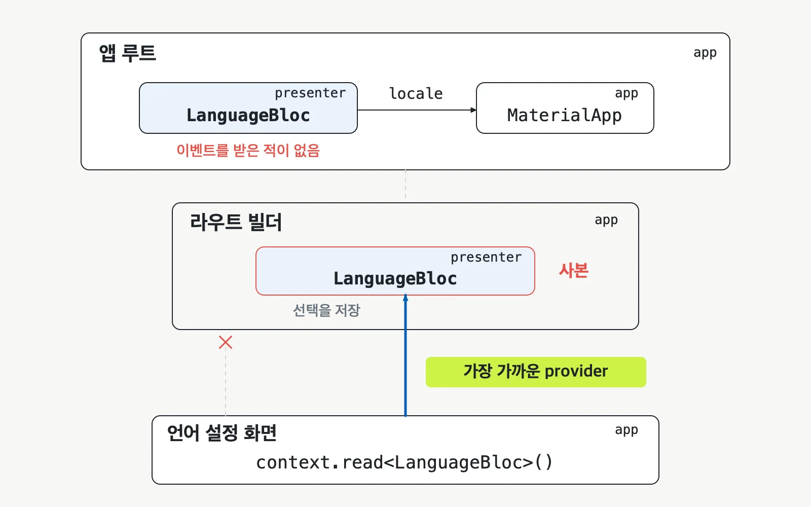

## 들어가며: 저장은 됐는데 언어가 바뀌지 않았다

올해 8월에 앱 안에서 언어를 고르는 설정 화면을 만들었어요. 목록에서 일본어를 누르면 앱 전체가 일본어로 바뀌어야 해요. 그런데 눌러도 **화면이 그대로였어요.** 앱을 껐다 켜면 일본어로 떠 있었고요. 선택은 기기에 저장됐는데, 지금 떠 있는 앱만 그 사실을 몰랐던 거예요.

같은 화면에서 하나가 더 걸렸어요. 저장이 실패하면 "다시 시도해 주세요" 토스트를 띄우는데, 구현 계획대로 짰다면 **두 번째 실패부터는 토스트가 뜨지 않았을** 거예요. 이건 리뷰에서 잡혔어요.

두 문제 모두 에러가 없었어요. BLoC 은 이벤트를 받았고, `emit` 도 불렸어요. 그런데 화면은 반응하지 않았어요. 제가 믿고 있던 규칙은 이랬어요.

> 이벤트를 넣으면 BLoC 이 상태를 `emit` 하고, `emit` 하면 화면이 다시 그려진다.

이 글은 이 문장이 어디서 깨지는지에 대한 기록이에요. 「Flutter 앱을 6개 패키지로 나눈 이유」 시리즈 4편으로, [1편](/posts/flutter_architecture_1_monorepo)에서 "BLoC(ViewModel 역할)" 한 줄로 넘어간 `presenter` 패키지를 열어 봐요. 이런 분께 도움이 될 거예요.

- "서버에는 반영됐는데 화면이 안 바뀐다"는 버그를 자주 고치는 분
- 토스트·화면 이동을 상태에 넣을지 따로 뺄지 고민 중인 분
- `Cannot add new events after calling close` 를 본 적 있는 분

숫자는 2026년 11월 18일 main 기준이고, `bloc` 8.1.4·`flutter_bloc` 8.1.6·`equatable` 2.0.8 이에요.

## 「BLoC = ViewModel」은 출력을 두 갈래로 나눈다는 뜻이었다

저희 규칙 문서에는 "BLoC 을 View Model 로 취급한다"는 한 줄이 있어요. 이름만 바꿔 부르는 줄 알았는데, 세어 보니 꽤 구체적인 모양을 만들고 있었어요.

먼저 **Cubit 은 하나도 없어요.** 프로젝트 둘째 날(2025년 10월 30일) 제가 저장소에 넣은 BLoC 가이드 문서가 "이 프로젝트에서는 항상 BLoC 사용"이라고 정해 뒀어요. 이유로 든 건 두 가지예요. "어떤 이벤트가 이 상태를 만들었나"로 디버깅할 수 있고, 테스트를 "이 이벤트가 들어오면 이 상태가 나온다"로 쓸 수 있다는 거예요. 이 가이드가 어떤 원본을 바탕으로 했는지는 확인하지 못했어요.

그리고 BLoC 하나가 보통 파일 네 개로 나뉘어요.

| 파일 | 개수 | 특징 |
|---|---|---|
| `*_bloc.dart` | 146 | 이벤트 핸들러 등록, UseCase 호출 (1개는 공용 mixin) |
| `*_event.dart` | 142 | 그중 129개가 `sealed class` 계층 |
| `*_state.dart` | 143 | 그중 141개가 `Equatable` |
| `*_side_effect.dart` | 89 | `StreamController` 로 내보내는 일회성 알림 |

여기서 볼 건 마지막 줄이에요. **BLoC 의 절반 이상(89개)이 상태 말고 출력을 하나 더 가져요.** 저희는 이걸 **사이드 이펙트**라고 불러요. 토스트, 화면 이동, 바텀시트 열기처럼 "한 번 일어나고 끝나는 일"이에요.

이 글에서는 두 출력을 이렇게 나눠 부를게요.

- **상태**: 지금 화면이 그려야 할 **사실**. 같은 사실을 두 번 받아도 화면은 같아요.
- **사이드 이펙트**: 한 번 일어난 **사건**. 같은 사건이 두 번 일어나면 토스트도 두 번 떠야 해요.


<figure>
	
	<figcaption>상태는 화면이 그릴 사실이고, 사이드 이펙트는 한 번 일어나는 사건이에요.</figcaption>
</figure>

뒤에 나올 함정 대부분이 이 구분에서 나와요. **사건을 사실 자리에 넣으면 사라지고, 사실을 사건으로만 알리면 화면이 낡아요.**

비용도 있어요. 공통 예시인 이메일 수신 설정 BLoC 은 토글 두 종류를 저장하는데 파일 5개(barrel 포함), 165줄이에요. 대신 **무엇을 받고, 무엇을 그리게 하고, 무엇을 알리는지**를 파일별로 따로 읽을 수 있어요.

## 이메일 수신 설정 BLoC 을 끝까지 읽어 보기

[1편](/posts/flutter_architecture_1_monorepo) 도입부의 화면이에요. 마케팅 메일 전체 수신 토글 하나와 주제별 토글 몇 개가 있고, **누르는 즉시 저장**해요.

### 이벤트: sealed 계층으로 묶는다

```dart
// presenter/lib/src/blocs/email_preference/email_preference_event.dart
sealed class EmailPreferenceEvent {
  const EmailPreferenceEvent();
}

final class EmailPreferenceLoadEvent extends EmailPreferenceEvent { /* ... */ }

sealed class EmailPreferenceToggleEvent extends EmailPreferenceEvent {
  const EmailPreferenceToggleEvent({required this.subscribed});

  final bool subscribed;
}

final class EmailPreferenceMarketingToggledEvent extends EmailPreferenceToggleEvent { /* ... */ }

final class EmailPreferenceCategoryToggledEvent extends EmailPreferenceToggleEvent {
  // ...
  final EmailPreferenceCategoryType type;
}
```

여기서 볼 건 중간 계층인 `EmailPreferenceToggleEvent` 예요. 두 토글은 다른 이벤트지만 **같은 줄에 서서 차례로 저장돼야** 해서, sealed 상위 이벤트 하나로 묶고 핸들러를 그 타입에 한 번만 달아요. 핸들러 안의 `switch` 가 하위 타입을 빠짐없이 다뤘는지는 컴파일러가 확인해 줘요.

### 상태: 사실만, 비교할 수 있게

상태(`EmailPreferenceState`)는 `Equatable` 이고, 필드는 `status`(로딩·첫 조회 실패·준비)와 서버에서 받은 설정 모델 `preference` 두 개뿐이에요. **"저장 실패" 는 상태에 없어요.** 그건 사건이라 사이드 이펙트로 보내요. `props => [status, preference]` 는 `Equatable` 이 두 상태가 같은지 비교할 때 쓰는 목록이에요. 이 목록이 뒤에서 중요해져요.

### BLoC: 먼저 바꾸고, 실패하면 되돌린다

```dart
// presenter/lib/src/blocs/email_preference/email_preference_bloc.dart
EmailPreferenceBloc({required this._emailPreferenceUseCase}) : super(const EmailPreferenceState()) {
  on<EmailPreferenceLoadEvent>(_onLoad);
  on<EmailPreferenceToggleEvent>(_onToggle, transformer: sequential());
}

Future<void> _onToggle(EmailPreferenceToggleEvent event, Emitter<EmailPreferenceState> emit) async {
  final EmailPreferenceModel? previous = state.preference;
  if (previous == null || !previous.hasEmail || !previous.isChangeable) return;

  final Future<Result<EmailPreferenceModel>> request;
  switch (event) {
    case EmailPreferenceMarketingToggledEvent(:final subscribed):
      if (previous.marketingSubscribed == subscribed) return;
      emit(state.copyWith(preference: previous.withMarketingSubscribed(subscribed)));
      request = _emailPreferenceUseCase.updateMarketing(subscribed);
    case EmailPreferenceCategoryToggledEvent(:final type, :final subscribed):
      if (!previous.marketingSubscribed) return;
      emit(state.copyWith(preference: previous.withCategorySubscribed(type, subscribed)));
      request = _emailPreferenceUseCase.updateCategory(type, subscribed);
  }

  final result = await request;
  switch (result) {
    case Success(:final data):
      emit(state.copyWith(preference: data));
      // 전체 수신을 바꿨으면 처리 결과 고지 사이드 이펙트 ...
    case Failure(:final error):
      emit(state.copyWith(preference: previous));
      _emitSideEffect(EmailPreferenceUpdateFailedEffect(error: error));
      if (error is ResponseError && error.hasErrorCode(notChangeableErrorCode)) {
        await _onLoad(const EmailPreferenceLoadEvent(), emit);
      }
  }
}
```

흐름은 세 단계예요. 요청을 보내기 전에 **토글을 먼저 바꿔 그리고**(낙관적 갱신), 서버가 성공하면 **서버 값으로 덮어쓰고**, 실패하면 **`previous` 로 되돌린 뒤** 실패를 사이드 이펙트로 알려요. `Result`·`Success`·`Failure` 는 실패를 값으로 넘기는 타입으로, 3편에서 다뤄요.

`transformer: sequential()` 은 **토글이 겹치면 줄 세워 하나씩** 처리하라는 선언이에요. BLoC 은 기본이 동시 실행이라, 이게 없으면 늦게 온 응답이 그 뒤에 바꾼 값을 덮어요. 이벤트 겹침을 transformer 로 선언하게 된 과정은 [같은 문제를 270가지 방법으로 푼 코드베이스](/posts/bloc_concurrency_refactor)에 자세히 적었어요.

### 화면: 상태는 그리고, 사건은 듣는다

화면은 BLoC 을 **만들지 않고 꺼내 쓰기만** 해요(`context.read`). 상태는 `BlocBuilder` 에서 `status` 로 `switch` 해 로딩·재시도·본문 중 하나를 그려요. 사이드 이펙트는 `initState` 에서 `bloc.sideEffects.listen(...)` 으로 구독해 스낵바를 띄우고, `dispose` 에서 구독을 끊어요. 토글을 누르면 이벤트를 `add` 하는 게 전부예요. 화면이 하는 일은 **그리기와 이벤트 넣기** 두 가지뿐이에요.

화면이 BLoC 을 건너뛰고 `UseCase` 를 직접 부르는 건 [1편](/posts/flutter_architecture_1_monorepo)에서 소개한 아키텍처 테스트가 막아요. BLoC 관점에서 이 테스트가 지키는 건 **로딩·에러가 상태 밖에 흩어지지 않는 것**이에요. 위젯 지역 변수에 사는 로딩과 실패는 BLoC 테스트로 검증할 수 없거든요.

그럼 이 구조에서 첫 번째로 깨진 가정, **"emit 하면 화면이 바뀐다"**로 가 볼게요.

## 함정 1: 같은 상태는 두 번 emit 되지 않는다

언어 설정 화면의 구현 계획에는 저장 실패를 이렇게 담았어요.

```dart
// (당시 구현 계획) presenter/lib/src/blocs/language/language_state.dart
class LanguageState extends Equatable {
  const LanguageState({this.selectedLanguage, this.hasSaveFailed = false});

  final AppLanguage? selectedLanguage;
  final bool hasSaveFailed;

  @override
  List<Object?> get props => [selectedLanguage, hasSaveFailed];
}
```

화면은 `listenWhen: (previous, current) => !previous.hasSaveFailed && current.hasSaveFailed` 로 토스트를 띄울 계획이었어요. BLoC 가이드 문서도 `BlocListener` 에서 상태를 보고 부작용을 처리하는 예시를 들고 있어서 자연스러워 보였어요.

그런데 리뷰에서 **"두 번 연속 실패하면요?"** 라는 질문이 나왔고, 재현해 보니 정말 두 번째 토스트가 뜨지 않았어요. 답은 `bloc` 8.1.4 의 `emit` 에 있었어요.

```dart
// bloc-8.1.4/lib/src/bloc_base.dart
void emit(State state) {
  // ...
  if (state == _state && _emitted) return;
  // ...
}
```

**이전과 같은 상태는 조용히 버려요.** 첫 실패로 `hasSaveFailed` 가 `true` 가 되면, 두 번째 실패의 상태는 필드까지 똑같아요. `Equatable` 이 같다고 판단하니 `emit` 도 리스너도 아무 일도 하지 않아요.

같은 사실을 두 번 그릴 필요는 없으니 이 동작은 맞아요. 문제는 **사건을 사실 자리에 넣은 것**이었어요. 고치는 방법은 두 가지였어요.

| 방법 | 모양 | 어울리는 곳 |
|---|---|---|
| 매번 달라지는 값 | `saveFailureCount` 를 1씩 올리고 `listenWhen: current.count > previous.count` | 토스트 하나 정도의 가벼운 신호 |
| 사이드 이펙트 스트림 | `StreamController.add(effect)` — 동등성 비교를 거치지 않음 | 시트·화면 이동처럼 사건이 여러 종류일 때 |

언어 설정은 **카운터**를 골랐어요. 사이드 이펙트도 후보였지만, 토스트 하나에 구독 수명 관리를 새로 들이는 비용이 컸고 이중 구독 사고 이력도 있었거든요. 반대로 이메일 수신 설정은 사건이 두 종류라 사이드 이펙트를 썼어요. 어느 쪽이든 테스트에 **연속 두 번 실패하는 경우**를 넣는 게 이 함정을 잡는 가장 싼 방법이에요.

그 이중 구독 사고가 무엇이었는지 볼게요.

## 함정 2: 사이드 이펙트 스트림은 구독자 수만큼 일어난다

저희 사이드 이펙트 컨트롤러 88개 중 84개가 `StreamController.broadcast()` 예요. 여러 곳에서 구독할 수 있다는 점이 편하기도 하고 위험하기도 해요.

팀 챌린지 화면에서는 기록을 마치고 축하 시트를 닫으면 **이미 닫았던 기록 시트가 그 아래 남아 있었어요.** 시트를 닫는 코드는 멀쩡했어요.

원인은 **같은 BLoC 의 사이드 이펙트를 두 위젯이 구독**한 거였어요. 하나로 합쳤던 구독이 머지 충돌을 풀면서 되살아났어요. "시트를 열어라" 사건 하나에 핸들러 두 개가 시트를 한 장씩 열었고, 닫기는 한 장만 닫았어요.

여기서 배운 규칙은 하나예요. **시트나 화면 이동을 일으키는 사이드 이펙트는 구독자가 하나여야 해요.** "시트가 안 닫힌다"는 증상인데 닫는 코드가 멀쩡하면, 시트가 두 장 열렸는지부터 봐요.

반대로 **구독자가 없을 때 나간 사건은 사라져요.** 그래서 화면은 `initState` 에서 구독하고, 라우트 빌더가 넣는 첫 이벤트(`EmailPreferenceLoadEvent`)는 사이드 이펙트를 내지 않게 짰어요. BLoC 이 닫힐 때는 컨트롤러도 닫고, 내보내는 쪽을 `if (!_sideEffectController.isClosed)` 로 감싸요. 이 `isClosed` 가드가 BLoC 자체에는 통하지 않는다는 건 함정 5에서 볼게요.

## 함정 3: 화면이 안 바뀌면 두 게이트를 다 본다

팀 화면에서 방장 위임을 수락한 멤버가 설정 버튼을 누르면 **여전히 멤버용 설정 화면**으로 갔어요. 서버에서는 이미 방장이었는데요.

한 군데만 고치면 될 줄 알았는데, **독립된 두 곳이 모두 막고 있었어요.** 이 글에서는 이걸 **두 게이트**라고 부를게요.

**게이트 1: 핸들러가 바뀐 사실을 다시 받아 emit 하나.** 수락 핸들러는 "위임 성공" 사이드 이펙트만 내보냈고, 화면은 그걸 받아 게시판만 새로 불렀어요. 설정 화면을 가르는 "내 역할"은 다른 API 값이라 아무도 다시 받지 않았어요. 사건은 알렸지만 **사실은 낡은 채로** 남은 거예요.

```dart
// presenter/lib/src/blocs/team/team_main_bloc.dart
.onSuccess((_) async {
  // 수락하면 내 역할이 바뀌므로 멤버십을 서버에서 다시 받아 emit 한다. 거절은 역할이 그대로라 생략.
  if (event.accepted) await _refreshMembership(emit);
  if (!_sideEffectController.isClosed) {
    _sideEffectController.add(const TeamMainLeadershipTransferSucceeded());
  }
})
```

**게이트 2: 위젯이 그 필드의 변화를 보고 다시 그리나.** 멤버십을 새로 emit 해도 화면은 그대로였어요. 팀 화면의 `BlocBuilder` 가 `buildWhen` 으로 코인과 배지 수만 비교하고 있었거든요. 아래 위젯은 `ValueKey(teamId)` 로 State 를 유지하면서 생성자로 받은 멤버십만 쓰는 구조라, 부모가 다시 그려지지 않으면 옛 멤버십을 계속 들고 있었어요. `buildWhen` 에 `prev.membership != curr.membership` 비교를 더해 고쳤어요.

여기서 볼 건 두 게이트가 **서로 다른 패키지**(`presenter` 의 핸들러, `app` 의 `buildWhen`)에 있다는 점이에요. 하나만 고치면 증상이 그대로라 "고쳤는데 왜 안 되지"를 한 번 더 겪어요. `Equatable` 의 `props` 도 게이트 2에 속해요. 새 필드를 `props` 에 넣지 않으면 그 필드만 바뀐 상태는 함정 1처럼 `emit` 에서 버려져요.

저희 BLoC 가이드는 "항상 `buildWhen` 과 `listenWhen` 사용"을 성능 최적화로 권해요. 지금 `app` 에는 `buildWhen` 이 73곳 있어요. 그런데 `buildWhen` 은 **비교하지 않은 필드의 변화를 버리겠다는 선언**이기도 해서, 상태에 필드가 늘 때마다 다시 봐야 해요. 이 일을 고치고 열흘 뒤, `presenter` 패키지의 규칙 파일에는 이 한 줄이 들어갔어요.

> 서버 액션 후 화면 갱신 안 되면: ①핸들러 재조회 emit ②buildWhen/props 둘 다 의심

재조회는 값이 바뀌는 액션에만 해요(거절은 생략). 그리고 **서버에서 다시 받는 쪽**을 기본으로 둬요. 이메일 토글처럼 앱이 결과를 알 수 있으면 낙관적 갱신이 맞지만, 역할처럼 서버가 여러 규칙으로 정하는 값은 앱이 추측하면 틀려요.

들어가며의 언어 설정은 BLoC 이 **둘**이 되면서 생긴 문제였어요.

## 함정 4: BLoC 을 어디서 만드는지가 화면이 듣는 BLoC 을 정한다

저희는 **화면 전용 BLoC 을 라우트 빌더(`{feature}_page_route.dart`)에서 만들고, Page 는 `context.read` 로 꺼내기만** 해요. BLoC 관점에서 이 규칙이 주는 건 **BLoC 의 수명이 라우트의 수명과 같아진다**는 거예요. 화면이 닫히면 `BlocProvider` 가 BLoC 을 닫아요. 규칙이 생긴 경위와 DI·테스트 쪽 이점은 [5편](/posts/flutter_architecture_5_di_routing_testing)에서 다뤄요.

### 루트에 있는 BLoC 을 라우트에서 또 만들면

들어가며의 언어 설정이 이 규칙을 그대로 따른 결과였어요. 라우트 빌더가 `LanguageBloc` 을 새로 만들었는데, `LanguageBloc` 은 **이미 앱 루트에 하나 있었고** 그 루트 인스턴스가 `MaterialApp` 의 `locale` 을 정하고 있었어요. 화면의 `context.read<LanguageBloc>()` 은 **가장 가까운** provider, 즉 라우트가 만든 사본을 잡아요. 사본은 선택을 저장했지만 루트 인스턴스는 이벤트를 받은 적이 없으니, 재시작해야 바뀌었던 거예요.


<figure>
	
	<figcaption>화면은 가장 가까운 provider 인 사본에 이벤트를 넣었고, locale 을 정하는 루트 BLoC 은 몰랐어요.</figcaption>
</figure>

"라우트 빌더에서 주입"은 **그 화면 전용 BLoC** 에 대한 규칙이었는데, 규칙 한 줄에는 그 구분이 없었어요. 규칙을 성실히 따른 결과가 버그였어요.

테스트로도 잡기 어려워요. 화면 테스트가 자기 `BlocProvider` 로 화면을 감싸면 테스트 안에는 사본 하나뿐이라 잘 동작해요. **실제 라우트 객체를 테스트 라우터에 물리고, 루트 BLoC 의 상태를 확인해야** 이 불일치가 보여요.

### 같은 BLoC 이 두 곳에서 태어나면

팀 채팅에서는 채팅 BLoC 이 채팅 탭 위젯과 라우트 빌더, **두 곳에서 만들어지고 있었어요.** 둘이 같은 싱글톤 소켓을 써서 팀 탭에 들어갈 때마다 연결이 두 번 시작됐고, 라우트 쪽 BLoC 은 아무것도 그리지 않은 채 살아 있었어요. 생성 위치를 한 곳으로 줄여 고쳤어요.

두 사례 모두 **에러가 없었어요.** 두 BLoC 은 각자 정상으로 동작했고, 화면이 듣는 쪽과 일이 일어나는 쪽이 달랐을 뿐이에요. 그래서 새 화면을 만들 때 먼저 묻는 게 생겼어요. **이 BLoC 이 루트에 이미 있나?** 있으면 라우트는 화면만 그려요.

## 함정 5: 닫히는 중인 BLoC 은 아직 닫히지 않았다

라우트가 만든 BLoC 은 화면을 닫으면 닫혀요. 그런데 서버 응답은 그 뒤에도 도착해요. 응답을 받은 쪽이 이벤트를 넣으면 이런 에러가 나요.

```text
Bad state: Cannot add new events after calling close
```

`bloc` 8.1.4 의 `add` 는 이 에러를 보고한 뒤 다시 던져서, 앱이 실제로 죽어요. 흔한 처방은 `if (!isClosed) add(...)` 이고, 저희 `presenter` 규칙에도 stream 리스너의 `add()` 앞에 `isClosed` 가드를 두라고 적혀 있어요.

그런데 이 가드를 넣어도 같은 에러가 났어요. `close()` 순서를 보면 이유가 보여요.

```dart
// bloc-8.1.4/lib/src/bloc.dart
Future<void> close() async {
  await _eventController.close(); // 1. 이벤트 입구를 먼저 닫는다
  // ... 진행 중인 핸들러·구독 정리를 기다린다
  return super.close();           // 2. 상태 스트림은 마지막에 닫는다
}
```

`isClosed` 는 2번, 상태 스트림이 닫혔는지를 봐요. 이벤트 입구는 1번에서 이미 닫혔고요. 그래서 **`close()` 가 시작된 뒤 끝나기 전까지는 `isClosed` 가 `false` 인데 `add` 는 실패해요.** 화면을 닫는 순간 응답이 도착하면 정확히 이 틈에 걸려요.

저희는 이 틈을 두 가지로 막았어요.

**핸들러 안의 후속 조회는 이벤트로 넣지 않고 직접 부른다.** 이메일 수신 설정에서 "이 계정은 이제 바꿀 수 없다"는 에러가 오면 설정을 다시 받아야 해요. 앞에서 본 `_onToggle` 의 마지막 줄처럼, `add(LoadEvent)` 대신 같은 핸들러 안에서 `await _onLoad(...)` 를 불러요. 닫힌 뒤의 `emit` 은 아무 일도 하지 않으니 안전해요.

**핸들러 밖에서 오는 지연 add 는 입구에서 막는다.** 시트가 닫히는 콜백이나 타이머처럼 BLoC 밖에서 늦게 `add` 하는 호출부는 수십 곳에 흩어져 있어요. 동료가 이걸 호출부마다 막는 대신, `add` 를 덮어쓰는 mixin 하나로 막았어요.

```dart
// presenter/lib/src/blocs/common/close_safe_add_bloc.dart
mixin CloseSafeAddBloc<Event, State> on Bloc<Event, State> {
  LogInterface get closeSafeAddLogger;

  bool _isClosing = false;

  @override
  void add(Event event) {
    if (isClosed || _isClosing) {
      closeSafeAddLogger.nonFatalError(StateError('...add after close'), StackTrace.current);
      return;
    }
    super.add(event);
  }

  @override
  Future<void> close() {
    _isClosing = true;
    return super.close();
  }
}
```


<figure>
	
	<figcaption>isClosed 가 false 인 동안에도 add 는 이미 실패하는 틈이 있어서, close() 에 들어온 순간을 따로 기록했어요.</figcaption>
</figure>

여기서 볼 건 두 가지예요. `isClosed` 대신 **`close()` 에 들어온 순간을 따로 기록**하고, 버린 이벤트를 **치명적이지 않은 에러로 보고**해요. 닫힌 BLoC 에 이벤트를 보내는 호출부 자체가 결함일 수 있으니, 크래시는 없애되 빈도는 추적하려는 거예요.

이 mixin 은 **12개 BLoC 에만** 붙어 있어요. 기준은 "라우트가 소유해서 닫히면서, 실제로 이 크래시가 관측된 BLoC"이에요. 루트 BLoC 은 앱이 살아 있는 동안 닫히지 않으니 붙일 이유가 없어요.

## 마치며: 이벤트와 화면 사이에는 칸이 다섯 개 있었다

처음 믿었던 규칙은 "이벤트를 넣으면 상태를 emit 하고, emit 하면 화면이 다시 그려진다"였어요. 실제로는 그 사이에 칸이 더 있었어요.

1. 이벤트가 **화면이 듣는 그 BLoC** 에 들어가야 해요. 루트 BLoC 을 라우트가 가리면 사본이 받아요.
2. 그 BLoC 이 **아직 이벤트를 받을 수 있어야** 해요. 닫히는 중이면 `isClosed` 가 거짓말을 해요.
3. 핸들러가 **바뀐 사실을 다시 받아** emit 해야 해요. 사건만 알리면 사실은 낡아요.
4. 새 상태가 **이전 상태와 달라야** 해요. 같으면 `emit` 이 버려요.
5. 위젯의 `buildWhen` 이 **그 필드를 비교해야** 해요.


<figure>
	
	<figcaption>이벤트에서 화면까지 다섯 칸 중 어느 하나라도 막히면, 에러 없이 화면이 그대로예요.</figcaption>
</figure>

「BLoC = ViewModel」이라는 한 줄이 실제로 정한 건 **출력을 상태와 사이드 이펙트로 나눠 생각하게 한 것**이었어요. 사실은 상태로, 사건은 사이드 이펙트로 보내면 3·4번 칸의 함정 대부분이 사라져요. 1·2번 칸은 BLoC 이 어디서 태어나 언제 죽는지의 문제였고요.

돌아보면 모든 함정이 **에러 없이 아무 일도 일어나지 않는** 모양이었어요. 같은 상태를 버리고, 가장 가까운 provider 를 고르는 건 다 맞는 동작이에요. **맞는 동작이 겹쳐서 틀린 화면이 나왔어요.**

여러분의 저장소에서도 이렇게 확인해 보세요.

- 상태 클래스에 `bool` 로 된 일회성 플래그(`hasError`, `isSaved` 등)가 있나요? 있다면 연속 두 번 실패하는 테스트를 넣어 보세요.
- 앱 루트에서 제공하는 BLoC 목록을 뽑고, 같은 타입을 `BlocProvider(create:)` 로 만드는 라우트가 있는지 찾아보세요.
- `buildWhen` 이 있는 `BlocBuilder` 하나를 골라, 그 상태의 필드 중 비교 목록에 빠진 것이 무엇인지 세어 보세요.

### 시리즈 안내

1. **모노레포 지도: 왜 패키지를 6개로 나눴나** ([1편](/posts/flutter_architecture_1_monorepo))
2. **데이터 한 사이클**: 토글 하나가 화면에서 서버까지 갔다 오는 길, 그리고 계층 경계 ([2편](/posts/flutter_architecture_2_data_flow))
3. **Result 와 ROP**: 예외 대신 실패를 값으로 넘기기
4. **BLoC 을 ViewModel 로**: 상태·이벤트·사이드 이펙트를 나누는 기준 (이 글)
5. **DI·라우팅·테스트, 그리고 AI 와 일할 때**: 구조를 사람과 AI 에이전트가 함께 지키는 법 ([5편](/posts/flutter_architecture_5_di_routing_testing))

## 참고 자료

- [bloc](https://pub.dev/packages/bloc) 8.1.4 — `emit` 은 `lib/src/bloc_base.dart`, `close()` 는 `lib/src/bloc.dart`
- [flutter_bloc](https://pub.dev/packages/flutter_bloc) 8.1.6 — `BlocBuilder.buildWhen`, `BlocListener.listenWhen`
- [bloc_concurrency](https://pub.dev/packages/bloc_concurrency) 0.2.5 — `sequential()` 등 transformer
- [equatable](https://pub.dev/packages/equatable) 2.0.8 — `props` 로 동등성을 정의
- [같은 문제를 270가지 방법으로 푼 코드베이스](/posts/bloc_concurrency_refactor) — 이벤트 겹침을 transformer 로 정리한 기록
