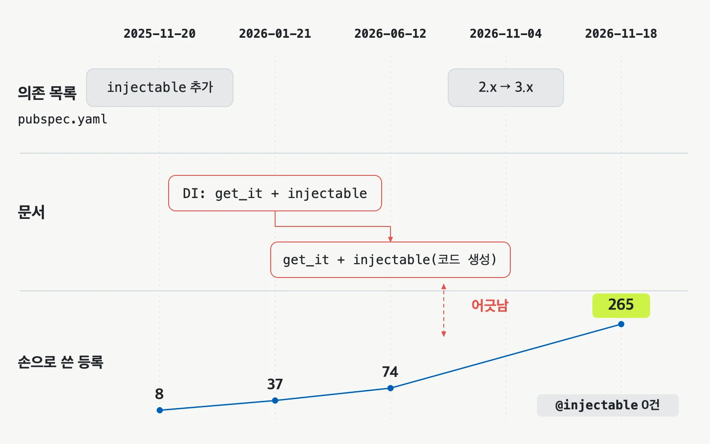
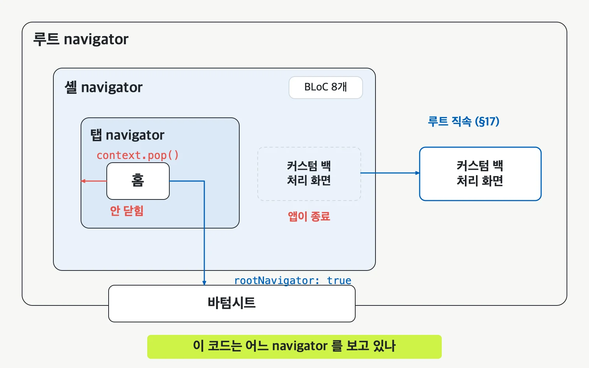
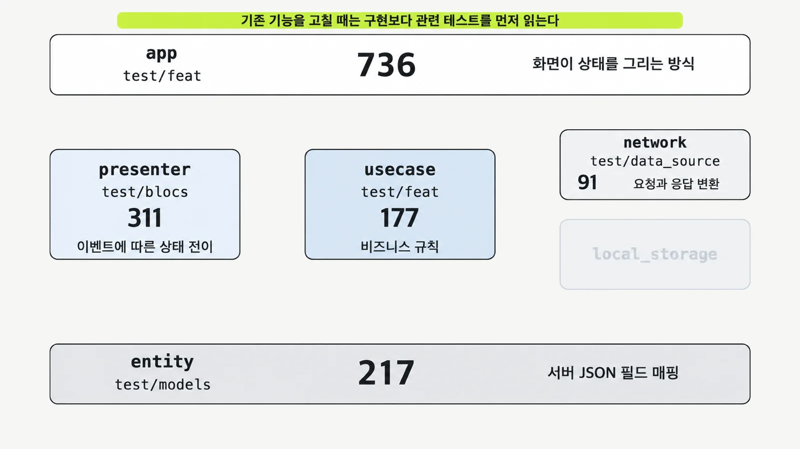
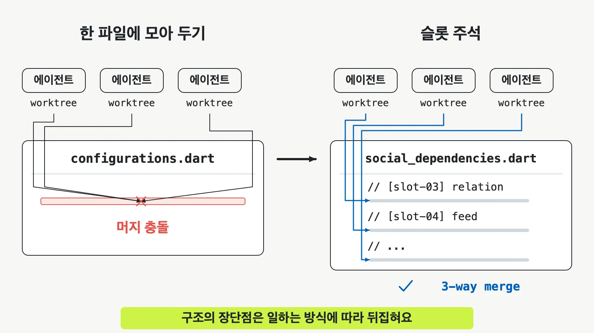

## 들어가며: 문서에는 코드 생성, 코드에는 손으로 쓴 등록 265곳

저장소 루트 문서의 기술 스택에는 `DI: get_it + injectable` 이라고 적혀 있어요. 어노테이션으로 등록 코드를 생성해 주는 그 injectable 이요. 그런데 저장소에는 생성 파일(`*.config.dart`)이 하나도 없고, 손으로 쓴 등록 파일 두 개가 있어요. 합쳐서 1,931줄, `register` 호출은 265곳이에요.

시리즈 마지막 편은 2~4편의 "이메일 수신 설정" 조각을 조립하는 쪽, 즉 DI·라우팅·테스트를 보고, 이 어긋남에서 시작해 시리즈를 한 질문으로 닫아요. 이 구조는 AI 에이전트와 일할 때 무엇을 줬고, 무엇을 막았을까요? 숫자는 2026년 11월 18일 main 기준이고, Flutter 3.47.4, go_router 14.8.1, get_it 8.3.0, flutter_bloc 8.1.6 이에요.

## injectable 은 한 번도 쓰인 적이 없었다

예전에 쓰다가 손으로 바꿨겠거니 했는데, 모든 브랜치 이력에서 `git log --all -S` 로 `@injectable`, `@lazySingleton`, `injection.config` 를 찾아보니 세 검색 모두 0건이었어요. 그럼 문서의 그 줄은 어디서 왔을까요?

| 날짜 | 무슨 일 | DI 파일 |
|---|---|---|
| 2025-11-20 | 동료가 뼈대 커밋에서 `get_it`·`injectable`·`injectable_generator` 를 의존에 추가. 같은 커밋에서 DI 파일은 손으로 작성 | 82줄, 등록 8곳 |
| 2026-01-21 | 제가 `CLAUDE.md` 에 "Tech Stack" 절을 만들며 `DI: get_it + injectable` 을 적음 | 213줄, 37곳 |
| 2026-06-12 | 문서를 나누며 `docs/architecture.md` 에 "get_it + injectable(코드 생성)" 으로 옮김 | 417줄, 74곳 |
| 2026-11-04 | 코드 생성기를 새 Dart 문법에 맞추려고 `injectable` 을 2.x → 3.x 로 올림 | — |
| 2026-11-18 | 지금 | 2개 파일 1,931줄, 265곳 |

<figure>
	
	<figcaption>문서와 의존 목록이 injectable 을 말하는 동안, 코드는 처음부터 손으로 등록했어요.</figcaption>
</figure>

코드는 첫날부터 손으로 썼고, 문서 한 줄은 제가 DI 코드를 건드리지 않은 QA 수정 커밋에서 적었어요(어떻게 쓰게 됐는지는 기억에 없어요). 그 줄은 나중에 "(코드 생성)"까지 붙어 옮겨졌고, 쓰지 않는 패키지를 업그레이드까지 했어요. `entity` 문서의 "모델은 json_serializable"도 같은 경우예요. **의존 목록을 보고 쓴 문서는 의존 목록만큼만 정확했어요.**

## 손으로 등록해서 얻은 것과 잃은 것

이메일 수신 설정의 등록은 `usecase` 의 인터페이스에 `network` 의 구현을 끼우는 곳이에요.

```dart
// app/lib/system/di/configurations.dart
getIt.registerLazySingleton<EmailPreferenceDataSource>(
  () => EmailPreferenceDataSourceImpl(baseNetwork: getIt<BaseNetwork>(instanceName: 'apiNetwork')),
);
// ...
getIt.registerLazySingleton<EmailPreferenceUseCase>(
  () => EmailPreferenceUseCase(dataSource: getIt<EmailPreferenceDataSource>()),
);
```

얻은 건 DI 컨테이너를 아는 패키지가 `app` 하나뿐이라는 점이에요. 나머지 패키지의 `lib/` 에는 `get_it` import 가 0줄이고, BLoC 과 UseCase 는 생성자로 받기만 하니 `presenter/test`·`usecase/test` 에서 `getIt` 에 등록하는 파일도 0개예요. injectable 을 썼다면 어노테이션 때문에 이 패키지들도 injectable 을 알아야 했을 거예요(이걸 노리고 손으로 썼다는 기록은 없어요).

잃은 것도 있어요. 등록을 빠뜨려도 컴파일은 되고, 그 타입을 처음 꺼내는 화면에서야 에러가 나요. 부팅 중이면 더 아파요. get_it 8.3.0 에서는 비동기 싱글턴이 준비되지 않았어도 `isRegistered<T>()` 가 true 인데 `getIt<T>()` 는 `StateError` 를 던지고, `Error` 라서 `on Exception catch` 로는 안 잡혀요. 동료가 첫 화면이 영영 안 뜨는 문제를 고치며 싱글턴마다 8초 상한을 두고, 부팅 경로의 접근을 던지지 않는 함수로 감쌌어요.

```dart
// app/lib/system/di/safe_get.dart
T? safeGet<T extends Object>() {
  try {
    if (!getIt.isRegistered<T>()) return null;
    return getIt<T>();
  } on Object catch (error) {
    debugPrint('safeGet<$T> failed: $error');
    return null;
  }
}
```

`on Object` 로 `Error` 까지 잡아요. 로그를 남기려던 `getIt` 접근이 던져서 방어 코드가 앱을 스플래시에 가둔 일이 실제로 있었거든요.

두 번째 비용은 파일 크기예요. `configurations.dart` 는 2026년 3월 1일 240줄·40곳에서 지금 1,656줄·227곳이 됐고(두 번째 파일 275줄·38곳 별도), 6월 1일 71곳에서만 세 배 넘게 늘었어요. 이 파일을 고친 커밋도 227개예요. 모든 기능이 지나가는 길목이 된 거고, 이게 진짜 문제가 된 건 AI 에이전트 여럿이 동시에 일할 때였어요.

그럼 injectable 로 바꿔야 할까요? 저희는 누락 사고가 드물었고 사고 대부분은 코드 생성이 못 푸는 부팅 순서 문제였어요. 토큰 갱신용 네트워크 → 데이터 소스 → 일반 API 네트워크 같은 등록 순서가 코드에 그대로 보이는 것도 장점이고요. 그래서 바꾸지 않고, 문서에서 "injectable"을 지우고 쓰지 않는 의존을 빼기로 했어요. 순서와 무관한 단순 바인딩에 누락이 잦은 저장소라면 답이 반대일 거예요.

## BLoC 은 화면이 아니라 라우트 빌더가 만든다

DI 에서 꺼낸 UseCase 가 BLoC 에 들어가는 자리는 "BlocProvider 는 `{feature}_page_route.dart` route builder 에서 주입, Page 는 `context.read` 만"이라는 규칙(§15)이 정해요.

```dart
// app/lib/feat/notifications/email_preference_page_route.dart
static Future<void> push(BuildContext context) {
  return Navigator.of(context).push<void>(
    MaterialPageRoute<void>(
      builder: (_) => BlocProvider<EmailPreferenceBloc>(
        create: (_) => EmailPreferenceBloc(emailPreferenceUseCase: getIt<EmailPreferenceUseCase>())
          ..add(const EmailPreferenceLoadEvent()),
        child: const EmailPreferencePage(),
      ),
    ),
  );
}
```

화면은 `getIt` 도 BLoC 생성자도 모르니, 화면 테스트는 가짜 BLoC 을 끼울 수 있어요. 라우트 빌더 148개 중 134개는 `GoRoute` 를, 6개는 `Navigator` 로 직접 밀지만 어느 쪽이든 BLoC 은 라우트 빌더가 만들어요.

다만 언어 설정의 라우트 빌더가 앱 최상단의 `LanguageBloc` 을 하나 더 만들어 사본이 이벤트를 먹은 뒤로([4편](/posts/flutter_architecture_4_bloc_viewmodel)), §15 는 화면 전용 BLoC 에만 적용하고 최상단 BLoC(지금 8개)은 다시 만들지 않아요.

## go_router 의 navigator 는 하나가 아니다

저희 홈 화면은 navigator 세 겹 안쪽에 있어요. 루트 navigator 아래에 탭 화면들이 공유하는 BLoC 8개를 주입하는 `ShellRoute` 의 셸 navigator, 그 아래에 `StatefulShellRoute.indexedStack` 의 탭별 navigator 가 있어요.

<figure>
	
	<figcaption>navigator 가 세 겹이라, 함정마다 원인은 이 코드가 어느 navigator 를 보고 있느냐였어요. 그냥 <code>context.pop()</code> 하면 가장 가까운 탭 navigator 에서 멈춰요.</figcaption>
</figure>

그래서 "navigator 는 하나"라고 가정한 곳마다 함정이 있었어요. 루트에 띄운 바텀시트는 `context.pop()` 으로 닫으면 깊은 탭에서만 안 닫혀 `rootNavigator: true` 로 닫아야 하고, 셸 `pageBuilder` 페이지는 `key: state.pageKey` 가 없으면 리다이렉트 순간 GlobalKey 충돌로 셸 전체가 깨져요. 살아 있는 탭에 `extra` 로 넘긴 값은 두 번째 진입부터 무시되고, 탭 화면이 구독한 루트의 `RouteObserver` 는 위에 화면이 덮여도 콜백을 주지 않아요. 함정 여섯 개 중 다섯 개가 에러 없이 조용히 실패했고, 원인은 매번 "이 코드는 어느 navigator 를 보고 있나"였어요.

나머지 둘 중 하나는 백키를 눌렀더니 앱이 꺼진 일이에요. Android 의 predictive back(뒤로 가기 미리 보기)은 지금 누가 백을 처리하는지 미리 알아야 하는데, 셸 안쪽 라우트의 신호가 루트까지 모이지 않아 Android 가 액티비티를 내렸어요. 셸의 손자 라우트는 `parentNavigatorKey: rootNavigatorKey` 로 올리고 직속 자식은 루트 라우트 목록으로 옮겨 고쳤어요(§17).

다른 하나는 `await` 가 영영 끝나지 않은 일이에요. `await context.pushNamed(CreatePage.routeName);` 다음 줄에서 재조회하는데, `CreatePage` 가 `pushReplacementNamed` 로 완료 화면으로 바뀌면 go_router 14.8.1 은 마지막 라우트를 지우고 새 completer 로 push 해요. 지워진 라우트의 completer 는 완료되지 않으니 처음 `await` 는 영원히 기다리고, 챌린지 개설 후 목록이 갱신되지 않았어요. 이제 화면 간 갱신은 `await` 대신 UseCase 가 발행한 이벤트를 BLoC 이 구독해 재조회해요.

## 테스트는 패키지를 따라 스펙이 된다

테스트 폴더도 패키지를 따라 나뉘어요. JSON 매핑은 `entity/test/models`(217개), 비즈니스 규칙은 `usecase/test/feat`(177개), 상태 전이는 `presenter/test/blocs`(311개), 요청·응답 변환은 `network/test/data_source`(91개), 화면은 `app/test/feat`(736개)예요. 기존 기능을 고칠 때는 구현보다 관련 테스트를 먼저 읽는다는 규칙(§21)이 이 폴더들을 스펙으로 만들어요.

<figure>
	
	<figcaption>테스트 폴더가 패키지를 따라 나뉘어 있어서, 고칠 곳의 스펙을 어디서 읽을지 정해져 있어요.</figcaption>
</figure>

이메일 수신 설정은 모델 테스트(58줄)가 필드 매핑을, BLoC 테스트(157줄)가 토글 실패 시 되돌림을, 화면 테스트(150줄)가 전체 수신을 끄면 주제가 잠기는지를 못 박아요. 화면 테스트는 가짜 BLoC 을 `BlocProvider.value` 로 넣어요.

```dart
// app/test/feat/notifications/email_preference_page_test.dart
await tester.pumpWidget(
  localizedTestApp(
    home: MultiBlocProvider(
      providers: [
        BlocProvider<EmailPreferenceBloc>.value(value: bloc), // MockBloc
        BlocProvider<NetworkStatusBloc>.value(value: networkStatusBloc),
      ],
      child: const EmailPreferencePage(),
    ),
  ),
);
```

화면 테스트에 `getIt` 이 없어요. 반대로 `app/test` 에는 `getIt` 에 가짜를 등록하는 파일이 177개 있는데, 위젯이 UseCase 를 직접 꺼내는 곳(2편의 78개 파일)이 그만큼 테스트 준비를 무겁게 만들어요. **경계가 새는 곳은 테스트 준비 코드에서 먼저 티가 나요.** 화면 테스트가 라우트와 똑같이 BlocProvider 를 만들면 라우트의 실수는 못 잡으니, 라우팅 계약은 실제 라우트 객체를 테스트용 GoRouter 에 붙이는 테스트로 `app/test/router` 에 모아 뒀어요(18개 파일).

`entity` 와 `usecase` 도 `flutter test` 로만 돌려요. `dart test` 는 여러 파일을 한 묶음으로 컴파일해서, 간접적으로 `package:flutter` 를 끌어오는 파일 하나가 깨지면 멀쩡한 파일까지 빈 메시지로 "Failed to load"가 돼요. 2026년 8월에 디렉토리로 40여 개가 실패한 걸 환경 문제로 잘못 판정한 뒤로, 빈 메시지 실패가 무더기로 나오면 회귀보다 러너를 먼저 의심해요.

위젯 테스트에는 틀린 값으로 통과하는 자리도 있었어요. 기본 폰트는 글자가 전부 정사각형이라 11자 문구 폭이 실제 64.45px 대신 132px 로 나오고, 번역 없는 `MaterialApp` 은 긴 대체 문자열을 그려 높이가 달라져요. 오버플로우는 RenderObject 하나당 한 번만 보고돼서 여러 폭·배율을 한 테스트에서 돌리면 32조합이 전부 통과로 읽혀요. 그래서 텍스트 크기를 재는 테스트는 실제 폰트와 번역부터 올려요.

## 이 구조가 AI 에이전트에게 준 것

저는 올해 코드 대부분을 AI 코딩 에이전트(Claude Code)와 함께 썼어요. AI 를 염두에 두고 만든 구조는 아니지만 꽤 도움이 됐어요. 규칙 문서를 읽히는 쪽은 [AI 에게 규칙은 쓰는 것보다 읽히는 게 어렵다](/posts/ai_agent_harness)에서 다뤘으니, 여기서는 패키지 구조 쪽만 볼게요.

먼저 찾는 범위가 패키지 이름으로 좁혀져요. "토글 실패 시 되돌리기"는 `presenter` 의 BLoC 폴더, "서버 필드가 안 들어온다"는 `entity` 의 모델이에요. `*_page_route.dart`·`*_bloc.dart`·파일당 public 클래스 하나 같은 이름 규칙 덕분에 기능 이름 하나로 파일 이름을 맞힐 수도 있어요.

규칙 문서도 패키지마다 있고, 에이전트는 그 디렉토리 파일을 다룰 때만 읽어요. 규칙이 패키지 책임과 같은 모양으로 나뉘는 셈이에요. `app` 문서(10,606 B)가 나머지 다섯 개를 합친 것(6,840 B)보다 큰 건, navigator 함정처럼 함정이 화면 패키지에 가장 많이 모여 있어서예요.

테스트 위치는 먼저 읽을 것을 정해 줘요. 코드만 읽으면 지금 동작을 의도로 받아들이기 쉬운데, §21 은 "같은 패키지의 `test/` 에서 같은 이름을 찾아 먼저 읽어라"라는 기계적인 지시가 돼요. 이 규칙을 정한 2026년 6월의 첫 ADR 도 AI 세션이 만든 코드의 "왜"가 다른 세션에 남지 않는다는 게 이유였어요.

## 같은 구조가 AI 에이전트를 막은 곳

기능 하나가 다섯 패키지를 지나가는 건 에이전트에게도 부담이에요. 1편에서 기능 커밋의 52% 가 패키지 3개 이상을 고쳤다고 했는데, `usecase` 의 sealed 이벤트에 하위 타입을 더하면 다른 패키지의 BLoC `switch` 가 깨져요. 그래서 "디렉토리가 아니라 패키지 전체를 분석한다"는 규칙이 생겼어요.

가장 크게 부딪힌 건 에이전트 여럿을 동시에 돌릴 때였어요. 올해 10월 소셜 탭을 21개 작업 단위, 11개 묶음으로 나눠 에이전트마다 각자의 git worktree 에서 병렬 구현했는데, 서로 다른 화면을 만들어도 DI 등록 파일·barrel·라우트 목록은 모두가 손대야 했어요. 앞의 "길목"이 머지 충돌로 터진 거예요. 해법은 코드가 아니라 파일 배치였어요. 첫 묶음이 소셜 전용 DI 파일, barrel 네 개, 라우트 목록을 따로 만들고 작업 단위별 슬롯 주석을 미리 넣었어요.

```dart
// app/lib/system/di/social_dependencies.dart
// 각 작업은 자기 슬롯 주석 바로 아래에만 줄을 추가한다 — 슬롯 주석이 병렬 머지의 경계다.
void registerSocialDataSources() {
  // [slot-03] relation
  getIt.registerLazySingleton<SocialRelationDataSource>(/* ... */);
  // [slot-04] feed
  getIt.registerLazySingleton<SocialFeedDataSource>(/* ... */);
  // ...
}
```

원래의 DI 파일과 barrel 은 그 뒤로 아무도 고치지 않았어요. 슬롯 주석 사이에 고정된 줄이 있으니, 각자 자기 슬롯 아래에 줄을 더해도 git 의 3-way merge 가 합쳐요. 지금 이 파일의 슬롯 주석은 22개예요. 그래도 같은 자리에 몰리는 import 줄은 남아서 머지 전 rebase 후 재검증 단계를 뒀어요.

<figure>
	
	<figcaption>모두가 고치는 파일을 나누고 슬롯 주석을 미리 박아 두니, 병렬 작업이 충돌 없이 합쳐졌어요.</figcaption>
</figure>

**사람이 순서대로 일할 때 장점이던 "한 파일에 모아 두기"가, 에이전트가 동시에 일하면 충돌 지점이 됐어요.** 구조의 장단점은 일하는 방식에 따라 뒤집혀요.

낡은 문서는 에이전트에게 더 위험해요. 사람은 DI 파일을 한 번 열면 "get_it + injectable"이 틀렸다는 걸 알지만, 에이전트는 매 세션 그 문서를 사실로 깔고 시작해요. 2026-11-04 의 업그레이드 때 에이전트는 "새 `@injectable` 클래스를 추가하면 DI 등록이 막힌다"며 생성기부터 올리자고 권했는데, 같은 세션이 전날 `@injectable` 사용처를 0건으로 세어 둔 뒤였어요. 문서가 낡는 문제는 [하네스 글](/posts/ai_agent_harness)에서 다뤘고, 덧붙이면 패키지마다 문서를 나누면 낡을 수 있는 곳도 패키지 수만큼 늘어나요.

## 마치며: 구조는 사람보다 에이전트가 더 문자 그대로 읽는다

"문서에는 injectable, 코드에는 손으로 쓴 등록"이라는 어긋남이 1년을 살아남은 이유를 따라가다 시리즈의 결론에 닿았어요. 패키지 경계, barrel, 라우트 빌더, 패키지별 테스트 폴더와 규칙 문서는 모두 "어디에 무엇이 있는가"를 이름과 위치로 말해 주는 장치였어요. 사람은 그 장치가 조금 틀려도 눈치로 메우지만, 에이전트는 문자 그대로 따라가요. 그래서 **구조가 맞으면 사람보다 빨리 길을 찾고, 구조가 틀리면 사람보다 자신 있게 틀린 길로 가요.**

AI 와 일하는 저장소에서 구조 문서는 설명이 아니라 지시입니다.

여러분의 저장소에서도 확인해 보세요.

- 문서의 기술 스택 목록을 열고, 각 항목이 실제 코드에서 쓰이는 곳을 하나씩 찾아보세요. 의존 목록에만 있는 항목이 있나요?
- 여러 기능이 함께 손대는 파일(DI 등록, barrel, 라우트 목록)을 세어 보세요. 두 작업이 동시에 고치면 어떻게 되나요?
- 화면 테스트 하나를 골라, 실제 라우트와 같은 방식으로 BLoC 을 주입하는지 보세요. 같다면, 라우트의 실수를 그 테스트가 잡을 수 있나요?

### 시리즈 안내

1. [패키지를 6개로 나눠도 경계는 린트가 지킨다](/posts/flutter_architecture_1_monorepo)
2. [계층의 경계는 타입이 바뀌는 자리였다 — 토글 하나를 서버까지 따라가 보기](/posts/flutter_architecture_2_data_flow)
3. [실패를 값으로 바꾸자, 던져진 실패가 숨기 시작했다](/posts/flutter_architecture_3_result)
4. [emit 했는데 화면이 그대로인 이유 — 이벤트와 화면 사이의 다섯 칸](/posts/flutter_architecture_4_bloc_viewmodel)
5. **구조는 사람보다 AI 가 더 문자 그대로 읽는다 — DI·라우팅·테스트 편** (이 글)

BLoC 이벤트가 겹칠 때의 처리는 [기준 없이 AI 와 1년, 연타 방지 코드가 270가지가 됐다](/posts/bloc_concurrency_refactor)에서 따로 다뤘어요.

## 참고 자료

- [get_it](https://pub.dev/packages/get_it) — 8.3.0 기준. 비동기 싱글턴은 `isReady` 로 준비를 기다린다
- [go_router](https://pub.dev/packages/go_router) — 14.8.1 기준. `ShellRoute`, `StatefulShellRoute`, `pushReplacement`
- [Android predictive back](https://developer.android.com/guide/navigation/custom-back/predictive-back-gesture) — 뒤로 가기 제스처 미리 보기
- [Flutter: Android predictive back 변경 안내](https://docs.flutter.dev/release/breaking-changes/android-predictive-back) — `PopScope` 와 `canPop`
