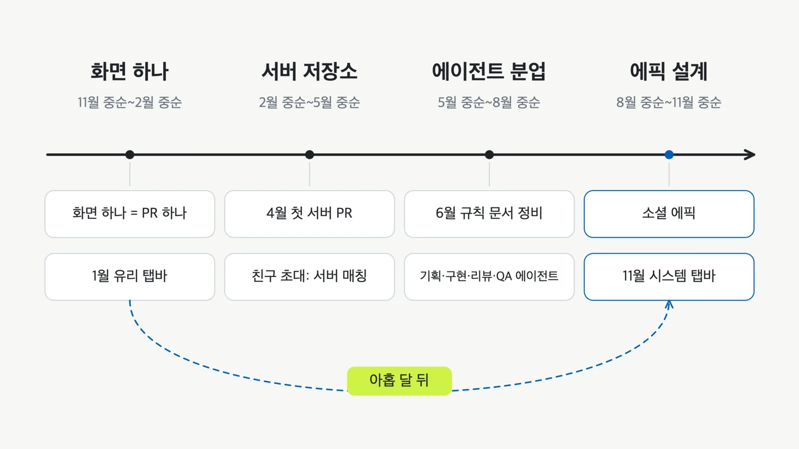
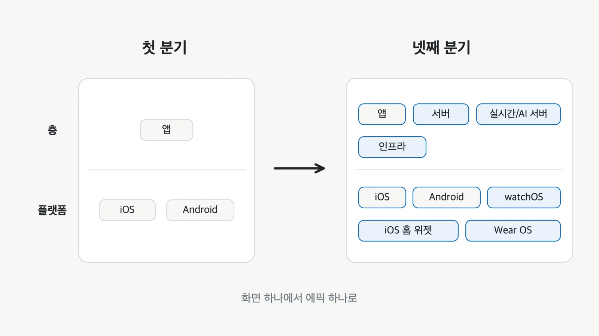
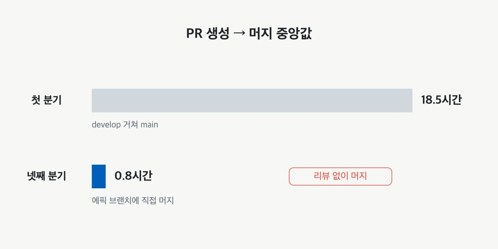
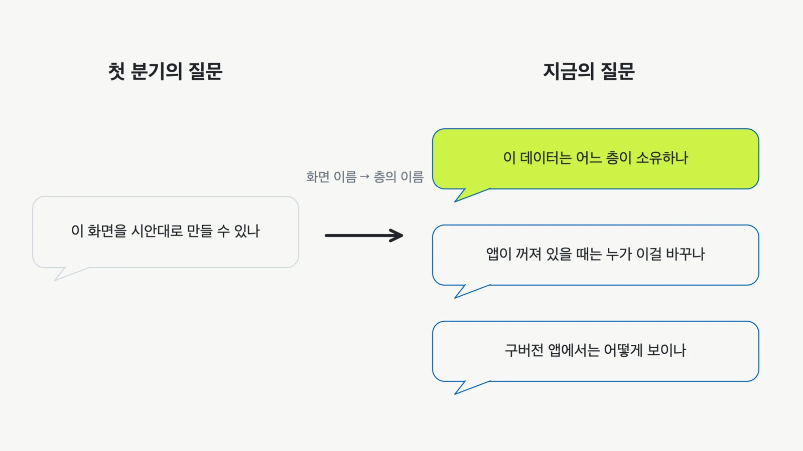

## 들어가며: PR 제목이 티켓 번호로 시작하던 때

최근에 지난 1년 동안 제가 올린 PR 목록을 처음부터 끝까지 펼쳐 봤어요. 첫 분기의 PR 제목은 거의 다 이런 모양이었어요.

```text
feat: <티켓 번호> onboarding primary goal
feat: <티켓 번호> onboarding loading
feat: <티켓 번호> progress calendar
feat: <티켓 번호> chatting UI
```

티켓 하나가 화면 하나였고, 화면 하나가 PR 하나였어요. 마지막 분기의 PR 제목은 이렇게 바뀌어 있었어요.

```text
feat(social): 소셜 DB 스키마와 마이그레이션 추가
feat(social): 게시물·댓글 번역 API — 요청 시 번역 + 캐시
feat(running-coach): 러닝 시작 안내와 구간 평균 심박을 보낸다
feat(watch): Apple Watch 컴플리케이션 10종과 탭 상세 화면
```

같은 사람의 PR 인데, 앞의 것은 화면 이름이고 뒤의 것은 한 기능을 이루는 여러 층 중 하나의 이름이에요. 이 글에서는 여러 층(앱, 서버, 실시간·AI 서버, 네이티브)에 걸친 기능 묶음 하나를 에픽이라고 부를게요.

개발 경력 3년쯤 중 이 회사에서 Flutter 로 일한 시간이 1년 3개월이에요. 2025년 7월 말에 입사해 다른 프로젝트를 먼저 맡았고, 지금의 앱 저장소에는 10월 말부터 커밋했어요. 입사할 무렵 기대한 건 앱 개발자로서의 커리어였어요. 이 글은 그동안 쓴 기술 글들을 닫는 회고로, 2025년 11월 중순부터 1년 동안 그 문제들이 어떤 순서로 찾아왔는지 분기마다 사건 하나씩 골라 이어 붙여요.

<figure>
	
	<figcaption>분기마다 일의 단위가 화면에서 서버, 에이전트, 에픽으로 넓어졌어요.</figcaption>
</figure>

## 첫 분기: 화면 하나를 끝내는 게 일의 단위였다

첫 분기(2025년 11월 중순~2026년 2월 중순)에 main 에 들어간 제 PR 은 전부 앱 저장소에 있었어요. 온보딩, 기록, 홈, 채팅 UI, 프로필 순서로 티켓이 오면 그 화면을 만들었어요. 대표 장면은 1월 말, 하단 탭바를 유리처럼 보이게 만드는 티켓이에요. Flutter 유리 효과 패키지로 선택된 탭 뒤에 반투명 모양이 미끄러지는 탭바를 위젯으로 그렸어요. 화면 안에서 끝나는 일이었고, 이 탭바는 아홉 달 뒤에 다른 모습으로 돌아와요.

[앞 글](/posts/bloc_concurrency_refactor)에 적었듯 1월부터 코드 대부분을 Claude Code 같은 에이전트와 함께 썼어요(커밋에 AI 공동 작성 표시 `Co-Authored-By` 가 붙은 건 3월부터예요). 이 분기에 배운 건 Flutter 프레임워크에 대한 이해였어요.

## 둘째 분기: 서버 저장소를 처음 열었다

둘째 분기(2월 중순~5월 중순)에도 PR 은 대부분 화면이었지만, 4월에 처음으로 서버 저장소에 기록 보상 코인을 고치는 작은 PR 을 올렸어요. 곧이어 맡은 친구 초대 기능은 설치를 거치면 링크 정보가 사라져서 앱 안에서는 풀 수 없었고, 매칭을 서버에서 직접 하기로 했어요([디퍼드 딥링크 글](/posts/deferred_deeplink_in_house)). 그전까지 API 는 받아서 쓰는 것이었는데, **이때 처음으로 화면이 원하는 데이터를 서버가 어떻게 만들어 줄지 제가 정하는 자리에 섰어요.** AI 가 발전하면서 백엔드도 자연스럽게 같이 하게 된 거예요.

4월에는 제 커밋의 약 3할에 AI 공동 작성 표시가 붙었어요(표시 없이 쓴 커밋도 있어 실제보다 낮은 값이에요). 이 분기에 배운 건 Django 와 FastAPI 에 대한 이해였어요.

## 셋째 분기: 에이전트에게 일을 나눠 주는 법을 만들었다

셋째 분기(5월 중순~8월 중순)에는 서버 PR 이 앱 PR 에 가까워졌어요. main 에 들어간 Django PR 이 앞 분기 8건에서 87건으로 늘었어요(같은 분기 앱 PR 은 132건). 팀 기능, 인앱 결제와 구독, 배틀패스 유료 전환처럼 앱과 서버를 같이 바꿔야 하는 기능을 연달아 맡았거든요.

대표 사건은 6월에 AI 에이전트용 규칙 문서를 처음 정비한 일이에요(계기는 기억에 없어요). 뭉쳐 있던 규칙 파일을 규칙과 아키텍처 지도로 나누고, ADR 과 인수인계 문서 자리를 만들고, 기획·구현·리뷰·QA 를 나눠 맡는 에이전트와 리뷰 명령들을 만들었어요. 인앱 상품 가격 등록, 스토어 스크린샷 업로드, PR 리뷰 같은 스킬까지 1년 동안 직접 만든 에이전트·명령·스킬이 약 24개가 됐어요.

AI 공동 작성 표시 비율은 6~8월에 달마다 약 65~73% 로 가장 높았어요. 표시 습관에 따라 달라지는 값이라 "AI 가 7할을 썼다"로 읽으면 안 되지만, 에이전트에게 역할을 나눠 맡기기 시작한 시기인 건 확인돼요. 규칙 문서는 계속 자라 10월에는 예산을 16바이트 남기고 꽉 찼어요([에이전트 규칙 글](/posts/ai_agent_harness)).

## 넷째 분기: 에픽 하나를 층마다 나눠 설계했다

넷째 분기(8월 중순~11월 중순)에는 앱 PR 161건, Django PR 143건, FastAPI PR 13건이 main 에 들어갔어요. 범위는 앱·서버·실시간/AI 서버·인프라 네 층, 플랫폼은 iOS·Android·watchOS·iOS 홈 위젯·Wear OS 다섯 개가 됐어요.

<figure>
	
	<figcaption>앱 저장소 하나에서 시작한 범위가 넷째 분기에는 네 층, 다섯 플랫폼이 됐어요.</figcaption>
</figure>

에픽이 겹쳐서 지나갔어요. 8월에는 온보딩 설문 로딩을 23번에서 2번으로 줄였고([설문 저장 큐 글](/posts/onboarding_background_save_queue)), 9월에는 루틴 Live Activity 13종과 홈 위젯 10종을 만들며 서버가 push 로 배너를 돌리는 구조에 도착하기까지 첫 설계가 실기기에서 두 번 무너졌어요([Live Activity 글](/posts/live_activity_push_to_start)). 10월에는 러닝 기능을 폰·Apple Watch·Wear OS 에 붙이고 FastAPI 에 구간별 LLM 코칭과 TTS API 를 붙였어요. 11월에는 코인을 거는 챌린지를 만들며 판정과 정산은 서버가, 금액 표시는 앱이 맡게 나눴어요.

대표 사건은 10월 말에 맡은 소셜 에픽이에요. 테이블 14개짜리 스키마부터 피드·댓글·DM·알림·신고·번역 API, AI 2차 검토까지 이어지는 검열을 만들었고, 화면별 QA 를 나눈 것 말고는 앱과 서버를 혼자 설계하고 만들었어요. 앱과 서버 사이에 계약 문서를 두고, 앱은 계약에 맞춘 가짜(mock) 데이터로 화면을 먼저 만든 뒤 서버 API 가 머지될 때마다 의존성 주입 한 곳에서 실제 구현으로 갈아 끼웠어요. 덕분에 서버를 기다리지 않고 두 층을 나란히 진행했어요.

**에픽에서 어려운 건 각 층의 코드가 아니라, 층과 층 사이에서 누가 무엇을 소유하는지 정하는 일이었어요.** 금액은 누가 계산하는지, 배너 문구는 누가 만드는지, 구버전 앱은 새 필드가 없을 때 어떻게 보이는지를 먼저 정하면 나머지는 각 층 안의 문제가 됐어요.

## 빠르게 머지한 대가는 11월에 한꺼번에 왔다

PR 을 만들고 머지하기까지의 중앙값이 첫 분기 18.5시간에서 넷째 분기 0.8시간이 됐어요. 그대로 "빨라졌다"로 읽으면 안 돼요. 첫 분기에는 develop 을 거쳐 main 에 반영했고, 넷째 분기에는 에픽 브랜치에 제가 직접 머지하는 일이 많았어요. 바로 그 변화가 문제였어요. **리뷰 없이 머지한 PR 이 많았다는 뜻이기도 하니까요.**

<figure>
	
	<figcaption>머지까지의 시간이 줄어든 데에는 리뷰 없이 머지한 몫이 섞여 있었어요.</figcaption>
</figure>

11월에 그 대가가 한꺼번에 보였어요. 코드를 직접 읽어 보니 BLoC 의 이벤트 겹침 처리를 약 270곳이 저마다 다른 방법으로 풀고 있었고([BLoC 글](/posts/bloc_concurrency_refactor)), iOS 크래시는 CocoaPods 에서 Swift Package Manager 로 옮기며 조용히 실패하기 시작한 빌드 단계 때문에 21개 빌드 동안 0건으로 집계되고 있었어요([Crashlytics 글](/posts/ios_crashlytics_zero_crashes), 전환 자체는 [SPM 전환 글](/posts/cocoapods_to_spm_migration)). 둘 다 잘 돌아가는 것처럼 보이던 이유를 몰랐던 거예요. 이벤트 겹침이 드물어서, CocoaPods 가 대신 해 주던 일 덕분에 잘 돌아갔을 뿐이에요. 속도가 빨라질수록 그 이유를 확인하는 일이 먼저 빠졌어요.

리뷰를 사람 눈에만 기대지 않으려고, 공용 위젯에 접근성 노드와 QA 용 식별자를 붙여 스크립트로 실기기 QA 를 돌리게 한 것도 이때예요([실기기 QA 글](/posts/wda_semantics_device_qa)). 그리고 1월의 탭바가 돌아왔어요. iOS 26 에서는 Flutter 로 그린 유리 대신 시스템 탭바를 플랫폼 뷰로 띄우게 바꿨어요([Liquid Glass 탭바 글](/posts/ios_liquid_glass_tab_bar)). 1월에는 위젯 문제였던 것이, 11월에는 Flutter 와 네이티브 중 어느 쪽이 그릴지 정하는 문제가 돼 있었어요.

## 앞으로 할 일

먼저 실기기 확인이 남은 워치 러닝 앱과 위젯, 소셜 기능을 끝낼 거예요. 지금 손으로 덜어 내고 있는 에이전트 규칙 문서는 넘칠 때를 도구가 먼저 알려 주게 하고, BLoC 정리처럼 한 번 정한 기준을 리뷰하는 쪽도 같이 읽게 할 거예요. 더 길게 보면, 지루하고 오래 걸리는 코딩을 AI 가 해 주니 다양한 개발을 해 볼 기회가 많을 거라고 생각해요.

## 마치며: 단위가 바뀌면 질문도 바뀐다

1년 전 PR 제목은 화면 이름이었고, 지금은 층의 이름이에요. 바뀐 건 기술의 개수보다 스스로 던지는 질문이었어요. "이 화면을 시안대로 만들 수 있나"에서 "이 데이터는 어느 층이 소유하나", "앱이 꺼져 있을 때는 누가 바꾸나", "구버전 앱에서는 어떻게 보이나"로요. 기대했던 커리어도 앱, 서버, 기획, 디자인까지 경험하며 나름 잘 쌓은 것 같아요.

<figure>
	
	<figcaption>PR 제목이 화면 이름에서 층의 이름으로 바뀌면서, 먼저 던지는 질문도 바뀌었어요.</figcaption>
</figure>

> 일의 단위를 키우는 건 화면을 더 많이 만드는 게 아니라, 화면 바깥의 질문을 먼저 던지는 일입니다.

AI 와 일하면서 머지는 하루에서 한 시간 안으로 줄었어요. 그 시간에서 가장 먼저 빠진 건 **"왜 이게 돌아가지?"를 확인하는 시간**이었고, 그 비용은 몇 달 뒤 한꺼번에 돌아왔어요.

화면 단위에서 범위를 넓혀 가고 있다면, 이렇게 물어보세요.

1. 지금 만드는 화면의 데이터는 어느 층이 소유하나? 앱이 계산하고 있는 값 중 서버가 가져야 할 게 있지 않나?
2. 앱이 꺼져 있거나 구버전일 때, 이 기능은 어떻게 보이나?
3. 최근 한 달 동안 머지한 코드 중, 왜 잘 돌아가는지 설명할 수 있는 건 몇 개인가?

마지막으로 1년 동안 함께 일한 동료들께 고마워요. 같이 일할 수 있어서 좋았고, 저에게는 많이 배울 수 있는 기회였던 것 같아요.
