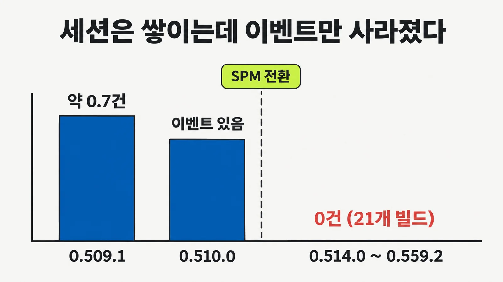
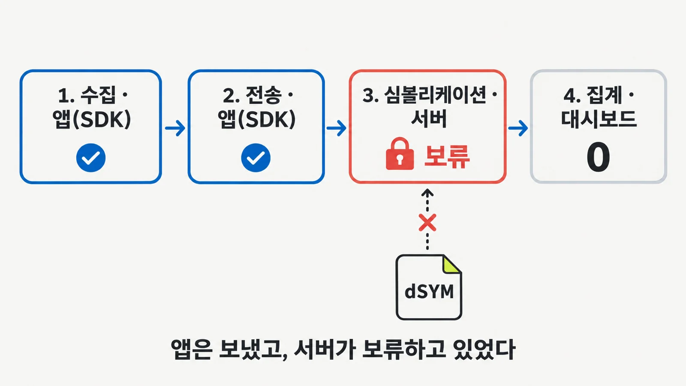
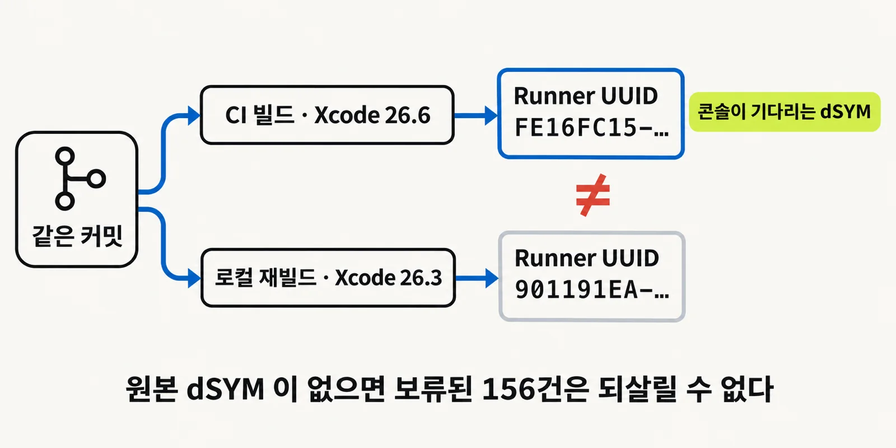
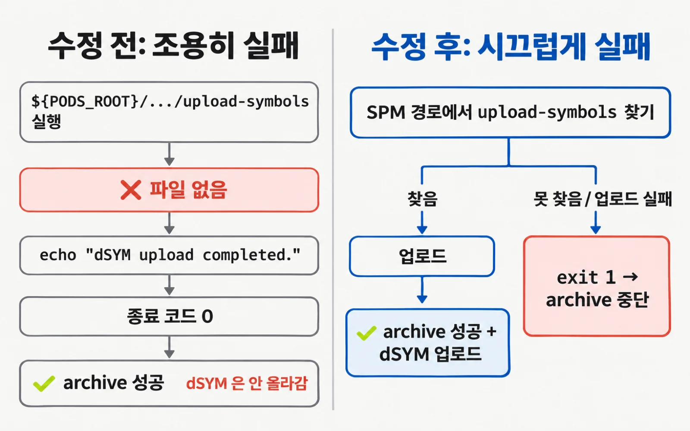

## 들어가며: 눈앞에서 꺼진 앱, 그런데 0건

어느 날 팀원이 iOS 에서 앱이 꺼졌다고 알려 왔어요. 로그를 보려고 Crashlytics 를 열었는데, 최신 iOS 버전의 크래시 리포트가 0건이었어요. 방금 꺼진 앱의 기록도, non-fatal 한 건도 없었어요.

평소라면 "요즘 안정적이네" 하고 넘어갔을 숫자예요. 하지만 눈앞에서 꺼진 앱이 있는데 0건이라면, 그 0은 "크래시가 없다"가 아니라 **"측정이 안 되고 있다"** 는 뜻일 수 있어요.

원인은 CocoaPods 에서 Swift Package Manager(SPM)로 옮기면서 조용히 실패하기 시작한 빌드 단계 하나였어요. 그 바람에 iOS 21개 빌드 동안 크래시가 하나도 집계되지 않았어요. 이 글은 의심을 하나씩 지워 간 과정과, 같은 일이 다시 조용히 일어나지 않게 막은 방법을 담았어요. iOS 의존성을 SPM 으로 옮겼거나 옮길 예정이라면 한 번 읽어 볼 만해요.

## 크래시가 대시보드에 오기까지

iOS 크래시는 네 단계를 거쳐 대시보드에 보여요.

| 단계 | 어디서 | 하는 일 |
|---|---|---|
| 1. 수집 | 앱(SDK) | 크래시·non-fatal 을 기기에 저장 |
| 2. 전송 | 앱(SDK) | 다음 실행 때 서버로 업로드 |
| 3. 심볼리케이션 | Crashlytics 서버 | 메모리 주소를 함수 이름·줄 번호로 바꿈 (**dSYM** 필요) |
| 4. 집계 | Crashlytics 서버 | 이슈로 묶어 대시보드·알림·BigQuery 로 내보냄 |

dSYM 은 빌드할 때 만들어지는 디버그 심볼 파일이에요. 배포용 바이너리에는 함수 이름이 없어서, 서버는 이 파일이 있어야 스택 트레이스를 읽을 수 있게 바꿔요. 보통 Xcode 빌드 단계(Run Script)에 업로드 스크립트를 넣어 archive 할 때마다 올려요.

조사를 시작할 때 저는 두 가지를 당연하게 믿고 있었어요. 0건이면 앱이 리포트를 안 보낸 것이니 문제는 1~2단계에 있을 거라는 것, 그리고 archive 가 성공했으면 그 안의 빌드 단계도 다 성공했을 거라는 것이요. 둘 다 틀렸어요.

## iOS 최신 빌드만 0건이었다

먼저 범위를 좁혔어요. 슬랙의 Crashlytics 알림을 플랫폼별로 나눠 보니, Android 는 최근 빌드까지 꾸준히 들어오는데 iOS 는 몇 달 전 버전의 알림뿐이었어요. 정확한 경계는 BigQuery 로 잡았어요. Firebase 가 내보내는 Sessions(앱 실행 기록)와 Crashlytics 이벤트를 앱 버전으로 묶으면, 세션은 있는데 이벤트가 없는 버전이 드러나요.

| iOS 버전 | 세션당 Crashlytics 이벤트 |
|---|---|
| 0.509.1 | 약 0.7건 |
| 0.510.0 | 이벤트 있음 |
| 0.514.0 ~ 0.559.2 (21개 빌드) | **0건** |

<figure>
	
	<figcaption>SPM 전환 빌드부터 이벤트가 0건으로 끊겼어요.</figcaption>
</figure>

0.514.0 부터는 세션이 꾸준히 쌓이는데도 이벤트가 0건이었어요. 이전 비율대로라면 수백 건은 들어왔어야 해요. 같은 시각 구버전 iOS 의 이벤트는 계속 들어오고 있었으니, Firebase 프로젝트가 아니라 새 빌드 쪽에서 무언가 바뀐 거였어요. 그리고 0.514.0 은 iOS 의존성을 CocoaPods 에서 SPM 으로 옮긴 첫 빌드였어요.

## 헛걸음: SDK 는 멀쩡했다

첫 번째 가정대로 앱 쪽부터 의심했어요. firebase-ios-sdk 에 비슷한 증상의 이슈([#15696](https://github.com/firebase/firebase-ios-sdk/issues/15696))가 있었거든요. 실행 파일에서 `__mh_execute_header` 심볼을 못 찾으면 Crashlytics 가 아예 기동을 포기한다는 내용이라, 링크 방식이 바뀌는 SPM 전환과 잘 맞아 보였어요.

Release 로컬 빌드로 확인해 보니 전부 정상이었어요. 심볼은 strip 뒤에도 남아 있었고, Crashlytics 네이티브 코드(`FIRCLS*` 심볼 1,737개)도 링크돼 있었어요. `GoogleService-Info.plist`, SDK 버전(전환 전후 모두 Firebase iOS SDK 12.14.0), 수집 설정도 문제없었어요.

그래도 로컬 빌드는 CI 와 Xcode 버전이 달라서, 실제 배포 빌드를 실기기에 깔고 기기 로그를 봤어요. 비행기 모드로 앱을 켜서 네트워크 오류를 non-fatal 로 남기고, 비행기 모드를 끈 뒤 다시 실행해 업로드 장면을 잡았어요.

```
[FirebaseCrashlytics] Automatic data collection is enabled
[FirebaseCrashlytics] Packaged report with id '2d2a3b2c…' for submission
[FirebaseCrashlytics] Completed report submission with id: 2d2a3b2c…
```

SDK 는 리포트를 만들고 제출까지 끝냈어요. 그런데 16분을 기다려도 BigQuery 에 나타나지 않았어요. 구버전 이벤트는 4~5분이면 들어오던 때였어요. **앱은 보냈고, 서버가 받고도 내놓지 않고 있었어요.** 첫 번째 가정이 여기서 깨졌고, 남은 건 3단계 심볼리케이션이었어요.

> 이 조사는 Claude Code 에이전트와 함께 했어요. BigQuery 쿼리, 로컬 빌드 검사, WebDriverAgent 로 실기기 조작과 기기 로그 수집을 에이전트가 맡았고, 저는 가설을 고르고 결과를 판정했어요. 로컬 빌드로 끝내려던 검증을 실기기로 돌린 게 전환점이었어요.

## 원인: 없는 경로를 부르고도 성공한 빌드 단계

dSYM 업로드 빌드 단계의 핵심은 이랬어요.

```sh
if [ -f "${GSP_PATH}" ]; then
  "${PODS_ROOT}/FirebaseCrashlytics/upload-symbols" \
    -gsp "${GSP_PATH}" \
    -p ios \
    "${DWARF_DSYM_FOLDER_PATH}"
  echo "dSYM upload completed."
else
  echo "warning: GoogleService-Info.plist not found at ${GSP_PATH}"
fi
```

`${PODS_ROOT}/FirebaseCrashlytics/upload-symbols` 는 CocoaPods 가 Firebase 를 설치할 때만 있는 경로예요. SPM 으로 옮기면서 이 파일도 사라졌어요.

그래도 archive 는 계속 성공했어요. 없는 파일을 실행한 줄은 실패하지만, `set -e` 가 없으니 스크립트는 다음 줄로 넘어가요. 마지막 `echo` 가 성공하면서 스크립트의 종료 코드는 0이 되고, 로그에는 "dSYM upload completed." 까지 찍혔어요. **archive 는 성공했지만 그 안의 업로드는 21개 빌드 내내 실패하고 있었어요.** 두 번째 가정도 깨졌어요.

dSYM 이 없으면 서버는 이벤트를 버리지 않고 보류해요. FlutterFire 문서에도 이렇게 적혀 있어요.

> Without these files, you'll see a "Missing dSYM" alert in the Crashlytics dashboard and exceptions will be held by the backend until the missing files are uploaded.
>
> (이 파일이 없으면 대시보드에 "Missing dSYM" 경고가 뜨고, 누락된 파일이 올라올 때까지 예외는 백엔드에 보류돼요.)

<figure>
	
	<figcaption>4단계 중 1·2단계는 정상이었고, dSYM 이 오지 않아 3단계에서 멈춰 있었어요.</figcaption>
</figure>

실제로 콘솔 상단에는 "처리되지 않은 비정상 종료가 156개 있습니다. dSYM 파일 16개를 업로드하여 처리하세요." 라는 배너가 떠 있었고, 누락 목록은 0.514.0 부터 시작했어요. 답은 처음부터 대시보드 위에 있었던 셈이에요. 다만 "0건 = 안정적"이라고 읽는 동안에는 그 배너를 볼 이유가 없었어요.

## 보류된 156건은 되살리지 못했다

dSYM 만 올리면 보류된 이벤트가 처리되니, 같은 커밋을 다시 빌드하면 될 것 같았어요. 누락 목록에 버전은 다른데 UUID 가 같은 쌍이 있어서, 네이티브 코드가 같으면 같은 UUID 가 나올 거라는 기대도 있었어요.

<figure>
	
	<figcaption>커밋이 같아도 Xcode 버전이 다르면 UUID 가 달라져서, 로컬 재빌드로는 보류된 이벤트를 되살릴 수 없었어요.</figcaption>
</figure>

하지만 CI(Xcode 26.6)와 로컬(Xcode 26.3)의 Runner UUID 는 달랐어요. CI 에도 원본이 없었어요. 배포 lane 이 TestFlight 업로드 직후 archive 를 지우고 있었거든요. 결국 그 기간의 iOS 크래시 156건은 잃었어요. 앞으로의 빌드를 고치는 것과 별개로, 복구할 원본은 남겨야 한다는 걸 배웠어요.

## 해결: 조용히 실패할 수 없게 만들기

경로를 틀린 건 실수였지만, 그 실수가 21개 빌드 동안 숨어 있을 수 있었던 건 실패해도 아무 일도 일어나지 않는 구조 때문이었어요. 그래서 고친 건 세 가지예요.

첫째, SPM 이 패키지를 받는 DerivedData 의 `SourcePackages/checkouts/` 에서 `upload-symbols` 를 찾고, CocoaPods 경로는 대비용으로 뒤에 남겼어요. 둘째, **업로드 도구를 못 찾거나 업로드가 실패하면 archive 를 멈추게 했어요.** 이게 핵심이에요.

```sh
UPLOAD_SYMBOLS=""
for candidate in \
  "${BUILD_DIR%/Build/*}/SourcePackages/checkouts/firebase-ios-sdk/Crashlytics/upload-symbols" \
  "${PODS_ROOT}/FirebaseCrashlytics/upload-symbols"; do
  if [ -x "${candidate}" ]; then
    UPLOAD_SYMBOLS="${candidate}"
    break
  fi
done
if [ -z "${UPLOAD_SYMBOLS}" ]; then
  echo "error: Crashlytics upload-symbols not found (BUILD_DIR=${BUILD_DIR})"
  exit 1
fi

if ! "${UPLOAD_SYMBOLS}" -gsp "${GSP_PATH}" -p ios -- "${DWARF_DSYM_FOLDER_PATH}"; then
  echo "error: dSYM upload to Crashlytics failed"
  exit 1
fi
```

<figure>
	
	<figcaption>수정 전에는 실패해도 archive 가 성공했고, 수정 후에는 실패하면 archive 가 멈춰요.</figcaption>
</figure>

`GoogleService-Info.plist` 가 없을 때도 `warning` 대신 `exit 1` 로 바꿨어요. dSYM 없이 나간 빌드는 그 빌드의 iOS 크래시를 전부 숨기니까요. 셋째, CI 가 `Runner.app.dSYM.zip` 을 30일 동안 아티팩트로 보관해요. 업로드가 또 빠져도 나중에 올려 복구할 수 있어요.

스크립트는 Debug·도구 없음·plist 없음·SPM Release 네 경우로 돌려서 기대한 종료 코드가 나오는지 확인했어요. 하나 걸린 게 있었는데, `upload-symbols … -p ios --validate <경로>` 순서로 쓰면 "No dSYM paths provided" 오류가 나요. 위 스크립트처럼 `--` 로 경로를 구분해야 해요.

검증은 실제 빌드에서 했어요. 흥미롭게도 수정 전 빌드 하나(0.561.9)가 원인을 확인해 줬어요. 이 빌드만 누군가 dSYM 을 따로 올려 두었는데, 이벤트가 정상으로 집계되고 있었어요. 같은 스크립트여도 dSYM 이 있으면 집계되고 없으면 0건이었던 거예요. 수정이 들어간 스토어 빌드(0.562.0)는 배포 1주일 동안 fatal·non-fatal 이 정상으로 집계됐어요.

0.514.0 부터 0.559.2 까지는 지금도 0건이에요. 그 기간의 0은 "크래시 없음"이 아니라 "집계 안 됨"으로 읽어야 한다고 팀에 공유했어요.

## 같은 모양의 두 번째 사고: 사라진 `Package.resolved`

수정을 확인하던 중에 develop 브랜치의 iOS 빌드가 전부 실패하고 있었어요. SPM 이 쓸 패키지 버전을 고정하는 잠금 파일 `Package.resolved` 가 main 을 develop 으로 합친 머지 커밋에서 빠져 있었거든요. 충돌 목록에 없던 파일이라 왜 빠졌는지는 지금도 몰라요.

잠금 파일이 없으면 SPM 은 허용 범위 안에서 최신판을 새로 받아요. 이번에는 그 최신판이 더 높은 iOS 최소 버전을 요구해서 archive 가 깨졌어요. 만약 조용히 빌드됐다면 검증하지 않은 의존성이 그대로 배포됐을 거예요.

dSYM 사고와 모양이 같아요. **빠지면 안 되는 것이 빠졌는데, 도구가 "성공처럼" 넘어가요.** 이번에는 직접 검사 스크립트를 만들기 전에 표준 옵션을 먼저 찾았고, `xcodebuild` 의 `-disableAutomaticPackageResolution`(fastlane gym 에서는 `disable_package_automatic_updates: true`)이 있었어요. 이 옵션을 켜면 잠금 파일이 없을 때 `a resolved file is required when automatic dependency resolution is disabled` 라는 에러로 바로 멈춰요.

## 마치며: 0은 측정값이 아닐 수 있다

팀원의 크래시가 없었다면 저도 0건을 보고 넘어갔을 거예요. 실제로 크래시 수정 작업 목록에서 iOS 는 "고칠 게 없음"으로 나오고 있었어요. 0이라는 숫자는 문제가 없다는 신호처럼 보여서, 아무도 의심하지 않아요.

잘 돌아가던 이유를 모르면, 그 이유가 사라져도 알아채기 어렵습니다.

dSYM 업로드는 CocoaPods 가 Firebase 를 `Pods/` 에 넣어 줬기 때문에 돌아가고 있었어요. 아무도 그걸 의식하지 않았으니 SPM 전환 체크리스트에도 없었고, 실패를 삼키는 스크립트가 그 사실을 21개 빌드 동안 숨겼어요.

Crashlytics 를 쓰고 있다면 세 가지를 확인해 보세요.

1. 콘솔의 dSYM 탭이나 상단 배너에 "누락"이 있나요? 있다면 그 버전의 iOS 이벤트는 집계되지 않고 있어요.
2. 업로드 스크립트의 경로를 일부러 틀리게 바꿔도 archive 가 성공하나요? 그렇다면 이 글과 같은 구조예요.
3. 업로드가 빠졌을 때 올릴 dSYM 원본이 어딘가 남아 있나요?

SPM 으로 옮기는 중이라면 `grep -n 'PODS_ROOT' ios/Runner.xcodeproj/project.pbxproj` 로 `Pods/` 경로를 참조하는 빌드 단계가 남아 있지 않은지 한 번 찾아보세요.

## 참고 자료

- Firebase, [Get deobfuscated crash reports (Flutter)](https://firebase.google.com/docs/crashlytics/get-deobfuscated-reports?platform=flutter) — dSYM 이 없으면 이벤트가 보류된다는 문구. 원문은 [flutterfire 저장소](https://github.com/firebase/flutterfire/blob/main/docs/crashlytics/_deobfuscated.md) (2026-11 확인)
- Firebase, [Get readable crash reports (Apple platforms)](https://firebase.google.com/docs/crashlytics/ios/get-deobfuscated-reports) — 업로드 스크립트 예시. 2026-11 기준 CocoaPods 경로(`$PODS_ROOT`)만 나와 있어요
- firebase-ios-sdk [#15696](https://github.com/firebase/firebase-ios-sdk/issues/15696) — `__mh_execute_header` 관련 이슈 (이번 원인은 아니었어요)
- 기준 버전: Firebase iOS SDK 12.14.0, `firebase_crashlytics` 5.2.3, Xcode 26.6(CI)·26.3(로컬), fastlane 2.236.1
