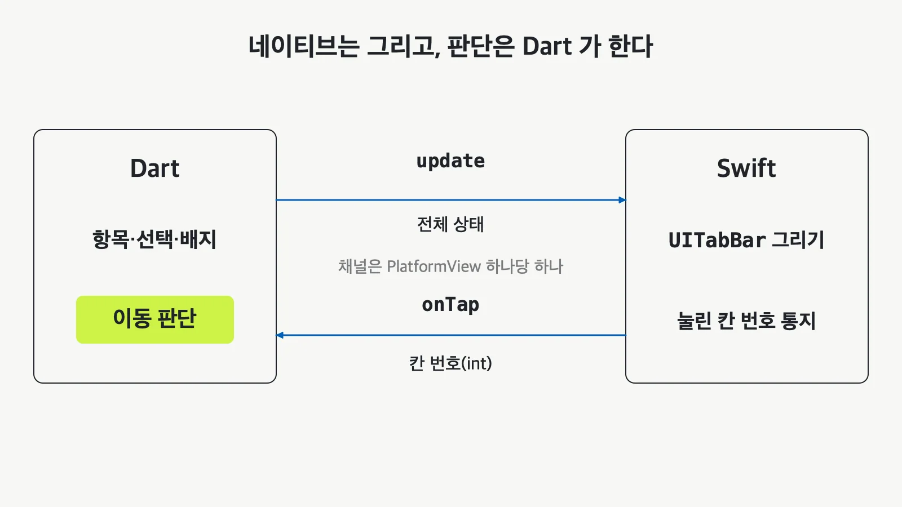
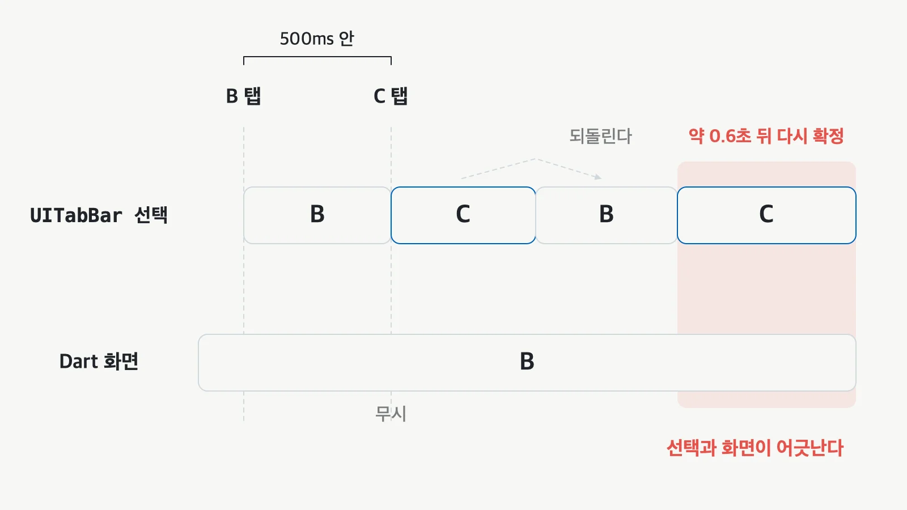
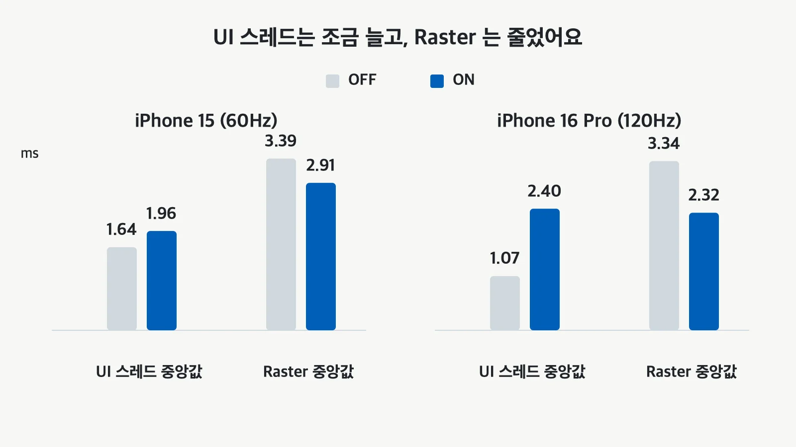
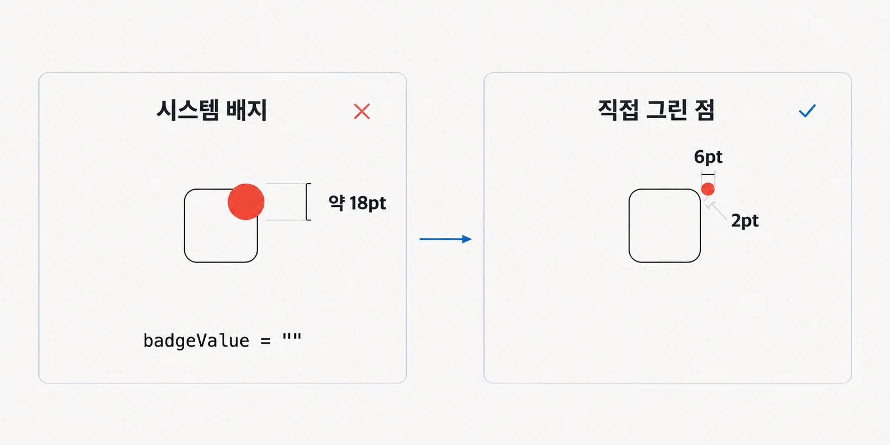

## 들어가며: 앱을 다시 쓰기 전에, 탭바 한 장만

iOS 26 이 나오고 나서 "iOS 에서는 앱이 iOS 답지 않아 보인다. 네이티브로 다시 써야 하지 않을까?"라는 이야기가 나왔어요. 시스템 앱들은 모두 Liquid Glass 로 바뀌었는데, 저희 앱의 하단 탭바는 Flutter 로 그린 유리 흉내였거든요.

전면 재작성은 큰 결정이라, 먼저 질문 하나를 확인해 보기로 했어요. **iOS 다움의 차이가 화면 전체에 퍼져 있나, 아니면 시스템 부품 몇 개에 몰려 있나?** 몰려 있다면 그 부품만 네이티브로 바꾸면 돼요. 가장 눈에 띄는 부품이 탭바였어요.

그래서 화면은 전부 Flutter 에 두고 하단 탭바 한 장만 UIKit `UITabBar` 로 바꿔 PlatformView 로 띄웠어요. 채널로 탭 번호만 주고받으면 끝일 줄 알았는데, 탭이 안 먹고, 빠르게 누르면 선택과 화면이 어긋나고, 출시 뒤에는 시스템 배지가 아이콘을 덮었어요.

## 배경: 흉내 낸 유리와 시스템 유리

기존 탭바는 `liquid_glass_renderer` 패키지로 그렸는데, 굴절 셰이더 경로는 애니메이션 마지막 프레임에서 좌표가 갱신되지 않는 문제가 있어 `fake: true` 로 `BackdropFilter`(blur 25) 하나만 쓰고 있었어요. 흐릿하긴 해도 굴절이나 선택 렌즈는 없어요.

반대로 시스템 탭바는 거의 공짜로 Liquid Glass 가 돼요. Apple 의 [Adopting Liquid Glass](https://developer.apple.com/documentation/technologyoverviews/adopting-liquid-glass) 문서는 이렇게 말해요(2026-11-18 확인).

> In system frameworks, standard components like bars, sheets, popovers, and controls automatically adopt this material.
>
> (시스템 프레임워크의 막대, 시트, 팝오버, 컨트롤 같은 표준 컴포넌트는 이 재질을 자동으로 입어요.)

최신 Xcode 로 다시 빌드하기만 하면 돼요. 그렇다면 Flutter 화면 위에 UIKit 부품을 하나 얹으면 되겠다 싶었고, 그 방법이 PlatformView(`UiKitView`)예요. Flutter 문서([Hosting native iOS views](https://docs.flutter.dev/platform-integration/ios/platform-views), 2026-11-18 확인)에 따르면 iOS 는 네이티브 `UIView` 를 실제 뷰 계층에 붙이는 Hybrid composition 만 쓰고, 성능 비용이 따라요.

## 첫 설계: SwiftUI 로 그린 유리도 흉내였다

처음 시제품은 SwiftUI 의 `glassEffect` 로 탭바 모양을 직접 그려 `UIHostingController` 에 담은 것이었어요. 호스팅 컨트롤러가 safe area 를 받으면 Flutter 가 계산한 하단 여백 위에 홈 인디케이터 높이가 한 번 더 붙어서, safe area 를 끄고 여백을 Dart 쪽 계산(24pt)에 맞춰 직접 줬어요.

```swift
// 하단 여백은 Dart 쪽 높이 계산(24)과 맞춰 직접 준다. safe area 를 받으면 홈 인디케이터 높이가 이중으로 붙는다.
hosting.safeAreaRegions = []
```

시뮬레이터(iPhone 17 Pro, iOS 26.3)에서 유리 바는 잘 나왔지만, 화면을 보고 바로 알았어요. 제가 원한 건 "유리처럼 생긴 바"가 아니라 "설정 앱에 있는 그 탭바"였어요. 직접 그린 유리는 또 하나의 흉내라 선택 렌즈, 눌림 반응, 다크 재질을 다시 따라 그려야 했어요.

그래서 한 시간 만에 시스템 `UITabBar` 로 교체했어요. 외형은 시스템에 맡기고, 어두운 앱 화면에 맞춰 다크로 고정하고, 선택 아이콘을 라임색(`#CDF246`)으로 칠하고, 회색 선택 버블에 라임을 25% 섞은 것만 정했어요.

```swift
tabBar.overrideUserInterfaceStyle = .dark
tabBar.tintColor = tintColor
let appearance = tabBar.standardAppearance.copy()
appearance.selectionIndicatorTintColor = tintColor.withAlphaComponent(0.25)
tabBar.standardAppearance = appearance
tabBar.scrollEdgeAppearance = appearance
```

`UITabBar` 는 홈 인디케이터 영역을 포함한 높이를 시스템이 정해서, Dart 가 준 영역의 아래쪽에만 붙이고 위쪽은 투명으로 뒀어요.

```swift
NSLayoutConstraint.activate([
    tabBar.leadingAnchor.constraint(equalTo: containerView.leadingAnchor),
    tabBar.trailingAnchor.constraint(equalTo: containerView.trailingAnchor),
    tabBar.bottomAnchor.constraint(equalTo: containerView.bottomAnchor),
])
```

top 제약이 없다는 게 요점이에요. Dart 는 글자 배율을 반영한 넉넉한 상자를 주고, 네이티브는 그 바닥에 시스템 높이로 붙어요. 서로의 높이를 정확히 맞추려 하지 않으니, 계산이 어긋나도 바가 잘리지 않아요.

## 경계 긋기: 네이티브는 그리고, 판단은 Dart 가 한다

기준은 **탭바 말고는 아무것도 바꾸지 않는다**였어요. 어느 화면으로 갈지, 재선택 시 맨 위로 스크롤할지, 연타를 막을지는 이미 Dart 의 탭바 위젯과 라우터(`go_router` 의 `goBranch`)가 알고 있어서, Swift 로 옮기면 iOS 와 Android 의 규칙이 갈라져요. 그래서 Dart 는 무엇을 그릴지(항목·선택·배지) 정하고 탭을 받아 이동을 판단하고, Swift 는 받은 상태대로 `UITabBar` 를 그리고 눌린 칸 번호만 알려요. 채널은 PlatformView 마다 뷰 ID 를 붙여 하나씩 두고, Dart → Swift 는 전체 상태를 보내는 `update`(생성 시에는 같은 형식의 `creationParams`), Swift → Dart 는 칸 번호를 보내는 `onTap` 하나씩이에요.

<figure>
	
	<figcaption>판단은 Dart 가 하고, 네이티브는 받은 상태대로 그리고 눌린 칸 번호만 알려 줘요.</figcaption>
</figure>

상태의 모양은 Dart 위젯 주석에 계약으로 적어 뒀어요. 한쪽만 고쳐도 다른 쪽이 주석만 보고 맞출 수 있게요.

```dart
/// 채널 계약(`update` 인자·creationParams): `{selectedIndex: int, textScale: double, items: [{label, icon, iconSize,
/// badgeCount, hasRedDot, identifier}]}`.
class NativeGlassTabBar extends StatefulWidget {
  static const String _viewType = 'app/native_glass_tab_bar';
  // ...
}
```

`icon` 은 `Assets.xcassets` 에 템플릿 렌더링으로 넣어 둔 이미지셋 이름이라, 선택 색은 시스템이 틴트로 칠해요. 전체 상태는 항목 6개 남짓이라 매번 보내도 작지만 같은 상태를 두 번 보내지는 않게 했고, 중첩 `List` 는 `==` 로 비교가 안 돼서 문자열로 바꿔 비교해요.

```dart
void _sendStateIfChanged() {
  final channel = _channel;
  if (channel == null) return;
  final state = _buildState(_currentTextScale());
  if (state.toString() == _lastSentState) return;
  _lastSentState = state.toString();
  channel.invokeMethod<void>('update', state);
}
```

이 함수는 `didUpdateWidget`·`didChangeDependencies`(글자 배율 변경)와 뷰 생성 직후에 불려요. 마지막은 리뷰에서 나온 지적이었어요. `creationParams` 는 첫 `build` 시점의 값인데 네이티브 뷰는 그보다 늦게 만들어져서, 그 사이에 바뀐 배지나 선택은 `_channel` 이 `null` 이라 버려져요. 그래서 `onPlatformViewCreated` 에서 마지막 전송 기록을 지우고 한 번 더 보내요.

```dart
void _handlePlatformViewCreated(int viewId) {
  _channel = MethodChannel('${NativeGlassTabBar._viewType}_$viewId')
    ..setMethodCallHandler((call) async {
      if (call.method == 'onTap' && call.arguments is int) {
        widget.onTap(call.arguments as int);
      }
    });
  // creationParams 는 첫 build 시점 값이라, 뷰 생성 전에 바뀐 선택·뱃지를 한 번 더 보낸다.
  _lastSentState = '';
  _sendStateIfChanged();
}
```

Swift 쪽에서는 항목 구성(라벨 목록)이 같으면 `UITabBarItem` 을 다시 만들지 않아요. `setItems` 로 갈아끼우면 선택 애니메이션이 끊기거든요.

## 막힌 지점 1: 탭이 안 먹는다

처음 띄운 `UITabBar` 는 유리는 예쁜데 탭을 눌러도 아무 일이 없었어요. 앱의 공용 Scaffold 는 화면 아무 데나 누르면 키보드를 내리려고 탭 인식기를 감싸 두는데, PlatformView 위의 터치도 Flutter 의 제스처 경쟁(gesture arena)을 먼저 거쳐요. 여기서 Scaffold 의 인식기가 이기면 터치가 네이티브 뷰까지 가지 않아요. 그래서 `UiKitView` 에 손가락이 닿는 즉시 제스처를 가져가는 `EagerGestureRecognizer` 를 줬어요.

```dart
UiKitView(
  viewType: NativeGlassTabBar._viewType,
  creationParams: _buildState(textScale),
  creationParamsCodec: const StandardMessageCodec(),
  onPlatformViewCreated: _handlePlatformViewCreated,
  // 공용 Scaffold 의 키보드 내리기 탭 인식기가 제스처 경쟁에서 이겨 네이티브로 터치가 안 간다.
  gestureRecognizers: const {Factory<OneSequenceGestureRecognizer>(EagerGestureRecognizer.new)},
)
```

탭바는 스크롤이나 드래그를 Flutter 와 나눠 쓸 일이 없어서 잃는 게 없었어요. 스크롤 가능한 네이티브 뷰라면 필요한 인식기 종류만 넘겨야 해요.

## 막힌 지점 2: UIKit 의 선택은 거절할 수 없었다

다음은 빠르게 연달아 누르면 탭바는 C 가 선택돼 있는데 화면은 B 에 머무는 문제였어요. 원인은 Flutter 탭바의 연타 방지였어요. 마지막 탭에서 500ms 안에 들어온 탭은 모두 무시하는데, Flutter 탭바는 선택 표시도 Dart 상태로 그리니 무시된 탭이 흔적을 남기지 않았어요. 하지만 `UITabBar` 는 누르는 순간 UIKit 이 스스로 선택을 옮겨요. Dart 는 그 탭을 무시했으니 `update` 도 보내지 않고, 네이티브 선택만 C 로 가 있게 되죠.

처음엔 `didSelect` 가 오면 Dart 가 확정한 칸으로 즉시 되돌리고, 실제 이동은 `update` 로 받게 고쳤어요.

```swift
func tabBar(_ tabBar: UITabBar, didSelect item: UITabBarItem) {
    applySelection(confirmedSelectedIndex) // Dart 가 확정한 칸으로 되돌린다
    channel.invokeMethod("onTap", arguments: item.tag)
}
```

그런데 고쳐지지 않았어요. 로그를 찍어 보니 iOS 26 의 `UITabBar` 는 콜백 안에서 선택을 되돌려도 선택 애니메이션이 끝날 즈음(약 0.6초 뒤) 탭한 항목으로 선택을 다시 확정했어요. 렌즈가 미끄러지는 애니메이션이 중간에 바꾼 값을 덮어쓰는 것으로 보여요. Apple 문서에서는 찾지 못했고, 디버그 로그로 확인한 동작이에요(iOS 26.x 기준).

<figure>
	
	<figcaption>UITabBar 는 누르는 순간 스스로 선택을 옮기고, 되돌려도 애니메이션 끝에 다시 확정해서 Dart 가 거절할 자리가 없었어요.</figcaption>
</figure>

UIKit 의 선택을 거스를 수 없다면 Dart 가 맞추는 수밖에 없어요. 그래서 네이티브 경로에서는 다른 탭으로의 전환을 무조건 받고, 연타 방지는 맨 위로 스크롤하는 같은 탭 재선택에만 걸었어요. 기준 시각도 "마지막 탭"이 아니라 "마지막 재선택"으로 바꿔서, 다른 탭으로 옮긴 직후의 재선택은 막히지 않게 했어요.

```dart
void _handleNativeTap(int index) {
  final now = DateTime.now();
  final isReselect = index == _selectedSlot;
  final isRapidReselect =
      isReselect &&
      _lastReselectTime != null &&
      now.difference(_lastReselectTime!) <= const Duration(milliseconds: 500);

  if (isRapidReselect) return;
  widget.onTap?.call(widget.items[index]);
  _lastReselectTime = isReselect ? now : null;
}
```

Swift 의 되돌리기 코드는 지웠어요. **상태의 주인이 둘이면, 한쪽은 다른 쪽을 거절할 수 없어야 해요.** `UITabBar` 는 선택을 스스로 바꾸니 Dart 가 그 탭을 무시할 자리가 없었고, 그래서 두 탭바는 같은 `onTap` 을 받아도 연타 처리 함수는 따로 둬요.

## 성능: 켜도 떨어지지 않았다

기본값을 켜기 전에 profile 빌드에서 홈 화면을 스크롤하며(약 50초) 켠 빌드(ON)와 끈 빌드(OFF)를 Flutter 타임라인으로 한 번씩 비교했어요. iPhone 15 는 60Hz·iOS 26.6.1, iPhone 16 Pro 는 120Hz 예요.

| 항목 (ms) | 15 OFF | 15 ON | 16 Pro OFF | 16 Pro ON |
|---|---|---|---|---|
| UI 스레드 중앙값 / p99 | 1.64 / 2.31 | 1.96 / 2.90 | 1.07 / 2.63 | 2.40 / 3.30 |
| Raster 중앙값 / p99 | 3.39 / 4.30 | 2.91 / 4.03 | 3.34 / 5.26 | 2.32 / 3.34 |
| 네이티브 합성 평균·중앙값 / p99 | — | 0.38 / 1.14 | — | 0.36 / 0.71 |
| 예산(16.7·8.3ms) 넘은 프레임 | 0 / 2,421 | 0 / 2,088 | 7 | 3 |

<figure>
	
	<figcaption>두 기기 모두 UI 스레드는 조금 늘고 Raster 는 줄었어요(빌드별 1회 측정).</figcaption>
</figure>

UI 스레드는 조금 늘고 Raster 는 줄었어요. Raster 가 준 건 흉내 유리의 `BackdropFilter` 가 빠진 몫으로 추정해요(따로 재지는 않았어요). 네이티브 합성(`PlatformViewsController::PerformSubmit`) 비용은 p99 로도 1ms 남짓이었고, Xcode Instruments 의 Animation Hitches 로 봐도 두 기기 모두 hitch 는 0건이었어요.

다만 빌드마다 1회, 홈 화면만 쟀어요. iPhone 16 Pro ON 녹화에서 약 8초 동안 표시 프레임이 초당 85~92 로 떨어진 구간(Flutter 타임라인은 120fps 유지)과 UI 269ms 프레임 한 번은 원인 미확인으로 남겼어요.

## 폴백: iOS 26 미만과 Android 는 그대로

이 앱의 최소 배포 버전은 iOS 15.6 이에요. Liquid Glass 탭바는 iOS 26 부터라, 그 아래와 Android 는 기존 Flutter 탭바를 써요. 판정은 Dart 에서 한 번만 해요.

```dart
static final bool isSupported = Platform.isIOS && (_iosMajorVersion() ?? 0) >= 26;

// Platform.operatingSystemVersion 은 iOS 에서 "Version 26.0 (Build 23A341)" 형태다.
static int? _iosMajorVersion() {
  final match = RegExp(r'(\d+)').firstMatch(Platform.operatingSystemVersion);
  return match == null ? null : int.tryParse(match.group(1)!);
}
```

버전을 읽지 못하면 `0` 으로 보고 Flutter 탭바로 떨어져요. 모르면 옛길로 가는 쪽이 안전해서예요. 스위치는 실기기 비교용 개발자 화면 토글과, profile 빌드용 `--dart-define=NATIVE_TAB_BAR=false` 두 개를 뒀어요.

시제품은 기본 OFF 로 시작해 측정 뒤 ON 으로 바꿨고, 개발용 빌드에서 몇 주 동안 탭 전환, 배지, 바 위에 겹치는 튜토리얼·토스트를 지켜본 뒤 iOS 26 이상 기본 ON 으로 출시 브랜치에 반영했어요.

## 출시 뒤 1: 탭바가 위젯 트리에서 사라졌다

출시 브랜치에 반영한 날, UI 자동화 스크립트가 하단 탭을 찾지 못했어요. 스크립트가 찾던 Flutter Semantics 식별자(`main_tab_home` 같은 값)가 탭바와 함께 사라졌거든요. 채널 계약에 `identifier` 를 더하고 Swift 에서 `UITabBarItem.accessibilityIdentifier` 에 같은 값을 넣으니, 스크립트는 어느 쪽 탭바든 똑같이 찾았어요. 자동화 도구(WebDriverAgent)가 PlatformView 안의 `UITabBar` 를 보이지 않는 요소(`isVisible=0`)로 보고하는 것도 스크립트 쪽에서 따로 맞췄어요.

PlatformView 로 바꾸면 그 영역만큼 Flutter 위젯 트리가 사라지고, 접근성·테스트·계측처럼 위젯 트리에 기대던 것들이 함께 빠져요.

## 출시 뒤 2: 시스템 배지가 아이콘을 덮는다

이 글을 쓰게 된 직접적인 계기예요. 하단 탭에 숫자 없는 빨간 점(레드닷)을 찍는 기능이 붙었어요. Flutter 탭바에는 이미 지름 6pt 의 점 위젯이 있었고, 네이티브 쪽은 채널 계약에 `hasRedDot` 을 더해 이렇게 그렸어요.

```swift
// 빈 문자열 badgeValue 는 숫자 없는 점으로 그려진다.
tabBar.items?[index].badgeValue = badgeCount > 0 ? "\(min(badgeCount, 99))" : (hasRedDot ? "" : nil)
```

그런데 실기기(iPhone 15, iOS 26)에서 보니 빈 문자열로 그린 "점"은 숫자 배지와 같은 약 18pt 의 빨간 원이라 아이콘을 절반쯤 덮었어요. Apple 문서([`badgeValue`](https://developer.apple.com/documentation/uikit/uitabbaritem/badgevalue), 2026-11-18 확인)에는 빈 문자열일 때의 크기가 적혀 있지 않고, 크기를 줄이는 공개 API 도 찾지 못했어요. 그래서 숫자 배지(채팅 안 읽음 수)는 시스템 배지로 두고, 점만 6pt 로 직접 그리기로 했어요.

<figure>
	
	<figcaption>시스템 배지는 숫자 배지 크기로 아이콘을 덮어서, 6pt 점을 직접 그리기로 했어요.</figcaption>
</figure>

### 어디에 얹나: 아이콘 뷰 안이 아니라 그 위

점 뷰를 아이콘 이미지 뷰의 자식으로 넣었더니, 시스템 틴트가 점까지 아이콘 색(라임·흰색)으로 칠했어요. 그래서 점은 탭바 계층 밖, 탭바를 담은 컨테이너 뷰에 얹고 위치만 아이콘에 맞춰요.

### 아이콘 위치는 어떻게 아나: 에셋 이름으로 찾는다

`UITabBarItem` 은 뷰가 아니라 아이콘의 화면 위치를 알려 주지 않아요. 단서는 `UIImage(named:)` 로 만든 이미지가 그 이름을 `accessibilityIdentifier` 로 갖는다는 점이라, 채널로 받은 아이콘 이름으로 탭바의 하위 뷰를 뒤져 찾아요. 함정이 하나 더 있었어요. iOS 26 탭바는 평소 아이콘과 선택 렌즈 안의 아이콘, 두 벌을 같은 이름으로 그려요. 그래서 같은 가로 중심에는 한 번만 달아요.

```swift
private func layoutRedDots() {
    var frames: [CGRect] = []
    var placed: Set<Int> = []
    for iconView in descendants(of: tabBar).compactMap({ $0 as? UIImageView }) {
        let name = iconView.accessibilityIdentifier ?? iconView.image?.accessibilityIdentifier
        guard let name, redDotIconNames.contains(name) else { continue }
        let icon = iconView.convert(iconView.bounds, to: containerView)
        guard icon.width > 0, icon.height > 0, containerView.bounds.contains(icon) else { continue }
        guard placed.insert(Int(icon.midX.rounded())).inserted else { continue } // 두 벌 중 한 번만
        frames.append(CGRect(
            x: icon.maxX + redDotOutset - redDotSize,  // 오른쪽 위에서 2pt 바깥
            y: icon.minY - redDotOutset,
            width: redDotSize,                          // 6pt
            height: redDotSize
        ))
    }
    // ... frames 개수에 맞춰 점 뷰를 더하거나 빼고, frame 을 옮긴다
}
```

위치 규칙(지름 6pt, 아이콘 오른쪽 위에서 2pt 바깥)은 Flutter 탭바의 `Positioned(right: -2, top: -2, child: RedDot())` 와 같게 맞췄어요.

다만 **탭바의 하위 뷰 계층은 Apple 의 공개 계약이 아니에요.** iOS 업데이트로 아이콘을 못 찾게 되면 큰 배지로 되돌리지도, 엉뚱한 자리에 그리지도 않고 점 없이 지나가기로 정했어요. 있으면 좋은 안내라, 사라지는 쪽이 아이콘을 덮는 쪽보다 나아요.

### 언제 위치를 맞추나: 배치가 끝난 뒤, 두 번

아이콘 위치는 탭바가 배치를 마쳐야 정해지고, 탭을 바꾸면 선택 렌즈가 미끄러지는 동안 아이콘이 흔들려요. 그래서 이번 런루프 끝과 애니메이션 끝 즈음, 두 번 맞춰요.

```swift
private func scheduleRedDotLayout() {
    DispatchQueue.main.async { [weak self] in self?.layoutRedDots() }                     // 이번 런루프 끝
    DispatchQueue.main.asyncAfter(deadline: .now() + 0.4) { [weak self] in self?.layoutRedDots() } // 애니메이션 끝 즈음
}
```

`update`·탭 선택 때와 컨테이너의 `layoutSubviews` 에서도 불러요. 그런데 점 뷰를 더하거나 빼면 `layoutSubviews` 가 또 불리는 무한 반복이 생길 수 있어요. 그래서 점 개수가 바뀔 때만 뷰를 더하고 빼고, 나머지는 `frame` 만 옮겨요.

바꾼 뒤 실기기에서는 6pt 점이 챌린지 아이콘 오른쪽 위에 찍혔고, 그 탭을 선택해 아이콘이 라임 렌즈 안에 들어가도 점은 빨간색 그대로 같은 자리에 있었어요.

## 어디에 쓰지 않나

이 방식이 맞는지는 **그 부품이 시스템이 그려 주는 모양 말고는 앱만의 상태를 거의 갖지 않는가**로 가를 수 있어요. 탭바는 선택 칸과 배지뿐이라 맞았어요. 텍스트 입력이나 스크롤 뷰처럼 스스로 상태를 계속 바꾸는 부품이면 동기화 비용이 훨씬 커지고, 디자인이 시스템 모양에서 멀어질수록 레드닷 같은 우회가 늘어요. 위젯 트리에 기대는 도구가 많은 영역이라면 그것들이 함께 빠진다는 것도 감안해야 해요.

## 마치며: 흉내를 멈추니 남은 일

처음 질문에 탭바 하나로 답한 건, 적어도 탭바는 시스템 부품 하나로 차이가 메워진다는 거예요. 굴절, 선택 렌즈, 다크 재질을 따라 그리지 않아도 됐고, 성능도 측정한 범위에서는 떨어지지 않았어요. 앱 전체를 다시 쓸지는 이 결과만으로 정하지 않았어요.

시스템 부품을 빌리면, 모양만이 아니라 그 부품의 고집도 함께 빌려 옵니다.

`UITabBar` 는 누르는 순간 선택을 옮기고, 애니메이션 끝에 다시 확정하고, 빈 배지도 숫자 배지 크기로 그려요. 흉내 낼 때는 제가 정하던 것들을 빌려 오고 나서는 제가 맞춰야 했고, 고생한 지점은 전부 "Dart 가 정하고 싶은 것"과 "UIKit 이 이미 정한 것"이 겹치는 자리였어요.

Flutter 앱에 시스템 부품을 PlatformView 로 붙이려 한다면, 시작하기 전에 세 가지를 물어보세요.

1. 이 부품은 사용자의 입력에 스스로 상태를 바꾸나요? 바꾼다면 Dart 쪽에서 그 변화를 거절하는 코드(디바운스, 검증)를 네이티브 경로에서는 다르게 짜야 해요.
2. 디자인이 시스템 기본 모양에서 얼마나 벗어나나요? 공개 API 로 못 바꾸는 부분이 있다면, 그 부분이 사라져도 괜찮은지 먼저 정하세요.
3. 그 영역의 위젯 트리에 기대던 것이 뭐가 있나요? Semantics 식별자, 위젯 테스트, 자동화 스크립트를 바꾸기 전에 목록으로 뽑아 두세요.

## 참고 자료

- Apple, [Adopting Liquid Glass](https://developer.apple.com/documentation/technologyoverviews/adopting-liquid-glass) — 표준 컴포넌트가 재질을 자동으로 입는다는 설명 (2026-11-18 확인)
- Apple, [`UITabBarItem.badgeValue`](https://developer.apple.com/documentation/uikit/uitabbaritem/badgevalue) — 빈 문자열일 때의 크기는 설명하지 않아요 (2026-11-18 확인)
- Flutter, [Hosting native iOS views in your Flutter app with platform views](https://docs.flutter.dev/platform-integration/ios/platform-views) — iOS 는 Hybrid composition 만 쓴다는 설명과 성능 주의 (2026-11-18 확인)
- 기준 환경: 시뮬레이터 iPhone 17 Pro(iOS 26.3), 실기기 iPhone 15(iOS 26.6.1)·iPhone 16 Pro, 최소 배포 버전 iOS 15.6, 출시 시점 Flutter 3.47.4
