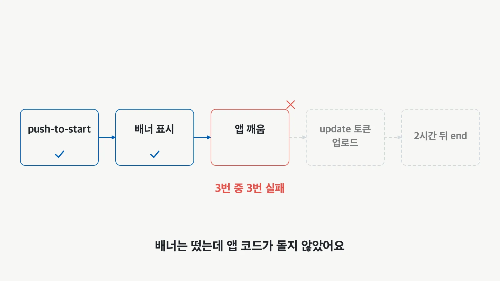
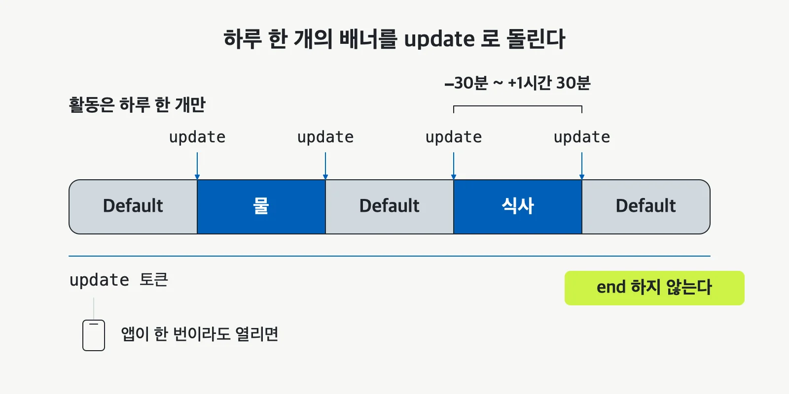
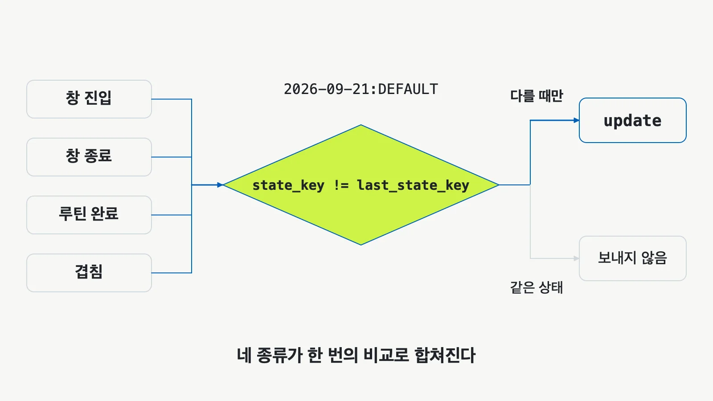

## 들어가며: 점심인데 아침 체중 배너가 떠 있다

> 점심인데 라이브 액티비티에 아침 체중이 계속 나와요.

QA 에서 온 보고였어요. 앱에는 아침 체중 재기, 물 마시기처럼 정해진 시각에 하는 루틴이 있고, 이걸 잠금화면과 Dynamic Island 에 보여 주는 Live Activity(화면 템플릿 13종)가 있어요. 처음엔 앱이 홈 화면을 그릴 때 보여 줄 루틴을 골라 배너를 띄우거나 바꿨어요.

코드에는 잘못이 없었어요. 사용자가 점심 루틴 알림을 받고도 앱을 열지 않았을 뿐이에요. **앱이 잠들어 있는 동안에는 배너를 바꿀 주체가 없었던 거예요.**

이 글은 그 빈칸을 서버로 메운 과정이에요. 처음엔 서버가 push-to-start 로 새 배너를 띄우면 된다고 생각했어요. 그 설계는 실기기에서 두 번 무너졌고, 마지막에는 배너를 갈아끼우지 말고 하루 한 개의 배너를 update 로 돌리는 구조에 도착했어요.

## Live Activity 를 바꾸는 길과 토큰 두 개

앱 안에서 부르는 `Activity.request` 나 `activity.update` 는 당연히 앱이 살아 있어야 해요. 앱이 잠든 동안 배너를 바꾸려면 서버가 APNs 로 ActivityKit 푸시(`event: "start"`, `"update"`, `"end"`)를 보내는 수밖에 없어요. 이때 헷갈리기 쉬운 게 토큰이 두 종류라는 점이에요.

| | push-to-start 토큰 | update 토큰 |
|---|---|---|
| 개수 | 앱(기기)당 1개 | 활동(배너) 하나당 1개 |
| 받는 곳 | `Activity<T>.pushToStartTokenUpdates` | `activity.pushTokenUpdates` |
| 할 수 있는 일 | 새 배너 시작(`start`) | 그 배너의 갱신·종료(`update`·`end`) |
| 언제 바뀌나 | 바뀔 수 있음 — 새 값이 오면 서버 값을 갈아끼움 | 활동 도중에도 바뀔 수 있고, 그 활동이 끝나면 무효 |
| 지원 버전 | iOS 17.2 이상 | iOS 16.2 이상 (`request(attributes:content:pushType:)` 기준) |

push-to-start 토큰은 "이 기기에 이 타입의 배너를 새로 띄울 권리"이고, update 토큰은 "이미 떠 있는 바로 그 배너를 만질 권리"예요. 이 차이가 글 전체를 끌고 가요.

제한도 있어요([Apple 문서](https://developer.apple.com/documentation/activitykit/displaying-live-data-with-live-activities), 2026-11-18 확인). 활동은 최대 8시간 살고 끝난 뒤 잠금화면에 최대 4시간 더 남아요(최대 12시간). 데이터는 4 KB 를 넘을 수 없고, 푸시에는 시간당 예산이 있어 `apns-priority: 10` 은 예산을 쓰고 `5` 는 쓰지 않아요.

## 첫 설계: 루틴 알림이 나갈 때 push-to-start 를 같이 보낸다

서버는 이미 매분 루틴 알림을 보내고 있었으니, 첫 설계는 알림이 나간 순간 같은 회원의 기기로 push-to-start 를 함께 보내는 거였어요. 이전 배너가 남지 않도록 `end` 를 먼저 보내고 `start` 를 보내기로 했고요.

앱 쪽 일은 토큰을 서버에 올리는 것이었어요. Swift 에서 push-to-start 토큰 스트림을 구독해 두고, Dart 가 MethodChannel 로 그 값을 읽어 서버에 보내요.

```swift
// ActivityKit 관리 actor (줄임)
func pushToStartTokenObserving() -> String? {
    guard #available(iOS 17.2, *) else { return nil }

    if pushToStartTask == nil {
        pushToStartTask = Task {
            for await tokenData in Activity<RoutineActivityAttributes>.pushToStartTokenUpdates {
                self.pushToStartToken = tokenData.map { String(format: "%02x", $0) }.joined()
            }
        }
    }
    return pushToStartToken
}
```

토큰은 비동기로 도착해서 첫 호출은 거의 항상 `nil` 이에요. 그래서 Dart 쪽은 2초, 5초 뒤에 다시 묻고, 그래도 없으면 다음 포그라운드 복귀나 로그인 때 시도해요.

서버는 FCM 을 거치지 않고 APNs 에 직접 보냈어요. 거절 사유(`BadDeviceToken`, `BadTopic`)가 그대로 보여야 진단할 수 있었거든요.

## APNs 는 200 인데 배너가 안 뜬다

dev 서버에서 처음 보낸 `start` 는 APNs 가 `200` 을 돌려줬는데 잠금화면에는 아무것도 없었어요. 원인은 셋이 차례로 나왔고, **셋 다 오류 없이 조용히 버려지는 종류**였어요.

첫째, `start` 에 `aps.alert` 가 없었어요. alert 가 없으면 iOS 가 payload 를 버리고, APNs 는 그래도 `200` 을 줘요. [Apple 문서](https://developer.apple.com/documentation/activitykit/starting-and-updating-live-activities-with-activitykit-push-notifications)(2026-11-18 확인)도 start payload 요구사항에 alert 포함을 적어 두었는데, 저는 알림용 옵션으로 읽고 넘어갔었어요. 실기기에서 alert 는 알림함·소리·배지에 나타나지 않았고, 문구는 그 순간 나간 루틴 알림 문구를 재사용했어요.

둘째, `content-state` 의 키가 파이썬은 `title_key`, Swift `ContentState` 는 `titleKey` 였어요. 디코딩이 실패해도 APNs 는 `200` 이라, pydantic alias 를 달고 `model_dump(by_alias=True)` 로 덤프하게 했어요.

셋째, 시각 필드의 기준일이 둘이었어요.

```python
def build_payload(event, content_state, attributes, alert, stale_at, now) -> dict:
    aps = {
        "timestamp": now,                       # Unix 초 (1970 기준)
        "event": event.value,
        "content-state": content_state.model_dump(by_alias=True) if content_state else {},
    }
    if event is PushEvent.START:
        aps["attributes-type"] = "RoutineActivityAttributes"
        # attributes 안의 startTime / endTime 은 Apple 기준일(2001-01-01) 초
        aps["attributes"] = attributes.model_dump(by_alias=True, exclude_none=True)
        aps["alert"] = {"title": alert.title, "body": alert.body}  # 없으면 iOS 가 버린다
    if stale_at is not None:
        aps["stale-date"] = stale_at            # 다시 Unix 초
    return {"aps": aps}
```

`aps.stale-date` 는 Unix(1970) 초인데, `attributes` 안의 `Date` 필드는 Swift 기본 `JSONDecoder` 의 `.deferredToDate` 전략 때문에 2001년 1월 1일 기준 초로 읽혀요. 틀려도 디코딩은 성공하고 시각만 31년 어긋나서, 변환 함수를 따로 두고 시간대 없는 `datetime` 은 받지 않게 막았어요.

```python
headers = {
    "authorization": f"bearer {provider_jwt}",            # ES256, 45분마다 재발급
    "apns-push-type": "liveactivity",
    "apns-topic": f"{bundle_id}.push-type.liveactivity", # 번들 ID 만 쓰면 BadTopic
    "apns-priority": "10" if event is PushEvent.START else "5",
    "apns-expiration": str(stale_at),                     # 지난 루틴 배너가 뒤늦게 뜨지 않게
}
```

`apns-priority` 는 `start` 만 10, `update`·`end` 는 5 예요. 갱신은 몇 분 늦어도 괜찮은데, 모두 10 으로 보내면 예산을 써 버려 다음 `start` 가 밀릴 수 있어요. JWT 를 45분마다 바꾸는 건 [Apple 문서](https://developer.apple.com/documentation/usernotifications/establishing-a-token-based-connection-to-apns)(2026-11-19 확인)가 20분보다 자주도, 60분보다 드물게도 바꾸지 말라고 하기 때문이에요. 이 셋을 고치고 나서야 dev 실기기에서 물·명상·식사 배너가 서버 푸시만으로 떴어요.

## 배너가 쌓인다: end 를 보내려면 update 토큰이 필요했다

배너가 뜨기 시작하자 다음 문제가 보였어요. 처음 실기기에서는 `start` 를 보낼 때마다 새 활동이 생겼고(뒤에서 다시 다뤄요), 이전 배너를 끝내지 않으면 "점심인데 아침 배너"가 "점심과 아침이 나란히"로 바뀌어요. 그런데 `end` 는 그 배너의 update 토큰이 있어야 보낼 수 있어요.

update 토큰은 앱이 관찰해서 올려야 하는데, 놓치기 쉬운 곳이 둘 있었어요. `Activity.request` 에 `pushType: .token` 을 안 넘기면 update 토큰이 아예 발급되지 않아요. 실기기 로그에서 활동은 보이는데 토큰 줄이 70초 동안 안 찍히는 걸 보고 찾았어요. 그리고 지금 살아 있는 활동(`activities`)과 앞으로 생길 활동(`activityUpdates`)을 모두 봐야 어느 배너도 놓치지 않아요.

```swift
func updateTokenObserving() async {
    if updateTokenTask == nil {
        for activity in Activity<RoutineActivityAttributes>.activities {
            observeUpdateToken(activity)
        }
        updateTokenTask = Task {
            for await activity in Activity<RoutineActivityAttributes>.activityUpdates {
                observeUpdateToken(activity)
                await reduceToLatestActivity()  // 잠든 사이 쌓인 배너를 하나로
            }
        }
    }
}

private func observeUpdateToken(_ activity: Activity<RoutineActivityAttributes>) {
    guard updateTokenTasks[activity.id] == nil else { return }
    updateTokenTasks[activity.id] = Task {
        for await tokenData in activity.pushTokenUpdates {
            self.updateToken = tokenData.map { String(format: "%02x", $0) }.joined()
            self.updateActivityId = activity.id
            self.onUpdateToken?()              // Dart 에 "새 토큰 왔다"고 알린다
        }
        // 스트림이 끝났다 = 활동이 끝났다. 죽은 토큰을 다음 배너 토큰인 양 올리지 않는다.
        self.updateTokenTasks[activity.id] = nil
        if self.updateActivityId == activity.id { self.updateToken = nil }
    }
}
```

update 토큰은 활동 도중에도 바뀔 수 있어서, 네이티브가 받는 순간 Dart 를 불러 바로 올려요. 서버가 토큰을 끄는 건 `BadDeviceToken` 과 `Unregistered` 뿐이에요. 일시적 사유로 끄면 멀쩡한 기기가 영영 배너를 못 받아요.

남은 질문은 하나였어요. 서버가 push-to-start 로 띄운 배너의 update 토큰은 언제 서버에 닿을까요?

## 가정이 깨졌다: push-to-start 는 앱을 깨워 주지 못했다

Apple 문서에는 이렇게 적혀 있어요.

> When the system receives the ActivityKit push notification on a device, it starts a new Live Activity, wakes up your app, and grants it background runtime …
>
> (시스템이 기기에서 ActivityKit 푸시를 받으면 새 Live Activity 를 시작하고, 앱을 깨우고, 백그라운드 실행 시간을 줘요.)

그러니 push-to-start 가 앱을 깨우면, 앱이 새 배너의 update 토큰을 서버에 올리고, 서버는 그 토큰으로 2시간 뒤 `end` 를 보낸다는 설계였어요. 네이티브와 Dart 양쪽에 계측 로그를 심고 실기기에서 확인했더니 결과는 **3번 중 3번 실패**였어요. 배너는 떴는데 앱 코드가 돌지 않았어요. iOS 가 앱 프로세스를 main 진입 전 단계에서 동결해 두었다가 푸시가 오면 그 미완성 부팅을 재개하는 모양이었고, 12초를 기다려도 앱 코드에 닿지 않았어요. dev 서버 액세스 로그 2,300여 건을 뒤져도 네이티브 HTTP 클라이언트(`CFNetwork`)가 올린 토큰은 한 건도 없었고, 전부 앱을 연 뒤 Dart(`dart:io`)가 올린 것이었어요.

<figure>
	
	<figcaption>배너는 떴지만 앱이 깨어나지 않아서, update 토큰을 서버에 올리는 단계부터 끊겼어요.</figcaption>
</figure>

기기 한 대에서 세 번 본 결과라 모든 조건에서 그렇다고 말할 수는 없어요. 하지만 깨어남이 보장되지 않는 경로에 배너 종료를 걸 수는 없었어요. 토큰을 네이티브에서 바로 HTTP 로 올리는 방법도 결국 앱 코드가 돌아야 하는 길이라 같은 벽에 막혀요.

## 다시 세운 설계: 배너를 갈아끼우지 말고 하루 한 개를 돌린다

다시 보니 문제는 `start` 와 `end` 가 둘 다 새 활동을 전제로 한다는 데 있었어요. 새 활동마다 새 update 토큰이 생기고, 그 토큰은 앱이 깨어나야 서버에 닿아요. 반면 `update` 푸시가 오면 시스템은 앱이 아니라 위젯 익스텐션을 깨워 화면을 그려요. 토큰만 있으면 앱이 하루 종일 안 깨어나도 내용을 바꿀 수 있어요. 그래서 **배너를 바꾸는 일을 새 배너를 띄우는 일이 아니라, 이미 떠 있는 배너의 내용을 바꾸는 일로** 다시 정의했어요.

이 구조를 회전이라고 부를게요. 활동은 하루 한 개만 두고, 아침에 앱이 한 번이라도 열리면 그 배너의 update 토큰이 서버에 올라가요. 루틴 예정 시각 −30분 ~ +1시간 30분을 그 루틴의 창으로 보고, 창 안이면 그 루틴 화면, 창 밖이면 "오늘 남은 루틴" 요약 화면(Default 화면)을 보여 줘요. 창이 겹치면 나중 루틴이 이겨요. 그리고 남은 루틴이 0개여도 `end` 하지 않아요. `end` 하는 순간 update 토큰이 함께 죽어 그날 남은 회전을 잃어요.

<figure>
	
	<figcaption>새 배너를 띄우지 않고, 하루 한 개의 배너 내용을 update 로 돌려요.</figcaption>
</figure>

앱 쪽에도 같은 함정이 있었어요. 홈 화면이 "보여 줄 배너 없음"을 계산하면 그대로 활동을 내렸는데, 그러면 토큰까지 죽어요. 그래서 상태를 활동을 내리는 `None` 과 아무것도 하지 않는 `Keep` 으로 나눴어요. 비교 축도 바꿨어요. 처음엔 화면 템플릿이 바뀌면 `start` 로 새 활동을 세웠는데, 그러면 물 → Default → 식사로 넘어갈 때마다 토큰이 죽어요. 그래서 시작할 때 고정되는 `attributes` 에는 화면 대신 활동 종류(`dailyRoutine` / `fastOngoing`)를 넣고, 종류가 같으면 `update` 로 이어 가게 했어요.

단식만은 별도 활동으로 남겼어요. 단식 카운트다운은 `attributes` 의 끝 시각으로 iOS 가 직접 그리는데 서버 `update` 가 덮으면 깨지기 때문에, 서버에는 진행 중 단식 배너에 `update`·`end`·`start` 어느 것도 보내지 않는다는 금지 목록이 있어요.

## 서버가 매분 정하는 것: 상태 diff 와 다음 전환 시각

회전은 서버의 Celery 태스크가 매분 돌면서 해요. 창 경계가 분 단위 벽시계(12시 루틴이면 11:30 진입, 13:30 종료)라 더 긴 주기로는 경계를 지나칠 수 있어서예요.

처음 기획 문서는 전환을 창 진입, 창 종료, 루틴 완료, 겹침의 네 종류로 나눠 감지하자고 했는데, 조회 범위가 5분이라 전환 하나에 `update` 가 3~5번 나갔어요. 그래서 이벤트를 세지 않고 상태를 비교하기로 했어요. 매 틱마다 "지금 보여야 할 상태"를 계산하고, 마지막으로 보낸 상태와 다를 때만 보내요.

```python
state_key = f"{member_local_date}:{item_id or 'DEFAULT'}"   # 예: "2026-09-21:DEFAULT"

if state_key != token.last_state_key:
    await apns.send(event=PushEvent.UPDATE, push_token=token.update_token, ...)
    token.last_state_key = state_key
token.next_state_change_at = next_boundary_after(now)       # 다음 창 경계 또는 다음 로컬 자정
```

<figure>
	
	<figcaption>전환을 종류별로 세지 않고 상태를 비교하니, 같은 상태를 두 번 계산해도 update 는 한 번만 나가요.</figcaption>
</figure>

네 종류의 전환이 모두 `DEFAULT` 와 `item_id` 사이의 변화로 바뀌어 비교 한 번으로 합쳐져요. 같은 상태를 두 번 계산해도 두 번째는 아무것도 보내지 않으니 멱등이 구조로 보장되고, 날짜가 키에 들어 있어 자정이 지나면 같은 루틴이어도 새 상태가 돼요.

작업량도 신경 썼어요. 한 회원의 상태는 하루 10~20번 바뀌는데 매분 평가하면 1,440번이에요. 그래서 토큰 행에 다음 전환 예정 시각(`next_state_change_at`)을 들고 그 시각이 지난 행만 partial index 로 골라, 일의 양이 실제로 경계를 넘은 토큰 수에 비례하게 했어요.

`stale-date` 도 같은 함수에서 나와요. 그 시각이 지나면 iOS 가 앱 없이도 배너를 흐리게 그려, 틀린 내용이 최신인 척하는 것은 막아요.

### 조용히 아무 일도 안 할 뻔한 곳들

회전은 안 돌아도 배너가 시작 화면에 머물 뿐이라 오류 로그가 나지 않아요. 그런 구멍을 셋 찾았어요. 토큰을 저장할 때 `next_state_change_at` 를 안 채워 새 행이 전부 `NULL` 이었고, `NULL` 은 어떤 틱에도 안 잡혀요. 그대로 배포했으면 기능 전체가 무동작이었어요. 첫 평가에서는 배너가 이미 그리는 내용으로 중복 `update` 가 나가서, 첫 평가는 상태만 받아 적게 했어요. 그리고 금지 목록에 단식 시작·완료 화면이 빠져 있어, 방금 띄운 단식 시작 배너를 서버가 1분 만에 Default 로 덮었어요.

## 문구는 서버가 아니라 위젯이 만든다: 키와 표시 언어

서버가 완성 문구를 만들면 앱이 지원하는 35개 언어의 번역을 서버 DB 에 복제하고 영원히 맞춰야 해요. 그래서 서버는 `titleKey`, `valueCurrent` 같은 키와 숫자만 보내고, 위젯 익스텐션이 앱 번역 원본에서 생성한 번들로 조립해요. 구버전 호환을 위해 `ContentState` 는 완성 문구가 오면 그것을 우선해요.

언어도 문제였어요. 앱 안에서 기기와 다른 언어를 고를 수 있는데 위젯은 기기 언어를 따라서, 앱은 영어인데 배너는 한국어로 나와요. 그래서 토큰을 올릴 때 앱 표시 언어를 함께 올리고, 서버가 `content-state` 의 `locale` 에 실어 보내요.

`zh` 하나로는 간체와 번체를 가를 수 없어 국가까지 붙은 태그(`zh_CN`)를 보내고, 같은 회원이어도 기기마다 언어가 다를 수 있어 `content-state` 는 토큰마다 조립해요. 문구를 만드는 쪽이 Dart 가 아니면, 앱 언어는 누군가 명시적으로 건네줘야 해요.

## 어디에 쓰지 않나: 루틴과 걸음만

지금 Live Activity 는 기획상 루틴과 걸음 두 종류만, 한 번에 한 종류씩 노출해요. 걸음 화면은 서버가 회전시키지 않아요. 걸음 수의 표시 정본은 앱의 만보계 계산이라 서버 스냅샷을 내리면 숫자가 어긋나서, 서버는 걸음 템플릿이면 배너를 건드리지 않고 물러나요. 서버 회전을 붙일지는 결국 **그 화면의 값을 서버가 앱과 같은 숫자로 알고 있는가**로 갈렸어요. 루틴 예정 시각과 완료 여부는 서버가 정본이라 맞고, 걸음 수와 진행 중 단식처럼 기기가 실시간으로 계산하는 값은 맞지 않아요.

## 남은 구멍: 8시간

활동은 8시간이 지나면 iOS 가 끝내요. 아침 7시에만 앱을 연 사용자는 오후 3시쯤 update 토큰도 함께 죽어서, 저녁 루틴은 회전으로 덮을 수 없어요. 이 구간은 루틴 알림 시각의 push-to-start 가 새 배너를 띄우는 게 바닥층인데, 그 배너의 토큰은 앱이 열려야 서버에 닿으니 그날 저녁의 회전은 끊겨요.

push-to-start 가 기존 활동을 교체하는지도 기록이 엇갈려요. 처음엔 새 활동을 만들고 기존 것을 치워 주지 않는다고 봤는데, 다음 날 디버그 빌드 한 대에서 연속 전송했을 때는 매번 마지막 하나만 남았어요. release 빌드와 다른 iOS 버전은 아직 확인 전이라, 서버의 `end` → `start` 와 앱의 "가장 최근 배너 하나만 남기기"를 둘 다 유지하고 있어요. iOS 18 부터는 start payload 에 `input-push-token: 1` 이나 채널 ID 를 실어 시작과 동시에 갱신 경로를 여는 방법도 생겼는데(같은 Apple 문서), 이번 구조를 만들 때는 검토하지 못했어요.

## 결과: 앱이 잠들어도 배너가 루틴 시각을 따라간다

회전은 9월 22일 앱(머지 시점 버전 0.280.0)과 서버에 함께 들어갔어요. 바뀐 것을 숫자로 보면 이래요.

- 아침에 앱을 한 번만 열어도, 활동이 살아 있는 8시간 동안은 앱 없이 배너가 루틴 시각에 맞춰 바뀌어요.
- 루틴 전환 하나에 나가던 `update` 가 3~5번에서 1번으로 줄었어요. 이벤트를 세지 않고 상태를 비교한 덕분이에요.
- 서버가 한 회원을 평가하는 횟수는 하루 1,440번(매분)이 아니라 실제로 상태가 바뀌는 10~20번이에요.

출시 뒤에도 지난 루틴 배너가 남는 판정 버그가 두 가지 나와, 11월에 팀원이 고쳤어요. 하나는 매일 반복하는 루틴의 어제 완료 기록이 오늘 회차를 가린 것이었고, 다른 하나는 앞에서 중복 `update` 를 막으려고 "첫 평가는 상태만 받아 적게" 한 결정이 배너가 뜬 뒤 상태가 바뀐 경우까지 고치지 않게 만든 것이었어요. 둘 다 회전 판정 파일 하나 안에서 고쳐졌어요.

## 마치며: 바꾸는 일과 띄우는 일은 다르다

"점심인데 아침 배너"를 처음 봤을 때는 새 배너를 제때 띄우면 된다고 생각했어요. 그래서 push-to-start 를 붙였고 배너는 떴어요. 그런데 띄우는 일은 끝내는 일을 낳고, 끝내는 일은 앱이 깨어나야 받을 수 있는 토큰을 요구했어요. 결국 고친 건 질문이었어요. "언제 새 배너를 띄울까"에서 "하루 한 개의 배너를 어떻게 계속 만질 수 있게 둘까"로요.

**앱 프로세스가 필요 없는 경로만으로 닫히는지 확인하지 않으면, 그 설계는 앱이 깨어날 때만 동작합니다.**

Live Activity 를 서버에서 다루려 한다면 세 가지를 먼저 물어보세요.

1. 이 흐름의 어느 단계가 앱 코드 실행을 전제하나요? 토큰 업로드 한 줄이라도 있다면, 앱이 안 깨어나는 날 그 흐름은 멈춰요.
2. `end` 를 보내는 순간 무엇을 잃나요? update 토큰은 활동과 함께 죽어요. 없앨지 내용을 바꿀지는 그 토큰을 다시 얻을 수 있는지로 정해야 해요.
3. APNs 가 `200` 을 줬을 때 무엇을 확인하나요? alert 누락, 키 이름, epoch 기준처럼 이 기능의 실패는 대부분 조용해요. 실기기에서 배너가 바뀌는 걸 직접 보는 단계를 빼지 마세요.

## 참고 자료

- Apple, [Starting and updating Live Activities with ActivityKit push notifications](https://developer.apple.com/documentation/activitykit/starting-and-updating-live-activities-with-activitykit-push-notifications) — start payload 요구사항(alert 포함), 앱을 깨운다는 문구, `apns-priority` 5/10 과 시간당 예산, update 토큰 교체, iOS 18 의 `input-push-token`. 2026-11-18 확인
- Apple, [Displaying live data with Live Activities](https://developer.apple.com/documentation/activitykit/displaying-live-data-with-live-activities) — 8시간 활동 수명과 잠금화면 최대 12시간, 4 KB 데이터 크기 제한, Apple Watch 에서의 alert 표시. 2026-11-18 확인
- Apple, [`pushToStartTokenUpdates`](https://developer.apple.com/documentation/activitykit/activity/pushtostarttokenupdates) — iOS 17.2 부터 지원. 2026-11-18 확인
