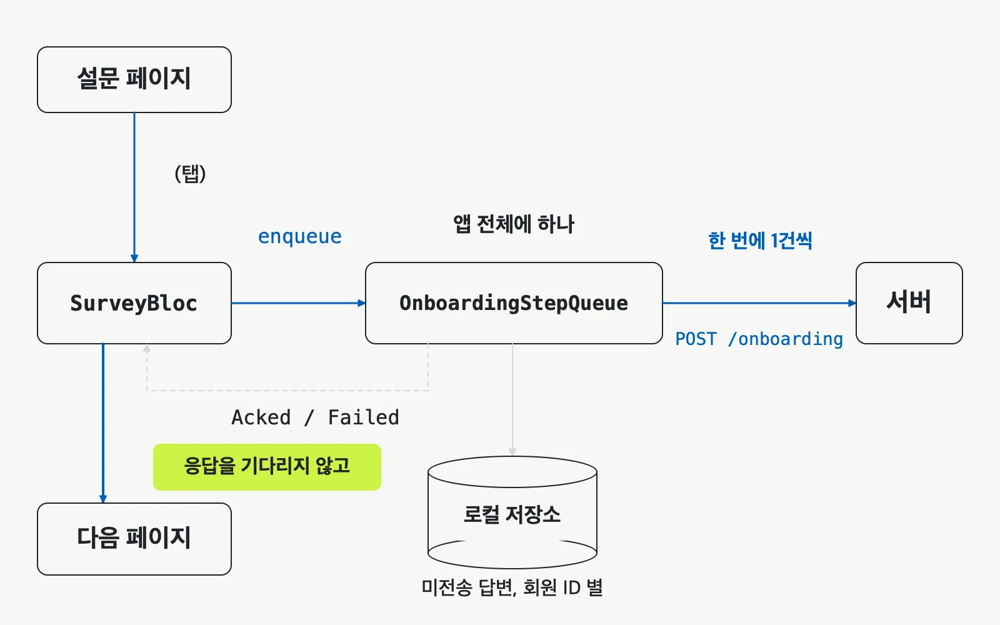
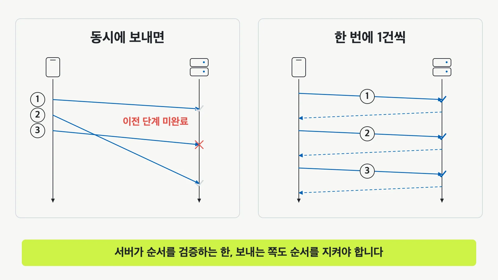
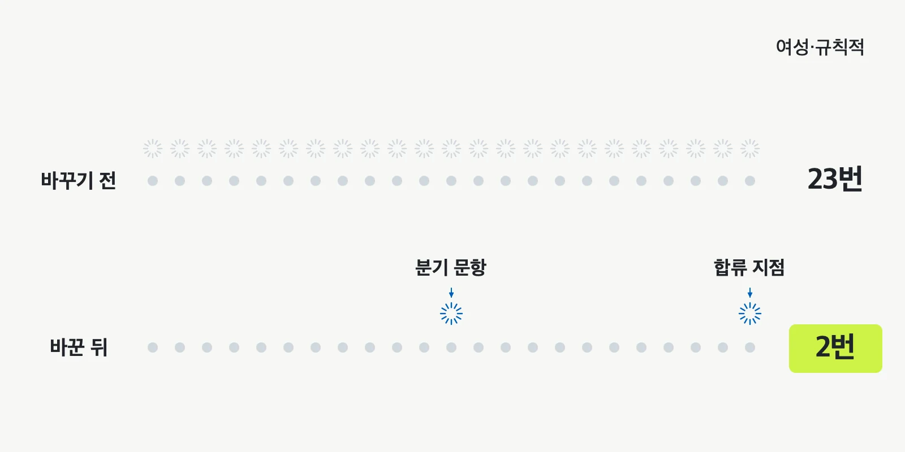
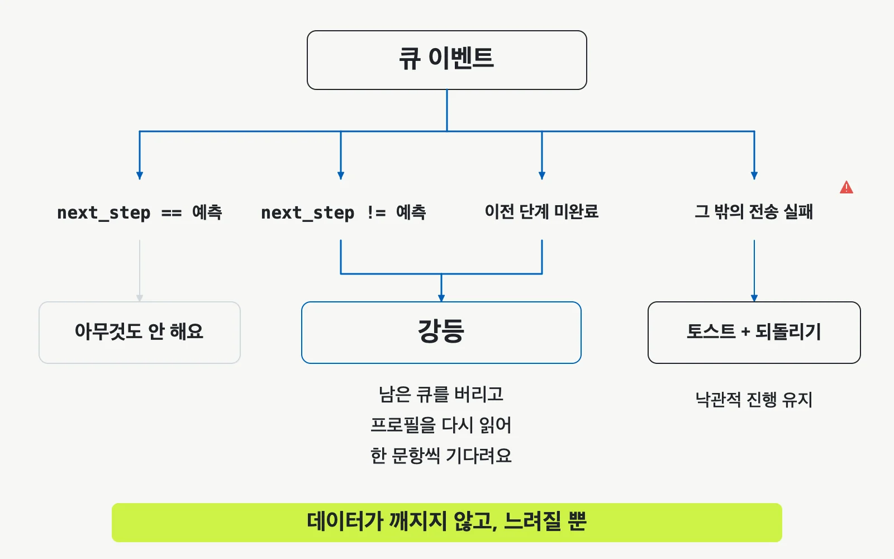

## 들어가며: 답을 하나 고를 때마다 화면이 멈췄다

앱을 처음 켠 사람은 수면 시간, 앉아 있는 시간, 복용 중인 약 같은 몸 상태와 생활 습관을 묻는 온보딩 설문을 거쳐요. QA 에서 "설문 문항이 넘어갈 때마다 로딩이 떠서 느리다"는 지적이 왔어요. 확인해 보니 답을 하나 고를 때마다 전체 화면 로딩이 떴다가 사라진 뒤에야 다음 문항으로 넘어갔어요. 설문은 최대 23문항이었으니, 사용자는 로딩을 23번 봤어요.

이 글은 답변 저장을 백그라운드 직렬 큐로 보내 그 23번을 2번으로 줄인 과정이에요.

## 23번은 코드 경로로 셌다

23은 측정값이 아니라 코드 경로로 센 값이에요. 바꾸기 전 BLoC 은 답변 하나를 받으면 이렇게 처리했어요(줄인 코드예요).

```dart
Future<void> _onSelectAnswer(SelectAnswerEvent event, Emitter<SurveyState> emit) async {
  final data = {event.stepType.value: event.answerId};

  await _onboardingUseCase
      .updateOnboardingStep(data)                       // POST /onboarding
      .onStart(() => _emitSideEffect(LoadingEffect(isLoading: true)))
      .onSuccess((stepModel) async {
        await _navigateToNextStep(emit, stepModel.step); // 응답의 next_step 으로 이동
      })
      .onFinal(() => _emitSideEffect(LoadingEffect(isLoading: false)))
      .execute();
}
```

문항 하나당 POST 1건과 전체 화면 로딩 1번이 묶여 있고, 다음 문항은 서버 응답의 `next_step` 으로만 정해져요. 그러니 로딩 횟수는 곧 답하는 문항 수예요. 계정 조건별 서버 응답으로 세 보니 남성 21문항, 생리 주기 "해당 없음"인 여성 22문항, "규칙적"인 여성 23문항이었어요. 23은 가장 긴 경우이고, 뒤의 2번도 같은 조건, 같은 정의로 셌어요.

## 다음 문항을 몰라서 기다리는 게 아니었다

처음에는 서버가 답을 보고 다음 문항을 정하니 기다릴 수밖에 없다고 생각했어요. 그런데 코드를 따라가 보니 서버는 이미 프로필 응답의 `onboarding_steps` 로 그 사용자에게 보여 줄 전체 스텝 목록을 주고 있었고, 앱도 그 목록으로 설문 `PageView` 를 미리 만들어 두고 있었어요. 서버의 `next_step` 계산과 스텝 목록 생성은 같은 판정 함수를 써서, `next_step` 은 정의상 목록의 바로 다음 항목이에요. 앱에는 로컬에서 다음 스텝을 구하는 함수도 쓰이지 않은 채 있었어요. **문제는 다음 단계를 모르는 게 아니라, 응답을 기다리는 것 자체였어요.**

서버를 빠르게 하는 길도 따져 봤지만, POST 1건의 DB 왕복 11~14번 중 기능을 바꾸지 않고 줄일 수 있는 건 1~4번뿐이었어요. 기대 이득은 10~30% 정도였고, 줄여도 로딩은 여전히 23번 떠요.

## 기다리지 않고 넘어가기: 답은 큐에, 화면은 예측으로

새 구조에서 BLoC 은 답변을 앱 전체에 하나뿐인 큐에 넣고 바로 다음 페이지로 넘어가요. 서버 응답은 나중에 이벤트로 받아 예측과 맞는지 대조만 해요.

```text
설문 페이지
   │ (탭)
SurveyBloc ──enqueue──▶ OnboardingStepQueue (앱 전체에 하나)
   ▲                         │ 한 번에 1건씩 POST /onboarding
   │◀── Acked / Failed ──────┤
   │                         └──▶ 로컬 저장소 (미전송 답변, 회원 ID 별)
   │
   └─ 응답을 기다리지 않고 바로 다음 페이지로
```

<figure>
	
	<figcaption>BLoC 은 답을 큐에 넣고 바로 넘어가고, 서버 전송은 앱 전체에 하나뿐인 큐가 맡아요.</figcaption>
</figure>

서버가 다음 문항을 말해 주기 전에 앱이 같은 목록으로 먼저 계산해서 넘어가는 이 방식을 여기서는 낙관적 진행이라고 부를게요.

```dart
await _stepQueue.enqueue(step: stepType, value: value);

// 예측은 서버와 같은 기준(전체 스텝 목록)으로 한다.
final index = _flattenSteps.indexOf(stepType);
final hasNext = index != -1 && index + 1 < _flattenSteps.length;
final predictedNext = hasNext ? _flattenSteps[index + 1] : OnboardingStepType.unknown;
_predictedNext[stepType] = predictedNext;   // 나중에 서버 응답과 대조할 기록

final pageIndex = state.surveyStepInfos.indexWhere((info) => info.stepType == predictedNext);
if (pageIndex == -1) {
  await _completeSurvey(emit);   // 다음 스텝이 설문이 아니다 = 설문 끝
  return;
}
_moveToPage(pageIndex);
```

함정은 예측의 기준 목록이에요. 화면의 설문 문항 목록(`surveyStepInfos`)으로 예측하고 싶어지지만, 서버의 `next_step` 은 걸러 내기 전 전체 목록의 다음 항목이에요. 지금은 우연히 같아도, 서버에 주석 처리된 스텝 9개 중 하나만 설문 사이에 다시 켜지면 배포된 앱의 예측이 전부 틀어져요. 그래서 예측은 전체 목록(flatten), 화면 이동만 설문 목록 기준으로 나누고 회귀 테스트로 고정했어요.

## 서버가 순서를 검증하니 큐도 직렬이어야 했다

기다리지 않을 거면 문항마다 POST 를 바로 쏘면 되지 않을까 싶지만, 서버는 답변을 저장하기 전에 앞 스텝이 모두 저장됐는지 검증하고(`_validate_previous_steps_completed`) 앞서 나간 요청은 "이전 단계 미완료"로 거부해요. 빠르게 답한 3문항이 동시에 나가면 3번째가 2번째보다 먼저 도착해 거부될 수 있어요. **서버가 순서를 검증하는 한, 보내는 쪽도 순서를 지켜야 합니다.**

<figure>
	
	<figcaption>서버가 앞 스텝 저장을 검증하니, 동시에 보내면 순서가 뒤집혀 거부될 수 있어요.</figcaption>
</figure>

그래서 큐는 앞 건의 응답을 받은 뒤에야 다음 건을 보내요. 뒤에 나올 기다려야 하는 문항조차 큐를 우회하지 않아요. 우회하면 큐에서 기다리던 앞 문항보다 먼저 도착해 같은 검증에 걸리니까요. 직렬로 보내는 일꾼은 하나만 돌게 했어요.

```dart
/// 진행 중인 drain 이 있으면 그 Future 를 재사용한다 — 이것이 곧 재진입 가드다.
void _kick() {
  _drainFuture ??= _drain().whenComplete(() => _drainFuture = null);
}

Future<void> _drain() async {
  while (_pending.isNotEmpty && !_stopped) {
    final item = _pending.first;
    final result = await _onboardingUseCase.updateOnboardingStep(item.toRequestBody());
    final succeeded = result.fold(
      (model) { _emit(Acked(step: item.step, serverNextStep: model.step)); return true; },
      (error, _) { _emit(Failed(step: item.step, error: error)); return false; },
    );
    if (!succeeded) { _stopped = true; return; }   // 실패하면 멈춘다
    _pending.remove(item);
    await _persist();
  }
}
```

`isSending` 같은 플래그를 따로 두면 Future 와 어긋날 수 있어 `_drainFuture` 하나를 가드로 썼어요. 직렬은 덮어쓰기에도 필요해요. 뒤로 가서 답을 바꿨을 때 동시에 보내면 늦게 도착한 옛 답이 마지막 값이 될 수 있거든요. 나아가 같은 스텝이 아직 대기 중이면 줄을 새로 세우지 않고 그 자리를 새 값으로 바꿔요. 전송 중인 항목만 빼고요.

```dart
// 전송 중인 항목(맨 앞)은 바꿀 수 없으므로 탐색에서 뺀다.
final searchStart = _inFlight == null ? 0 : 1;
final existingIndex = _pending.indexWhere((item) => item.step == step, searchStart);
if (existingIndex == -1) {
  _pending.add(next);
} else {
  _pending[existingIndex] = next;   // 대기 중인 옛 답을 새 답으로 교체
}
await _persist();   // 보내기 전에 먼저 디스크에
_kick();
```

> 이전 글에서 BLoC 이벤트를 `sequential()` 로 줄 세우는 이야기를 했는데, 이 큐는 다른 층이에요. `sequential()` 은 BLoC 하나 안의 처리 순서를 정하고 BLoC 이 닫히면 같이 사라져요. 이 큐는 앱 전체에 하나(`registerLazySingleton`)로 두고 디스크에도 남겨서, 설문 화면을 벗어나거나 앱이 꺼져도 보내던 순서를 이어 가요.

## 꼭 기다려야 하는 두 곳

### 첫째, 답에 따라 뒤 문항이 바뀌는 문항

생리 주기가 규칙적인지 묻는 문항에 "규칙적"이나 "불규칙"으로 답하면, 서버가 마지막 생리 시작일 문항을 목록에 새로 넣어요. 저장 전에는 목록에 그 문항이 없으니 앱이 아무리 정확히 예측해도 맞힐 수 없어요. 이런 문항을 분기 문항이라고 부를게요.

앱이 직접 문항을 끼워 넣는 설계는 버렸어요. 서버의 조건 셋(성별, GLP-1 사용 여부 포함) 중 하나만 알게 되고, 진행도도 손으로 다시 계산해야 하고, 조건이 늘면 앱과 서버를 같이 배포해야 하니까요. 대신 서버가 스텝 항목에 `affects_next_steps` 필드를 더해 분기 문항을 알려 주게 했어요.

```json
{ "step": "MENSTRUAL_REGULARITY", "id": 1, "affects_next_steps": true }
{ "step": "LAST_MENSTRUAL_DATE",  "id": 2 }
```

나머지 항목에는 `None` 을 넣고 서버가 `None` 을 빼고 직렬화하니, 기존 응답과 바이트가 같아 구버전 앱은 모르고 지나가요. 결과(생리 시작일)가 아니라 원인(그 문항을 부르는 답)에 표시해야 앱이 어느 답에서 기다릴지 알 수 있어요. 앱은 이 필드와 로컬 폴백 집합을 OR 해서, 서버 배포 전에도 기다리는 쪽으로 남게 했어요.

```dart
bool _isBranchingStep(OnboardingStepType stepType) {
  final info = state.surveyStepInfos.where((info) => info.stepType == stepType).firstOrNull;
  return (info?.affectsNextSteps ?? false) || _fallbackBranchingSteps.contains(stepType);
}

static const _fallbackBranchingSteps = {OnboardingStepType.menstrualRegularity};
```

분기 문항에서는 큐가 빌 때까지(`flush`) 기다리고, 프로필을 다시 읽어 서버가 정한 스텝으로 이동해요. 목록을 바꾸는 권한은 여전히 서버에 있어요. 분기 문항 셋 중 성별과 GLP-1 은 설문 앞의 채팅형 구간에 있어서, 설문 구간에 걸리는 건 하나뿐이에요.

### 둘째, 마지막 문항

설문 뒤의 건강 분석 API 는 모든 답변을 읽으니, 마지막 문항에서는 큐를 끝까지 비우고 넘어가요. 흩어져 보내던 답변이 한 번 모이는 합류 지점이에요.

```dart
Future<void> _completeSurvey(Emitter<SurveyState> emit) async {
  _emitSideEffect(LoadingEffect(isLoading: true));
  final flushed = await _stepQueue.flush();
  _emitSideEffect(LoadingEffect(isLoading: false));

  if (!flushed) {
    return;   // 실패 이벤트가 이미 그 문항으로 되돌렸다. 여기서 성공을 내면 미전송 답으로 분석이 돈다.
  }
  _emitSideEffect(SuccessEffect());
}
```

마지막 문항 즈음엔 큐가 거의 비어 있어 이 로딩은 짧을 거라고 예상했어요. 실제 대기 시간은 `final_flush_wait_ms` 로 남기지만, 실측 분포는 싣지 않았으니 아직 예상이에요.

이렇게 23번이 분기 문항 1번과 합류 지점 1번, 합해서 2번이 됐어요. 분기 문항이 없는 남성 계정은 1번이에요. 앱이 꺼진 뒤 미전송 답을 들고 다시 들어온 드문 경우에는, 그 답을 보내는 동안 진입 시점에 로딩이 한 번 더 떠요.

<figure>
	
	<figcaption>로딩은 답이 뒤 문항을 바꾸는 분기 문항과 마지막 합류 지점, 두 곳에만 남았어요.</figcaption>
</figure>

## 실패하면 멈추고, 앱이 꺼져도 남는다

전송이 실패하면 토스트를 띄우고 실패한 문항으로 화면을 되돌리고, 그 뒤의 답변은 보류해요. 건너뛰어 보내면 순서 검증으로 줄줄이 거부되니까요. 사용자가 다시 답하면 같은 스텝 교체 규칙으로 실패한 항목이 바뀌고 큐가 다시 돌아요. 큐에서 따로 재시도하지 않은 건 dio 인터셉터가 이미 타임아웃·연결 오류를 재시도하고 있어서예요.

앱 종료에 대비해 큐에 넣을 때는 보내기보다 디스크 저장이 먼저예요. 저장 키는 회원 ID 로 나눴고(`onboarding_pending_steps_{memberId}`), 회원 ID 를 아직 모르면 메모리로만 돌아요. 재개할 때는 서버에 이미 저장된 답을 먼저 걸러 내요. POST 는 성공했는데 응답 전에 앱이 죽었다면 같은 답을 다시 보내게 되는데, 생리 시작일 답은 저장할 때마다 생리 주기와 일일 기록을 새로 만들어서 기록이 두 벌 생기거든요.

## 예측이 틀리면 어제의 방식으로 돌아간다

낙관적 진행은 "서버가 준 목록으로 계산한 다음 문항 = 서버의 `next_step`" 이라는 전제 위에 있어요. 서버가 순서 규칙을 바꾸면 이 전제가 깨질 수 있으니, 예측을 기록해 두고 큐가 응답을 받을 때마다 대조해요. 같으면 아무것도 안 해요. 다르거나 "이전 단계 미완료"로 거부되면 강등해요. 낙관적 진행을 끄고, 남은 큐를 버리고, 프로필을 다시 읽어 서버가 말한 스텝으로 이동한 뒤, 이후 문항은 바꾸기 전처럼 한 문항씩 기다려요. 그 밖의 전송 실패는 네트워크 문제일 뿐이라 토스트와 되돌리기만 하고 낙관적 진행은 유지해요.

<figure>
	
	<figcaption>예측이 빗나가면 한 문항씩 기다리는 예전 방식으로 강등해서, 데이터는 깨지지 않고 느려지기만 해요.</figcaption>
</figure>

이 작업에서 가장 중요하게 본 성질은 **서버가 순서를 바꿔도 데이터가 깨지지 않고 느려질 뿐**이라는 거예요. 강등은 설계된 안전장치가 작동한 거라 크래시 지표의 치명 오류(`fatalError`)가 아니라 비치명 오류로만 남겼어요. 서버가 스텝 하나를 추가하는 순간 구버전 앱 전체가 이 경로를 탈 텐데, 예상된 결과로 알림을 울릴 이유가 없으니까요.

강등 뒤에도 큐가 이미 보낸 다음 건의 응답이 도착할 수 있어요. 버린 세대의 응답을 처리하면 강등이 두 번 돌아 토스트와 페이지 이동이 겹치니, 강등 뒤의 큐 이벤트는 모두 버려요.

## 같은 큐 위에 얹힌 두 번째 구간: 프로그램 설정

몇 주 뒤 설문 뒤에 끼니 시각, 단식, 걷기·수면 목표를 묻는 프로그램 설정 구간(9개 스텝, 화면 16개)이 붙어 같은 큐를 탔어요. 서버는 이 9스텝을 v2 API(`/api/v2/onboarding`, `/api/v2/members/me/profile`)로만 노출했어요. 구버전 앱이 모르는 스텝을 받으면 "알 수 없는 스텝 → 홈 → 다시 온보딩"의 무한 루프에 빠지니까요. 또 새 9스텝에는 `affects_next_steps` 를 하나도 붙이지 않고 테스트로 고정했어요. 이 서버 신호가 로딩 횟수를 서버가 통제하는 손잡이가 된 셈이에요.

한계도 드러났어요. 예측 목록에는 설문 스텝만 있어서 마지막 문항 다음은 언제나 "알 수 없음"인데, 앱이 이걸 기본값(건강 분석)으로 읽어 이미 지나온 분석 화면으로 되돌아가는 증상이 실기기에서 나왔어요. 합류 지점에서 큐를 비우면 마지막 POST 의 응답이 이미 와 있으니, 설문 밖 첫 목적지만큼은 그 `next_step` 을 쓰게 했어요. 문항 사이는 예측으로, 구간의 경계는 서버 응답으로 나눈 거예요.

## 정리하며: 기다림을 없앤 게 아니라 옮겼다

같은 조건(여성·규칙적), 같은 정의로 전후를 놓으면 이래요.

| | 바꾸기 전 | 바꾼 뒤 |
|---|---|---|
| 설문 구간 전체 화면 로딩 | **23번** (남성 21번) | **2번** (남성 1번) |
| 사용자가 기다리는 지점 | 모든 문항 | 분기 문항 1개, 마지막 문항(합류 지점) |
| 문항당 서버 요청 | 1건 | 1건 (그대로) |
| 다음 문항을 정하는 근거 | 서버 응답의 `next_step` | 서버가 준 목록으로 예측, 응답과 대조 |
| 서버가 순서를 바꾸면 | 그대로 따라감 | 예측이 틀린 걸 감지하고 바꾸기 전 방식으로 강등 |

23과 2는 코드 경로로 센 값이고, 배포 빌드에서 직접 센 기록은 없어요. 요청 수는 그대로예요. **기다림을 없앤 게 아니라, 사용자가 보지 않는 곳으로 옮긴 거예요.** 답을 고르는 동안 요청은 뒤에서 하나씩 나가고, 사용자가 기다리는 건 정말 기다려야 하는 두 곳뿐이에요.

처음에는 서버가 다음을 정하니 기다릴 수밖에 없다고 생각했지만, 서버는 답을 미리 주고 있었고 앱이 쓰지 않고 있었어요. 돌아보면 응답을 기다리는 코드는 대개 응답에만 있는 정보가 필요해서가 아니라, 처음에 그렇게 짰으니까 기다리고 있었어요.

화면 전환마다 `await` 하는 곳이 있다면 세 가지를 물어보세요.

1. 지금 기다리는 응답에만 있는 정보가 정말 있나? 이미 받아 둔 목록이나 상태로 계산할 수 있지 않나?
2. 서버가 순서를 검증하나? 그렇다면 동시 전송 대신 직렬 큐가 필요하고, 실패한 항목 뒤는 보류해야 해요.
3. 예측이 틀렸을 때 데이터가 깨지나, 느려지기만 하나? 느려지기만 하게 만들 수 없다면 낙관적 진행을 쓰지 않는 게 맞아요. 답에 따라 뒤가 바뀌는 문항처럼 예측의 입력 자체가 아직 없는 곳에서는 기다려야 해요.
