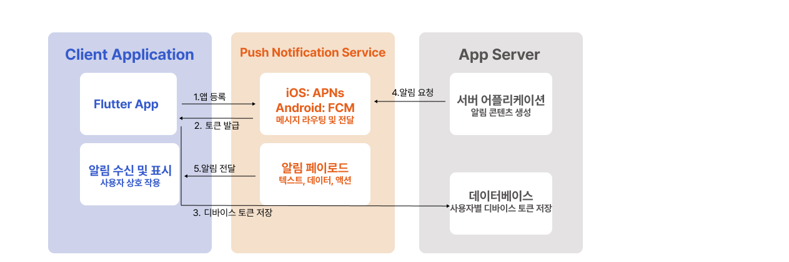

> [!info]
> This document is originally generated by Gemini2.5 deep research, and pruned for more readability by the author(jack).
>
> Keep in mind that AI could make mistakes and generate wrong informations.

---

## Push notification in Flutter

푸시 알림은 모바일 애플리케이션의 핵심 커뮤니케이션 채널로, 개발자가 사용자에게 시의적절하고 관련성 높은 정보를 기기 화면에 직접 전달할 수 있도록 합니다.

푸시 알림은 기본적으로 간결한 메시지 형태로, 사용자의 데스크탑 브라우저, 모바일 홈 화면, 또는 기기의 알림 센터에 팝업 형태로 표시됩니다. 이러한 알림은 일반적으로 **사용자의 동의**를 필요로 하며, 텍스트뿐만 아니라 이미지나 인터랙티브 버튼 같은 리치 미디어 요소도 포함할 수 있어, 사용자가 특정 행동을 취하도록 유도할 수 있습니다.

모바일 생태계에서 푸시 알림의 중요성은 아무리 강조해도 지나치지 않습니다.

푸시 알림은 사용자가 앱을 사용하고 있지 않을 때에도 중요한 업데이트, 개인화된 콘텐츠, 프로모션 등을 직접 전달할 수 있는 통로를 제공합니다. 이는 사용자 참여도를 높이고, 사용자 유지율을 향상시키며, 전반적인 사용자 경험을 강화하는 데 핵심적인 역할을 합니다. 또한, 푸시 알림은 마케팅 외에도, 시민 안전 알림과 커뮤니티 정보 전달 등 공공 커뮤니케이션 영역이나 보안 인증 과정에서도 다양하게 활용될 수 있습니다.

Flutter 애플리케이션 개발에서 푸시 알림은 크게 두 가지 유형으로 분류할 수 있습니다:

**원격 푸시 알림(Remote Push Notifications)** 과 **로컬 알림(Local Notifications)** 입니다.

Firebase Cloud Messaging(FCM)과 같은 서비스를 예로 들 수 있는 원격 알림은 서버에서 시작되어 네트워크를 통해 사용자 기기로 전달됩니다. 이는 백엔드 이벤트에 따라 알림을 보내거나 특정 사용자 집단을 타겟팅해야 하는 상황에서 매우 유용합니다.

반면, 로컬 알림은 애플리케이션이 사용자 기기 내에서 직접 생성 및 예약하는 알림으로, 서버 연결 없이도 동작합니다. 이 유형은 리마인더, 일정 알림, 또는 앱 내 사용자 행동을 기반으로 한 개인화된 경고 등에 적합합니다.

Flutter 애플리케이션에서 푸시 알림을 구현하면 다양한 이점을 얻을 수 있습니다.

개인화된 알림을 통해 사용자 참여를 높일 수 있으며, 앱을 오랫동안 사용하지 않은 유저에게 다시 관심을 끌기 위해 관련 콘텐츠나 매력적인 제안을 담은 타겟 알림을 보냄으로써 사용자 복귀율을 높일 수 있습니다. 또한, 푸시 알림은 번개 세일, 약속 리마인더, 중요한 경고와 같은 시간에 민감한 정보를 사용자에게 즉시 전달하는 수단이 될 수 있습니다.

사용자 참여 외에도 푸시 알림은 수익화 전략에도 기여하며, 시의적절하고 관련성 높은 정보를 제공함으로써 전체 고객 경험을 향상시킵니다. 앱 사용률을 높이고 사용자 유지율을 향상시킬 수 있는 능력은 Flutter에서 푸시 알림 구현의 가치를 더욱 부각시킵니다. 특히 여행, 미디어 소비 같은 특정 맥락에서는 푸시 알림이 적절한 순간에 필수적인 정보를 제공하거나 흥미로운 콘텐츠를 추천함으로써 사용자 경험을 크게 향상시킬 수 있습니다.

## 푸시 알림 구현 원리



Flutter에서 푸시 알림을 구현하기 위해서는 그 기반이 되는 기술에 대한 기초적인 이해가 필수적입니다. 이 과정은 일반적으로 여러 핵심 단계를 포함하며, 메시지가 대상 사용자에게 안정적으로 전달되도록 보장합니다.

높은 수준에서 보면, 푸시 알림의 전달은 애플리케이션이 **플랫폼별 푸시 알림 서비스**에 등록하는 것으로 시작됩니다.
Android의 경우에는 **Firebase Cloud Messaging (FCM)**, iOS의 경우에는 **Apple Push Notification service (APNs)** 가 해당됩니다.

등록이 성공하면, 해당 기기는 **디바이스 토큰(device token)** 이라는 고유 식별자를 받습니다. 이 토큰은 해당 기기에서 특정 애플리케이션 인스턴스에 알림을 보낼 수 있는 주소 역할을 합니다.

어떤 이벤트에 의해 알림 전송이 필요해지면, 애플리케이션 서버는 이 디바이스 토큰과 함께 메시지를 해당 푸시 알림 서비스로 보냅니다.

푸시 알림 서비스는 이후 해당 메시지를 적절한 사용자 기기로 라우팅하고 전달하는 책임을 집니다. APNs와 FCM 같은 플랫폼별 서비스는 각 생태계에서 알림을 안정적으로 전달하는 데 있어 복잡한 과정을 관리하는 중요한 역할을 합니다.

푸시 알림 시스템은 여러 핵심 구성 요소로 이루어져 있습니다.

- **푸시 알림 서비스**: APNs, FCM, 또는 웹 애플리케이션의 경우 Web Push 등이 있으며, 메시지 전달의 중간 매개체 역할을 합니다.
- **앱 서버**: 알림의 콘텐츠를 생성하고 이를 푸시 알림 서비스로 전송하는 역할을 합니다.
- **디바이스 토큰**: 각 디바이스에 대한 고유 주소로, 알림이 정확한 기기로 전달되도록 합니다.
- **알림 페이로드(Payload)**: 텍스트, 데이터, 관련 미디어나 액션 등 실제 알림의 콘텐츠입니다.
- **클라이언트 애플리케이션**: 사용자의 기기에 설치된 앱으로, 알림을 수신하고 표시하며 사용자 상호작용을 처리합니다.

이러한 핵심 구성 요소를 이해하면 푸시 알림이 어떻게 구현되고 관리되는지를 구조적으로 파악할 수 있습니다.

모바일 환경에서는 주로 두 가지 플랫폼별 푸시 알림 서비스가 중심을 이룹니다.

- **Apple Push Notification Service (APNs)** 는 iOS 및 macOS에서 동작하는 Apple 기기를 위한 독점 서비스입니다. 이 서비스는 Apple 운영체제에 깊이 통합되어 있으며, Apple 기기에서 알림을 전달하는 데 매우 견고한 메커니즘을 제공합니다.
- 반면 **Firebase Cloud Messaging (FCM)** 은 Google이 개발한 크로스 플랫폼 메시징 솔루션으로, Android, iOS, 그리고 웹 애플리케이션을 지원합니다.

FCM은 다양한 플랫폼에 걸쳐 메시지를 전달할 수 있기 때문에, Android와 iOS 모두를 타겟으로 하는 Flutter 개발자에게 특히 매력적인 선택지입니다. APNs는 Apple 생태계를 위한 맞춤형 솔루션인 반면, FCM은 폭넓은 호환성을 제공하여 다양한 사용자 기반을 대상으로 하는 애플리케이션의 개발 과정을 단순화시켜 줍니다.

## Firebase Cloud Messaging (FCM)

Firebase Cloud Messaging (FCM)은 Flutter 애플리케이션에서 푸시 알림을 구현하기 위한 핵심 솔루션으로, 다양한 플랫폼에 걸쳐 사용자에게 알림을 전달할 수 있는 포괄적이고 확장 가능한 기능을 제공합니다.

FCM의 아키텍처는 안정적인 메시지 전달을 보장하기 위해 정교하게 설계되어 있으며, 기본적으로 세 가지 주요 구성 요소로 이루어져 있습니다:

- **FCM 연결 서버(connection server)**
- **신뢰된 환경(trusted environment)에서 실행되는 애플리케이션 서버**
- **클라이언트 애플리케이션**

FCM 연결 서버는 클라이언트 애플리케이션과의 지속적인 연결을 유지하며, 메시지를 실시간으로 수신할 수 있도록 지원합니다.

신뢰된 환경에는 애플리케이션 서버가 존재하며, 이 서버는 HTTP 또는 XMPP 프로토콜을 사용해 클라우드 기능을 통해 메시지를 생성하고, 타겟팅하며, 전송하는 역할을 합니다.

마지막으로, 클라이언트 애플리케이션(iOS, Android, 또는 웹 앱)은 FCM SDK를 통합하여 메시지를 수신하고 처리합니다.

이 아키텍처는 메시지의 생성, 전송, 수신 과정을 유기적으로 연결하는 여러 구성 요소에 기반합니다.

- 메시지를 구성하기 위한 도구
- 메시지 요청과 주제(topic) 팬아웃 처리를 담당하는 FCM 백엔드
- 플랫폼별 전송 계층 (Android의 ATL, Apple의 APNs, 웹의 Web Push 프로토콜)
- 사용자의 기기에 설치된 FCM SDK

FCM 백엔드는 애플리케이션 서버로부터 메시지 요청을 수락하고, 구독된 주제로 메시지를 분배하며, 메시지 ID와 같은 중요한 메타데이터를 생성합니다. 이후 플랫폼 전송 계층이 메시지를 올바른 기기로 라우팅하고, 플랫폼별 설정에 따라 알림 전달을 처리합니다.

---

### Flutter 애플리케이션에서 FCM 사용 시작하기

Flutter 앱에서 FCM을 사용하기 위한 첫 번째 단계는 **Firebase 콘솔에서 Firebase 프로젝트를 설정**하는 것입니다. 이 프로젝트 내에서 앱을 등록할 때, Android와 iOS 양쪽을 모두 지원하는 경우 두 플랫폼 모두에 대해 등록해야 합니다. 이 과정에서 다음과 같은 **플랫폼별 설정 파일**이 생성됩니다:

- Android: `google-services.json`
- iOS: `GoogleService-Info.plist`

이 파일들은 Flutter 프로젝트의 해당 플랫폼 디렉토리에 추가해야 합니다.

또한 iOS 애플리케이션의 경우에는 **APNs 설정**이 추가로 필요합니다. 이를 위해 **APNs 인증서 또는 권장되는 방식인 APNs 키**를 Firebase에 업로드해야 하며, 이를 통해 Firebase가 APNs를 통해 iOS 디바이스로 알림을 보낼 수 있는 신뢰를 설정합니다.

---

### Flutter에서 FCM 통합하기

Flutter 애플리케이션에서 FCM을 통합하기 위해서는 공식 **FlutterFire 플러그인**을 사용합니다. `pubspec.yaml` 파일에 다음과 같은 의존성을 추가해야 합니다:

```yaml
dependencies:
  firebase_core: latest_version
  firebase_messaging: latest_version
```

이후 터미널에서 다음 명령어를 실행하여 패키지를 설치합니다:

```bash
flutter pub get
```

Firebase를 Flutter 애플리케이션에서 초기화하려면, `main()` 함수 내에서 `Firebase.initializeApp()` 메서드를 호출해야 합니다:

```dart
void main() async {
  WidgetsFlutterBinding.ensureInitialized();
  await Firebase.initializeApp();
  runApp(MyApp());
}
```

이로써 Flutter 앱에서 FCM을 통해 푸시 알림을 수신할 수 있는 기본 구성이 완료됩니다.

### Firebase 초기화 이후: 디바이스 토큰 관리와 메시지 송수신

Firebase가 초기화되면, 다음으로 중요한 단계는 **디바이스 등록 토큰(device registration token)을 얻고 이를 관리하는 것입니다. **

애플리케이션이 푸시 알림을 수신하기 위해서는 **사용자의 권한 요청이 선행되어야** 하며, 이는 `FirebaseMessaging.instance.requestPermission()` 메서드를 통해 이루어집니다. 사용자가 권한을 허용하면, `FirebaseMessaging.instance.getToken()`을 사용하여 해당 디바이스의 FCM 토큰을 얻을 수 있습니다.

앱이 시작될 때나 새로운 토큰이 생성될 때를 대비하여, `FirebaseMessaging.instance.onTokenRefresh`를 통해 **토큰 변경 사항을 감지하고 처리하는 리스너를 등록**하는 것이 중요합니다.

이 토큰은 **사용자 계정과 연결하여 안전하게 애플리케이션 서버에 저장**해야 푸시 알림을 안정적으로 전달할 수 있습니다.

---

### 서버에서 애플리케이션으로 메시지 전송 (Downstream Messaging)

서버에서 클라이언트 앱으로 메시지를 보내는 방식에는 여러 가지가 있습니다.

- **Firebase Console**: 테스트 알림, 마케팅 메시지, 사용자 참여 유도를 위한 알림을 손쉽게 보낼 수 있는 직관적인 UI를 제공합니다. 사용자 세그먼트 기반 타겟팅, 데이터 페이로드 포함 등의 기본 기능을 지원합니다.
- **Firebase Admin SDK**: 보다 프로그래밍 방식의 자동화된 메시지 전송이 가능하며,
  - 단일 디바이스
  - 디바이스 그룹
  - 주제(Topic)  
     등으로 메시지를 보낼 수 있습니다. Admin SDK를 사용하려면 **Cloud Functions for Firebase**, **Google App Engine**, 또는 **사용자 정의 앱 서버** 등 **신뢰된 서버 환경(trusted environment)**이 필요합니다.
- **FCM HTTP v1 API**: 또 다른 옵션으로, 보다 유연하게 플랫폼별 메시지를 구성할 수 있으며, 인증 처리 및 전송 요청을 직접 구현해야 합니다.

---

## Flutter에서 메시지 수신 및 처리

Flutter 애플리케이션에서 FCM 메시지를 수신하고 처리하는 방식은 **애플리케이션의 상태**에 따라 달라집니다:

- **포그라운드 상태**:  
   `FirebaseMessaging.onMessage` 스트림을 리스닝하여 실시간으로 메시지를 처리할 수 있습니다.  
   기본적으로 Android와 iOS에서는 포그라운드에서 수신된 알림은 **시각적으로 표시되지 않으며**,  
   `flutter_local_notifications` 플러그인을 사용하여 **직접 표시 로직을 구현**할 수 있습니다.
- **백그라운드 또는 종료 상태**:  
   `FirebaseMessaging.onBackgroundMessage` 핸들러를 사용하여 메시지를 처리합니다.  
   이 핸들러는 Android에서 **별도의 isolate**에서 실행되며, **최상위 함수**이거나  
   Flutter 3.3.0 이상에서는 `@pragma('vm:entry-point')`로 주석 처리된 static 함수여야 합니다.
- **앱이 종료된 상태에서 푸시 알림으로 앱을 열었을 경우**:  
   `FirebaseMessaging.instance.getInitialMessage()`를 통해 앱이 시작될 때 전달된 초기 메시지를 받아올 수 있습니다.
- **백그라운드 상태에서 알림을 눌러 앱이 열린 경우**:  
   `FirebaseMessaging.onMessageOpenedApp` 스트림을 통해 이 상황을 감지할 수 있습니다.

---

### 플랫폼별 구성

#### Android:

- 디바이스에 **Google Play 서비스**가 설치되어 있어야 함
- `AndroidManifest.xml` 파일에 **백그라운드 메시지 처리**, **기본 알림 채널 메타데이터** 등을 포함해야 함

#### iOS:

- Xcode 프로젝트에서 **푸시 알림 권한**, **백그라운드 모드** 활성화
- **APNs 인증 키**를 Firebase에 업로드
- `method swizzling`을 비활성화하지 말아야 함 (기본 설정 유지 필요)

#### Web:

- Firebase Console에서 **웹 자격 증명(VAPID 키)** 구성
- `web/` 디렉토리에 `firebase-messaging-sw.js`라는 서비스 워커 파일을 생성

---

### FCM의 고급 기능

FCM은 다양한 고급 기능을 통해 메시징 능력을 확장할 수 있습니다:

- **알림 메시지(Notification Messages)**:  
   앱이 백그라운드일 때 **자동으로 처리**되며, 사용자에게 표시되는 기본 키들과 선택적인 데이터 페이로드 포함
- **데이터 메시지(Data Messages)**:  
   사용자 정의 키-값 쌍만 포함하며, **앱 코드에서 직접 처리**해야 함
- **토픽 메시징**:  
   특정 주제에 구독된 디바이스 그룹에 메시지를 보낼 수 있어, **관심사가 비슷한 사용자에게 브로드캐스트** 가능
- **메시지 우선순위 설정 (normal / high)**:  
   디바이스가 저전력 모드일 때도 즉시 수신 가능하게 할지 여부 결정
- **전송 옵션**:  
   메시지의 **수명(Time-to-Live)** 설정, **유사 메시지 병합을 위한 collapse key** 설정 등 지원
- **업스트림 메시징 (Upstream Messaging)**:  
   클라이언트 앱이 서버로 메시지를 전송할 수 있음.  
   이 기능은 XMPP 서버로 설정된 앱 서버가 필요하며, **디바이스-서버 간 양방향 통신**이 필요한 경우 유용

반면, 일반적인 푸시 알림 구현은 **다운스트림 메시징(서버 → 클라이언트)**을 중심으로 이루어집니다.

## Flutter Local Notifications (로컬 푸시 알림)

**Flutter Local Notifications**는 Flutter 애플리케이션 내에서 **인터넷 연결이나 서버 없이도** 디바이스에 직접 알림을 표시할 수 있는 강력한 기능을 제공합니다.  
이러한 알림은 앱 내부에서 생성되고 예약되므로, **리마인더, 예약된 이벤트, 사용자 상호작용 기반의 개인화된 경고** 등에 적합합니다.  
네트워크와 무관하게 동작하기 때문에 **신뢰성 높은 알림 전달**이 가능하며, **시의적절하고 관련성 높은 사용자 경험**을 향상시키는 데 기여합니다.

---

### 패키지 통합

Flutter Local Notifications를 프로젝트에 통합하려면 다음 단계를 따릅니다:

1. `pubspec.yaml` 파일에 다음 의존성을 추가합니다:

   ```yaml
   dependencies:
     flutter_local_notifications: latest_version
   ```

2. 터미널에서 `flutter pub get` 명령어를 실행해 패키지를 설치합니다.
3. Dart 코드에서 패키지를 임포트합니다:

   ```dart
   import 'package:flutter_local_notifications/flutter_local_notifications.dart';
   ```

4. 다음과 같이 플러그인 인스턴스를 생성합니다:

   ```dart
   final FlutterLocalNotificationsPlugin flutterLocalNotificationsPlugin = FlutterLocalNotificationsPlugin();
   ```

이처럼 간단한 통합 과정을 통해 **알림 생성, 표시, 스케줄링** 기능을 쉽게 구현할 수 있습니다.

---

### 초기화 및 플랫폼 설정

Flutter Local Notifications를 사용하려면 **플랫폼별 초기 설정**이 필요합니다.  
다음과 같이 `flutterLocalNotificationsPlugin.initialize()` 메서드를 통해 초기화를 수행합니다:

- **Android**:  
   `AndroidInitializationSettings`를 사용하며, 보통 앱 아이콘을 지정해야 합니다.
- **iOS / macOS**:  
   `IOSInitializationSettings` 또는 최신 버전에서는 `DarwinInitializationSettings`를 사용하여  
   **사운드, 배지, 경고 등 권한 요청 설정**을 구성합니다.
- 사용자가 **알림을 클릭했을 때의 동작을 처리**하기 위해,  
   `onDidReceiveNotificationResponse` 콜백을 지정할 수 있습니다.
- **알림 예약 기능**을 사용하려면 `timezone` 패키지를 초기화하고  
   **사용자의 로컬 시간대를 설정**해야 정확한 스케줄링이 가능합니다.

---

### 기본 알림 표시

기본적인 로컬 알림은 `flutterLocalNotificationsPlugin.show()` 메서드를 사용해 표시할 수 있습니다:

```dart
flutterLocalNotificationsPlugin.show(
  0, // 알림 ID (고유해야 함)
  '제목',
  '본문 내용',
  NotificationDetails(
    android: AndroidNotificationDetails(
      'channel_id',
      'channel_name',
      channelDescription: 'channel_description',
    ),
    iOS: DarwinNotificationDetails(),
  ),
  payload: '전달할 데이터',
);
```

- `NotificationDetails` 객체는 Android와 iOS에 대한 **플랫폼별 구성 옵션**을 담습니다.
- 알림마다 고유한 **ID, 제목, 본문**을 제공해야 하며,
- 선택적으로 `payload`를 포함시켜 **사용자가 알림을 눌렀을 때 특정 데이터를 전달**할 수 있습니다.

이 API를 통해 로컬 알림을 앱 내 기능과 자연스럽게 연동하여 **사용자 맞춤형 경험을 강화**할 수 있습니다.

## Flutter Local Notifications - 고급 기능 및 플랫폼 구성

**Flutter Local Notifications**는 다양한 **알림 예약 옵션**, **알림 UI 커스터마이징**, **사용자 상호작용 처리**, 그리고 **플랫폼별 구성**을 지원합니다. 다음은 이에 대한 상세 설명입니다.

---

### 📆 알림 예약 기능

Flutter Local Notifications는 다양한 방식의 알림 예약을 지원합니다:

- **단일 예약 (1회성)**  
   `flutterLocalNotificationsPlugin.zonedSchedule()` 메서드와 `TZDateTime` 객체를 함께 사용하여 특정 시간에 알림을 예약합니다. 이 기능을 사용하려면 `timezone` 패키지를 초기화해야 합니다.
- **반복 예약 (매일 / 매주)**  
   `zonedSchedule()` 메서드의 `matchDateTimeComponents` 매개변수를 활용합니다.
  - `DateTimeComponents.time` → 매일 같은 시간에 알림
  - `DateTimeComponents.dayOfWeekAndTime` → 매주 같은 요일과 시간에 알림
- **주기적 반복 알림**  
   `flutterLocalNotificationsPlugin.periodicallyShow()` 메서드를 사용하면 **매시간, 매일, 매분** 같은 고정 주기로 알림을 표시할 수 있습니다. 사용자 정의 반복 주기도 설정 가능합니다.  
   ⚠️ 단, **Windows에서는 반복 알림이 지원되지 않습니다.**

---

### 🎨 알림 UI 커스터마이징

Flutter Local Notifications는 플랫폼별로 다양한 **알림 디자인 설정**을 지원합니다:

#### Android

- **아이콘 설정**: 초기화 시 및 `AndroidNotificationDetails` 내에서 지정
- **커스텀 사운드**:
  - `RawResourceAndroidNotificationSound`: 앱 내 `/res/raw/` 디렉터리에 파일 추가
  - `UriAndroidNotificationSound`: 시스템 사운드 사용
- **스타일 정보** (`styleInformation`):
  - Big Picture Style
  - Big Text Style
  - Inbox Style
  - Messaging Style
  - Media Style

#### iOS / macOS

- **커스텀 사운드**: 앱 번들에 사운드 파일을 추가하고 `IOSNotificationDetails` 또는 `DarwinNotificationDetails`에 지정
- **앱 배지 설정**: `badgeNumber` 속성 사용
- **이미지 등의 첨부파일**: `DarwinNotificationAttachment`를 통해 첨부 (iOS 10+, macOS 10.14+)

#### 기타 플랫폼

- **Linux**: 테마 아이콘, Flutter assets 기반 아이콘, 사운드
- **Windows**: XML 기반 고급 커스터마이징 지원

---

### 👆 사용자 상호작용 처리

사용자와의 상호작용을 적절히 처리하는 것은 UX에서 매우 중요합니다:

- **알림 클릭 처리**  
   `initialize()` 시 `onDidReceiveNotificationResponse` 콜백을 지정하여 앱 실행 중 알림 클릭 시의 동작을 처리
- **앱이 꺼진 상태에서 알림 클릭 시 처리**  
   `getNotificationAppLaunchDetails()`를 통해 앱이 알림으로 인해 실행되었는지 확인 가능
- **payload 전달**  
   `show()` 메서드 호출 시 `payload`를 포함시켜, 클릭 시 특정 화면으로 이동하는 등 동작 제어 가능
- **액션 버튼 추가**  
   Android, iOS, Windows에서 **빠른 동작 수행을 위한 버튼**을 알림에 추가할 수 있음

---

### ⚙️ 플랫폼별 설정 주의사항

#### Android

- `AndroidManifest.xml`:
  - 권한 추가: 부팅 완료 이벤트, 정확한 알람 스케줄링 등
  - 리시버 선언 필요
- `build.gradle`:
  - 구버전 Android 호환을 위해 **Desugaring 설정** 필요할 수 있음
- Android 12(API 31)+:
  - `PendingIntent`에 **FLAG_IMMUTABLE 또는 FLAG_MUTABLE** 설정 필수

#### iOS

- `AppDelegate.swift` 또는 `AppDelegate.m`에 알림 처리 코드 추가
- 앱이 포그라운드일 때 알림을 직접 처리하는 로직 구현 필요

#### Web

- 공식 지원은 제한적이며, **JavaScript interop**으로 브라우저의 Notification API를 활용해야 함

---

### 🧩 자주 발생하는 문제 및 디버깅 팁

- **iOS 릴리즈 모드에서 알림 미표시**: 권한 설정 또는 초기화 누락 여부 확인
- **알림 아이콘 미등록 시 오류**: Android에선 반드시 아이콘 리소스 추가 필요
- **백그라운드에서 알림 수신 안 됨**: 제조사 특유의 백그라운드 제한 정책 때문일 수 있음
- **예약 알림 불안정**: 일부 Android 기기에서 스케줄링 기능이 신뢰성 낮을 수 있음
- **디버깅 팁**: 콘솔 로그를 확인하여 에러 메시지를 파악하면 문제 해결에 도움

---

이처럼 **Flutter Local Notifications는 강력하면서도 유연한 로컬 알림 시스템**을 제공하며, 플랫폼별 요구사항을 충족시키는 적절한 구성을 통해 **전천후 사용자 알림 기능**을 구현할 수 있습니다.

## Flutter Local Notifications와 FCM 푸시 알림 통합

**Firebase Cloud Messaging(FCM)**과 **Flutter Local Notifications**의 통합은 Flutter 앱 내에서 **알림 표시를 보다 세밀하게 제어**하고, **사용자 경험을 향상**시키는 강력한 방법을 제공합니다.

---

### 🧩 FCM과 Local Notifications의 통합 사용 사례

두 시스템을 결합함으로써 다음과 같은 다양한 시나리오를 구현할 수 있습니다:

- **백엔드 데이터 기반 커스텀 알림**  
   FCM을 통해 앱의 백엔드에 데이터 업데이트를 트리거하고, 이후 해당 데이터를 바탕으로 **Flutter Local Notifications**를 사용해 사용자에게 **맞춤형 알림**을 표시할 수 있습니다. → 실시간 데이터 기반 알림에 적합
- **앱이 포그라운드 상태일 때의 FCM 알림 처리**  
   기본적으로 Android와 iOS에서는 앱이 포그라운드 상태일 경우 **FCM 알림이 화면에 표시되지 않음**. 이때 Flutter Local Notifications를 활용하면 **포그라운드에서도 알림을 표시**할 수 있습니다.  
   → 사용자 경험의 일관성 확보
- **앱 상태와 무관한 통일된 알림 처리**  
   앱이 포그라운드, 백그라운드, 종료 상태에 있든 관계없이 **통일된 사용자 알림 경험** 제공 가능

---

### ⚙️ 포그라운드 알림 커스터마이징 구현 방법

포그라운드 상태의 FCM 알림을 Flutter Local Notifications로 커스터마이징하려면 다음 단계를 따릅니다:

1. **`FirebaseMessaging.onMessage` 스트림 리스닝**  
   앱이 포그라운드일 때 수신된 FCM 메시지를 감지

   ```dart
   FirebaseMessaging.onMessage.listen((RemoteMessage message) {
     // 메시지 처리 로직
   });
   ```

2. **RemoteMessage에서 알림 데이터 추출**  
   제목, 본문, 기타 커스텀 데이터 추출
3. **`flutterLocalNotificationsPlugin.show()` 호출**  
   추출한 데이터를 바탕으로 **커스텀 로컬 알림**을 생성 및 표시

   ```dart
   flutterLocalNotificationsPlugin.show(
     0,
     message.notification?.title,
     message.notification?.body,
     notificationDetails,
     payload: 'custom_payload',
   );
   ```

이렇게 하면 앱이 포그라운드일 때도 **사용자 정의된 방식**으로 알림을 표시할 수 있습니다.

---

### ✅ FCM + Local Notification 통합 시 Best Practices

- **중복 알림 방지**  
   동일한 메시지에 대해 FCM SDK와 Flutter Local Notifications가 모두 알림을 표시하지 않도록 주의 필요  
   → 일반적으로 포그라운드 메시지는 직접 표시, 백그라운드 메시지는 FCM 기본 처리 유지
- **Android Notification Channel 관리**  
   알림 채널 충돌 방지를 위해 채널을 명확히 정의하고 재사용  
   → Android 8.0 이상에서는 채널이 필수
- **사용자 경험 고려**
  - 너무 많은 알림으로 사용자 피로 유발하지 않기
  - 알림은 **적절한 시점**에, **의미 있는 내용**으로

---

이처럼 FCM과 Flutter Local Notifications를 함께 사용하면, **앱의 상태에 관계없이 일관된 사용자 알림 처리**를 구현할 수 있으며, 다양한 사용자 시나리오에 **정교하게 대응**하는 것이 가능합니다.

## FCM 푸시 알림 vs Flutter Local Notifications 선택 기준

Flutter 애플리케이션에서 어떤 알림 방식을 사용할지 결정하려면 **Firebase Cloud Messaging(FCM) 푸시 알림**과 **Flutter Local Notifications**의 기능, 장단점을 명확히 이해하는 것이 중요합니다.

---

### 🌐 FCM 푸시 알림의 특징

**FCM**은 서버에서 사용자 기기로 **인터넷을 통해 메시지를 전달**하는 방식으로, **원격 알림**이 필요한 상황에 적합합니다.

- **인터넷 연결 필수**: 메시지를 전송하거나 수신하려면 서버와 클라이언트 모두 온라인 상태여야 함
- **백엔드 필요**: 알림 발송을 위한 **서버 인프라**가 반드시 필요
- **리치 알림 지원**: 이미지, 영상, 버튼 등 **인터랙티브한 알림 구성 가능**
- **정교한 타겟팅**: 특정 사용자, 사용자 그룹, 또는 주제(Topic) 구독자에게 **정밀 타겟팅 발송**
- **앱 상태와 무관하게 동작**: 앱이 **백그라운드/종료 상태**여도 알림 수신 가능
- **크로스 플랫폼 지원**: Android, iOS, 웹 지원 (iOS의 경우 내부적으로 APNs 사용)

→ **실시간 소통, 백엔드 기반 알림 발송, 사용자 참여 유도** 등에 적합

---

### 📱 Flutter Local Notifications의 특징

**Flutter Local Notifications**는 기기 내에서 직접 알림을 생성하여 표시하는 방식으로, **로컬 이벤트 기반 알림**에 적합합니다.

- **오프라인 사용 가능**: 인터넷 연결 없이 **완전 오프라인 환경**에서도 작동
- **기기 내 생성/스케줄링**: 알림 생성, 예약 등 모든 과정이 **로컬에서 처리**
- **높은 커스터마이징**: 알림의 **스타일, 소리, 반복 주기** 등 다양한 옵션 제공
- **정교한 스케줄링**: 일회성, 매일, 매주, 반복 알림 등 다양한 예약 방식 지원
- **다양한 플랫폼 지원**: Android, iOS, macOS, Linux, Windows 지원  
   단, 일부 플랫폼에서는 기능 제한 있음  
   (예: **Windows에서는 반복 알림 미지원**, **Linux에서는 예약 알림 제한**)

→ **할 일, 알람, 약 복용, 반복 일정 알림** 등 사용자 디바이스 기반 이벤트에 적합

---

### ✅ 어떤 알림 시스템을 선택해야 할까?

| 조건                                     | 추천 시스템                     |
| ---------------------------------------- | ------------------------------- |
| 서버에서 실시간 메시지 발송 필요         | **FCM**                         |
| 앱이 꺼져 있어도 알림 전달 필요          | **FCM**                         |
| 마케팅 캠페인, 사용자 리텐션 전략        | **FCM**                         |
| 디바이스 내 알림 예약 (예: 알람, 일정)   | **Flutter Local Notifications** |
| 오프라인 환경에서도 알림 필요            | **Flutter Local Notifications** |
| 커스터마이징된 UI로 포그라운드 알림 표시 | **Flutter Local Notifications** |

---

### 💡 통합 전략: FCM + Local Notifications

두 시스템을 함께 사용하는 것이 가장 유연한 전략입니다. 예를 들어:

- **FCM으로 실시간 데이터 수신**
- 받은 메시지를 Flutter Local Notifications로 **사용자 정의 UI로 표시**  
   → 특히 **앱이 포그라운드 상태**일 때 유용

이런 구조는 **앱 상태와 상관없이 일관된 알림 경험**을 제공하고, 동시에 **UI와 UX 제어권**을 개발자에게 부여합니다.

---

### 📌 결론

- FCM: **서버 기반, 원격 트리거, 실시간 대응**
- Flutter Local Notifications: **오프라인 가능, 로컬 예약, 높은 커스터마이징**
- 둘의 **조합**이 최상의 사용자 경험과 기능적 유연성을 제공함

## 단계별 구현 가이드 및 모범 사례

Flutter 애플리케이션에 **FCM 푸시 알림**이나 **Flutter Local Notifications**를 구현하려면 체계적인 접근이 필요합니다. 다음은 두 방식에 대한 **구체적인 단계별 가이드와 실무 팁**입니다.

---

## 🔔 FCM 푸시 알림 구현 가이드

1. **Firebase 프로젝트 생성 및 FCM 활성화**  
   Firebase 콘솔에서 새 프로젝트를 만들고 **Cloud Messaging**을 활성화합니다.
2. **앱 등록 (Android/iOS)**  
   Android와 iOS 앱을 Firebase에 등록합니다.

   - Android: `package name` 입력
   - iOS: `bundle identifier` 입력

3. **구성 파일 다운로드**

   - Android: `google-services.json` → `android/app/`
   - iOS: `GoogleService-Info.plist` → `ios/Runner/`

4. **iOS APNs 설정** (필요한 경우)  
   Firebase Console > 프로젝트 설정 > Cloud Messaging에서

   - `.p8 인증키` 업로드
   - Apple 개발자 계정의 **Key ID**, **Team ID** 입력

5. **의존성 추가 (`pubspec.yaml`)**

   ```yaml
   dependencies:
     firebase_core: ...
     firebase_messaging: ...
   ```

6. **Firebase 초기화 (`main.dart`)**

   ```dart
   await Firebase.initializeApp();
   ```

7. **알림 권한 요청**

   ```dart
   await FirebaseMessaging.instance.requestPermission();
   ```

8. **FCM 토큰 수신 및 저장**

   ```dart
   final token = await FirebaseMessaging.instance.getToken();
   FirebaseMessaging.instance.onTokenRefresh.listen(...);
   ```

9. **테스트 알림 발송**  
   Firebase 콘솔에서 테스트 메시지를 전송하여 수신 확인
10. **수신 메시지 처리**

```dart
FirebaseMessaging.onMessage.listen(...);               // 포그라운드
FirebaseMessaging.onBackgroundMessage(...);            // 백그라운드/종료
FirebaseMessaging.onMessageOpenedApp.listen(...);      // 백그라운드 앱 클릭
FirebaseMessaging.instance.getInitialMessage();        // 종료 앱 클릭
```

11. **플랫폼별 설정 확인**

    - Android: `AndroidManifest.xml` 설정
    - iOS: Xcode 설정 및 권한 처리

---

## 📱 Flutter Local Notifications 구현 가이드

1. **의존성 추가 (`pubspec.yaml`)**

   ```yaml
   dependencies:
     flutter_local_notifications: ...
   ```

2. **플러그인 초기화**

   - `FlutterLocalNotificationsPlugin` 인스턴스 생성 및 초기화
   - `AndroidInitializationSettings` 및 `IOSInitializationSettings` 사용
   - 알림 권한 요청 포함

3. **기본 알림 표시**

   ```dart
   flutterLocalNotificationsPlugin.show(
     0, "제목", "내용", NotificationDetails(...)
   );
   ```

4. **알림 예약 설정**

   - 일회성: `zonedSchedule()` + `TZDateTime`
   - 반복: `periodicallyShow()` 또는 `zonedSchedule()` + `matchDateTimeComponents`

5. **알림 스타일 및 소리 커스터마이징**

   - Android: `AndroidNotificationDetails`  
      → 커스텀 사운드는 `android/app/src/main/res/raw/`에 저장
   - iOS: `IOSNotificationDetails` 또는 `DarwinNotificationDetails`  
      → 앱 번들에 사운드 파일 추가

6. **알림 클릭 처리**

   - 초기화 시 `onDidReceiveNotificationResponse` 콜백 등록
   - 앱이 종료된 상태에서 알림 클릭 시 `getNotificationAppLaunchDetails()` 활용
   - payload를 통해 특정 화면으로 이동

7. **플랫폼별 구성 추가**

   - Android: `AndroidManifest.xml`에 권한 및 리시버 추가
   - iOS: `AppDelegate.swift`에 포그라운드 알림 처리 코드 작성

8. **기기에서 철저히 테스트**

   - 앱 상태별(포그라운드, 백그라운드, 종료)로 Android/iOS 모두에서 동작 확인

---

## ✅ 푸시 알림 모범 사례 (Best Practices)

- **권한 요청 타이밍 고려**  
   사용자가 기능의 필요성을 느끼는 시점에 권한을 요청하고 명확히 설명
- **사용자 맞춤화 & 세분화**  
   사용자 행동 및 선호에 기반해 **관련성 높은 알림** 제공
- **적절한 타이밍 설정**  
   시간대와 사용자 패턴을 고려해 **최적 시간대**에 발송
- **간결하고 명확하게**  
   핵심 메시지 + 강력한 행동 유도(Call To Action)
- **리치 미디어 활용**  
   이미지, 이모지, 영상 등을 활용해 시각적 흥미 유도
- **앱 상태별 알림 처리 철저히**  
   포그라운드/백그라운드/종료 상태에 맞게 **정확한 처리 흐름 구현**
- **에러 처리와 로그 기록**  
   오류 발생 시 원인 파악을 위한 **로깅 및 예외 처리 코드** 작성
- **옵트아웃 기능 제공**  
   사용자가 쉽게 **알림 수신 거부**할 수 있도록 설정
- **성과 측정 및 최적화**  
   **열람률, 클릭률** 등 주요 지표 분석 → 데이터 기반 개선

---

이 가이드를 기반으로 FCM 및 Flutter Local Notifications을 효과적으로 구성하면, 사용자에게 적시에 맞춤형 알림을 전달하는 **강력한 알림 시스템**을 구축할 수 있습니다.

## Example code

### notification class

```dart
import 'dart:io';

import 'package:cloud_firestore/cloud_firestore.dart';
import 'package:farmers_journal/gorouter_config.dart';
import 'package:farmers_journal/src/data/fcm_token_provider.dart';
import 'package:farmers_journal/src/presentation/controller/journal/journal_controller.dart';
import 'package:firebase_auth/firebase_auth.dart';
import 'package:firebase_messaging/firebase_messaging.dart';
import 'package:flutter/foundation.dart';
import 'package:flutter_local_notifications/flutter_local_notifications.dart';
import 'package:flutter_riverpod/flutter_riverpod.dart';

// TODO: Add token refresh listener.
class FlutterLocalNotification {
  // Private constructor. Prevents creating new instance from outside.
  // This is to implement FlutterNotification class with singleton pattern.  FlutterLocalNotification._();

  static FlutterLocalNotificationsPlugin flutterLocalNotificationsPlugin =
      FlutterLocalNotificationsPlugin();

  static init(WidgetRef ref) async {
    AndroidInitializationSettings androidInitializationSettings =
        const AndroidInitializationSettings('mipmap/ic_launcher');

    DarwinInitializationSettings iosInitializationSettings =
        const DarwinInitializationSettings(
      requestAlertPermission: false,
      requestBadgePermission: false,
      requestSoundPermission: false,
    );

    InitializationSettings initializationSettings = InitializationSettings(
      android: androidInitializationSettings,
      iOS: iosInitializationSettings,
    );
    requestNotificationPermission();
    FirebaseMessaging.onMessage.listen(_handleForeGroundMessage);
    FirebaseMessaging.onMessageOpenedApp.listen((message) async {
      if (kDebugMode) {
        debugPrint("Notification opened: ${message.notification?.title}");
      }
      // a single journal can be retrieved through journalId.
      final String journalId = message.data['journalId'];
      try {
        final journal = await ref
            .read(journalControllerProvider.notifier)
            .getJournal(journalId);

        router.goNamed('journal-detail',
            pathParameters: {"journalId": journalId}, extra: journal);
      } catch (error) {
        if (kDebugMode) {
          debugPrint(
              "Error occured while fetching journal with journalId $journalId");
          debugPrint("Error: $error}");
        }
      }
      ref.read(fcmTokenInitializerProvider);
    });
    try {
      await saveTokenToDatabase();
    } catch (e) {
      if (kDebugMode) {
        debugPrint(e.toString());
      }
    }
    await flutterLocalNotificationsPlugin.initialize(initializationSettings);
  }

  // Remote notification foreground handler
  static Future<void> _handleForeGroundMessage(RemoteMessage message) async {
    RemoteNotification? notification = message.notification;
    // You should debug how the data is actually being sent from the server.
    // In my case the firebase cloud functions.
    Map<String, dynamic> data = message.data; // data holds 'journalId'
    if (kDebugMode) {
      debugPrint('incoming foreground notification: ${data.toString()}');
    }
    await cancelNotification();
    await requestNotificationPermission();
    await showNotification(
        title: data['title'] ?? '', message: data['value'] ?? '');
  }

  // Remote notification background handler
  static Future<void> backgroundHandler(RemoteMessage message) async {
    RemoteNotification? notification = message.notification;
    Map<String, dynamic> data = message.data;
    if (kDebugMode) {
      debugPrint('incoming background notification ${data.toString()}');
    }
    await cancelNotification();
    await requestNotificationPermission();
    await showNotification(
        title: data['title'] ?? '', message: data['value'] ?? '');
  }

  static Future<void> saveTokenToDatabase() async {
    final user = FirebaseAuth.instance.currentUser;
    if (user == null) return;

    final token = await FirebaseMessaging.instance.getToken();

    final tokensRef = FirebaseFirestore.instance
        .collection('users')
        .doc(user.uid)
        .collection('tokens')
        .doc(token);

    await tokensRef.set({
      'token': token,
      'createdAt': FieldValue.serverTimestamp(), // Optional: for audit
      'platform': Platform.operatingSystem,
    });
  }

  static Future<void> cancelNotification() async {
    await flutterLocalNotificationsPlugin.cancelAll();
  }

  static requestNotificationPermission() {
    // Use generic to target specific platform.
    // iOS:IOSFlutterLocalNotificationsPlugin    flutterLocalNotificationsPlugin
        .resolvePlatformSpecificImplementation<
            IOSFlutterLocalNotificationsPlugin>()
        ?.requestPermissions(
            alert: true, badge: true, sound: true, provisional: true);

    // TODO: Set android settings as well.
    // Android:AndroidFlutterLocalNotificationsPlugin


  static Future<void> showNotification(
      {required String title, required message}) async {
    const AndroidNotificationDetails androidNotificationDetails =
        AndroidNotificationDetails(
      'channel_id',
      'channel_name',
      channelDescription: 'channel description',
      importance: Importance.max,
      priority: Priority.max,
      showWhen: false,
    );
    const DarwinNotificationDetails iosNotificationDetails =
        DarwinNotificationDetails(
      presentBanner: true,
      presentBadge: true,
      presentList: true,
      badgeNumber: 0,
    );

    const NotificationDetails notificationDetails = NotificationDetails(
        android: androidNotificationDetails, iOS: iosNotificationDetails);

    await flutterLocalNotificationsPlugin.show(
        0, title, message, notificationDetails);
  }
}
```

### entry point of the application, main.dart

```dart
// Flutter imports
import 'dart:async';

import 'package:farmers_journal/src/presentation/controller/theme/theme_controller.dart';
import 'package:firebase_messaging/firebase_messaging.dart';
import 'package:flutter/material.dart';

//Firebase imports
import 'package:firebase_core/firebase_core.dart';
import 'package:flutter/services.dart';
import 'firebase_options.dart';

// pub import
import 'package:flex_color_scheme/flex_color_scheme.dart';
import 'package:flutter_riverpod/flutter_riverpod.dart';
import 'package:intl/date_symbol_data_local.dart';
import 'package:flutter_dotenv/flutter_dotenv.dart';
import 'package:kakao_flutter_sdk_common/kakao_flutter_sdk_common.dart';
import 'package:flutter_localizations/flutter_localizations.dart';

//config import
import 'package:farmers_journal/gorouter_config.dart';

// provider observer
import 'package:farmers_journal/src/data/my_observer.dart';

import 'notification.dart';

StreamController<String> streamController = StreamController.broadcast();

/// {@category Architecture}
void main() async {
  WidgetsFlutterBinding.ensureInitialized();
  await SystemChrome.setEnabledSystemUIMode(SystemUiMode.edgeToEdge);
  await dotenv.load(fileName: ".env");
  await Firebase.initializeApp(
    options: DefaultFirebaseOptions.currentPlatform,
  );

  FirebaseMessaging.onBackgroundMessage(
      FlutterLocalNotification.backgroundHandler);

  KakaoSdk.init(
    nativeAppKey: dotenv.env['KAKAO_NATIVE_APP_KEY'],
    javaScriptAppKey: dotenv.env['KAKAO_JAVASCRIPT_KEY'],
  );

  initializeDateFormatting('ko_KR').then(
    (_) => runApp(
      ProviderScope(
        observers: [MyObserver()],
        child: const MyApp(),
      ),
    ),
  );
}

class MyApp extends ConsumerStatefulWidget {
  const MyApp({super.key});

  @override
  ConsumerState<ConsumerStatefulWidget> createState() => _MyApp();
}

class _MyApp extends ConsumerState<MyApp> {
  @override
  void initState() {
    super.initState();
    FlutterLocalNotification.init(ref);
  }

  @override
  void dispose() {
    streamController.close();
    super.dispose();
  }

  @override
  Widget build(BuildContext context) {
    final themeRef = ref.watch(themeControllerProvider);

    return MaterialApp.router(
      localizationsDelegates: const [
        GlobalMaterialLocalizations.delegate,
        GlobalWidgetsLocalizations.delegate,
        GlobalCupertinoLocalizations.delegate,
      ],
      supportedLocales: const [
        Locale('en'),
        Locale('ko'),
      ],
      routerConfig: router,
      debugShowCheckedModeBanner: false,
      themeMode: themeRef.maybeWhen(
          orElse: () => ThemeMode.system, data: (mode) => mode),
      darkTheme: FlexThemeData.dark(
        scheme: FlexScheme.green,
        surfaceMode: FlexSurfaceMode.levelSurfacesLowScaffold,
        blendLevel: 7,
        fontFamily: 'Pretandard',
        subThemesData: const FlexSubThemesData(
          blendOnLevel: 10,
          blendOnColors: false,
          useM2StyleDividerInM3: true,
          inputDecoratorBorderType: FlexInputBorderType.underline,
          inputDecoratorUnfocusedBorderIsColored: false,
        ),
        visualDensity: FlexColorScheme.comfortablePlatformDensity,
        useMaterial3: true,
        swapLegacyOnMaterial3: true,
      ),
      theme: FlexThemeData.light(
        scheme: FlexScheme.green,
        surfaceMode: FlexSurfaceMode.levelSurfacesLowScaffold,
        blendLevel: 7,
        fontFamily: 'Pretandard',
        subThemesData: const FlexSubThemesData(
          blendOnLevel: 10,
          blendOnColors: false,
          useM2StyleDividerInM3: true,
          inputDecoratorBorderType: FlexInputBorderType.underline,
          inputDecoratorUnfocusedBorderIsColored: false,
        ),
        visualDensity: FlexColorScheme.comfortablePlatformDensity,
        useMaterial3: true,
        swapLegacyOnMaterial3: true,
        // To use the playground font, add GoogleFonts package and uncomment
        // fontFamily: GoogleFonts.notoSans().fontFamily,      ),
    );
  }
}
```

### cloud function

```typescript
import { onDocumentCreated } from "firebase-functions/v2/firestore";
import { initializeApp } from "firebase-admin/app";
import { getFirestore, Timestamp } from "firebase-admin/firestore";
import { getMessaging } from "firebase-admin/messaging";

// Initialize Firebase AdmininitializeApp();

// Define interfaces for our data typesinterface JournalData {
  writerId: string;
  title?: string;
  content?: string;
  createdAt?: Timestamp;
  // Add other journal fields as needed}


interface FcmTokenData {
  token: string;
  createdAt: Timestamp;
  deviceId?: string;
  // Add other token fields as needed}

/**
 * Cloud Function that sends a notification to a journal writer when a comment is added * * Triggered when a document is created in the comments subcollection of a journal */
exports.notifyJournalWriter = onDocumentCreated("journals/{journalId}/comments/{commentId}", async (event)=>{
    debugger;

    const snapshot = event.data;
    if (!snapshot) {
        console.log("No data associated with the event");
        return;
        }
    const {journalId} = event.params;

    const db = getFirestore();
    const journalSnapshot = await db.collection("journals").doc(journalId).get();

    if (!journalSnapshot.exists) {
       console.log(`No journal found with ID: ${journalId}`);
       return;
    }
    const journalData = journalSnapshot.data() as JournalData;
    const writerId = journalData["writer"];
    const userFcmCollection = db.collection("users").doc(writerId).collection("tokens");
    const userFcmSnapshot = await userFcmCollection
        .orderBy("createdAt", "desc")
        .limit(1)
        .get();

    if (userFcmSnapshot.empty) {
        console.error(`No FCM tokens found for user: ${writerId}`);
        return;
        }

    const userFcmDoc = userFcmSnapshot.docs[0];
    const fcmData = userFcmDoc.data() as FcmTokenData;
    const fcmToken = fcmData.token;

    if (!fcmToken) {
        console.error(`FCM token is empty for user: ${writerId}`);
        return;
    }

    // Create notification message    const message = {
        notification: {
          title: "댓글 알림",
          body: "내 게시물에 새로운 댓글이 달렸습니다.",
        },
        data: {
          journalId: journalId,
          click_action: "FLUTTER_NOTIFICATION_CLICK",
        },
        token: fcmToken,
      };

    // Send the notification    const messaging = getMessaging();
    try {
        const response = await messaging.send(message);
        console.log("Successfully sent notification:", response);
    } catch (error) {
        console.error("Error sending notification:", error);
    }
});
```

Fore more information about the topics listed above, visit official documentations and videos.

[Flutter_local_notifications](https://pub.dev/packages/flutter_local_notifications)

[Getting started with cloud functions](https://www.youtube.com/watch?v=2u6Zb36OQjM&list=LL&index=1&t=631s)

[Firebase cloud messaging](https://firebase.google.com/docs/cloud-messaging?_gl=1*166hl5u*_up*MQ..*_ga*MTY5ODgxNTc5LjE3NDczODgxMDQ.*_ga_CW55HF8NVT*czE3NDczODgxMDQkbzEkZzAkdDE3NDczODgxMDQkajAkbDAkaDA.)
