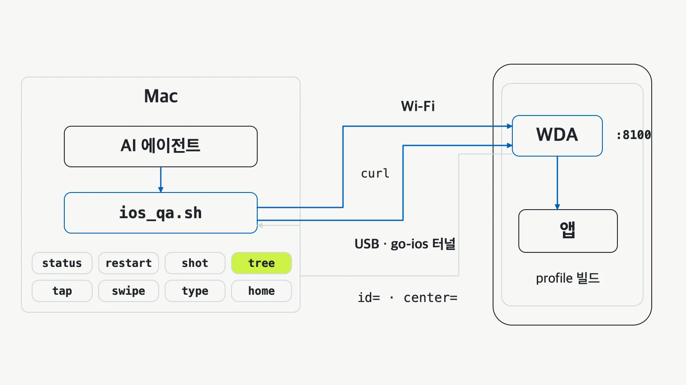
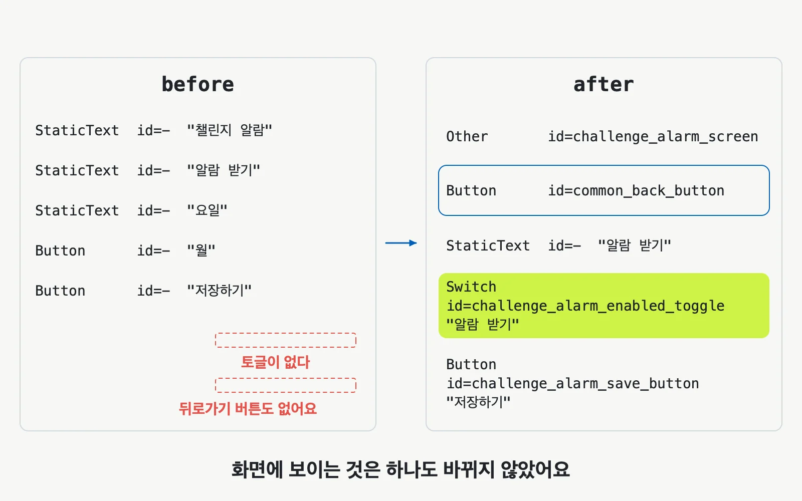
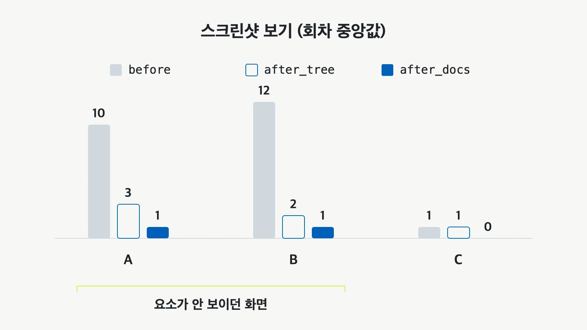
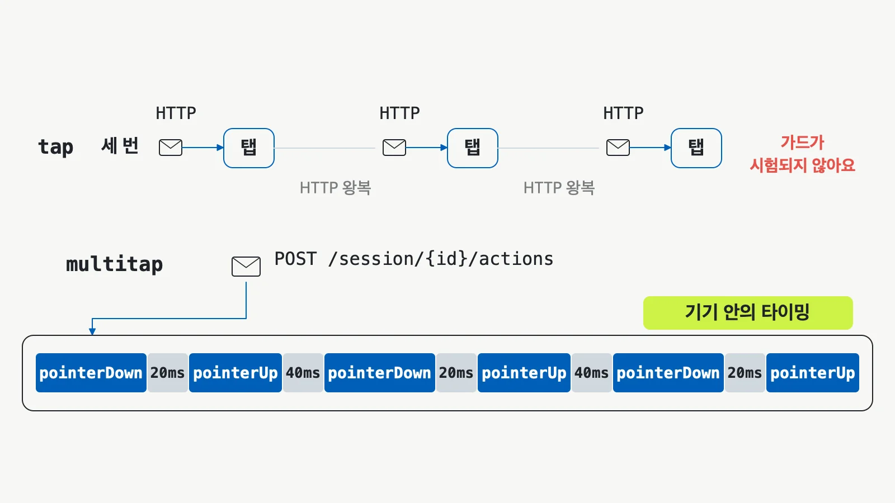

## 들어가며: 실기기 확인만 사람 손에 남아 있었다

「구매 버튼을 빠르게 세 번 눌러도 코인이 한 번만 빠지는가」. [지난 글](/posts/bloc_concurrency_refactor)에서 BLoC 의 연타 방지 코드를 49곳 옮긴 뒤 남은 확인이었어요. 테스트 작성, 빌드, 로그 분석까지 Claude Code 같은 AI 에이전트에게 넘겼지만, 폰을 들고 눌러 보는 실기기 확인만은 사람 손에 남아 있었어요. 손으로는 누를 때마다 간격이 달라서 49곳을 전부 확인할 수도 없었고요.

그래서 에이전트가 실기기 iPhone 을 직접 조작하게 만들었어요. 접근성 트리에 ID 를 붙여 비용을 줄였지만 ID 만으로는 에이전트가 쓰지 않았고, 탭을 세 번 부르는 건 연타가 아니었고, 실기기는 같은 에러 문구 뒤에 다른 원인을 숨기고 있었어요.

## WDA 는 기기 안에서 도는 HTTP 서버다

iOS 실기기를 바깥에서 조작하는 방법은 생각보다 적어요. Dart VM Service 는 입력을 넣을 수 없고(Android 는 `adb shell input tap` 으로 우회하지만 iOS 실기기는 수단이 없어요), Patrol 은 iOS 에서 UI 테스트 타깃을 손으로 만들어야 해서 PoC 단계에서 멈춰 뒀어요. 남은 게 WebDriverAgent(WDA)였어요. Appium 프로젝트가 관리하는 XCTest 기반 서버로, `xcodebuild test` 로 기기에 러너를 올리면 기기 안에서 8100 포트로 HTTP 요청을 받아요. curl 만 있으면 기기를 조작할 수 있어요.

```bash
# 한 번: WDA 러너를 기기에 올리고 띄워 둔다
git clone --depth 1 https://github.com/appium/WebDriverAgent.git ~/WebDriverAgent
xcodebuild -project ~/WebDriverAgent/WebDriverAgent.xcodeproj -scheme WebDriverAgentRunner \
  -destination 'platform=iOS,id=(기기 UDID)' -allowProvisioningUpdates \
  DEVELOPMENT_TEAM=(서명 팀) CODE_SIGN_STYLE=Automatic \
  PRODUCT_BUNDLE_IDENTIFIER=com.example.qa.WebDriverAgentRunner test
```

기기와 Mac 이 같은 Wi-Fi 에 있으면 `http://(기기 IP):8100` 으로 바로 붙고, USB 로 붙이려면 go-ios 의 터널(`ios tunnel start --userspace`)과 포트 포워드(`ios forward 8100 8100`)를 띄워 두면 돼요. 이 둘의 차이가 뒤에서 한 번 중요해져요.

> 처음 출발점은 mobile-mcp 기준의 QA 킷이었지만, mobile-mcp 도 기기 쪽에서는 같은 WDA 를 쓰고 이미 WDA 를 직접 부르고 있어서 셸 스크립트로 측정하기로 했어요.

## 도구: 명령 여덟 개짜리 셸 스크립트

도구는 일부러 작게, `ios_qa.sh` 하나에 `status`·`restart`·`shot`·`tree`·`tap`·`swipe`·`type`·`home` 만 뒀어요. 탭은 WDA 의 탭 API 를 한 번 부르는 게 전부예요.

```bash
post() { curl -sf -m 60 -X POST "$WDA$1" -H 'Content-Type: application/json' -d "${2:-{\}}"; }

case "$cmd" in
  tap)
    sid=$(session)
    post "/session/$sid/wda/tap" "{\"x\":${1:?X},\"y\":${2:?Y}}" >/dev/null
    echo "tapped ($1,$2)"
    ;;
```

핵심은 `tree` 예요. WDA 의 `/source` 가 돌려주는 접근성 트리를 걸러 한 줄 목록으로 바꿔요. 요소에 identifier 가 있으면 `id=` 열에 나오고, 에이전트는 이 목록에서 요소를 찾아 `center` 좌표를 `tap` 에 넘겨요.

```python
# ios_qa.sh tree — WDA /source?format=json 을 한 줄 목록으로 (줄임)
def walk(node):
    ident = node.get("rawIdentifier") or ""
    label = (node.get("label") or "").replace("\n", " / ")
    kind = node.get("type", "").replace("XCUIElementType", "")
    if visible and (ident or label):
        cx = round(rect["x"] + rect["width"] / 2); cy = round(rect["y"] + rect["height"] / 2)
        rows.append(f"{kind:<12} id={ident or '-':<34} center=({cx},{cy}) label=\"{label[:80]}\"")
    for child in node.get("children") or []:
        walk(child)
```

WDA 가 트리를 조회하면 플래그 없이도 Flutter 시맨틱스가 켜져서 앱 코드는 건드릴 필요가 없었어요. 앱은 디버거 없이 다시 띄울 수 있는 profile 빌드로 설치했어요.

<figure>
	
	<figcaption>에이전트는 셸 스크립트 하나로 기기 안의 WDA 에 HTTP 요청을 보내 앱을 조작해요.</figcaption>
</figure>

## 에이전트는 트리 대신 스크린샷을 읽고 있었다

시나리오 세 개는 통과했는데, 에이전트가 탭할 때마다 스크린샷을 찍고 이미지를 읽고 있었어요. 이미지를 읽을수록 턴과 토큰이 늘어요. 이유는 챌린지 알람 설정 화면의 트리에 있었어요.

```text
StaticText   id=-        center=(196,84)  label="챌린지 알람"
StaticText   id=-        center=(166,178) label="알람 받기"
StaticText   id=-        center=(196,232) label="요일"
Button       id=-        center=(56,268)  label="월"
...
Button       id=-        center=(196,782) label="저장하기"
```

「알람 받기」 토글이 없어요. 글자만 있고 스위치는 트리에서 사라졌고, 뒤로가기 버튼도 없어요. 에이전트는 스크린샷에서 스위치 위치를 눈으로 추정할 수밖에 없었어요. 다른 화면은 반대로 너무 많이 합쳐져 있었어요. 챌린지 상세의 인증 규칙 카드는 카드 전체가 버튼 하나여서, 그 안의 「인증 규칙 자세히」 링크가 따로 잡히지 않았어요.

원인은 공용 탭 위젯이었어요. 이 화면들의 탭 영역은 모두 `SocialTapTarget` 을 거쳐 맨 `GestureDetector` 로 끝나는데, 이 위젯은 접근성 노드 경계를 만들지 않아요. 그래서 탭 영역이 주변 글자와 한 덩어리가 되거나 트리에서 빠졌어요. 이건 QA 도구만의 문제가 아니었어요. **VoiceOver 도 같은 트리를 읽으니, 에이전트가 못 찾는 버튼은 화면 낭독기 사용자도 못 찾아요.**

## Semantics ID 붙이기: 레이아웃은 그대로, 트리만 바꾼다

그래서 시나리오가 지나는 화면에 접근성 노드와 identifier 를 붙였어요. Flutter `Semantics` 위젯의 `identifier` 는 iOS 에서 `accessibilityIdentifier` 로 나가고, WDA 트리의 `id=` 열에 보이는 값이 이거예요. 붙이는 코드는 래퍼 하나로 통일했어요.

```dart
/// Semantics identifier 를 붙이는 공통 래퍼 — 접근성 트리만 바꾸고 레이아웃·동작은 바꾸지 않는다.
class TestId extends StatelessWidget {
  const TestId(this.id, {required this.child, this.merge = true, this.label, super.key});

  final String id;
  final Widget child;
  final bool merge;
  final String? label;

  @override
  Widget build(BuildContext context) {
    if (merge) return MergeSemantics(child: Semantics(identifier: id, label: label, child: child));
    return Semantics(identifier: id, label: label, container: true, explicitChildNodes: true, child: child);
  }
}

extension TestIdX on Widget {
  Widget semId(SemId id, {bool merge = true, String? label}) =>
      TestId(id.value, merge: merge, label: label, child: this);
}
```

갈림길은 `merge` 하나예요. 버튼이나 토글처럼 누를 대상이 하나인 요소는 `merge: true` 로, `MergeSemantics` 가 자식의 라벨과 역할을 한 노드로 합쳐요. 이게 그동안 없던 노드 경계 역할을 해서 카드 안 링크가 카드에서 떨어져 나와요. 카드나 시트처럼 안에 다른 탭 대상이 있는 컨테이너는 `merge: false` 예요. 여기서 합쳐 버리면 안쪽 버튼이 트리에서 사라져, 처음 문제를 반대 방향으로 다시 만들어요. 알람 화면에는 이렇게 붙였어요.

```dart
Semantics(
  toggled: _isEnabled,
  child: BasicSwitch(value: _isEnabled, onChanged: _onToggle),
).semId(ChallengeAlarmIds.enabledToggle, label: Lang.get('social_challenge_alarm_enable')),
// ...
).semId(ChallengeAlarmIds.saveButton),
// ...
).semId(ChallengeAlarmIds.screen, merge: false);
```

같은 화면의 트리가 이렇게 바뀌었어요.

```text
Other        id=challenge_alarm_screen          center=(196,426)
Button       id=common_back_button              center=(28,84)
StaticText   id=-                               center=(166,178) label="알람 받기"
Switch       id=challenge_alarm_enabled_toggle  center=(327,178) label="알람 받기"
...
Button       id=challenge_alarm_save_button     center=(196,782) label="저장하기"
```

스위치와 뒤로가기가 트리에 나타났지만, 문구·레이아웃·동작은 하나도 바뀌지 않았어요.

<figure>
	
	<figcaption>화면은 그대로인데, 트리에 스위치와 뒤로가기가 나타났어요.</figcaption>
</figure>

ID 는 화면별 클래스에만 `{화면}_{요소}_{역할}` 소문자 스네이크 케이스로 정의하고, ID 마다 에이전트가 읽을 한국어 설명을 붙였어요.

```dart
static const enabledToggle = SemId(
  'challenge_alarm_enabled_toggle',
  '「알람 받기」 켜기/끄기 토글. 켜짐 여부는 toggled(value) 로 읽힌다. 끄면 요일·시간 영역이 흐려지고 눌리지 않는다',
);
```

이 정의에서 Markdown 카탈로그(`docs/qa/semantic_ids.md`)를 생성하는 스크립트도 만들었어요. 이 카탈로그가 뒤에서 결정적인 역할을 해요.

## 측정: ID 만 붙여서는 쓰지 않았다

세 조건을 비교했어요. identifier 0개인 before, 시나리오 화면에 38개를 붙인 after_tree, 같은 빌드에 카탈로그로 찾으라는 한 줄을 프롬프트에 더한 after_docs 예요. 시나리오는 「인증 규칙 자세히」 열기(A), 알람 끄고 켜기(B), 챌린지 개설 중 종류 바꾸기(C)로, 조건·시나리오마다 5회씩 모두 45회를 돌렸어요. 에이전트는 `claude -p` 에 모델을 고정했고(`claude-sonnet-5-5`), 도구는 `ios_qa.sh` 와 이미지 읽기뿐이에요. 추가한 한 줄은 이거예요.

```text
- UI 요소는 docs/qa/semantic_ids.md 의 identifier(tree 의 id= 열)로 찾는다. 화면 문구나 스크린샷 좌표 추정보다
  우선한다. 스크린샷은 identifier 로 판정할 수 없는 시각적 확인이 필요할 때만 쓴다.
```

결과는 회차 중앙값이에요(2026-11-06, iPhone 15, Wi-Fi 연결 WDA). 비용은 에이전트 실행의 API 요금이에요.

| 시나리오 | 지표 | before | after_tree | after_docs |
|---|---|---:|---:|---:|
| A | 비용 | $0.259 | $0.207 | $0.202 (−22%) |
| | 소요 시간 | 93.9초 | 80.9초 | 79.4초 (−15%) |
| | 턴 수 | 22 | 17 | 14 |
| | 스크린샷 보기 | 10 | 3 | 1 |
| B | 비용 | $0.280 | $0.191 | $0.172 (−39%) |
| | 소요 시간 | 81.9초 | 73.4초 | 69.0초 (−16%) |
| | 턴 수 | 26 | 16 | 15 |
| | 스크린샷 보기 | 12 | 2 | 1 |
| C | 비용 | $0.213 | $0.228 | $0.221 (+4%) |
| | 소요 시간 | 91.1초 | 93.1초 | 97.7초 (+7%) |
| | 턴 수 | 18 | 19 | 17 |
| | 스크린샷 보기 | 1 | 1 | 0 |

45회 모두 통과해서, 차이는 정확도가 아니라 비용과 시간에서 났어요. 효과는 요소가 트리에 안 보이던 A·B 에만 있었고, C 는 원래 라벨 붙은 버튼으로 잘 보이던 화면이라 달라지지 않았어요(+4%·+7% 는 회차 편차 범위로 봤어요).

<figure>
	
	<figcaption>요소가 트리에 안 보이던 A·B 에서만 스크린샷 보기가 크게 줄었어요.</figcaption>
</figure>

제 가정을 깬 건 따로 있었어요. ID 를 붙이면 에이전트가 알아서 쓸 줄 알았는데, after_tree 에서 ID 로 검색한 횟수는 회차당 0~5번이었고 C 에서는 0번이었어요. **카탈로그 안내 한 줄을 넣자 15회 모두 카탈로그를 먼저 읽고, 회차당 3~14번 ID 로 요소를 찾았어요.**

비용 차이는 회차별 전략에서 나왔어요. before 의 A·B 는 10회 중 7회가 탭마다 캡처를 읽는 스크린샷 위주였고, after_docs 는 15회 모두 트리 위주였어요.

한계도 있어요. 표본이 조건당 5회라 after_tree 의 변화가 ID 덕인지 우연인지 가를 수 없고, 탭은 여전히 ID 로 찾은 요소의 중심 좌표로 해요.

## 연타: tap 을 세 번 부르는 건 연타가 아니다

측정 뒤 열흘쯤 지나 이 도구를 다시 꺼냈어요. [BLoC 연타 방지 코드를 옮긴 PR](/posts/bloc_concurrency_refactor)을 실기기에서 확인하려고요. 요청이 진행 중일 때 연타해도 한 번만 처리되는지, 끝난 뒤에는 다시 눌리는지를 봐야 했어요.

처음엔 `tap` 을 세 번 부르고 Network Link Conditioner 로 네트워크를 느리게 만들 생각까지 했어요. 그런데 문제는 스크립트 구조였어요. `tap` 은 탭마다 HTTP 요청을 보내서, 왕복 시간이 쌓이는 사이 첫 요청이 이미 끝나 가드가 시험되지 않을 수 있어요.

WDA 는 W3C WebDriver 표준의 actions API(`POST /session/{id}/actions`)를 지원해요. 손가락의 누르기·쉬기·떼기를 한 요청에 담아 보내면 기기 안에서 그 순서대로 실행돼요. 그래서 `multitap` 명령을 더했어요.

```bash
  multitap)  # multitap X Y [N=3] [GAP_MS=40] — W3C actions 한 요청으로 N번 연타
    sid=$(session)
    body=$(python3 -c '
import json,sys
x,y,n,gap=int(float(sys.argv[1])),int(float(sys.argv[2])),int(sys.argv[3]),int(sys.argv[4])
acts=[{"type":"pointerMove","duration":0,"x":x,"y":y}]
for i in range(n):
    acts+=[{"type":"pointerDown","button":0},{"type":"pause","duration":20},{"type":"pointerUp","button":0}]
    if i<n-1: acts.append({"type":"pause","duration":gap})
print(json.dumps({"actions":[{"type":"pointer","id":"finger","parameters":{"pointerType":"touch"},"actions":acts}]}))
' "${1:?X}" "${2:?Y}" "${3:-3}" "${4:-40}")
    post "/session/$sid/actions" "$body" >/dev/null
    echo "multitapped ($1,$2) x${3:-3} gap ${4:-40}ms"
    ;;
```

한 번 누르고 20ms 뒤에 떼고, 40ms 쉬고 다시 눌러요. **탭 사이 간격이 HTTP 왕복이 아니라 기기 안의 타이밍으로 정해져요.** Network Link Conditioner 는 필요 없었어요.

<figure>
	
	<figcaption>탭 간격이 HTTP 왕복이 아니라 기기 안의 타이밍으로 정해지게, 연타를 요청 하나에 담았어요.</figcaption>
</figure>

에이전트에게는 반드시 `multitap` 을 쓰고 결제 시트가 뜨면 즉시 취소하라고 했고, PASS 기준은 「코인이 1개 가격만큼만 줄고, 이어서 일반 `tap` 하면 다시 구매된다」처럼 화면에서 판정할 수 있게 썼어요.

결과(2026-11-17, iPhone 15, dev profile 빌드, 3연타·40ms)는 아이템 구매, 팀 자동 배정, 댓글 게시, DM 전송, 걸음 과거 그래프 더 보기, 러닝 시작, 루틴 편집 저장 일곱 흐름 모두 PASS 였어요. 아이템 구매는 3연타에 코인 100 만 차감됐고, 루틴 편집 저장은 예전에 저장 요청이 두 번 나가 화면을 두 번 닫다가 크래시가 난 곳인데 한 번만 닫히고 홈으로 돌아왔어요.

다만 profile 빌드에서는 네트워크 로그 화면이 열리지 않아 요청 횟수를 직접 세지는 못했고, 판정은 코인·개수·토스트 같은 화면 결과 기준이에요.

## 실기기가 거는 함정들

도구보다 시간이 더 든 건 실기기 쪽이었어요.

### 같은 에러 문구, 다른 원인: automation mode 타임아웃

WDA 러너를 띄우다 `Timed out while enabling automation mode` 로 실패했어요. 기기가 잠겨 있거나 UI 자동화가 꺼져 있을 때 나는 에러로 기록해 둔 문구라 기록대로 잠금을 풀고 UI 자동화를 껐다 켰는데, 세 번 연속 같은 에러가 났어요. 그제야 버전을 비교했어요.

```bash
xcodebuild -version                                  # 로컬 Xcode
xcrun devicectl device info details --device (UDID) | grep osVersionNumber   # 기기 iOS
```

며칠 전 정상 동작한 iPhone 16 은 iOS 27.0.1 이었고, 타임아웃이 난 iPhone 15 는 iOS 27.2.1 이었어요. 로컬 Xcode 는 26.3 이었고요. **기기 iOS 가 로컬 Xcode 보다 새로웠어요.** Xcode 를 27.2 로 올리고 라이선스 동의(`sudo xcodebuild -license accept`)까지 마치자 바로 WDA 서버 주소가 떴어요. 지금은 잠금 해제 뒤에도 이 에러가 나면 바로 두 버전을 비교해요.

### 비행기 모드를 켜면 Wi-Fi 로 붙은 WDA 가 끊긴다

다른 조사에서 대상 번들을 설정 앱(`com.apple.Preferences`)으로 바꿔 같은 스크립트로 비행기 모드를 켰어요.

```text
Switch  id=com.apple.settings.airplaneMode  center=(201,320) size=370x53 label="에어플레인 모드" [value=0]
```

비행기 모드를 켜는 순간 Wi-Fi 도 꺼져서 Wi-Fi 로 붙은 WDA 로는 다시 끌 수 없으니, 켜기 전에 go-ios 터널로 USB 연결로 바꿨어요. 또 이 Switch 노드는 폭 370pt 인 행 전체라 중심(201,320)을 탭해도 안 바뀌었고, 손잡이 쪽(340,320)을 탭하자 `[value=1]` 이 됐어요. `tree` 에 `[value=…]` 를 찍어 둔 덕분에 캡처 없이 확인할 수 있었어요.

그 밖에도 푸시 배너가 뜨면 트리가 배너만 돌려줘서 측정할 땐 방해 금지 모드를 켜요. iOS 26 에서 하단 탭바를 네이티브 Liquid Glass 탭바로 바꾸자 ID 가 사라져서, 같은 ID 를 채널로 넘겨 `UITabBarItem.accessibilityIdentifier` 에 넣었어요. 특정 입력칸에 `type` 하면 앱이 종료되는 문제는 원인을 못 찾아 그 단계는 사람이 해요.

## 어디까지 ID 를 붙이나

측정을 보고 규칙을 둘로 나눴어요. 노드와 ID 는 같은 게 아니라서요. 접근성 노드는 새로 만드는 모든 탭 영역·토글·칩에 둬요. VoiceOver 도 같은 트리를 읽으니까요. Semantics ID 는 QA 시나리오가 지나는 요소에만 붙여요. 이름표일 뿐이라 라벨로 잘 잡히는 화면(C)에서는 효과가 없었어요.

노드 쪽은 탭 공용 위젯에 `semanticIdentifier`·`toggled`·`container` 같은 선택형 인자를 열고, 인자를 넘기지 않으면 시맨틱스가 이전과 똑같다는 걸 트리 덤프 비교 테스트로 고정해 기존 호출부 451곳은 건드리지 않았어요. 소셜 탭 영역 위젯에는 노드 경계(`container: true`)를 기본으로 넣어 VoiceOver 가 읽는 단위가 바뀌는데, 실기기에서 VoiceOver 로 직접 들어 보는 확인은 아직 하지 못했어요.

ID 를 붙일지는 한 문장으로 판별해요. `tree` 를 찍었을 때 누르려는 요소가 그 이름의 버튼·스위치로 따로 보이면 ID 는 필요 없고, 글자로만 보이거나 없으면 노드부터 만들어요.

## 마치며: 에이전트가 읽는 화면은 접근성 트리다

에이전트는 실제로 사람처럼 화면을 보고 눌렀고, 그게 가장 비싼 방법이었어요. 트리에 요소가 제대로 보이자 스크린샷 보기가 10회에서 1회로 줄었어요. QA 비용을 줄이려고 시작한 일이었지만, 고친 트리는 화면 낭독기 사용자도 그대로 읽어요.

도구를 줬다고 쓰는 게 아니고, 쓰라고 말해야 씁니다.

ID 38개를 붙여도 에이전트는 거의 쓰지 않았고, 카탈로그를 읽으라는 한 줄이 들어가자 15회 모두 썼어요. 연타도 같았어요. WDA 에는 처음부터 actions API 가 있었는데, 제가 만든 `tap` 이 그걸 쓰지 않고 있었어요.

에이전트에게 실기기 QA 를 맡겨 볼 생각이라면, 먼저 세 가지를 확인해 보세요.

1. 확인하려는 화면의 접근성 트리를 한 번 찍어 보셨나요? WDA `/source` 나 Xcode Accessibility Inspector 로요. 누르려는 버튼이 글자로만 보이거나 없다면, 에이전트는 스크린샷을 읽게 돼요.
2. 에이전트 프롬프트에 「무엇으로 찾으라」가 적혀 있나요? ID 카탈로그든 라벨 목록이든, 쓰라고 적지 않으면 쓰지 않아요.
3. 연타 확인이 탭 API 를 여러 번 부르는 방식인가요? 그렇다면 두 번째 탭이 요청이 끝난 뒤에 들어가고 있을 수 있어요.

## 참고 자료

- Appium, [WebDriverAgent](https://github.com/appium/WebDriverAgent) — 기기 안에서 도는 XCTest 기반 WebDriver 서버. 글을 쓸 때 기기에 올린 버전은 16.15.3(커밋 `3d6a4e0`)
- W3C, [WebDriver — Actions](https://www.w3.org/TR/webdriver2/#actions) — `pointerDown`·`pause`·`pointerUp` 으로 입력 순서를 한 요청에 담는 표준
- Flutter API, [`Semantics.identifier`](https://api.flutter.dev/flutter/widgets/Semantics/identifier.html) — iOS 에서 `accessibilityIdentifier` 로 나가는 값
- [go-ios](https://github.com/danielpaulus/go-ios) — USB 터널·포트 포워드. 사용한 버전은 1.3.2
- 기준 환경: iPhone 15(iOS 27.2.1), iPhone 16(iOS 27.0.1), Xcode 26.3 → 27.2(로컬), Flutter 3.47.4, 측정 에이전트 `claude-sonnet-5-5`
